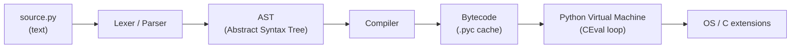
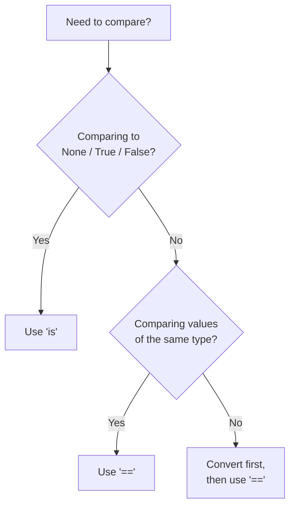

# Python Basics & Syntax — Detailed Notes

---

## 1. How Python Runs (Under the Hood)

### What is Python?

Python is a **high-level, interpreted, dynamically typed, garbage-collected, multi-paradigm** programming language. "Interpreted" here is a slight simplification — CPython (the reference implementation) actually **compiles** your source to an intermediate **bytecode**, then **interprets** that bytecode on a virtual machine.

Key characteristics:
- **Dynamically typed** — types are attached to values, not names; checked at runtime.
- **Strongly typed** — `"1" + 1` raises `TypeError` (no silent coercion like JavaScript).
- **Indentation-significant** — blocks are defined by whitespace, not braces.
- **Everything is an object** — functions, classes, modules, even integers.

### How Execution Works (CPython Pipeline)



1. **Lexing & Parsing** — source text is tokenized and turned into an AST.
2. **Compilation** — AST is compiled to bytecode (a sequence of simple stack-machine instructions).
3. **Caching** — bytecode is cached in `__pycache__/module.cpython-311.pyc` (version-tagged).
4. **Execution** — the PVM (a big `switch` loop in `ceval.c`) executes bytecode one instruction at a time.

You can inspect bytecode yourself:

```python
import dis
dis.dis("x = 1 + 2")
#   0 LOAD_CONST   1 (1)
#   2 LOAD_CONST   2 (2)
#   4 BINARY_OP    0 (+)
#   6 STORE_NAME   0 (x)
```

### Three Ways to Run Python

| Method | Command | Use case |
|---|---|---|
| **REPL** | `python` | Quick experiments, exploration |
| **Script** | `python script.py` | Full programs |
| **Module** | `python -m package.module` | Run a module *as* `__main__` (e.g. `python -m http.server`, `python -m pytest`) |

**REPL** (Read-Eval-Print Loop):
```python
>>> 2 + 3
5
>>> name = "Ada"
>>> f"Hello, {name}"
'Hello, Ada'
>>> exit()
```

**Script** (`hello.py`):
```python
# hello.py
def main() -> None:
    print("Hello from a script")

if __name__ == "__main__":
    main()
```

**Module execution** — `python -m` is preferred over `python path/to/file.py` because it:
- Adds the current directory to `sys.path` correctly.
- Runs the module inside its package context (relative imports work).
- Sets `__name__ == "__main__"`.

```bash
python -m venv .venv        # run venv module
python -m http.server 8000  # run a simple web server
python -m json.tool data.json  # pretty-print JSON
```

### Comparison with Alternatives

| Aspect | Python | C | Java | JavaScript |
|---|---|---|---|---|
| Execution | Bytecode + PVM | Native machine code | Bytecode + JVM | JIT (V8) |
| Typing | Dynamic, strong | Static, weak | Static, strong | Dynamic, weak |
| Blocks | Indentation | `{}` | `{}` | `{}` |
| Startup speed | Slow | Instant | Slow | Fast |
| Runtime speed | Slow (but C extensions) | Fast | Fast | Fast |

---

## 2. Syntax Foundations

### Indentation, Comments, and Line Structure

Python uses **indentation** to delimit blocks. The community standard is **4 spaces** per level (PEP 8). Mixing tabs and spaces raises `TabError`.

```python
# This is a comment
x = 10  # inline comment

"""
This is a multi-line string.
Often used as a docstring or block comment.
"""

if x > 5:
    print("big")     # 4 spaces
    if x > 8:
        print("huge")  # 8 spaces
else:
    print("small")
```

- **Line continuation** is implicit inside `()`, `[]`, `{}`.
- Explicit continuation uses a backslash: `total = 1 + \` then newline `2`.
- Multiple statements on one line with `;` are legal but discouraged.

```python
total = (1 + 2 +
         3 + 4)          # implicit continuation

a = 1; b = 2; c = 3     # legal, but avoid
```

### Variables and Naming Rules

A variable is a **name bound to an object**. Assignment does not copy — it binds.

```python
x = 42          # x -> int object 42
y = x           # y -> same object
x = "hello"     # x now points to a str; y still 42
```

**Naming rules:**
- Must start with a letter or `_` (not a digit).
- Can contain letters, digits, underscores.
- Case-sensitive (`Name` ≠ `name`).
- Cannot be a keyword (`if`, `for`, `class`, `None`, `True`, `False`, …).
- `_` alone is conventional for "throwaway".

**Conventions (PEP 8):**

| Style | Meaning | Example |
|---|---|---|
| `snake_case` | variables, functions, modules | `user_name`, `parse_file` |
| `PascalCase` | classes | `HttpClient` |
| `UPPER_SNAKE` | constants | `MAX_RETRIES` |
| `_leading` | "internal use" | `_cache` |
| `__dunder__` | Python-reserved | `__init__` |
| `__mangled` | name-mangled in classes | `__secret` |

```python
# Check keywords
import keyword
print(keyword.kwlist)
# ['False', 'None', 'True', 'and', 'as', 'assert', ...]
```

### Basic Data Types

| Type | Literal | Example | Mutable? |
|---|---|---|---|
| `int` | `42`, `0xFF`, `0b1010`, `1_000` | `age = 30` | No |
| `float` | `3.14`, `1e-3`, `float('inf')` | `pi = 3.14159` | No |
| `bool` | `True`, `False` | `ok = True` | No |
| `str` | `'hi'`, `"hi"`, `"""hi"""` | `s = "abc"` | No |
| `NoneType` | `None` | `x = None` | No |

```python
n = 1_000_000          # underscores for readability
big = 2 ** 100         # arbitrary precision int
f = 1.5e10             # float
s = "unicode: α β γ 😀" # str is full Unicode
b = True               # bool is a subclass of int!
print(True + True)     # 2  — yes, really
```

> **Under the hood:** `int` is arbitrary-precision (bignum). Small ints (−5..256) are **interned/cached** at startup. `float` is a C `double` (IEEE 754). `bool` is a subclass of `int` with only two singletons.

### Input / Output

```python
name = input("Your name: ")          # always returns a str
age = int(input("Your age: "))       # must convert manually

print("Hello,", name)                # space-separated by default
print("a", "b", sep="-", end="!\n")  # a-b!
print(f"{name} is {age} years old.") # f-string
```

**f-strings** (Python 3.6+) are the modern standard:

```python
value = 3.14159
print(f"{value:.2f}")        # 3.14  (format spec)
print(f"{value=}")           # value=3.14159  (debug form)
print(f"{name!r}")           # repr()
print(f"{age:>5}")           # right-align width 5
print(f"{255:#x}")           # 0xff
```

### Type Conversion

```python
int("42")        # 42
int(3.99)        # 3   (truncates toward zero)
float("3.14")    # 3.14
str(42)          # "42"
bool(0)          # False
bool("")         # False
bool("0")        # True  (non-empty string!)
list("abc")      # ['a', 'b', 'c']
tuple([1, 2])    # (1, 2)
set([1, 1, 2])   # {1, 2}

int("abc")       # ValueError: invalid literal for int()
int(None)        # TypeError
```

> **Pitfall:** `bool("False")` is `True` — any non-empty string is truthy.

---

## 3. Operators & Expressions

### Operator Categories

**Arithmetic**
```python
7 + 2   # 9
7 - 2   # 5
7 * 2   # 14
7 / 2   # 3.5   ← true division, always float
7 // 2  # 3     ← floor division
7 % 2   # 1     ← modulo
7 ** 2  # 49    ← power
-7 // 2 # -4    ← floors toward -inf (differs from C!)
```

**Comparison** (return `bool`)
```python
1 == 1     # True
1 != 2     # True
3 > 2      # True
2 <= 2     # True
1 < 2 < 3  # True — chained comparison
```

**Logical** (short-circuit)
```python
True and False   # False
True or False    # True
not True         # False
x = a or b       # returns first truthy operand, not necessarily bool
```

**Assignment**
```python
x = 5
x += 3   # x = 8
x -= 1
x *= 2
x /= 2   # now float
x //= 2
x %= 3
x **= 2
x &= y; x |= y; x ^= y; x >>= 1; x <<= 1
x := 10  # walrus — assigns inside expression (3.8+)
```

**Membership**
```python
"a" in "cat"        # True
3 in [1, 2, 3]      # True
"k" in {"k": 1}     # True (checks keys)
"z" not in "cat"    # True
```

**Identity**
```python
a is b        # same object?
a is not b    # different object?
a is None     # preferred over == None
```

**Bitwise** (integers)
```python
5 & 3   # 1  (AND)
5 | 3   # 7  (OR)
5 ^ 3   # 6  (XOR)
~5      # -6 (NOT)
5 << 1  # 10 (shift left)
5 >> 1  # 2  (shift right)
```

### Operator Precedence (High → Low)

| Level | Operators |
|---|---|
| 1 | `()` `[]` `{}` — grouping, calls, indexing |
| 2 | `**` |
| 3 | `+x`, `-x`, `~x` (unary) |
| 4 | `*`, `/`, `//`, `%` |
| 5 | `+`, `-` |
| 6 | `<<`, `>>` |
| 7 | `&` |
| 8 | `^` |
| 9 | `\|` |
| 10 | `in`, `not in`, `is`, `is not`, `<`, `<=`, `>`, `>=`, `!=`, `==` |
| 11 | `not x` |
| 12 | `and` |
| 13 | `or` |
| 14 | `:=` (walrus) |

**Associativity:** most are left-associative. `**` is **right-associative**: `2 ** 3 ** 2 == 2 ** 9 == 512`.

```python
2 + 3 * 4      # 14, not 20
(2 + 3) * 4    # 20
not True or False   # (not True) or False → False
```

### Truthiness

Every object has a truth value. Falsy values:

```python
bool(False)      # False
bool(None)       # False
bool(0)          # False
bool(0.0)        # False
bool("")         # False
bool([])         # False
bool(())         # False
bool({})         # False
bool(set())      # False
bool(range(0))   # False
# Everything else is truthy
bool([0])        # True
bool("0")        # True
```

Custom truthiness via `__bool__` or `__len__`:

```python
class Box:
    def __init__(self, items): self.items = items
    def __bool__(self): return bool(self.items)

bool(Box([]))       # False
bool(Box([1]))      # True
```

### Conditional Expressions (Ternary)

```python
status = "adult" if age >= 18 else "minor"
# Equivalent to:
# if age >= 18: status = "adult"
# else:         status = "minor"
```

Can be chained, but readability suffers:

```python
grade = "A" if s >= 90 else "B" if s >= 80 else "C"
```

### `is` vs `==` — The Classic Trap

| | `==` | `is` |
|---|---|---|
| Compares | **value** (via `__eq__`) | **identity** (memory address / `id()`) |
| Use for | numbers, strings, lists, dicts | `None`, `True`, `False`, sentinels |
| Overloadable | Yes | No |

```python
a = [1, 2, 3]
b = [1, 2, 3]
c = a

a == b    # True  — same contents
a is b    # False — different objects
a is c    # True  — same object

x = 256
y = 256
x is y    # True  (small-int caching)

x = 257
y = 257
x is y    # False in CPython (outside cache) — do NOT rely on this

s1 = "hello"
s2 = "hello"
s1 is s2  # True due to interning — again, don't rely on it
```

**Golden rule:** use `is` only for `None`, `True`, `False`, and sentinel objects. Use `==` for everything else.

```python
if x is None: ...       # ✅
if x == None: ...       # ❌ works but wrong style
```

---

## 4. Real-World Use Case & Common Pitfalls

### Putting It Together — A Small CLI

```python
#!/usr/bin/env python3
"""A tiny BMI calculator."""
import sys

def bmi(weight_kg: float, height_m: float) -> float:
    return weight_kg / (height_m ** 2)

def main() -> int:
    try:
        w = float(input("Weight (kg): "))
        h = float(input("Height (m): "))
    except ValueError:
        print("Please enter numbers.", file=sys.stderr)
        return 1

    value = bmi(w, h)
    category = (
        "underweight" if value < 18.5 else
        "normal"      if value < 25   else
        "overweight"  if value < 30   else
        "obese"
    )
    print(f"BMI = {value:.1f} ({category})")
    return 0

if __name__ == "__main__":
    raise SystemExit(main())
```

This tiny program touches: f-strings, type hints, input conversion, exceptions, ternary chaining, `__name__` guard, `sys`, and truthiness.

### Common Pitfalls Checklist

| Pitfall | Wrong | Right |
|---|---|---|
| Mutating a default arg | `def f(x=[]):` | `def f(x=None): x = x or []` |
| `==` vs `is` for None | `x == None` | `x is None` |
| Chained assignment surprise | `a = b = []` (shared) | `a, b = [], []` |
| Float equality | `0.1 + 0.2 == 0.3` → `False` | `math.isclose(...)` |
| Integer division | `1 / 2 == 0` (expecting) | `1 // 2 == 0`, `1 / 2 == 0.5` |
| Mutable default in class | `class C: items = []` | define in `__init__` |
| String `+` in loop | `s += x` in big loop | `"".join(parts)` |
| `bool("False")` | `False` | `True` — parse explicitly |

```python
# Float comparison done right
import math
print(0.1 + 0.2 == 0.3)               # False
print(math.isclose(0.1 + 0.2, 0.3))   # True
```

### Quick Reference Card

```python
# Data types
int, float, bool, str, None

# Conversion
int("3"), float("1.5"), str(3), bool(x)

# Output
print(a, b, sep=",", end="\n")
print(f"{x:.2f}")

# Input
name = input("? ")

# Identity vs equality
x is None      # identity
x == 0         # equality

# Truthiness
if not items: ...

# Ternary
"yes" if cond else "no"
```

---

### Mermaid — Decision Flow for `is` vs `==`



---

### Summary

- Python compiles to **bytecode**, then interprets via the **PVM**; you can run code via **REPL**, **script**, or **`python -m`**.
- **Indentation** defines blocks; **naming** follows `snake_case` / `PascalCase` / `UPPER_SNAKE`.
- Core types (`int`, `float`, `bool`, `str`, `None`) are **immutable**; `bool` is a subclass of `int`.
- Operators have a well-defined **precedence**; `**` is right-associative; comparisons can be **chained**.
- **Truthiness** drives `if`/`while`; falsy values are `0`, `0.0`, `""`, `[]`, `{}`, `()`, `set()`, `None`, `False`.
- Use **`is` for identity** (mainly `None`/`True`/`False`) and **`==` for value equality** — never mix them.
