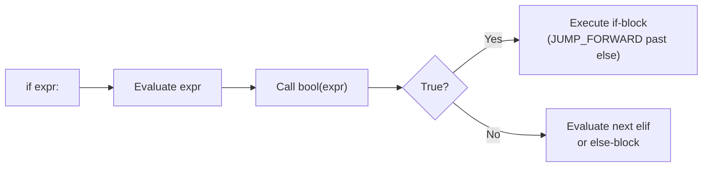
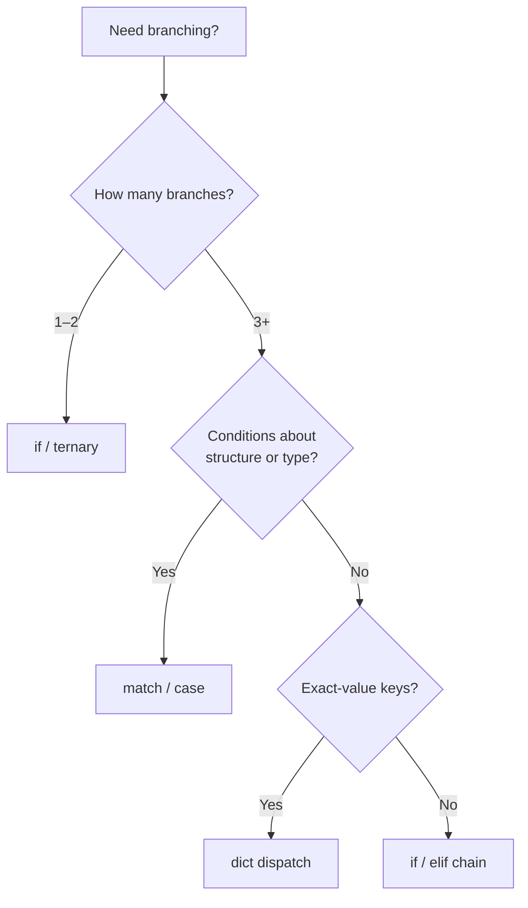

# Conditions — Detailed Notes

---

## 1. What Is It? (Concept & Under the Hood)

A **condition** is any expression whose **truthiness** decides which block of code runs. Python evaluates the expression, calls `bool()` on the result (which invokes `__bool__`, falling back to `__len__`), and branches.

Unlike C/Java, Python has **no `switch` statement** in the classical sense — it has **`match`/`case`** (3.10+), which is *structural pattern matching*, far more powerful than a switch.

### How the Interpreter Branches (Under the Hood)



At the bytecode level, an `if` compiles to a **conditional jump**:

```python
import dis
dis.dis("""
if x > 5:
    y = 1
else:
    y = 2
""")
```

```
  2           0 LOAD_NAME      0 (x)
              2 LOAD_CONST     1 (5)
              4 COMPARE_OP     4 (>)
              6 POP_JUMP_IF_FALSE  to 14
  3           8 LOAD_CONST     1 (1)
             10 STORE_NAME     1 (y)
             12 JUMP_FORWARD   to 18
  5     >>   14 LOAD_CONST     2 (2)
             16 STORE_NAME     1 (y)
        >>   18 ...
```

Key opcodes: `POP_JUMP_IF_FALSE`, `POP_JUMP_IF_TRUE`, `JUMP_FORWARD`, `JUMP_BACKWARD` (for loops).

### Core Characteristics

- **Indentation-defined blocks** — no braces.
- **Short-circuit evaluation** — `and` / `or` stop as soon as the result is known.
- **Chained comparisons** — `a < b < c` is `a < b and b < c` with `b` evaluated once.
- **No fallthrough** — unlike C's `switch`, only one branch runs.
- **Truthiness-driven** — no need for `== True`.

---

## 2. How It Works — `if` / `elif` / `else`

### Basic Form

```python
if temperature > 30:
    print("hot")
elif temperature > 15:
    print("mild")
elif temperature > 0:
    print("cold")
else:
    print("freezing")
```

**Rules:**
- `elif` and `else` are optional.
- Only **one** branch executes.
- Conditions are checked **top-to-bottom**; first truthy wins.
- `elif` chains are **not** the same as nested `if` inside `else` (though semantically equivalent — but flatter and cleaner).

### `if` Without `else`

```python
if user.is_admin:
    grant_access()
```

### Nested Conditions

```python
if user.is_authenticated:
    if user.has_permission("edit"):
        if post.author == user:
            post.edit()
```

**Refactor with `and`** — flatter is better:

```python
if (user.is_authenticated
        and user.has_permission("edit")
        and post.author == user):
    post.edit()
```

**Guard clauses / early return** — even better:

```python
def edit_post(user, post):
    if not user.is_authenticated:
        return
    if not user.has_permission("edit"):
        return
    if post.author != user:
        return
    post.edit()
```

### `if` on One Line

```python
if x > 0: print("positive")     # legal, discouraged for multiple statements
if x > 0: y = 1; z = 2          # works, but hurts readability
```

### Assignment Expression (Walrus `:=`)

Assign inside a condition to avoid double evaluation:

```python
# Without walrus
data = fetch()
if data:
    process(data)

# With walrus
if (data := fetch()):
    process(data)
```

Common in `while` loops:

```python
while (line := file.readline()) != "":
    process(line)
```

---

## 3. Structural Pattern Matching — `match` / `case`

Introduced in **Python 3.10**. Not a `switch` — it matches **structure** and **binds variables**.

### Basic Syntax

```python
match command:
    case "start":
        start()
    case "stop":
        stop()
    case _:
        print("unknown command")
```

- `_` is the **wildcard** (matches anything, binds nothing).
- Cases are checked **top-to-bottom**; first match wins.
- No fallthrough (no `break` needed).

### Matching Literals & OR Patterns

```python
match status:
    case 200 | 201 | 204:
        print("success")
    case 404:
        print("not found")
    case 500 | 502 | 503:
        print("server error")
```

### Capturing Values

```python
match point:
    case (0, 0):
        print("origin")
    case (x, 0):
        print(f"on x-axis at {x}")
    case (0, y):
        print(f"on y-axis at {y}")
    case (x, y):
        print(f"at ({x}, {y})")
```

### Matching Sequences & Types

```python
match data:
    case []:
        print("empty")
    case [x]:
        print(f"one element: {x}")
    case [x, y, *rest]:
        print(f"first two: {x}, {y}; rest: {rest}")
    case str() as s:
        print(f"string: {s}")
    case int() | float() as n:
        print(f"number: {n}")
```

### Matching Dictionaries

```python
match event:
    case {"type": "click", "x": x, "y": y}:
        handle_click(x, y)
    case {"type": "key", "key": key}:
        handle_key(key)
    case {"type": t}:
        print(f"unknown event type: {t}")
```

### Matching Classes (with `__match_args__`)

```python
from dataclasses import dataclass

@dataclass
class Point:
    x: int
    y: int

match p:
    case Point(0, 0):
        print("origin")
    case Point(x=0, y=y):
        print(f"y-axis at {y}")
    case Point(x, y):
        print(f"({x}, {y})")
```

### Guards (`if` inside `case`)

```python
match n:
    case int() if n > 0:
        print("positive")
    case int() if n < 0:
        print("negative")
    case int():
        print("zero")
```

### `case` vs `if/elif` — When to Use Which

| Use `match` when… | Use `if/elif` when… |
|---|---|
| Matching structure (tuples, dicts, classes) | Comparing simple booleans |
| Many literal alternatives | Complex boolean logic |
| Binding sub-parts | Only 1–2 branches |
| Parsing ASTs, protocols, events | Range checks (`0 < x < 10`) |

> **Note:** `match` isn't always faster than `if/elif` — it's about **clarity**, not speed.

---

## 4. Conditional Expressions (Ternary)

### Basic Form

```python
result = value_if_true if condition else value_if_false
```

Examples:

```python
status = "adult" if age >= 18 else "minor"
sign = "positive" if n > 0 else "negative" if n < 0 else "zero"
```

### With Function Calls

```python
print("yes" if flag else "no")
greet = greet_user if user else greet_guest
```

### Nested Ternaries — Readable or Not?

```python
# Readable enough
grade = "A" if s >= 90 else "B" if s >= 80 else "C"

# Too much — use if/elif
label = ("high" if v > 100 else
         "medium" if v > 50 else
         "low" if v > 10 else
         "none")
```

### Ternary Inside f-strings

```python
print(f"User is {'active' if active else 'inactive'}")
```

### Comparison Table

| Construct | Returns | Best for |
|---|---|---|
| Ternary `a if c else b` | Value | Assigning one of two values |
| `if`/`else` block | Nothing (statement) | Side effects, multiple lines |
| `dict.get` fallback | Value | Mapping lookups |
| `or` default | Value | Simple fallback (`x or default`) |

```python
# Idioms
name = user_input or "anonymous"       # falsy fallback
port = config.get("port", 8000)         # dict default
value = d["k"] if "k" in d else None    # explicit
```

---

## 5. Real-World Use Cases

### Use Case 1 — CLI Argument Handler with `match`

```python
def handle(argv: list[str]) -> None:
    match argv:
        case ["--help"] | ["-h"] | []:
            print_help()
        case ["--version"]:
            print(VERSION)
        case ["run", filename]:
            run(filename)
        case ["run", filename, *flags]:
            run(filename, flags=flags)
        case _:
            print(f"unknown: {argv}", file=sys.stderr)
```

### Use Case 2 — HTTP Response Dispatcher

```python
def dispatch(response):
    match response:
        case {"status": 200, "body": body}:
            return parse(body)
        case {"status": 301 | 302, "location": url}:
            return follow(url)
        case {"status": 404}:
            raise NotFound()
        case {"status": s} if 500 <= s < 600:
            raise ServerError(s)
        case _:
            raise Unexpected(response)
```

### Use Case 3 — State Machine

```python
state = "idle"

while True:
    match state:
        case "idle":
            event = wait_for_event()
            state = "running" if event == "start" else "idle"
        case "running":
            if should_stop():
                state = "idle"
            else:
                tick()
        case _:
            raise ValueError(f"bad state: {state}")
```

### Use Case 4 — Validation with Guard Clauses

```python
def withdraw(account, amount):
    if amount <= 0:
        raise ValueError("amount must be positive")
    if amount > account.balance:
        raise InsufficientFunds()
    if account.frozen:
        raise AccountFrozen()
    account.balance -= amount
    return account.balance
```

Flatter, easier to test, each condition isolated.

---

## 6. Common Pitfalls & How to Avoid Them

### Pitfall 1 — Assignment Instead of Comparison

```python
if x = 5:      # SyntaxError — good, Python catches it
    ...
if (x = 5):    # still SyntaxError
# Use ==
if x == 5: ...
```

Python's SyntaxError is a **feature** — C lets `if (x = 5)` silently pass.

### Pitfall 2 — Truthiness Surprises

```python
value = "0"
if value:              # True (non-empty string)
    print("truthy")

count = 0
if count:              # False
    print("never")

items = []
if items:              # False
    print("never")

data = {"x": 0}
if data:               # True (dict is non-empty)
    print("truthy")
```

Fix: be explicit when `0`, `""`, `[]` are valid data.

```python
if count is not None:
    ...
if len(items) > 0:
    ...
```

### Pitfall 3 — Using `is` for Value Comparison

```python
if x is 5:      # ❌ works for small ints, breaks for 257+
    ...

if x == 5:      # ✅
    ...
```

### Pitfall 4 — Operator Precedence Bug

```python
if x == 1 or 2:      # ❌ always True — evaluated as (x == 1) or 2
    ...

if x in (1, 2):      # ✅
    ...

if x == 1 or x == 2: # ✅
    ...
```

### Pitfall 5 — Chained Comparison Misuse

```python
if 0 < x < 10:       # ✅ means 0 < x and x < 10
    ...

if x > 0 and x < 10: # ✅ equivalent, more verbose
    ...

if x > 0 or x < 10:  # ❌ almost always True
    ...
```

### Pitfall 6 — Mutable Default Arguments (in functions)

```python
def append(item, target=[]):   # ❌ shared across calls
    target.append(item)
    return target

def append(item, target=None): # ✅
    if target is None:
        target = []
    target.append(item)
    return target
```

### Pitfall 7 — Fallthrough in `match`

```python
match x:
    case 1:
        print("one")      # no break needed
    case 2:
        print("two")
```

But you *can* combine patterns with `|`:

```python
match x:
    case 1 | 2 | 3:
        print("small")
```

### Pitfall 8 — Wildcard Before Specific Cases

```python
match x:
    case _:
        print("anything")  # always matches first!
    case 1:
        print("one")       # unreachable
```

Order matters — put `_` last.

### Pitfall 9 — `elif` Chain Order

```python
# ❌ wrong order — "B" never reached for score 95
if score >= 80:
    grade = "B"
elif score >= 90:
    grade = "A"

# ✅ specific first
if score >= 90:
    grade = "A"
elif score >= 80:
    grade = "B"
```

### Pitfall 10 — Comparing Floats Directly

```python
if 0.1 + 0.2 == 0.3:   # False!
    ...

import math
if math.isclose(0.1 + 0.2, 0.3):  # True
    ...
```

### Pitfall 11 — Truthiness of Custom Objects

```python
class Connection:
    def __init__(self): self.sock = None
    # no __bool__ / __len__ → always truthy

conn = Connection()
if conn:               # True even though sock is None!
    conn.send("hi")    # crashes

# Fix: implement __bool__
class Connection:
    def __init__(self): self.sock = None
    def __bool__(self): return self.sock is not None

if conn:               # False — correct
    ...
```

### Summary Table of Pitfalls

| Pitfall | Symptom | Fix |
|---|---|---|
| `=` vs `==` | SyntaxError | Use `==` |
| Truthy strings/numbers | `"0"` → True | Explicit `is not None` / `len()` |
| `is` for values | Works small, breaks large | Use `==` |
| `x == 1 or 2` | Always True | `x in (1,2)` |
| Chain `or` | Always True | `and` |
| Mutable default | Shared state | `None` sentinel |
| `_` first in `match` | Unreachable cases | Put last |
| `elif` order | Skipped branches | Most specific first |
| Float equality | Surprising False | `math.isclose` |
| Custom objects truthy | Silent bugs | `__bool__` |

---

## 7. Comparison with Alternatives

### `if/elif` vs `match` vs `dict` Dispatch

```python
# 1. if/elif — simple, readable
def route(path):
    if path == "/":
        return home()
    elif path == "/about":
        return about()
    elif path.startswith("/user/"):
        return user(path[6:])
    else:
        return not_found()

# 2. dict dispatch — fast, data-driven
ROUTES = {
    "/": home,
    "/about": about,
}
def route(path):
    handler = ROUTES.get(path, not_found)
    return handler()

# 3. match — best for structured data
def route(req):
    match req:
        case {"method": "GET", "path": "/"}:
            return home()
        case {"method": "GET", "path": f"/user/{uid}"}:
            return user(uid)
        case {"method": m}:
            return method_not_allowed(m)
```

| Technique | Readability | Speed | Best for |
|---|---|---|---|
| `if/elif` | High for few branches | O(n) linear | Simple, non-linear conditions |
| `dict` dispatch | High | O(1) | Exact-match keys |
| `match` | High for structure | O(n) cases | Structured data, tuples, dicts |
| `functools.singledispatch` | Medium | O(1) | Type-based dispatch |

### Type-Based Dispatch Example

```python
from functools import singledispatch

@singledispatch
def render(x):
    raise TypeError(x)

@render.register
def _(x: int):    return f"int: {x}"

@render.register
def _(x: str):    return f"str: {x}"

@render.register
def _(x: list):   return "\n".join(map(str, x))

render(42)         # "int: 42"
render("hi")       # "str: hi"
render([1, 2, 3])  # "1\n2\n3"
```

### Mermaid — Decision Tree



---

## 8. Quick Reference

```python
# Basic
if cond:
    ...
elif cond2:
    ...
else:
    ...

# Ternary
x = a if cond else b

# Walrus
if (n := len(data)) > 10:
    print(n)

# Chained comparison
if 0 <= x < 100: ...

# Membership
if key in d: ...

# Identity
if x is None: ...

# Truthiness
if items: ...
if not items: ...

# match (3.10+)
match value:
    case 1 | 2:
        ...
    case [a, b]:
        ...
    case {"k": v} if v > 0:
        ...
    case Point(x=0, y=y):
        ...
    case _:
        ...
```

---

## Summary

- **`if/elif/else`** is the bread-and-butter branching construct; conditions are evaluated top-to-bottom and short-circuit.
- **Truthiness** drives every condition — know your falsy values (`0`, `""`, `[]`, `{}`, `()`, `set()`, `None`, `False`).
- **`match`/`case`** (3.10+) is *structural pattern matching*, not a switch: matches literals, sequences, dicts, classes, with optional guards.
- **Conditional expressions** (`a if c else b`) are concise for single assignments; nest sparingly.
- **Guard clauses** (early `return`/`raise`) beat deep nesting for readability.
- **Pitfalls** cluster around `= vs ==`, `is vs ==`, `or` vs `and`, precedence, truthiness surprises, and float equality — know them and you avoid 90% of bugs.