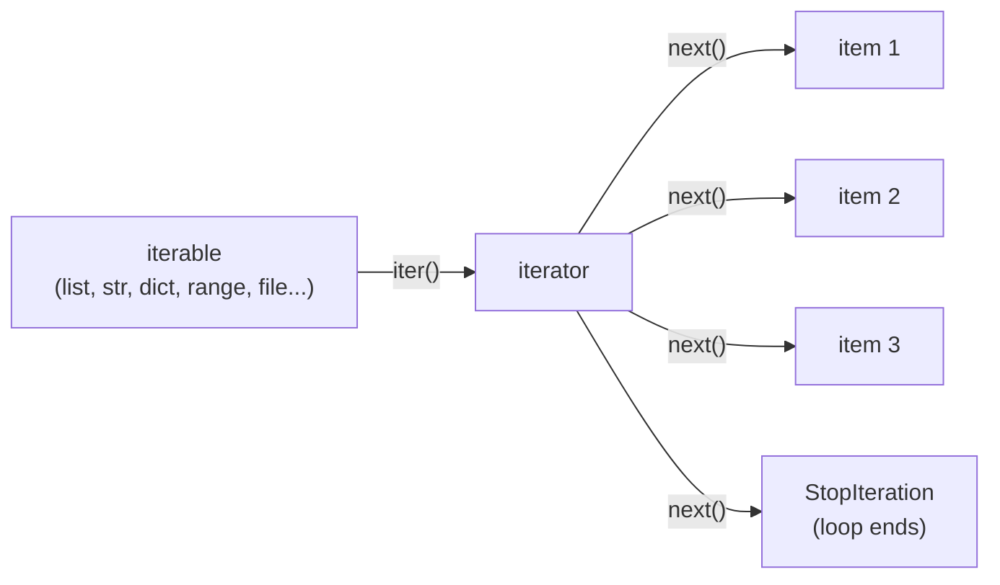
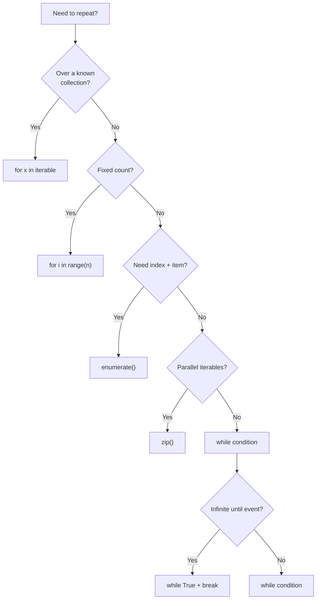

# Loops — Detailed Notes

---

## 1. What Is It? (Concept & Under the Hood)

A **loop** repeats a block of code. Python has two loop statements:

- **`for`** — iterates over an *iterable* (anything that can produce items one at a time).
- **`while`** — repeats as long as a condition is truthy.

There is **no C-style `for (i=0; i<n; i++)`** in Python. Instead, `for` consumes an **iterator** produced by calling `iter()` on an iterable. Each cycle calls `next()` until `StopIteration` is raised — at which point the loop ends cleanly.

### The Iterator Protocol (Under the Hood)



Every `for` loop is sugar for:

```python
it = iter(iterable)
while True:
    try:
        item = next(it)
    except StopIteration:
        break
    body(item)
```

You can drive the protocol yourself:

```python
nums = [10, 20, 30]
it = iter(nums)
print(next(it))   # 10
print(next(it))   # 20
print(next(it))   # 30
print(next(it))   # StopIteration
```

### Bytecode View

```python
import dis
dis.dis("""
for x in [1, 2, 3]:
    print(x)
""")
```

```
  2     >>  0 LOAD_NAME      0 (x)     # loop target
             2 ...
             4 FOR_ITER      ... (to ...)  # asks iterator for next item
             6 STORE_NAME    0 (x)
  3          8 LOAD_NAME      1 (print)
            10 LOAD_NAME      0 (x)
            12 CALL 1
            14 JUMP_BACKWARD  to 0
        >>  16 END_FOR
```

Key opcodes: **`GET_ITER`**, **`FOR_ITER`**, **`JUMP_BACKWARD`**, **`END_FOR`**.

### Characteristics

- `for` is **iterable-driven** (works on anything implementing `__iter__`).
- `while` is **condition-driven** (repeats while truthy).
- Both support `break`, `continue`, `else`.
- Both are **not** block-scoped — the loop variable **persists** after the loop.
- Loop bodies are indentation-defined.

---

## 2. `for` Loops

### Basic Form

```python
for item in iterable:
    # body
```

Examples:

```python
for ch in "abc":
    print(ch)             # a, b, c

for n in [1, 2, 3]:
    print(n)              # 1, 2, 3

for k in {"a": 1, "b": 2}:
    print(k)              # a, b  (keys only)

for k, v in {"a": 1, "b": 2}.items():
    print(k, v)           # a 1, b 2

for i in range(3):
    print(i)              # 0, 1, 2
```

### The Loop Variable Persists

```python
for i in range(3):
    pass
print(i)   # 2 — still bound after the loop
```

This is different from C/Java. Do not rely on the variable being "unset"; but also do not assume it holds the "last meaningful" value if the iterable was empty.

### `for` Over Multiple Iterables

```python
names = ["Ada", "Alan"]
ages  = [36, 41]

for name, age in zip(names, ages):
    print(name, age)
# Ada 36
# Alan 41
```

### `for` Over `dict`

```python
d = {"a": 1, "b": 2}

for k in d:            # same as d.keys()
    ...

for k in d.keys():
    ...

for v in d.values():
    ...

for k, v in d.items():
    ...
```

### Mutating While Iterating (Danger)

```python
nums = [1, 2, 3, 4]

# ❌ undefined behavior — you may skip items
for n in nums:
    if n % 2 == 0:
        nums.remove(n)

# ✅ iterate over a copy or build a new list
nums = [n for n in nums if n % 2 != 0]
```

For dicts, mutating during iteration raises `RuntimeError: dictionary changed size during iteration`.

```python
# ❌
for k in d:
    del d[k]

# ✅
for k in list(d):
    del d[k]
```

---

## 3. `while` Loops

### Basic Form

```python
while condition:
    # body
```

Examples:

```python
i = 0
while i < 3:
    print(i)
    i += 1

# Infinite loop (must break internally)
while True:
    cmd = input("> ")
    if cmd == "quit":
        break
    print(cmd)
```

### `while` with the Walrus Operator

```python
while (line := file.readline()) != "":
    process(line)
```

### Typical Uses

- Waiting for an external condition (I/O, user input, retries).
- Loops whose length isn't known in advance.
- Consumer loops (`while queue:`).

### Sentinel Pattern

```python
while (chunk := stream.read(1024)):
    buffer += chunk
```

### Retry Pattern

```python
attempts = 0
while attempts < 3:
    try:
        result = risky_call()
        break
    except TransientError:
        attempts += 1
        time.sleep(2 ** attempts)
else:
    raise RuntimeError("all retries failed")
```

---

## 4. `range()`, `enumerate()`, `zip()`

### `range(start, stop, step)`

Produces integers lazily — no list is created.

```python
range(5)          # 0, 1, 2, 3, 4
range(2, 5)       # 2, 3, 4
range(0, 10, 2)   # 0, 2, 4, 6, 8
range(5, 0, -1)   # 5, 4, 3, 2, 1

list(range(5))            # [0, 1, 2, 3, 4]
len(range(0, 10, 2))      # 5 — O(1), no iteration
5 in range(0, 10)         # True — O(1) membership
```

`range` supports indexing and slicing (returns another `range`):

```python
r = range(0, 100, 5)
r[3]         # 15
r[-1]        # 95
r[2:5]       # range(10, 25, 5)
```

> **Under the hood:** `range` is a sequence with O(1) `__getitem__`, O(1) `__contains__`, O(1) `__len__`. It stores only `(start, stop, step)`.

### `enumerate(iterable, start=0)`

Yields `(index, item)` pairs lazily.

```python
for i, name in enumerate(["a", "b", "c"]):
    print(i, name)
# 0 a
# 1 b
# 2 c

for i, name in enumerate(["a", "b", "c"], start=1):
    print(i, name)
# 1 a
# 2 b
# 3 c
```

Without `enumerate` (the anti-pattern):

```python
# ❌
i = 0
for item in items:
    print(i, item)
    i += 1
```

### `zip(*iterables)`

Yields tuples of corresponding elements; stops at the **shortest** input.

```python
for a, b in zip([1, 2, 3], "abc"):
    print(a, b)
# 1 a
# 2 b
# 3 c

# Uneven lengths — shortest wins
list(zip([1, 2, 3], "ab"))   # [(1, 'a'), (2, 'b')]
```

Use `zip(..., strict=True)` (3.10+) to raise on length mismatch:

```python
list(zip([1, 2, 3], "ab", strict=True))  # ValueError
```

Use `itertools.zip_longest` for the opposite behavior:

```python
from itertools import zip_longest
list(zip_longest([1, 2, 3], "ab", fillvalue=None))
# [(1, 'a'), (2, 'b'), (3, None)]
```

### `zip` Unzipping

```python
pairs = [(1, "a"), (2, "b"), (3, "c")]
nums, letters = zip(*pairs)
# nums = (1, 2, 3), letters = ('a', 'b', 'c')
```

### Combining Them

```python
names = ["Ada", "Alan", "Grace"]
scores = [99, 87, 95]

for i, (name, score) in enumerate(zip(names, scores), start=1):
    print(f"{i}. {name}: {score}")
# 1. Ada: 99
# 2. Alan: 87
# 3. Grace: 95
```

---

## 5. `break`, `continue`, `pass`

### `break` — Exit the Loop Immediately

```python
for n in range(10):
    if n == 5:
        break
    print(n)
# 0 1 2 3 4
```

### `continue` — Skip to Next Iteration

```python
for n in range(6):
    if n % 2:
        continue
    print(n)
# 0 2 4
```

### `pass` — Do Nothing (Placeholder)

```python
for n in data:
    if n < 0:
        pass    # TODO: handle negatives
    else:
        process(n)

# Also used for empty blocks
class Empty:
    pass

def noop():
    pass
```

`pass` is not a loop control — it's a syntactic no-op.

### Summary Table

| Keyword | Effect | Use case |
|---|---|---|
| `break` | Exit loop entirely | Found what you want |
| `continue` | Skip rest of current iteration | Filter/skip items |
| `pass` | Do nothing | Placeholder, stub |

---

## 6. Loop `else`

The `else` clause runs **only if the loop ended without `break`**.

```python
for n in range(2, 10):
    if n % 2 == 0:
        print("found even:", n)
        break
else:
    print("no even numbers found")
```

### Typical Pattern — Search

```python
def find_first(predicate, items):
    for item in items:
        if predicate(item):
            return item
    return None

# or, with loop-else
def find_first(predicate, items):
    for item in items:
        if predicate(item):
            result = item
            break
    else:
        return None
    return result
```

### Prime Check

```python
def is_prime(n):
    if n < 2:
        return False
    for d in range(2, int(n ** 0.5) + 1):
        if n % d == 0:
            break
    else:
        return True
    return False
```

> **Pitfall:** `else` on a loop is often confusing to readers. Many style guides prefer explicit flags:

```python
found = False
for item in items:
    if predicate(item):
        found = True
        break
if not found:
    ...
```

### In `while` Loops

```python
n = 10
while n > 0:
    if n == 5:
        break
    n -= 1
else:
    print("loop completed without break")
# (prints nothing, because break happened)
```

---

## 7. Nested Loops

```python
for i in range(3):
    for j in range(3):
        print(i, j)
```

Output:

```
0 0
0 1
0 2
1 0
...
```

### Breaking Out of Multiple Loops

`break` only exits the innermost loop. Options:

```python
# 1. Flag
found = False
for i in range(10):
    for j in range(10):
        if board[i][j] == target:
            found = True
            break
    if found:
        break

# 2. Function + return
def find(board, target):
    for i, row in enumerate(board):
        for j, cell in enumerate(row):
            if cell == target:
                return i, j
    return None

# 3. for-else (inverse flag)
for i in range(10):
    for j in range(10):
        if board[i][j] == target:
            break
    else:
        continue
    break
```

Option **2** (extract a function) is almost always the cleanest.

### Common Nested Patterns

**Multiplication table:**

```python
for i in range(1, 4):
    row = [f"{i*j:>3}" for j in range(1, 4)]
    print(" ".join(row))
```

**Matrix transposition:**

```python
matrix = [[1, 2, 3], [4, 5, 6]]
transposed = [[row[i] for row in matrix] for i in range(len(matrix[0]))]
# [[1, 4], [2, 5], [3, 6]]
```

**Cartesian product:**

```python
from itertools import product
for a, b in product("AB", "12"):
    print(a, b)
```

---

## 8. Choosing `for` vs `while`

| Situation | Use |
|---|---|
| Iterating over a known collection | **`for`** |
| Known number of repetitions | **`for` + `range()`** |
| Unknown repetitions until a condition | **`while`** |
| Reading until EOF/sentinel | **`while`** or `for` over an iterator |
| Waiting for external event | **`while`** |
| Consumer loop over a queue | **`while`** |
| Loop variable needed as index | `for i, x in enumerate(...)` |

### Anti-pattern: `while` as `for`

```python
# ❌
i = 0
while i < len(items):
    print(items[i])
    i += 1

# ✅
for item in items:
    print(item)
```

### Anti-pattern: `for` for infinite loops

```python
# ❌ awkward
for _ in iter(int, 1):   # infinite but cryptic
    ...

# ✅
while True:
    ...
```

### Anti-pattern: index-only loops

```python
# ❌
for i in range(len(items)):
    print(items[i])

# ✅
for item in items:
    print(item)

# ✅ when you need the index
for i, item in enumerate(items):
    print(i, item)
```

---

## 9. Advanced Loop Idioms

### Building a Result List

```python
# ❌ slow — repeated list growth
result = []
for n in range(1000):
    if n % 2 == 0:
        result.append(n * n)

# ✅ comprehension — faster, more idiomatic
result = [n * n for n in range(1000) if n % 2 == 0]
```

### Accumulators

```python
total = 0
for n in nums:
    total += n

# ✅ faster and shorter
total = sum(nums)
```

Same for `min`, `max`, `any`, `all`, `len`:

```python
max(nums)
any(x > 0 for x in nums)
all(x > 0 for x in nums)
```

### `while` with `itertools`

```python
from itertools import count, takewhile

for n in takewhile(lambda x: x < 100, count(1, 7)):
    print(n)
```

### Grouping by Key

```python
from itertools import groupby
from operator import itemgetter

data = sorted(records, key=itemgetter("dept"))
for dept, group in groupby(data, key=itemgetter("dept")):
    print(dept, list(group))
```

### Looping with Index Backwards

```python
for i in range(len(items) - 1, -1, -1):
    print(items[i])

# or
for item in reversed(items):
    print(item)
```

---

## 10. Under the Hood — Performance Notes

### `range` Is O(1) in Memory

```python
import sys
sys.getsizeof(range(1_000_000_000))    # ~48 bytes
sys.getsizeof(list(range(1_000_000))) # ~8 MB
```

Always prefer `range` over a list unless you need list methods.

### Comprehension vs Loop

Comprehensions are compiled to a specialized bytecode path with a hidden function scope — they avoid `LOAD_METHOD append` per iteration:

```python
import timeit

timeit.timeit(
    "[x*x for x in range(1000)]",
    number=1000
)
# ~0.03 s

timeit.timeit(
    """
    out = []
    for x in range(1000):
        out.append(x*x)
    """,
    number=1000
)
# ~0.05 s
```

### Local Variables Are Faster

```python
# Faster — `append` looked up locally once
def fast():
    out = []
    append = out.append
    for x in range(1000):
        append(x * x)
    return out

# Slower — `out.append` looked up each iteration
def slow():
    out = []
    for x in range(1000):
        out.append(x * x)
    return out
```

Modern CPython (3.11+) narrows this gap, but the idiom is still good practice.

### Avoid Repeated Length Checks

```python
# ❌ recomputes len every iteration
for i in range(len(data)):
    ...

# ✅
n = len(data)
for i in range(n):
    ...
```

### Premature Optimization Warning

CPython 3.11+ has an **adaptive specializing interpreter** (PEP 659) that optimizes hot loops at runtime. Measure before micro-optimizing — use `timeit` / `cProfile`.

---

## 11. Common Pitfalls

### Pitfall 1 — Mutating During Iteration

```python
nums = [1, 2, 3, 4, 5]

# ❌ skips items, may IndexError
for n in nums:
    if n % 2 == 0:
        nums.remove(n)

# ✅
nums = [n for n in nums if n % 2]
```

Same for dicts:

```python
# ❌ RuntimeError: dictionary changed size
for k in d:
    d[k + 1] = 0

# ✅
for k in list(d):
    d[k + 1] = 0
```

### Pitfall 2 — Reusing a Consumed Iterator

```python
it = iter([1, 2, 3])
print(list(it))   # [1, 2, 3]
print(list(it))   # [] — exhausted!

# ✅
data = [1, 2, 3]
print(list(data))
print(list(data))
```

### Pitfall 3 — `while` Loop Variable Out of Sync

```python
i = 0
while i < 10:
    if some_condition:
        continue   # ❌ i never increments → infinite loop
    i += 1
```

Always update the loop variable before any `continue`.

### Pitfall 4 — Comparing Loop Variable Scope

```python
for i in range(3):
    pass

print(i)     # 2 — still bound!

# Later code reusing `i` may collide with this
```

Use `_` if the loop variable isn't needed:

```python
for _ in range(3):
    do_something()
```

### Pitfall 5 — Floating-Point Loop Counters

```python
# ❌ risky — accumulate floating-point error
x = 0.0
while x < 1.0:
    x += 0.1     # eventually overshoots or stalls

# ✅ integer counter
for i in range(10):
    x = i / 10
```

### Pitfall 6 — `break` in Nested Loop Only Exits Innermost

```python
for i in range(3):
    for j in range(3):
        if board[i][j] == target:
            break       # only exits inner loop
    # outer loop continues
```

Use a function + `return`, or a flag.

### Pitfall 7 — `for-else` Confusion

```python
for n in nums:
    if n < 0:
        break
else:
    print("all non-negative")   # runs ONLY if no break
```

The `else` runs on normal completion — its name is misleading. Think "no-break clause".

### Pitfall 8 — `enumerate` Without Start

```python
for i, item in enumerate(items):
    print(f"{i}: {item}")   # 0-indexed

# 1-indexed when needed
for i, item in enumerate(items, start=1):
    ...
```

### Pitfall 9 — `zip` Silently Truncating

```python
list(zip([1, 2, 3], "ab"))   # [(1,'a'), (2,'b')] — '3' lost!
```

Use `strict=True` (3.10+) to catch the mistake.

### Pitfall 10 — Loop Invariant Recomputed

```python
# ❌
for item in items:
    result = expensive_lookup(key)   # same every time!
    process(item, result)

# ✅
result = expensive_lookup(key)
for item in items:
    process(item, result)
```

---

## 12. Real-World Use Cases

### Use Case 1 — Reading a File Line by Line

```python
with open("data.txt") as f:
    for line_num, line in enumerate(f, start=1):
        line = line.rstrip("\n")
        if not line:
            continue
        print(f"{line_num}: {line}")
```

### Use Case 2 — Retry with Backoff

```python
import time, random

def fetch_with_retry(url, attempts=5):
    for attempt in range(1, attempts + 1):
        try:
            return http_get(url)
        except TransientError as e:
            if attempt == attempts:
                raise
            delay = min(30, 2 ** attempt) + random.random()
            time.sleep(delay)
```

### Use Case 3 — Batch Processing with Progress

```python
for i, chunk in enumerate(chunks(data, size=1000), start=1):
    process(chunk)
    print(f"\rProcessed batch {i}", end="", flush=True)
print()
```

### Use Case 4 — Matrix Traversal

```python
def find_in_matrix(matrix, target):
    for row_idx, row in enumerate(matrix):
        for col_idx, value in enumerate(row):
            if value == target:
                return row_idx, col_idx
    return None
```

### Use Case 5 — Sliding Window

```python
def max_subarray_sum(nums, k):
    window = sum(nums[:k])
    best = window
    for i in range(k, len(nums)):
        window += nums[i] - nums[i - k]
        best = max(best, window)
    return best
```

### Use Case 6 — Producer–Consumer with `while`

```python
while True:
    try:
        item = queue.get(timeout=1)
    except queue.Empty:
        break
    consume(item)
```

---

## 13. Comparison Table — Loop Constructs

| Construct | Iterates over | Stops when | Typical use |
|---|---|---|---|
| `for x in iterable` | Any iterable | Iterator exhausted | Collection traversal |
| `for i in range(n)` | Integer sequence | `i == n` | Fixed count |
| `for i, x in enumerate(...)` | `(index, item)` pairs | Iterable exhausted | Need index + item |
| `for a, b in zip(...)` | Parallel tuples | Shortest exhausted | Parallel iteration |
| `while cond` | — | `cond` falsy | Unknown count, external condition |
| `while True` + `break` | — | Explicit break | Event loops, producers |
| `for ... else` | iterable | Normal completion | Search-then-act |
| `itertools` variants | Lazy streams | Depends | Complex sequences |

---

## 14. Mermaid — Loop Decision Flow



---

## 15. Quick Reference Card

```python
# for — iterate anything
for item in iterable: ...
for i in range(10): ...
for i, x in enumerate(items, start=1): ...
for a, b in zip(xs, ys): ...

# while — condition
while cond: ...
while (line := f.readline()) != "": ...
while True:
    if done: break

# Control
break        # exit loop
continue     # next iteration
pass         # no-op

# for-else — runs only if no break
for x in xs:
    if found(x): break
else:
    not_found()

# Nested + return
def find(xs, target):
    for i, row in enumerate(xs):
        for j, v in enumerate(row):
            if v == target:
                return i, j

# Refactor patterns
items = [x for x in xs if predicate(x)]      # filter
total = sum(xs)                              # accumulate
any(x > 0 for x in xs)                       # exists
all(x > 0 for x in xs)                       # forall
```

---

## Summary

- **`for`** consumes an **iterator** (`iter()` / `next()` / `StopIteration`); **`while`** repeats while a condition is truthy.
- **`range`**, **`enumerate`**, **`zip`** are the three workhorses for index- and parallel-driven iteration — all lazy, all O(1) in memory.
- **`break`** exits the innermost loop; **`continue`** skips the rest of the iteration; **`pass`** is a no-op.
- **Loop `else`** runs only when the loop exits without `break` — great for search, but name-confusing; use flags or functions for clarity.
- **Never mutate** the collection you're iterating; iterate over a copy or build a new collection.
- **Extract nested loops** into functions to get `return`-based early exit — beats flags and `for-else` gymnastics.
- **Prefer comprehensions** and built-ins (`sum`, `any`, `all`, `min`, `max`) for accumulation and filtering.
- **Pitfalls** cluster around mutation-during-iteration, exhausted iterators, `for-else` semantics, `zip` truncation, and stale `while` counters.