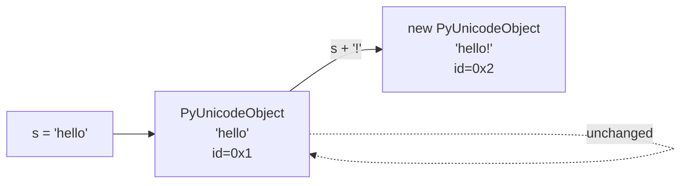
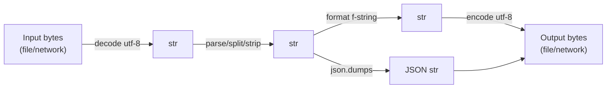

# Strings — Detailed Notes

---

## 1. What Is It? (Concept & Under the Hood)

A **`str`** is an **immutable sequence of Unicode code points**. Every character is a full Unicode scalar (not a byte), so `len("αβγ")` is `3`, not `6`, even though the UTF-8 encoding is longer.

Strings are:
- **Immutable** — no in-place modification; every "change" creates a new string.
- **Ordered** — support indexing and slicing.
- **Iterable** — support `for`, comprehensions, `in`, etc.
- **Hashable** — can be dict keys and set members (since immutable).
- **Interened selectively** — short identifier-like literals are cached by CPython.

### Under the Hood — CPython's `PyUnicodeObject`

Python 3 uses **flexible string representation** (PEP 393). Each string picks the smallest fixed-width encoding that can hold its widest character:

| Kind | Character width | Used when max code point is |
|---|---|---|
| `1-byte` (Latin-1) | 1 byte/char | ≤ 0xFF |
| `2-byte` (UCS-2) | 2 bytes/char | ≤ 0xFFFF |
| `4-byte` (UCS-4) | 4 bytes/char | > 0xFFFF |

```python
import sys

s1 = "hello"          # all ASCII → 1-byte
s2 = "héllo"          # é = U+00E9 → 1-byte (Latin-1)
s3 = "αβγ"            # Greek → 2-byte
s4 = "😀"             # emoji → 4-byte

sys.getsizeof(s1)     # 54 bytes (49 header + 5 chars)
sys.getsizeof(s3)     # 76 bytes (49 + 3*2 padded)
sys.getsizeof(s4)     # 80 bytes (49 + 4 padded)
```

Advantages:
- **Memory-efficient** for ASCII-heavy text.
- **O(1) indexing** — always fixed width per string.
- **No encoding stored** with the object — it's just code points.

### How String Operations Look in Bytecode

```python
import dis
dis.dis('"ab" + "cd"')
```

```
  0 LOAD_CONST   0 ('ab')
  2 LOAD_CONST   1 ('cd')
  4 BINARY_OP    0 (+)
  6 RETURN_VALUE
```

Constant folding applies: `"ab" + "cd"` may be folded to `'abcd'` at compile time. Runtime concatenation creates a new `str`.

### The Big Picture — Immutability



The original object is never modified. This is why strings can safely be shared, cached, and used as dict keys.

---

## 2. Creating Strings

### Literal Forms

```python
s1 = 'single'
s2 = "double"
s3 = '''triple
single quotes
span multiple lines'''
s4 = """triple
double quotes
span multiple lines"""
s5 = str(42)          # "42"
s6 = str([1, 2])      # "[1, 2]"
s7 = "a" "b" "c"      # implicit concatenation → "abc"
```

### Raw Strings — No Escape Processing

```python
path = r"C:\Users\Ada"          # backslashes are literal
regex = r"\d+\.\d+"             # ideal for regex
print(path)                     # C:\Users\Ada
```

Raw strings **cannot end with an odd number of backslashes**:

```python
r"C:\"       # SyntaxError
r"C:\\"      # OK — two backslashes
"C:\\"       # OK — escaped
```

### Byte Strings — Not `str`

```python
b = b"hello"          # bytes, not str
print(type(b))        # <class 'bytes'>
print(b[0])           # 104 (an int, not a char)
```

`bytes` is a separate type. Decode/encode to cross the boundary:

```python
s = "héllo"
b = s.encode("utf-8")       # b'h\xc3\xa9llo'
s2 = b.decode("utf-8")      # 'héllo'
```

### `str()` vs `repr()`

```python
s = "hi\nthere"
print(str(s))    # hi
                 # there
print(repr(s))   # 'hi\nthere'  — shows escapes
```

`repr` is for debugging; `str` is for users.

### String Interning

Short strings that look like identifiers are interned automatically:

```python
a = "hello"
b = "hello"
print(a is b)   # True — interned

a = "hello world!"
b = "hello world!"
print(a is b)   # may be False — not interned

import sys
a = sys.intern("hello world!")
b = sys.intern("hello world!")
print(a is b)   # True — forced
```

Never rely on interning for correctness — use `==`.

---

## 3. Indexing, Slicing, Iteration

### Indexing (Zero-Based, Negative Allowed)

```python
s = "Python"
#    0 1 2 3 4 5
#   -6-5-4-3-2-1

s[0]      # 'P'
s[-1]     # 'n'
s[100]    # IndexError: string index out of range
```

### Slicing — `s[start:stop:step]`

`start` inclusive, `stop` exclusive, `step` defaults to `1`.

```python
s = "Python"

s[0:3]      # 'Pyt'
s[:3]       # 'Pyt'  — start defaults to 0
s[3:]       # 'hon'  — stop defaults to len
s[:]        # 'Python' (shallow copy — same object for str)
s[::2]      # 'Pto'   — every other char
s[::-1]     # 'nohtyP' — reversed
s[-3:]      # 'hon'
s[:-3]      # 'Pyt'
s[10:20]    # '' — out-of-range slices silently clamp
```

### Important — Slicing Never Raises

```python
s[100:200]    # '' — no error
s[-100:3]     # 'Pyt' — clamped
```

### Iterating

```python
for ch in "abc":
    print(ch)

list("abc")          # ['a', 'b', 'c']
tuple("abc")         # ('a', 'b', 'c')
set("aabbcc")        # {'a', 'b', 'c'}
"a" in "abc"         # True
"bc" in "abc"        # True — substring
```

### Under the Hood — Slices Are O(k)

Slicing creates a **new string** by copying `k` characters. Very long slices are O(k) in time and memory.

```python
big = "x" * 1_000_000
half = big[:500_000]    # allocates 500 KB
```

---

## 4. Immutability — What It Really Means

```python
s = "hello"
# s[0] = "H"          # TypeError: 'str' object does not support item assignment

s = "H" + s[1:]       # 'Hello' — new object
s = s.upper()         # 'HELLO' — new object
s = s.replace("L", "l")  # 'Hello' — new object
```

Every "modifying" method returns a **new string**. The old one is untouched (unless GC'd).

### Why It Matters

- **Hashable** → usable as dict keys / set members.
- **Thread-safe** → no locking needed to read.
- **Cacheable** → safe to share between functions.
- **Interning** → savings for common identifiers.

### The Concatenation Trap

```python
# ❌ O(n²) — creates a new string every iteration
result = ""
for word in words:
    result += word + " "

# ✅ O(n) — join allocates once
result = " ".join(words)

# ✅ also fine — accumulate in a list
parts = []
for word in words:
    parts.append(word)
result = " ".join(parts)
```

Reason: `"" + "a" + "b" + ...` allocates a new string every time. CPython has a **peephole optimization** for the literal case, but not for loop-driven mutation.

---

## 5. Escape Characters

| Escape | Meaning | Hex |
|---|---|---|
| `\n` | Newline | 0x0A |
| `\t` | Tab | 0x09 |
| `\r` | Carriage return | 0x0D |
| `\\` | Backslash | 0x5C |
| `\'` | Single quote | 0x27 |
| `\"` | Double quote | 0x22 |
| `\0` | Null | 0x00 |
| `\a` | Bell | 0x07 |
| `\b` | Backspace | 0x08 |
| `\f` | Form feed | 0x0C |
| `\v` | Vertical tab | 0x0B |
| `\xhh` | Hex byte | — |
| `\ooo` | Octal | — |
| `\N{name}` | Unicode by name | — |
| `\uXXXX` | Unicode BMP | — |
| `\UXXXXXXXX` | Unicode full | — |

```python
print("tab\there")
print("new\nline")
print("quote: \"quoted\"")
print("\N{GREEK SMALL LETTER ALPHA}")   # α
print("\u03B1")                          # α
print("\U0001F600")                      # 😀
print("\x41")                            # A
```

### Multi-line Strings Without Escapes

```python
text = """line one
line two
line three"""
```

Triple-quoted strings include the newlines as typed. Use `\` at line end to suppress:

```python
text = """line one \
line two"""       # "line one line two"
```

---

## 6. String Methods — The Big Toolkit

> All methods return **new** strings; none modify in place.

### Case Manipulation

```python
s = "Hello World"

s.lower()          # 'hello world'
s.upper()          # 'HELLO WORLD'
s.capitalize()     # 'Hello world'
s.title()          # 'Hello World'
s.swapcase()       # 'hELLO wORLD'
s.casefold()       # 'hello world' — aggressive lower (for comparisons)
```

`casefold()` handles Unicode: `"ß".casefold() == "ss"` → `True`.

### Searching & Checking

```python
s = "Hello World"

s.startswith("Hello")     # True
s.endswith("World")       # True
s.startswith(("Hi", "Hello"))  # True — tuple of prefixes
s.find("o")               # 4  — first index, -1 if not found
s.rfind("o")              # 7  — last index
s.index("o")              # 4  — like find but raises ValueError
s.count("l")              # 3

"abc".isalpha()           # True
"abc123".isalnum()        # True
"123".isdigit()           # True
"123".isnumeric()         # True — includes Unicode numerals
"   ".isspace()           # True
"Hello".istitle()         # True
"HELLO".isupper()         # True
"hello".islower()         # True
```

### Stripping

```python
s = "  hello  \n"

s.strip()                 # 'hello' — both sides
s.lstrip()                # 'hello  \n'
s.rstrip()                # '  hello'
s.strip(" h")             # 'ello' — strips any of these chars
```

`strip()` doesn't take a substring; it takes a **set of characters**.

```python
"xyxhelloxyx".strip("xy")   # 'hello'
```

### Splitting & Joining

```python
s = "a,b,c"
s.split(",")              # ['a', 'b', 'c']
s.split(",", maxsplit=1)  # ['a', 'b,c']
s.rsplit(",", maxsplit=1) # ['a,b', 'c']

"a b  c".split()          # ['a', 'b', 'c'] — whitespace runs
"a b  c".split(" ")       # ['a', 'b', '', 'c']

"line1\nline2".splitlines()  # ['line1', 'line2'] — strips \n

",".join(["a", "b", "c"])    # 'a,b,c'
"".join(["a", "b", "c"])     # 'abc'
```

`split()` with **no arguments** is different from `split(" ")`: no-arg splits on **any whitespace run** and drops empty strings.

### Replacing

```python
s = "the cat sat"

s.replace("cat", "dog")       # 'the dog sat'
s.replace("t", "T")           # 'The caT saT'
s.replace("t", "T", 2)        # 'The caT sat' — max 2 replacements
```

### Aligning & Padding

```python
"42".rjust(5, "0")        # '00042'
"42".ljust(5, ".")        # '42...'
"42".center(6, "-")       # '--42--'
"42".zfill(5)             # '00042' — zero pad
```

### Partition

```python
"user@host".partition("@")   # ('user', '@', 'host')
"user@host".rpartition("@")  # ('user', '@', 'host')
"no-at-sign".partition("@")  # ('no-at-sign', '', '')
```

### Translation

```python
s = "hello"
table = str.maketrans("helo", "HELO")
s.translate(table)      # 'HELLO'
```

For removing characters:

```python
table = str.maketrans("", "", "aeiou")
"hello world".translate(table)   # 'hll wrld'
```

### Encoding

```python
s = "héllo"
s.encode("utf-8")        # b'h\xc3\xa9llo'
s.encode("ascii", errors="replace")  # b'h?llo'
s.encode("ascii", errors="ignore")   # b'hllo'
```

### Method Summary Table

| Category | Methods |
|---|---|
| Case | `lower`, `upper`, `capitalize`, `title`, `swapcase`, `casefold` |
| Search | `find`, `rfind`, `index`, `rindex`, `count`, `startswith`, `endswith` |
| Test | `isalpha`, `isalnum`, `isdigit`, `isspace`, `isupper`, `islower`, `istitle`, `isnumeric`, `isidentifier` |
| Trim | `strip`, `lstrip`, `rstrip` |
| Split/Join | `split`, `rsplit`, `splitlines`, `partition`, `rpartition`, `join` |
| Replace | `replace`, `translate`, `expandtabs` |
| Pad | `ljust`, `rjust`, `center`, `zfill` |
| Encode | `encode` |

---

## 7. String Formatting — Three Eras

### Era 1 — `%` (Old Style, Still Works)

```python
"%s is %d years old" % ("Ada", 36)         # 'Ada is 36 years old'
"%.2f" % 3.14159                            # '3.14'
"%(name)s: %(score)d" % {"name": "Ada", "score": 99}
```

- `%s` — `str()`, `%r` — `repr()`, `%d` — int, `%f` — float, `%x` — hex.
- Positional or named with a dict.
- Legacy; use f-strings for new code.

### Era 2 — `str.format()` (Verbose, Flexible)

```python
"{} is {} years old".format("Ada", 36)
"{0} {1} {0}".format("a", "b")             # 'a b a'
"{name}: {score}".format(name="Ada", score=99)
"{:>10}".format("hi")                       # '        hi'
"{:.2%}".format(0.1234)                     # '12.34%'
"{:,}".format(1_000_000)                    # '1,000,000'
"{:{align}{width}}".format("x", align="<", width=5)   # 'x    '
```

Useful when the format string is a variable:

```python
tmpl = "{name} scored {score}"
print(tmpl.format(name="Ada", score=99))
```

### Era 3 — f-strings (3.6+, the Standard)

```python
name, score = "Ada", 99
f"{name}: {score}"                    # 'Ada: 99'
f"{name=}"                            # "name='Ada'"
f"{score:>5}"                         # '   99'
f"{score:05d}"                        # '00099'
f"{3.14159:.2f}"                      # '3.14'
f"{0.1234:.2%}"                       # '12.34%'
f"{1_000_000:,}"                      # '1,000,000'
f"{255:#x}"                           # '0xff'
f"{name!r}"                           # "'Ada'"
f"{name!u}"                           # SyntaxError — !u removed in 3.12
```

Full grammar:

```
f"{expression:[!s|!r|!a][:format_spec]}"
```

- `!s` — `str()`, `!r` — `repr()`, `!a` — `ascii()`.
- `:format_spec` — same mini-language as `format()`.

Nested f-strings:

```python
width = 10
f"{'hi':>{width}}"     # '        hi'
```

Multiline:

```python
f"""
Name: {name}
Score: {score}
"""
```

### Format Spec Mini-Language

```
[[fill]align][sign][#][0][width][,][.precision][type]
```

| Spec | Meaning | Example |
|---|---|---|
| `<` `>` `^` | Left / right / center | `f"{'x':^7}"` → `'   x   '` |
| `=` | Pad after sign | `f"{-1:=5}"` → `'-   1'` |
| `+` | Always show sign | `f"{5:+}"` → `'+5'` |
| `,` | Thousands sep | `f"{1234567:,}"` → `'1,234,567'` |
| `_` | Underscore sep | `f"{1234567:_}"` → `'1_234_567'` |
| `.n` | Precision | `f"{3.14159:.2f}"` → `'3.14'` |
| `d` | Decimal int | `f"{42:d}"` |
| `b` `o` `x` `X` | Binary / octal / hex | `f"{255:x}"` → `'ff'` |
| `e` `f` `g` | Float notations | `f"{1.5:e}"` → `'1.500000e+00'` |
| `%` | Percentage | `f"{0.5:%}"` → `'50.000000%'` |
| `s` | String (default) | `f"{'x':s}"` |

### Comparison — Which Formatting Style?

| Feature | `%` | `.format()` | f-string |
|---|---|---|---|
| Readability | Low | Medium | **High** |
| Speed | Slow | Slow | **Fastest** |
| Expression support | No | No | **Yes** (`{x+y}`) |
| Debug `=` | No | No | **Yes** (`{x=}`) |
| Reusable template | Yes | **Yes** | No |
| Introduced | 2.0 | 2.6 | 3.6 |
| Recommended | Legacy | When template is dynamic | **Default choice** |

Rule of thumb: **f-strings for everything except dynamic templates**, then use `.format()` or `string.Template`.

### `string.Template` — Safe Substitution

```python
from string import Template

t = Template("Hello, $name!")
t.substitute(name="Ada")             # 'Hello, Ada!'
t.safe_substitute(missing="?")       # 'Hello, $name!' — no error
```

Useful for user-supplied templates (safer than f-string eval).

---

## 8. Common String Operations

### Concatenation

```python
"a" + "b"           # 'ab'
"a" * 3             # 'aaa'
"-" * 20            # '--------------------'
```

### Comparison

Strings compare **lexicographically** by code point:

```python
"apple" < "banana"     # True
"Z" < "a"              # True — uppercase letters come first in ASCII
"abc" == "abc"         # True
"abc" < "abd"          # True
```

### Length

```python
len("hello")           # 5
len("αβγ")             # 3
len("😀")              # 1 — one code point
len("e\u0301")         # 2 — e + combining acute accent
```

Grapheme clusters may span multiple code points:

```python
import unicodedata
s = "e\u0301"
print(len(s))                                    # 2
print(unicodedata.normalize("NFC", s))           # 'é' (1 code point)
print(len(unicodedata.normalize("NFC", s)))      # 1
```

### Reversal

```python
"abc"[::-1]            # 'cba'
"".join(reversed("abc"))  # 'cba'
```

### Checking Contents

```python
"a" in "abc"           # True
"abc".startswith("ab") # True
"abc".endswith("bc")   # True
"abc".isalpha()        # True
"abc1".isdigit()       # False
```

### Case-Insensitive Comparison

```python
"Hello".lower() == "hello".lower()    # True
"Straße".casefold() == "STRASSE".casefold()  # True
```

### Splitting on Multiple Delimiters

Use `re.split`:

```python
import re
re.split(r"[,;|]", "a,b;c|d")   # ['a', 'b', 'c', 'd']
```

### Padding Numbers for Sorting

```python
files = ["file1.txt", "file10.txt", "file2.txt"]
files.sort()                    # ['file1.txt', 'file10.txt', 'file2.txt'] — wrong

files.sort(key=lambda s: int(re.search(r"\d+", s).group()))
# ['file1.txt', 'file2.txt', 'file10.txt']
```

### `textwrap` for Long Strings

```python
import textwrap
textwrap.wrap("A long string that needs wrapping", width=20)
textwrap.fill("A long string that needs wrapping", width=20)
textwrap.dedent("""
    indented
    block
""")   # removes common leading whitespace
```

---

## 9. Real-World Use Cases

### Use Case 1 — Parsing Log Lines

```python
import re

LOG_RE = re.compile(
    r"(?P<ip>\S+) \S+ \S+ \[(?P<time>[^\]]+)\] "
    r'"(?P<method>\S+) (?P<path>\S+) [^"]+" (?P<status>\d+)'
)

for line in open("access.log"):
    m = LOG_RE.match(line)
    if m:
        print(f"{m['ip']} → {m['path']} [{m['status']}]")
```

### Use Case 2 — Template Rendering

```python
def render_email(user, order):
    return f"""
Hi {user['name']},

Your order #{order['id']} for {order['total']:.2f} USD
was shipped on {order['shipped_at']:%Y-%m-%d}.

Thanks!
""".strip()
```

### Use Case 3 — Slug Generation

```python
import re, unicodedata

def slugify(text):
    text = unicodedata.normalize("NFKD", text).encode("ascii", "ignore").decode()
    text = re.sub(r"[^\w\s-]", "", text).lower()
    return re.sub(r"[-\s]+", "-", text).strip("-")

slugify("Hello, World! Café au lait.")   # 'hello-world-cafe-au-lait'
```

### Use Case 4 — Number Formatting

```python
def human_bytes(n):
    for unit in ("B", "KB", "MB", "GB", "TB"):
        if n < 1024:
            return f"{n:.1f} {unit}"
        n /= 1024
    return f"{n:.1f} PB"

human_bytes(1_500_000)     # '1.4 MB'
```

### Use Case 5 — CSV Row Parsing (no library)

```python
line = 'Ada,36,"Lovelace, Ada",London'
# Naive split fails on quoted comma
row = next(csv.reader([line]))   # use csv module
```

The `csv` module handles quoting correctly; never hand-roll.

### Use Case 6 — Building SQL Safely (parameterized)

```python
# ❌ SQL injection risk
query = f"SELECT * FROM users WHERE name = '{name}'"

# ✅ Parameterized query
cursor.execute("SELECT * FROM users WHERE name = %s", (name,))
```

F-strings are for **display**, not for **data going into interpreters**.

---

## 10. Pitfalls & How to Avoid Them

### Pitfall 1 — Concatenation in a Loop

```python
# ❌ O(n²)
result = ""
for s in strings:
    result += s

# ✅ O(n)
result = "".join(strings)
```

### Pitfall 2 — `is` for String Comparison

```python
a = "hello"
b = "".join(["hel", "lo"])
print(a == b)    # True
print(a is b)    # False — don't use `is` for content
```

### Pitfall 3 — Unicode vs Bytes Confusion

```python
# ❌ mixing
"hello" + b"world"     # TypeError

# ✅
"hello".encode() + b"world"
"hello" + b"world".decode()
```

### Pitfall 4 — `strip("prefix")` Isn't Prefix Removal

```python
"prefixhello".strip("prefix")    # 'hello' — coincidence
"xhellox".strip("x")             # 'hello'
"prefixhello".strip("prefix")    # works but strips any char in set
"hello".strip("ehlo")            # '' — removes every matching char!
```

Use `removeprefix` / `removesuffix` (3.9+) for prefix/suffix removal:

```python
"prefixhello".removeprefix("prefix")   # 'hello'
"hello.txt".removesuffix(".txt")       # 'hello'
```

### Pitfall 5 — `split()` vs `split(" ")`

```python
"a  b".split()      # ['a', 'b'] — collapses whitespace
"a  b".split(" ")   # ['a', '', 'b'] — does not
```

### Pitfall 6 — Escaping Backslashes

```python
# ❌ — \n becomes newline
path = "C:\new\folder"

# ✅ raw
path = r"C:\new\folder"

# ✅ escaped
path = "C:\\new\\folder"
```

### Pitfall 7 — `%` Formatting with Tuples

```python
"%s" % ("a",)     # 'a' — need trailing comma for single-element tuple
"%s" % "a"        # 'a' — works because `%` accepts non-tuple
"%s %s" % "ab"    # TypeError
```

### Pitfall 8 — f-string `!r` vs `str`

```python
name = "Ada"
print(f"{name}")       # Ada
print(f"{name!r}")     # 'Ada' — includes quotes, useful in lists
print([f"{name}"])     # ['Ada']
print([repr(name)])    # ["'Ada'"]
```

### Pitfall 9 — Length ≠ Visual Length

```python
len("naïve")           # 5
len("e\u0301")         # 2, but looks like 1
len("👨‍👩‍👧")             # 5 code points (ZWJ sequence)
```

Use `unicodedata.normalize` and `grapheme` library for real-world text.

### Pitfall 10 — f-strings Can't Contain `\` Before 3.12

```python
# ❌ before 3.12
f"{'\n'.join(items)}"

# ✅ workaround
sep = "\n"
f"{sep.join(items)}"

# ✅ Python 3.12+ allows backslashes in f-strings
f"{'\n'.join(items)}"
```

### Pitfall 11 — Evaluating User Input in f-strings

```python
# ❌ DANGEROUS
eval(f"{user_input}")

# ✅ parse/validate explicitly
```

### Summary Table of Pitfalls

| Pitfall | Symptom | Fix |
|---|---|---|
| `+=` in loop | Slow, quadratic | `"".join(...)` |
| `is` comparison | Works sometimes | Use `==` |
| Bytes + str | TypeError | `encode`/`decode` |
| `strip("pre")` | Removes all matching chars | `removeprefix` |
| `split(" ")` | Empty strings | `split()` |
| Backslash paths | Newlines appear | Raw string `r"..."` |
| `len()` on emoji | Larger than 1 | Unicode awareness |
| f-string backslash | SyntaxError < 3.12 | Pre-extract |
| SQL in f-string | Injection | Parameterized queries |

---

## 11. Comparison Tables

### Immutable vs Mutable Sequence

| Aspect | `str` | `list` |
|---|---|---|
| Mutability | Immutable | Mutable |
| Hashable | Yes | No |
| Slicing cost | O(k) copy | O(k) copy |
| Membership | O(n) | O(n) |
| Concatenation | O(n) each | Amortized O(1) (append) |
| Iteration | Fast | Fast |
| Dict key | ✅ | ❌ |

### Which Formatting Method?

| Scenario | Best choice |
|---|---|
| Simple interpolation | **f-string** |
| Debug with `{x=}` | **f-string** |
| Dynamic template from config | `.format()` or `Template` |
| Logging call sites | `%` (lazy formatting in `logging`) |
| Very old code | `%` |

### Text vs Bytes

| Property | `str` | `bytes` |
|---|---|---|
| Element type | `str` (length-1) | `int` (0–255) |
| Literal | `'...'` | `b'...'` |
| Encoding | None (code points) | Raw bytes |
| Use | Human text | I/O, network, files |
| Slicing | Returns `str` | Returns `bytes` |

---

## 12. Mermaid — String Pipeline in Applications



Golden rule: **decode on input, work in `str`, encode on output.**

---

## 13. Performance Notes

### Fastest to Slowest — Concatenation

1. `"".join(iterable)` — **fastest** for many items.
2. f-string with fixed slots — fast for known count.
3. `+` for a few items — fine.
4. `+=` in loop — **quadratic**, avoid.

### Method Lookup Caching

```python
# ❌ repeated attribute lookup
for s in strings:
    s = s.lower().strip()

# ✅ local binding — marginal but visible in tight loops
low = str.lower
strip = str.strip
for s in strings:
    s = strip(low(s))
```

### `in` on Strings Is O(n·m)

```python
"needle" in huge_string     # O(len(needle) * len(huge))
```

For repeated searches, use `re.compile` or build a `set` of tokens.

### Interning for Repeated Keys

```python
import sys
keys = [sys.intern(k) for k in raw_keys]   # faster dict lookups
```

### `translate` vs Chained `replace`

```python
# ❌ multiple passes
s.replace("a", "1").replace("b", "2").replace("c", "3")

# ✅ one pass
table = str.maketrans("abc", "123")
s.translate(table)
```

---

## 14. Quick Reference Card

```python
# Literals
s = "text"
raw = r"C:\path"
multi = """line1
line2"""
b = b"bytes"

# Indexing / slicing
s[0]           # first char
s[-1]          # last char
s[1:4]         # slice
s[::-1]        # reversed
s[::2]         # every other

# Methods
s.lower() s.upper() s.title() s.capitalize()
s.strip() s.lstrip() s.rstrip()
s.split(",") s.split() s.rsplit(",", 1)
",".join(parts)
s.replace("a", "b")
s.find("x") s.rfind("x") s.index("x") s.count("x")
s.startswith("a") s.endswith("z")
s.isdigit() s.isalpha() s.isalnum() s.isspace()
s.zfill(5) s.ljust(5) s.rjust(5) s.center(7, "-")
s.partition("@") s.removeprefix("x") s.removesuffix(".txt")
s.encode("utf-8") b.decode("utf-8")

# Formatting
f"{name}: {score}"
f"{x:.2f}"
f"{x:>10}"
f"{n:,}"
f"{name!r}"

# Combined pipeline
clean = " ".join(line.strip().lower().split())
```

---

## Summary

- **`str` is immutable, ordered, Unicode-aware, hashable** — CPython stores it in 1, 2, or 4 bytes/char for efficiency (PEP 393).
- **Indexing is O(1)** (fixed-width), **slicing is O(k)** (copies), **membership is O(n·m)**.
- **Never build strings with `+=` in a loop** — use `"".join(parts)`.
- **Familiarize the method toolbox**: `lower`, `strip`, `split`, `join`, `replace`, `find`, `startswith`, `endswith`, `partition`, `translate`, `zfill`, `casefold`, `removeprefix`, `removesuffix`.
- **Three formatting styles** — `%` (legacy), `.format()` (dynamic templates), **f-strings** (default, fastest, most readable).
- **Know your escapes** — raw strings for paths and regex; Unicode escapes `\uXXXX`, `\UXXXXXXXX`, `\N{name}`.
- **Decode on input, work in `str`, encode on output** — never mix `str` and `bytes` accidentally.
- **Pitfalls** cluster around `strip`, `split`, `is`, `%`-with-tuples, f-string backslashes pre-3.12, Unicode length, and concatenation in loops.