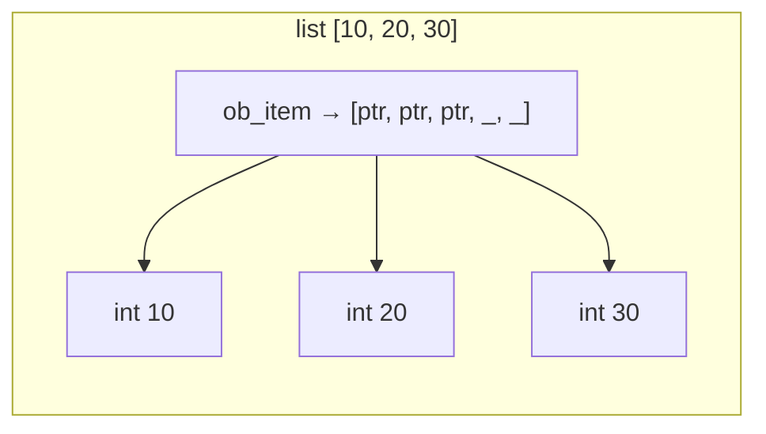
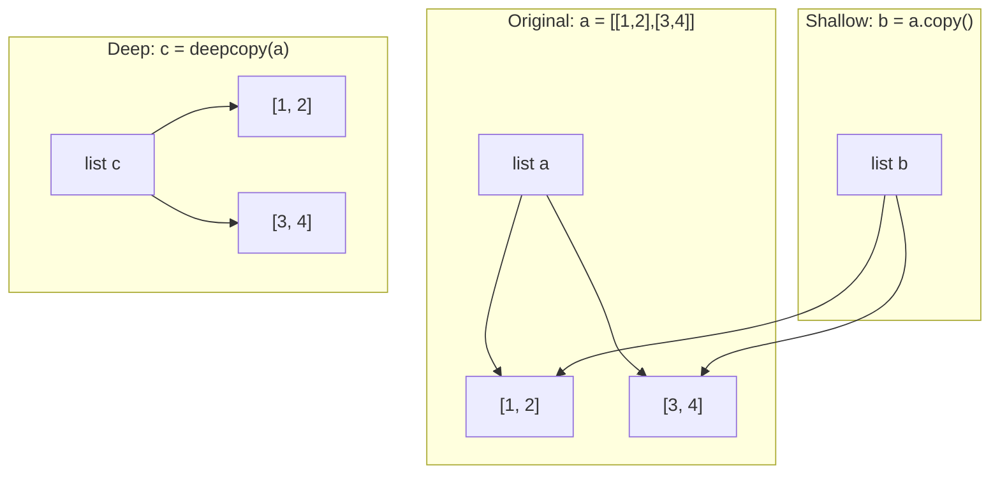
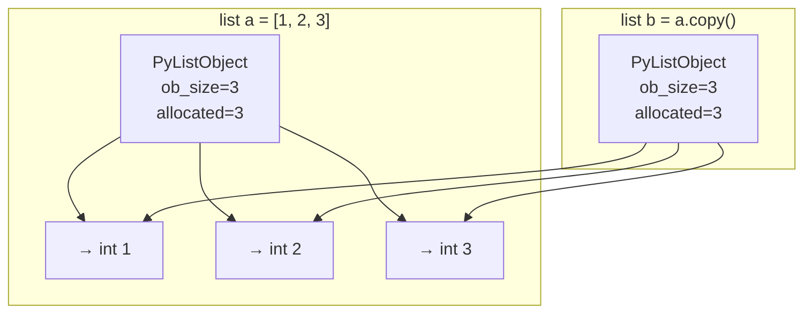

# Lists — Detailed Notes

---

## 1. What Is It? (Concept & Under the Hood)

A **`list`** is a **mutable, ordered, heterogeneous sequence** of Python objects. It's the workhorse data structure of the language — a resizable array of *pointers* to objects, not the objects themselves.

Key properties:
- **Mutable** — elements can be added, removed, or replaced in place.
- **Ordered** — insertion order is preserved.
- **Heterogeneous** — can mix types: `[1, "two", 3.0, None]`.
- **Indexable and sliceable** — O(1) random access.
- **Not hashable** — cannot be a dict key or set member.
- **Iterable** — supports `for`, comprehensions, unpacking.

### Under the Hood — CPython's `PyListObject`

A list is a **dynamic array** of `PyObject*` pointers:

```c
typedef struct {
    PyObject_VAR_HEAD
    PyObject **ob_item;   // pointer to array of PyObject*
    Py_ssize_t allocated; // capacity (>= ob_size)
} PyListObject;
```

- `ob_size` — current number of elements (`len()`).
- `allocated` — capacity of the underlying array.
- When the array fills, CPython **over-allocates** by ~12.5% to make `append` amortized O(1).



The list itself only stores *references*. Mutating a list never mutates the objects it points to (unless you mutate them explicitly).

### Over-Allocation Growth Pattern

```python
import sys

lst = []
sizes = []
for i in range(10):
    lst.append(i)
    sizes.append((i + 1, sys.getsizeof(lst)))

for n, size in sizes:
    print(f"len={n:2d}  bytes={size}")
```

Output (CPython 3.11):

```
len= 1  bytes=88
len= 2  bytes=88
len= 3  bytes=88
len= 4  bytes=88
len= 5  bytes=120    ← reallocated
len= 6  bytes=120
len= 7  bytes=120
len= 8  bytes=120
len= 9  bytes=184    ← reallocated
len=10  bytes=184
```

Growth factor is roughly `newsize = oldsize + oldsize // 8 + (oldsize < 9 ? 3 : 6)`.

### Characteristics

| Aspect | Value |
|---|---|
| Access by index | O(1) |
| Append / pop (end) | Amortized O(1) |
| Insert / pop (middle) | O(n) |
| Remove by value | O(n) |
| Membership (`in`) | O(n) |
| Slice | O(k) |
| Concatenation `+` | O(n + m) |
| Sort | O(n log n) |
| Iteration | O(n) |

---

## 2. Creating Lists

### Literals and Constructors

```python
empty = []
nums = [1, 2, 3]
mixed = [1, "two", 3.0, None, [4, 5]]
nested = [[1, 2], [3, 4], [5, 6]]

list()                 # []
list("abc")            # ['a', 'b', 'c']
list((1, 2, 3))        # [1, 2, 3]
list(range(5))         # [0, 1, 2, 3, 4]
list({"a": 1, "b": 2}) # ['a', 'b'] — keys only
list({1, 2, 3})        # [1, 2, 3] — arbitrary order

[x * 2 for x in range(5)]     # [0, 2, 4, 6, 8]
[0] * 5                        # [0, 0, 0, 0, 0]
```

### Repetition Trap — Same Object!

```python
row = [0] * 3              # [0, 0, 0] — fine, ints are immutable
grid = [[0] * 3] * 3       # ❌ three references to the SAME inner list

grid[0][0] = 1
print(grid)
# [[1, 0, 0], [1, 0, 0], [1, 0, 0]] — surprise!

# ✅ Use a comprehension
grid = [[0] * 3 for _ in range(3)]
grid[0][0] = 1
# [[1, 0, 0], [0, 0, 0], [0, 0, 0]]
```

### `list()` vs `[]`

```python
[]          # faster (LOAD_CONST)
list()      # slower (function call)
```

Prefer `[]` for empty lists.

### Unpacking

```python
a, b, c = [1, 2, 3]
first, *rest = [1, 2, 3, 4]    # first=1, rest=[2,3,4]
*init, last = [1, 2, 3, 4]     # init=[1,2,3], last=4
a, *mid, z = [1, 2, 3, 4, 5]   # a=1, mid=[2,3,4], z=5
```

---

## 3. Indexing, Slicing, Iteration

### Indexing (O(1))

```python
lst = [10, 20, 30, 40, 50]
#       0   1   2   3   4
#      -5  -4  -3  -2  -1

lst[0]     # 10
lst[-1]    # 50
lst[100]   # IndexError: list index out of range
```

### Slicing (O(k))

`lst[start:stop:step]` — always returns a **new list**.

```python
lst = [10, 20, 30, 40, 50]

lst[1:4]     # [20, 30, 40]
lst[:3]      # [10, 20, 30]
lst[2:]      # [30, 40, 50]
lst[:]       # [10, 20, 30, 40, 50] — shallow copy
lst[::2]     # [10, 30, 50]
lst[::-1]    # [50, 40, 30, 20, 10] — reversed
lst[-2:]     # [40, 50]
lst[100:200] # []  — clamped, no error
```

### Slice Assignment — In-Place Mutation

Unlike string slices, **list slice assignment mutates in place**:

```python
lst = [1, 2, 3, 4, 5]

lst[1:3] = [20, 30, 40]     # replace 2 elements with 3
# [1, 20, 30, 40, 4, 5]

lst[1:3] = []                # delete elements
# [1, 40, 4, 5]

lst[1:1] = [99]              # insert without removing
# [1, 99, 40, 4, 5]
```

This is a powerful and idiomatic operation — `del lst[i:j]` and `lst[i:j] = [...]` are equivalent to in-place splicing.

### Iteration

```python
for item in [1, 2, 3]:
    print(item)

for i, item in enumerate([1, 2, 3]):
    print(i, item)

for a, b in zip([1, 2], [3, 4]):
    print(a, b)

for i in range(len(lst)):
    print(lst[i])       # often an anti-pattern — use enumerate
```

### Reversing

```python
lst[::-1]                # new reversed list
list(reversed(lst))      # new reversed list
lst.reverse()            # in-place, returns None
```

---

## 4. Mutability — What It Really Means

```python
lst = [1, 2, 3]

lst[0] = 100             # mutate in place
lst.append(4)
lst.extend([5, 6])
lst.remove(2)
lst.pop()
lst.sort()
```

### Lists Are References

```python
a = [1, 2, 3]
b = a               # b refers to the SAME list

b.append(4)
print(a)            # [1, 2, 3, 4] — a changed too!
print(a is b)       # True
```

### Equality vs Identity

```python
a = [1, 2, 3]
b = [1, 2, 3]
c = a

a == b     # True — same contents
a is b     # False — different objects
a is c     # True — same object
```

### Hashability

```python
d = {}
d[[1, 2]] = "no"     # ❌ TypeError: unhashable type: 'list'
d[(1, 2)] = "yes"    # ✅ tuples are hashable
d[frozenset({1, 2})] = "yes"  # ✅ frozensets are hashable
```

Lists are unhashable because they can change — a dict key that mutates would break lookups.

---

## 5. Common Methods — The Complete Toolkit

### Adding Elements

```python
lst = [1, 2, 3]

lst.append(4)              # [1, 2, 3, 4]      — O(1) amortized
lst.extend([5, 6])         # [1, 2, 3, 4, 5, 6] — O(k)
lst.insert(0, 0)           # [0, 1, 2, 3, 4, 5, 6] — O(n)
lst += [7, 8]              # like extend
```

- `append(x)` — add **one item** (even if it's a list).
- `extend(iterable)` — add **each item** from iterable.
- `insert(i, x)` — insert at index `i` (O(n) due to shifting).

```python
lst = [1, 2, 3]
lst.append([4, 5])   # [1, 2, 3, [4, 5]] — nested!
lst.extend([4, 5])   # [1, 2, 3, 4, 5]   — flattened
```

### Removing Elements

```python
lst = [1, 2, 3, 2, 4]

lst.remove(2)          # [1, 3, 2, 4] — first occurrence, O(n)
lst.pop()              # returns last element, O(1)
lst.pop(0)             # returns first element, O(n)
lst.clear()            # [] — empties in place
del lst[0]             # delete by index
del lst[1:3]           # delete slice
```

- `remove(x)` — removes **first occurrence** of value; raises `ValueError` if absent.
- `pop([i])` — removes and returns item at index (default: last).
- `clear()` — empties the list in place.

### Searching & Counting

```python
lst = [1, 2, 3, 2, 4]

lst.index(2)             # 1 — first index, ValueError if absent
lst.index(2, 2)          # 3 — start search from index 2
lst.index(2, 0, 3)       # 1 — within [0, 3)
lst.count(2)             # 2

2 in lst                 # True — O(n)
```

### Sorting

```python
lst = [3, 1, 4, 1, 5, 9, 2]

lst.sort()                     # in place, returns None
lst.sort(reverse=True)         # descending
lst.sort(key=abs)              # by absolute value
lst.sort(key=lambda x: -x)     # descending via key

sorted(lst)                    # returns NEW sorted list
sorted(lst, reverse=True)
sorted(lst, key=str.lower)
```

**Never** do `lst = lst.sort()` — it sets `lst` to `None`!

### Reversing

```python
lst.reverse()               # in place, returns None
list(reversed(lst))         # returns iterator's values
lst[::-1]                   # returns new list
```

### Copying

```python
lst.copy()                  # shallow copy
lst[:]                      # shallow copy
list(lst)                   # shallow copy
```

All three are **shallow** — see §6.

### `+` vs `extend` vs `+=`

```python
a = [1, 2]
b = [3, 4]

c = a + b          # NEW list — a unchanged
a.extend(b)        # a mutated in place
a += b             # same as extend (mutates a in place)
```

Important gotcha:

```python
a = [1, 2]
b = a
a = a + [3]       # rebinds a to a NEW list; b unchanged
# a = [1, 2, 3], b = [1, 2]

a = [1, 2]
b = a
a += [3]          # mutates in place; b also changes
# a = [1, 2, 3], b = [1, 2, 3]
```

### Method Summary Table

| Method | Effect | Complexity |
|---|---|---|
| `append(x)` | Add x at end | O(1)* |
| `extend(it)` | Add items from iterable | O(k) |
| `insert(i, x)` | Insert x at index i | O(n) |
| `remove(x)` | Remove first x | O(n) |
| `pop([i])` | Remove & return item | O(1) end, O(n) middle |
| `clear()` | Remove all | O(n) |
| `index(x)` | First index of x | O(n) |
| `count(x)` | Count occurrences | O(n) |
| `sort(key=, reverse=)` | Sort in place | O(n log n) |
| `reverse()` | Reverse in place | O(n) |
| `copy()` | Shallow copy | O(n) |

\*Amortized.

---

## 6. Copying — Shallow vs Deep

### Reference Copy (Alias)

```python
a = [1, 2, 3]
b = a              # same object
b.append(4)
print(a)           # [1, 2, 3, 4]
```

### Shallow Copy

Copies the outer list, but inner objects are still shared:

```python
import copy

a = [[1, 2], [3, 4]]
b = a.copy()               # shallow
b[0].append(99)
print(a)                   # [[1, 2, 99], [3, 4]] — inner list shared!

b[1] = [100, 200]          # rebinding b[1] doesn't affect a[1]
print(a)                   # [[1, 2, 99], [3, 4]]
print(b)                   # [[1, 2, 99], [100, 200]]
```

Shallow copy methods:
- `a.copy()`
- `a[:]`
- `list(a)`
- `copy.copy(a)`

### Deep Copy

Recursively copies everything:

```python
import copy

a = [[1, 2], [3, 4]]
b = copy.deepcopy(a)
b[0].append(99)

print(a)   # [[1, 2], [3, 4]] — untouched
print(b)   # [[1, 2, 99], [3, 4]]
```

`deepcopy` handles cycles, shared references, and custom objects (via `__deepcopy__`).

### Comparison Diagram



### When to Use Which

| Scenario | Choice |
|---|---|
| Flat list of immutable items (ints, strs) | `a.copy()` |
| Nested lists, must isolate fully | `copy.deepcopy(a)` |
| Just need a slice view | `a[i:j]` |
| Passing to a function that shouldn't mutate | `a.copy()` |

---

## 7. Nested Lists (Matrices, Tables)

```python
matrix = [
    [1, 2, 3],
    [4, 5, 6],
    [7, 8, 9],
]

matrix[0]        # [1, 2, 3] — first row
matrix[1][2]     # 6 — row 1, column 2
```

### Building a Matrix Correctly

```python
# ❌ WRONG — all rows are the same object
grid = [[0] * 3] * 3

# ✅ comprehension creates distinct rows
grid = [[0] * 3 for _ in range(3)]

# ✅ or explicit
grid = []
for _ in range(3):
    grid.append([0] * 3)
```

### Transpose

```python
matrix = [[1, 2, 3], [4, 5, 6]]

# Comprehension approach
transposed = [[row[i] for row in matrix] for i in range(len(matrix[0]))]
# [[1, 4], [2, 5], [3, 6]]

# zip approach — idiomatic and fast
transposed = [list(col) for col in zip(*matrix)]
# [[1, 4], [2, 5], [3, 6]]
```

### Iterating a Matrix

```python
for row in matrix:
    for value in row:
        print(value)

for i, row in enumerate(matrix):
    for j, value in enumerate(row):
        print(f"[{i}][{j}] = {value}")
```

### Flattening

```python
nested = [[1, 2], [3, 4], [5, 6]]

# One level
flat = [x for row in nested for x in row]     # [1, 2, 3, 4, 5, 6]

# Any depth
def flatten(seq):
    for item in seq:
        if isinstance(item, list):
            yield from flatten(item)
        else:
            yield item

list(flatten([1, [2, [3, [4]]]]))     # [1, 2, 3, 4]
```

---

## 8. Sorting with `key` and `reverse`

### Basics

```python
nums = [3, 1, 4, 1, 5]
nums.sort()                    # [1, 1, 3, 4, 5]
nums.sort(reverse=True)        # [5, 4, 3, 1, 1]
```

### `key` — Custom Sort Criteria

`key` is a function applied to each element; the result is what's compared.

```python
words = ["banana", "Apple", "cherry"]

words.sort()                          # uppercase-first ASCII order
# ['Apple', 'banana', 'cherry']

words.sort(key=str.lower)             # case-insensitive
# ['Apple', 'banana', 'cherry']

words.sort(key=len)                   # by length
# ['Apple', 'banana', 'cherry']

words.sort(key=len, reverse=True)     # longest first
# ['banana', 'cherry', 'Apple']
```

### Sorting Tuples & Records

```python
people = [
    ("Ada", 36),
    ("Alan", 41),
    ("Grace", 45),
    ("Barbara", 36),
]

people.sort()                          # by name first, then age
people.sort(key=lambda p: p[1])        # by age
people.sort(key=lambda p: (p[1], p[0]))  # by age then name

# Better — operator.itemgetter
from operator import itemgetter
people.sort(key=itemgetter(1, 0))
```

### Sorting Objects

```python
from dataclasses import dataclass

@dataclass
class User:
    name: str
    age: int

users = [User("Ada", 36), User("Alan", 41), User("Grace", 45)]

users.sort(key=lambda u: u.age)
users.sort(key=lambda u: u.name)
```

### Multi-Key with Mixed Direction

Sort ascending by one field and descending by another:

```python
# Ascending by name, descending by age
people.sort(key=lambda p: (p[0], -p[1]))
```

For non-numeric fields, use `functools.cmp_to_key`:

```python
from functools import cmp_to_key

def compare(a, b):
    if a[0] != b[0]:
        return -1 if a[0] < b[0] else 1
    return 1 if a[1] < b[1] else -1   # descending age

people.sort(key=cmp_to_key(compare))
```

### Stability

Python's sort is **stable** (Timsort): equal elements retain their original relative order. Exploit this with multiple passes:

```python
# Sort by age first, then re-sort by name — stability preserves age order for ties
people.sort(key=lambda p: p[1])
people.sort(key=lambda p: p[0])
```

### `sorted()` vs `.sort()`

| `list.sort()` | `sorted(iterable)` |
|---|---|
| In place, returns `None` | Returns new list |
| Only for lists | Works on any iterable |
| Slightly faster | Slightly slower |

```python
result = sorted([3, 1, 2])          # returns [1, 2, 3]
nums = [3, 1, 2]
nums.sort()                          # mutates nums
result = nums.sort()                 # ❌ result is None
```

### Sorting with `reverse=True` and Custom Ties

```python
data = [("b", 2), ("a", 3), ("c", 1)]

sorted(data, key=lambda x: x[1])                 # [('c',1),('b',2),('a',3)]
sorted(data, key=lambda x: x[1], reverse=True)   # [('a',3),('b',2),('c',1)]
```

### Timsort Complexity

- **Best case** (already sorted): O(n).
- **Average / worst**: O(n log n).
- **Space**: O(n) auxiliary.

---

## 9. Real-World Use Cases

### Use Case 1 — Stack (LIFO)

```python
stack = []
stack.append(1)
stack.append(2)
top = stack.pop()      # 2
```

### Use Case 2 — Queue (FIFO) — but Use `deque`

```python
# ❌ O(n) per pop(0)
queue = [1, 2, 3]
queue.pop(0)

# ✅ O(1) with collections.deque
from collections import deque
queue = deque([1, 2, 3])
queue.popleft()
```

### Use Case 3 — Leaderboard

```python
scores = [("Ada", 99), ("Alan", 87), ("Grace", 95)]

leaderboard = sorted(scores, key=lambda s: s[1], reverse=True)
for rank, (name, score) in enumerate(leaderboard, start=1):
    print(f"{rank}. {name}: {score}")
```

### Use Case 4 — Batch Processing

```python
def chunked(seq, size):
    return [seq[i:i + size] for i in range(0, len(seq), size)]

chunked(list(range(10)), 3)
# [[0, 1, 2], [3, 4, 5], [6, 7, 8], [9]]
```

### Use Case 5 — Merge Sorted Lists

```python
import heapq
a = [1, 3, 5]
b = [2, 4, 6]
merged = list(heapq.merge(a, b))    # [1, 2, 3, 4, 5, 6]
```

### Use Case 6 — Deduplication (Order-Preserving)

```python
def dedupe(seq):
    seen = set()
    out = []
    for item in seq:
        if item not in seen:
            seen.add(item)
            out.append(item)
    return out

dedupe([1, 2, 1, 3, 2, 4])     # [1, 2, 3, 4]
```

Python 3.7+ preserves dict order — the one-liner:

```python
list(dict.fromkeys([1, 2, 1, 3, 2, 4]))    # [1, 2, 3, 4]
```

### Use Case 7 — Matrix Multiplication (no numpy)

```python
def matmul(A, B):
    n, m, p = len(A), len(B), len(B[0])
    return [
        [sum(A[i][k] * B[k][j] for k in range(m)) for j in range(p)]
        for i in range(n)
    ]
```

### Use Case 8 — Sliding Window Maximum

```python
from collections import deque

def max_sliding_window(nums, k):
    dq, out = deque(), []
    for i, n in enumerate(nums):
        while dq and dq[0] <= i - k:
            dq.popleft()
        while dq and nums[dq[-1]] < n:
            dq.pop()
        dq.append(i)
        if i >= k - 1:
            out.append(nums[dq[0]])
    return out
```

---

## 10. Common Pitfalls

### Pitfall 1 — Nested List Multiplication

```python
grid = [[0] * 3] * 3      # ❌ shared rows
grid = [[0] * 3 for _ in range(3)]  # ✅
```

### Pitfall 2 — `sort()` Returns `None`

```python
nums = [3, 1, 2]
nums = nums.sort()        # ❌ nums is None now
nums = sorted(nums)       # ✅
```

### Pitfall 3 — Mutating While Iterating

```python
nums = [1, 2, 3, 4]
for n in nums:
    if n % 2 == 0:
        nums.remove(n)    # ❌ skips 4

# ✅ iterate over copy
for n in nums[:]:
    if n % 2 == 0:
        nums.remove(n)

# ✅ or build a new list
nums = [n for n in nums if n % 2]
```

### Pitfall 4 — `append` vs `extend`

```python
lst = [1, 2]
lst.append([3, 4])    # [1, 2, [3, 4]]
lst.extend([3, 4])    # [1, 2, 3, 4]
```

### Pitfall 5 — Aliasing

```python
a = [1, 2, 3]
b = a                 # alias
b.append(4)           # a is now [1, 2, 3, 4]

b = a.copy()          # proper copy
b.append(5)           # a unchanged
```

### Pitfall 6 — Shallow Copy Trap

```python
a = [[1, 2], [3, 4]]
b = a.copy()          # shallow
b[0].append(99)       # mutates the inner list — a[0] also changed
```

### Pitfall 7 — `+=` vs `+` for Aliases

```python
a = [1, 2]
b = a
a = a + [3]           # rebinds a; b unchanged
a += [3]              # in-place; b changes too
```

### Pitfall 8 — O(n²) `pop(0)` / `insert(0, x)`

```python
# ❌ O(n²) for large n
queue = []
for x in data:
    queue.insert(0, x)         # shifting
    queue.pop(0)               # shifting

# ✅ deque
from collections import deque
q = deque()
q.appendleft(x)
q.popleft()
```

### Pitfall 9 — Sorting Mixed Types

```python
[1, "a", 2].sort()      # TypeError: '<' not supported between int and str
[1, 2.0, 3].sort()      # ✅ — numeric coercion works
[True, False].sort()    # ✅ — bools are ints
```

### Pitfall 10 — `index()` vs `in`

```python
lst = [1, 2, 3]
if 4 in lst:            # ✅ cheap check
    i = lst.index(4)    # unnecessary work

# If you need both:
try:
    i = lst.index(4)
except ValueError:
    i = -1
```

### Pitfall 11 — List Comprehensions with Side Effects

```python
# ❌ comprehension for side effects — anti-pattern
[print(x) for x in range(5)]

# ✅ use a loop
for x in range(5):
    print(x)
```

### Pitfall 12 — Deep List Comparison with `is`

```python
a = [1, 2, 3]
b = [1, 2, 3]
a == b     # True
a is b     # False — never use `is` for content comparison
```

### Pitfall 13 — Slice Assignment Type Mismatch

```python
lst = [1, 2, 3]
lst[0:1] = 5        # ❌ TypeError: can only assign iterable
lst[0:1] = [5]      # ✅
```

### Pitfall Summary Table

| Pitfall | Symptom | Fix |
|---|---|---|
| `[[0]*3]*3` | Shared rows | Comprehension |
| `x = x.sort()` | `x` is `None` | Use `sorted()` |
| Mutate while iterating | Skips items | `lst[:]` or new list |
| `append([...])` | Nested list | `extend()` |
| Aliasing | Unexpected mutations | `.copy()` |
| Shallow copy | Inner mutations leak | `deepcopy` |
| `pop(0)` in loop | Quadratic | `deque` |
| `is` for equality | Wrong results | `==` |

---

## 11. Comparison Tables

### List vs Tuple vs Set vs Dict

| | list | tuple | set | dict |
|---|---|---|---|---|
| Ordered | ✅ | ✅ | ❌ | ✅ (3.7+) |
| Mutable | ✅ | ❌ | ✅ | ✅ |
| Hashable | ❌ | ✅ | ❌ (frozen: ✅) | ❌ |
| Indexable | ✅ | ✅ | ❌ | keys only |
| Duplicates | ✅ | ✅ | ❌ | keys unique |
| Lookup | O(n) | O(n) | O(1)* | O(1)* |
| Best for | Sequences | Fixed records | Membership | Key→value |

\*Average.

### Copy Semantics Quick Table

| Operation | Copies outer | Copies inner | Preserves identity |
|---|---|---|---|
| `b = a` | No | No | Same object |
| `b = a[:]` | Yes | No | New outer, shared inner |
| `b = a.copy()` | Yes | No | Same |
| `b = list(a)` | Yes | No | Same |
| `b = copy.copy(a)` | Yes | No | Same |
| `b = copy.deepcopy(a)` | Yes | Yes | Fully new |

### `append` vs `extend` vs `+` vs `+=`

| Operation | Effect | Returns | Mutates |
|---|---|---|---|
| `a.append(x)` | Add x as single item | None | a |
| `a.extend(it)` | Add each item | None | a |
| `a + b` | New list | new list | neither |
| `a += b` | Extend in place | a | a |

### Sort vs Sorted

| | `list.sort()` | `sorted(...)` |
|---|---|---|
| In-place | ✅ | ❌ |
| Returns | None | new list |
| Works on | lists only | any iterable |
| Speed | Slightly faster | Slightly slower |

---

## 12. Mermaid — List Memory Model



Both lists point to the **same** int objects (ints are immutable, safe to share). For mutable items, shallow copy shares them; deep copy does not.

---

## 13. Performance Notes

### When `append` Reallocates

```python
import sys
lst = []
prev = sys.getsizeof(lst)
for i in range(20):
    lst.append(i)
    cur = sys.getsizeof(lst)
    if cur != prev:
        print(f"len={len(lst)}: {prev} → {cur} bytes")
        prev = cur
```

### Growth Is Amortized O(1)

Each `append` is O(1) *on average*. Individual reallocations cost O(n), but they occur rarely enough that the amortized cost stays constant.

### Preallocating with `[None] * n`

For fixed-size work:

```python
# ✅ preallocate when size known
result = [None] * n
for i in range(n):
    result[i] = compute(i)

# ❌ appending grows repeatedly
result = []
for i in range(n):
    result.append(compute(i))
```

The difference is significant in tight loops. CPython 3.11+ narrows it, but preallocation is still faster.

### Membership Is O(n)

```python
# ❌ O(n) per check inside a loop → O(n²)
for x in big_list:
    if x in another_big_list:
        ...

# ✅ O(n) total with sets
another = set(another_big_list)
for x in big_list:
    if x in another:
        ...
```

### `+` vs `extend`

```python
# Slightly slower — allocates a new list
a = a + b

# Faster — mutates in place
a.extend(b)
```

### Fast Membership — Sort or Set

| Operation | list | set | dict |
|---|---|---|---|
| Membership | O(n) | O(1) | O(1) |
| Iteration | O(n) | O(n) | O(n) |
| Add | O(1)* | O(1)* | O(1)* |
| Remove | O(n) | O(1)* | O(1)* |

Use `set` when you only need membership; `list` when order matters.

### Comprehension vs `map`/`filter`

```python
# Comprehension is usually fastest and clearest
[x * 2 for x in nums if x > 0]

# map+filter — slightly slower, less Pythonic
list(map(lambda x: x * 2, filter(lambda x: x > 0, nums)))
```

### Time Complexity Cheat Sheet

| Operation | list | deque | set | dict |
|---|---|---|---|---|
| `x[i]` | O(1) | O(n) | — | — |
| `x[i:j]` | O(k) | — | — | — |
| `x.append(v)` | O(1)* | O(1) | — | — |
| `x.pop()` | O(1) | O(1) | — | — |
| `x.pop(0)` | O(n) | O(1) | — | — |
| `v in x` | O(n) | O(n) | O(1)* | O(1)* |
| `x.sort()` | O(n log n) | — | — | — |
| `len(x)` | O(1) | O(1) | O(1) | O(1) |

\*Amortized / average.

---

## 14. Quick Reference Card

```python
# Creation
[]
[1, 2, 3]
list(iterable)
[x * 2 for x in range(5)]
[[0] * 3 for _ in range(3)]     # distinct rows

# Access
lst[i]
lst[-1]
lst[a:b]
lst[::2]
lst[::-1]

# Add
lst.append(x)
lst.extend(it)
lst.insert(i, x)
lst += [1, 2]

# Remove
lst.remove(x)           # first occurrence
lst.pop()               # last item
lst.pop(0)              # first item — O(n)
del lst[i]
lst.clear()

# Search
x in lst
lst.index(x)
lst.count(x)

# Reorder
lst.sort()
lst.sort(key=..., reverse=True)
lst.reverse()
sorted(lst)

# Copy
lst[:]                  # shallow
lst.copy()              # shallow
copy.deepcopy(lst)      # deep

# Iterate
for x in lst: ...
for i, x in enumerate(lst): ...
for a, b in zip(lst1, lst2): ...

# Idioms
[expr for x in lst if cond]              # comprehension
any(x > 0 for x in lst)                  # exists
all(x > 0 for x in lst)                  # forall
sum(lst)
min(lst), max(lst)
list(dict.fromkeys(lst))                 # dedupe, ordered
```

---

## Summary

- A `list` is a **dynamic array of pointers** with **amortized O(1) append** and **O(1) index access**.
- **Mutable, ordered, heterogeneous, not hashable**.
- **Slicing returns a new list**; **slice assignment mutates in place** — powerful and idiomatic.
- **`append` adds one item**, **`extend` adds many**; `+=` mutates in place like `extend`; `+` creates a new list.
- **`sort()` is in place and returns `None`**; `sorted()` returns a new list and works on any iterable.
- **`key=` transforms items before comparison**; sorts are **stable**, enabling multi-key ordering via multiple passes.
- **Shallow copy shares inner objects**; `copy.deepcopy` isolates completely.
- **Never multiply nested lists** — `[[0]*3]*3` aliases rows; use a comprehension.
- **Never mutate while iterating** — iterate over a copy or build a new list.
- **Use `deque` for queues** — `list.pop(0)` is O(n).
- **Use `set`/`dict` for membership** — `x in list` is O(n).
- **Pitfalls cluster around aliasing, shallow copy, `append` vs `extend`, `sort()` returning `None`, and mutating during iteration.**