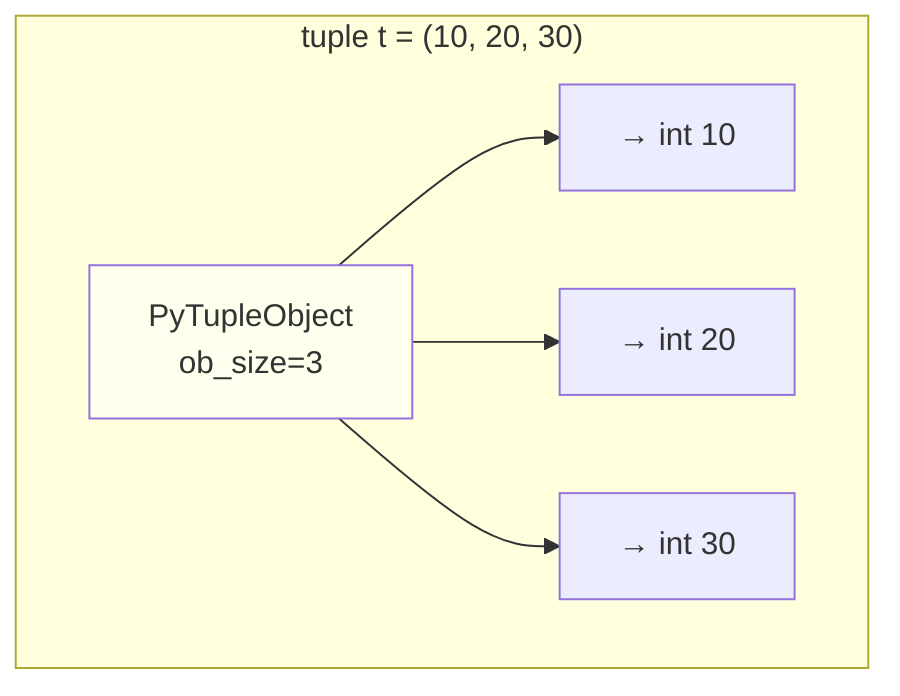
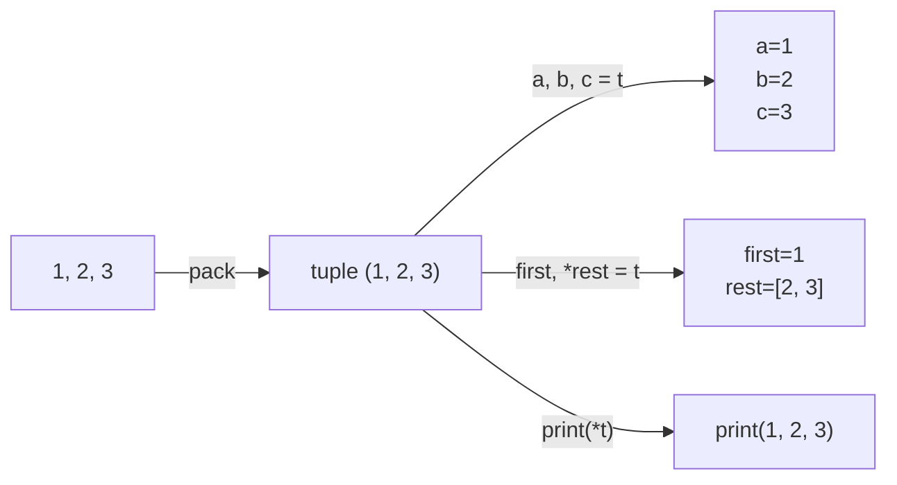
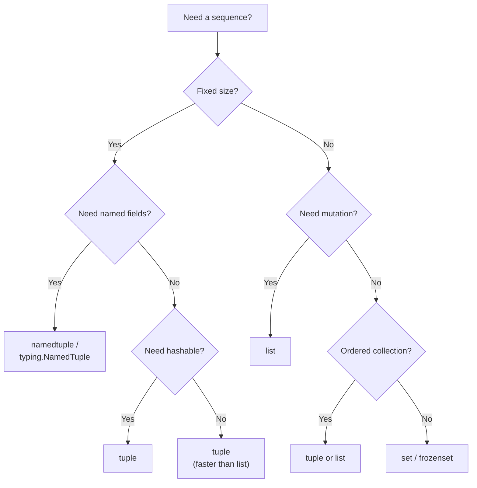

# Tuples — Detailed Notes

---

## 1. What Is It? (Concept & Under the Hood)

A **`tuple`** is an **immutable, ordered, heterogeneous sequence** of Python objects. If a list is a resizable array, a tuple is a **fixed-size array** — once created, its length and element references cannot change.

Key properties:
- **Immutable** — cannot add, remove, or replace elements after creation.
- **Ordered** — insertion order is preserved.
- **Heterogeneous** — can mix types: `(1, "two", 3.0, None)`.
- **Hashable** — if all its elements are hashable (usable as dict keys, set members).
- **Indexable and sliceable** — O(1) random access.
- **Iterable** — supports `for`, comprehensions, unpacking.
- **Comparable** — lexicographic comparison out of the box.

### Under the Hood — CPython's `PyTupleObject`

A tuple is a **fixed-size array of `PyObject*` pointers**:

```c
typedef struct {
    PyObject_VAR_HEAD
    PyObject *ob_item[1];   // flexible array — allocated inline
} PyTupleObject;
```

- **No `allocated` field** — no over-allocation, no dynamic resizing.
- **The array is inline** in the object — one allocation, not two.
- **Immutable after `__new__`** — no `__setitem__`, no `append`, no `pop`.
- **`ob_size` fixed at creation** — `len(t)` is O(1) but the length can never change.



Because the tuple is one allocation, it's **faster to create and cheaper in memory** than a list of the same length.

### Memory Comparison — Tuple vs List

```python
import sys

t = (1, 2, 3, 4, 5)
l = [1, 2, 3, 4, 5]

sys.getsizeof(t)   # 80 bytes
sys.getsizeof(l)   # 104 bytes (list header + separate array)
```

Empty containers:

```python
sys.getsizeof(())   # 40 bytes
sys.getsizeof([])   # 56 bytes
```

CPython caches the empty tuple as a **singleton** — `() is ()` is `True` for the same object.

### Tuple Interning (Constant Folding)

Tuples of literals that appear in source may be **interned** at compile time:

```python
a = (1, 2, 3)
b = (1, 2, 3)
a is b        # True in CPython (constant folding)
```

Tuples built at runtime are not interned:

```python
a = tuple([1, 2, 3])
b = tuple([1, 2, 3])
a is b        # False
```

Never rely on this — use `==`.

### Characteristics

| Aspect | Value |
|---|---|
| Access by index | O(1) |
| Slice | O(k) |
| Membership (`in`) | O(n) |
| Concatenation `+` | O(n + m) |
| Iteration | O(n) |
| Creation | O(n) |
| Hash | O(n) — computed once and cached |
| Comparison | O(n) worst case |

---

## 2. Creating Tuples

### Literals

```python
empty = ()
single = (42,)          # ← trailing comma REQUIRED for 1-tuple
not_a_tuple = (42)      # ← this is just int 42!
pair = (1, 2)
triple = 1, 2, 3        # parentheses optional
nested = (1, (2, 3), (4, (5, 6)))
mixed = (1, "two", 3.0, None, [4, 5])
```

### The Singleton Trap

```python
type((42))      # <class 'int'>  — NOT a tuple
type((42,))     # <class 'tuple'>
len((42))       # TypeError: object of type 'int' has no len()
len((42,))      # 1
```

The comma — not the parentheses — makes a tuple.

### From Other Iterables

```python
tuple()                 # ()
tuple("abc")            # ('a', 'b', 'c')
tuple([1, 2, 3])        # (1, 2, 3)
tuple(range(5))         # (0, 1, 2, 3, 4)
tuple({"a": 1, "b": 2}) # ('a', 'b') — keys only
tuple({1, 2, 3})        # (1, 2, 3) — arbitrary set order

tuple(x * 2 for x in range(5))   # (0, 2, 4, 6, 8) — from generator
```

### Repetition

```python
(0,) * 5            # (0, 0, 0, 0, 0)
(1, 2) * 3          # (1, 2, 1, 2, 1, 2)
```

Unlike lists, tuples of immutable items are safe to repeat because you can't mutate them.

```python
# Safe — tuple contains only immutables
grid = ((0, 0, 0),) * 3      # OK if you never need to modify

# But nested mutable objects still alias!
t = ([], []) * 2             # ([], [], [], []) — same inner lists
t[0].append(1)
# ([1], [], [1], []) — the outer two share the same inner list
```

### `tuple()` vs `()`

```python
()          # faster (LOAD_CONST)
tuple()     # slower (function call)
```

Prefer `()`.

### Hashability — What Can Be a Dict Key?

```python
d = {}
d[(1, 2)] = "yes"                   # ✅ all ints
d[(1, "a", 3.0)] = "yes"            # ✅ mixed immutable
d[(1, [2, 3])] = "no"               # ❌ TypeError — list inside
d[(1, (2, [3]))] = "no"             # ❌ nested list inside
d[(1, (2, 3))] = "yes"              # ✅ nested tuple of tuples
```

Rule: a tuple is hashable **iff every element is hashable**, recursively.

---

## 3. Indexing, Slicing, Iteration

### Indexing (O(1))

```python
t = (10, 20, 30, 40, 50)
#     0   1   2   3   4
#    -5  -4  -3  -2  -1

t[0]     # 10
t[-1]    # 50
t[100]   # IndexError: tuple index out of range
```

### Slicing (O(k))

Slices of a tuple return a **new tuple** (not a list):

```python
t = (10, 20, 30, 40, 50)

t[1:4]     # (20, 30, 40)
t[:3]      # (10, 20, 30)
t[2:]      # (30, 40, 50)
t[:]       # (10, 20, 30, 40, 50) — same object returned in CPython!
t[::2]     # (10, 30, 50)
t[::-1]    # (50, 40, 30, 20, 10)
t[100:200] # () — clamped, no error
```

Interesting: `t[:]` on a tuple returns **the same object** (no copy) because immutability makes it safe.

```python
t = (1, 2, 3)
t[:] is t    # True in CPython
```

### No Slice Assignment

```python
t = (1, 2, 3, 4)
t[1:3] = (20, 30)    # ❌ TypeError: 'tuple' object does not support item assignment
```

### Iteration

```python
for x in (1, 2, 3):
    print(x)

for i, x in enumerate((1, 2, 3)):
    print(i, x)

for a, b in zip((1, 2), (3, 4)):
    print(a, b)
```

### Reversing

```python
t = (1, 2, 3)
t[::-1]                # (3, 2, 1) — new tuple
tuple(reversed(t))     # (3, 2, 1) — new tuple
# No in-place reverse — tuples are immutable
```

### Membership

```python
3 in (1, 2, 3)         # True — O(n)
"x" in (1, 2, 3)       # False
```

---

## 4. Immutability — What It Really Means

```python
t = (1, 2, 3)

t[0] = 100       # ❌ TypeError
t.append(4)      # ❌ AttributeError — no append method
del t[0]         # ❌ TypeError
```

### But — "Immutable" Is About the Container

A tuple's **structure** cannot change, but the **objects it points to** can still be mutable:

```python
t = (1, [2, 3], 4)

t[1].append(99)    # ✅ works — mutating the LIST, not the tuple
print(t)           # (1, [2, 3, 99], 4)

t[1] = [2, 3]      # ❌ TypeError — cannot rebind element
```

**Rule:** tuples are *shallow-immutable*. They guarantee that *which* objects they reference never changes — but those objects can still mutate if they're mutable themselves.

### Hashability Pitfall

```python
t = (1, [2, 3])
hash(t)            # ❌ TypeError: unhashable type: 'list'
```

The moment you put a mutable object inside, the tuple becomes unhashable.

### Why Immutability Matters

- **Hashable** → usable as dict keys / set members.
- **Thread-safe** → no locking needed to read.
- **Constant-folding** → the compiler can pre-compute tuple literals.
- **Safe to share** → functions returning tuples can't be mutated by callers.
- **Memory-efficient** → no over-allocation, single object.
- **Faster to create** → one allocation, no resizing logic.

### Rebinding vs Mutating

```python
t = (1, 2, 3)
t = (1, 2, 3, 4)       # ✅ rebinding t to a NEW tuple
```

The variable `t` is just a name; the tuple object itself never changed — you just pointed `t` at a new object.

---

## 5. Packing and Unpacking

### Packing — Build a Tuple Implicitly

```python
t = 1, 2, 3             # packing
t = 1, 2, 3,            # trailing comma — still a 3-tuple
point = (10, 20)
person = "Ada", 36, "London"
```

### Unpacking — Destructure into Variables

```python
x, y, z = (1, 2, 3)
name, age, city = ("Ada", 36, "London")
```

The number of targets must match the tuple length:

```python
a, b = (1, 2, 3)        # ❌ ValueError: too many values to unpack
a, b, c, d = (1, 2, 3)  # ❌ ValueError: not enough values
```

### Star Unpacking (Extended Unpacking)

```python
first, *rest = (1, 2, 3, 4)      # first=1, rest=[2, 3, 4]  ← list!
*init, last = (1, 2, 3, 4)       # init=[1, 2, 3], last=4
a, *mid, z = (1, 2, 3, 4, 5)     # a=1, mid=[2, 3, 4], z=5
a, b, *rest = (1, 2)             # a=1, b=2, rest=[]
```

Note: `*rest` always captures a **list**, even when unpacking from a tuple.

### Nested Unpacking

```python
(a, b), (c, d) = (1, 2), (3, 4)
# a=1, b=2, c=3, d=4

name, (x, y) = "P", (10, 20)
# name='P', x=10, y=20

for (key, value) in [("a", 1), ("b", 2)]:
    print(key, value)
```

### Swap Without a Temp

```python
a, b = 1, 2
a, b = b, a            # a=2, b=1 — idiomatic!

# Under the hood, this is:
# 1. Build tuple (b, a)
# 2. Unpack into (a, b)
```

### Function Return Values — Unpacked

```python
def min_max(nums):
    return min(nums), max(nums)      # returns a tuple

lo, hi = min_max([3, 1, 4, 1, 5])
# lo=1, hi=5
```

This is why "functions can only return one value" is a half-truth — they return one **object**, often a tuple.

### Ignoring Values with `_`

```python
x, _, z = (1, 2, 3)          # discard the middle
first, *_ = (1, 2, 3, 4)     # discard the rest
```

`_` is a convention, not a special name.

### Passing `*args` from a Tuple

```python
t = (1, 2, 3)
print(*t)                    # same as print(1, 2, 3)
list(range(*t))              # range(1, 2, 3) → [1]
```

### The `*` in Function Calls and Literals

```python
a = (1, 2)
b = (*a, 3, 4)               # (1, 2, 3, 4)
merged = (*a, *(5, 6))       # (1, 2, 5, 6)
```

### Mermaid — Packing / Unpacking



---

## 6. Tuple Methods (Only Two!)

Tuples have only **two** instance methods (plus the universal ones from `object`):

```python
t = (1, 2, 3, 2, 4, 2)

t.count(2)              # 3 — number of occurrences
t.index(2)              # 1 — first index
t.index(2, 2)           # 3 — start searching from index 2
t.index(2, 2, 5)        # 3 — search within [2, 5)
t.index(99)             # ValueError: tuple.index(x): x not in tuple
```

### Everything Else Comes from Sequence Protocol

```python
len(t)                  # 6
max(t)                  # 4
min(t)                  # 1
sum(t)                  # 14
sorted(t)               # [1, 2, 2, 2, 3, 4] — returns a LIST
tuple(sorted(t))        # (1, 2, 2, 2, 3, 4)
reversed(t)             # <reversed object>
any(x > 3 for x in t)   # True
all(x > 0 for x in t)   # True
```

### No `sort`, No `append`, No `reverse`

```python
t = (3, 1, 2)
t.sort()                # ❌ AttributeError
sorted(t)               # ✅ returns a new list
```

If you need to modify, convert to list, modify, then convert back:

```python
t = (3, 1, 2)
l = list(t)
l.sort()
t = tuple(l)            # (1, 2, 3)
```

---

## 7. Named Tuples

A **namedtuple** is a tuple subclass with **named fields**. It's the original "lightweight record" in Python.

### Creating a Named Tuple

```python
from collections import namedtuple

Point = namedtuple("Point", ["x", "y"])
p = Point(10, 20)

print(p)               # Point(x=10, y=20)
print(p.x, p.y)        # 10 20
print(p[0], p[1])      # 10 20 — still a tuple
print(isinstance(p, tuple))   # True
```

Or with a string of space- or comma-separated names:

```python
Point = namedtuple("Point", "x y")
Point = namedtuple("Point", "x, y")
```

### Defaults and Renames

```python
Point = namedtuple("Point", ["x", "y"], defaults=[0, 0])
Point()                # Point(x=0, y=0)
Point(5)               # Point(x=5, y=0)

# If field names clash with keywords:
P = namedtuple("P", ["class", "type"], rename=True)
# field_names become ('_0', '_1')
```

### Methods

```python
Point = namedtuple("Point", ["x", "y"])
p = Point(3, 4)

p._fields              # ('x', 'y')
p._asdict()            # {'x': 3, 'y': 4} — ordered dict
p._replace(x=10)       # Point(x=10, y=4) — new instance
Point._make([1, 2])    # Point(x=1, y=2)
```

### Typed Named Tuples (3.6+)

```python
from typing import NamedTuple

class Point(NamedTuple):
    x: int
    y: int
    label: str = "origin"

p = Point(3, 4)
p.label                # 'origin'
```

`typing.NamedTuple` gives you type hints and is the modern choice.

### Named Tuple vs Plain Tuple vs Dataclass

| Feature | tuple | namedtuple | dataclass |
|---|---|---|---|
| Immutable | ✅ | ✅ | ✅ (frozen) / ❌ |
| Named fields | ❌ | ✅ | ✅ |
| Type hints | ❌ | ✅ (typing.NamedTuple) | ✅ |
| Default values | ❌ | ✅ | ✅ |
| Methods | ❌ | Limited | ✅ |
| Memory | Smallest | Small | Larger |
| Iterable | ✅ | ✅ | ✅ |
| Dict-convertible | ❌ | ✅ `_asdict` | ✅ `asdict()` |

---

## 8. When to Use Tuples vs Lists

### Tuples When…

- **Fixed-size records** — a point, a date, a row from a DB.
- **Heterogeneous data** — `(name, age, city)` — each position means something different.
- **Immutable by design** — you want to prevent accidental modification.
- **Dict keys / set members** — you need hashability.
- **Function returns of multiple values** — `return lo, hi`.
- **Performance-critical hot loops** — tuples are faster to create and iterate.

### Lists When…

- **Homogeneous collections** — `[1, 2, 3, 4]` — all the same "kind" of thing.
- **Variable length** — you'll add/remove items.
- **Mutability required** — sort in place, append, remove.
- **Queues, stacks, buffers**.

### Quick Heuristics

| Question | Tuple | List |
|---|---|---|
| Will size change? | No → tuple | Yes → list |
| Are all items the same type? | No → tuple | Yes → list |
| Need to hash it? | Yes → tuple | No → list |
| Need to sort/mutate? | No → tuple | Yes → list |
| Iterating in a hot loop? | Tuple (faster) | List |

### The Classic Example

```python
# A "row" — fixed schema, each field means something different
row = ("Ada", 36, "London")

# A collection of scores — homogeneous
scores = [99, 87, 95, 72]
```

### Comparison Table

| | tuple | list |
|---|---|---|
| Mutable | ❌ | ✅ |
| Hashable | ✅ (if elements are) | ❌ |
| Memory | Smaller | Larger |
| Creation speed | Faster | Slower |
| Iteration speed | Slightly faster | Slightly slower |
| Methods | 2 (`count`, `index`) | 11+ |
| Best for | Records, keys, returns | Collections, buffers |
| Literal syntax | `(1, 2, 3)` | `[1, 2, 3]` |

---

## 9. Real-World Use Cases

### Use Case 1 — Coordinates and Points

```python
def distance(p1, p2):
    return ((p1[0] - p2[0]) ** 2 + (p1[1] - p2[1]) ** 2) ** 0.5

a = (0, 0)
b = (3, 4)
print(distance(a, b))    # 5.0
```

### Use Case 2 — Multiple Return Values

```python
def divmod_plus(a, b):
    q, r = divmod(a, b)
    return q, r, q * b + r        # tuple

quotient, remainder, check = divmod_plus(17, 5)
```

### Use Case 3 — Dictionary Keys from Composite Values

```python
cache = {}

def memoized(x, y):
    key = (x, y)                  # tuple as key
    if key in cache:
        return cache[key]
    result = expensive(x, y)
    cache[key] = result
    return result
```

### Use Case 4 — Graph Edges

```python
edges = [
    ("A", "B", 3),
    ("A", "C", 5),
    ("B", "C", 2),
]

for u, v, weight in edges:
    graph.add_edge(u, v, weight)
```

### Use Case 5 — Iterating Over `dict.items()`

```python
d = {"a": 1, "b": 2}
for k, v in d.items():            # items() yields tuples
    print(k, v)
```

### Use Case 6 — Multiple Assignment

```python
x, y = 1, 2
x, y = y, x                        # swap without temp
a, b, c = "abc"                    # unpack a string
first, *rest = [1, 2, 3, 4]
```

### Use Case 7 — Function Arguments with `*`

```python
def add(a, b, c):
    return a + b + c

args = (1, 2, 3)
add(*args)                          # unpacks to positional args
```

### Use Case 8 — Named Tuples as Lightweight Classes

```python
from typing import NamedTuple

class Config(NamedTuple):
    host: str = "localhost"
    port: int = 8080
    debug: bool = False

cfg = Config(port=9000)
print(cfg.host, cfg.port)           # localhost 9000
```

### Use Case 9 — Record Parsing

```python
from collections import namedtuple

Row = namedtuple("Row", "id name email")

def parse_line(line):
    fields = line.strip().split(",")
    return Row(*fields)             # unpack list into namedtuple

row = parse_line("1,Ada,ada@example.com")
print(row.name)                     # Ada
```

### Use Case 10 — Set of Immutable Points

```python
visited = set()
visited.add((0, 0))
visited.add((0, 1))
visited.add((0, 0))                 # duplicate, ignored

len(visited)                        # 2
```

---

## 10. Common Pitfalls

### Pitfall 1 — Missing Comma for Singleton

```python
t = (42)          # ❌ this is int 42
t = (42,)         # ✅ 1-tuple
```

### Pitfall 2 — `tuple()` vs Parentheses

```python
t = tuple("abc")   # ('a', 'b', 'c')
t = ("abc")        # 'abc' — just a string!
```

### Pitfall 3 — Trying to Mutate

```python
t = (1, 2, 3)
t[0] = 100        # ❌ TypeError
t.append(4)       # ❌ AttributeError

# Convert if you really need mutability
l = list(t)
l[0] = 100
t = tuple(l)
```

### Pitfall 4 — Mutating a Mutable Item Inside

```python
t = (1, [2, 3])
t[1].append(99)   # ✅ works — mutating the inner list
print(t)          # (1, [2, 3, 99])

# But then it's no longer hashable
hash(t)           # ❌ TypeError
```

### Pitfall 5 — Hashability of Nested Tuples

```python
d = {}
d[(1, 2, 3)] = "ok"              # ✅
d[(1, (2, 3))] = "ok"            # ✅
d[(1, [2, 3])] = "no"            # ❌ — list inside
d[(1, {2, 3})] = "no"            # ❌ — set inside
d[(1, frozenset({2, 3}))] = "ok" # ✅ — frozenset is hashable
```

### Pitfall 6 — Unpacking Mismatch

```python
a, b = (1, 2, 3)          # ❌ ValueError
a, b, c, d = (1, 2, 3)    # ❌ ValueError

# ✅ use star
a, *rest = (1, 2, 3)      # a=1, rest=[2, 3]
```

### Pitfall 7 — Star Unpacking Captures a List

```python
a, *rest = (1, 2, 3, 4)
type(rest)                # <class 'list'>, not tuple
```

Convert if you need a tuple:

```python
a, *rest = (1, 2, 3, 4)
rest = tuple(rest)
```

### Pitfall 8 — Sorting Tuples Returns a List

```python
t = (3, 1, 2)
sorted(t)                 # [1, 2, 3] — list!
tuple(sorted(t))          # (1, 2, 3) — back to tuple
```

### Pitfall 9 — Named Tuple Names Starting with `_`

```python
from collections import namedtuple
P = namedtuple("P", ["_x", "y"])
# ValueError: Field names cannot start with an underscore
```

Use `rename=True` or rename fields.

### Pitfall 10 — Comparing Different-Length Tuples

```python
(1, 2) == (1, 2)          # True
(1, 2) < (1, 2, 3)        # True — shorter is "less" when prefix matches
(1, 2, 3) < (1, 2, 4)     # True — lexicographic
```

Lexicographic ordering is intuitive but can surprise:

```python
(2,) < (10,)              # True — 2 < 10
(2, 0) < (10,)            # True — 2 < 10 (compares first elements)
```

### Pitfall 11 — Using Tuple as List in Boolean Context

```python
t = (0, 0, 0)
bool(t)                   # True — non-empty tuple is truthy!
```

Non-empty tuples are always truthy — unlike the numbers they contain.

### Pitfall 12 — `+=` on Tuple

```python
t = (1, 2)
t += (3,)                 # ✅ works — rebinds t to a NEW tuple (1, 2, 3)
# Under the hood: t = t + (3,) — not mutation, but rebinding
```

### Pitfall 13 — Aliasing via `*` on Tuples

```python
a = ([], [])
t = (a,) * 2              # ((a, a)) — the same outer list object!
```

Actually, `(a,) * 2` creates a tuple of two references to the **same** inner list `a` — not a common pitfall with tuples specifically, but relevant when the tuple contains mutable items.

### Pitfall Summary Table

| Pitfall | Symptom | Fix |
|---|---|---|
| `(42)` vs `(42,)` | Int, not tuple | Add trailing comma |
| `t[0] = x` | TypeError | Convert to list first |
| Mutable inside | Hash fails | Ensure all-hashable |
| Unpack mismatch | ValueError | Use `*rest` |
| `sorted(t)` | Returns list | Wrap in `tuple()` |
| `_`-prefixed field | namedtuple error | `rename=True` |
| `bool((0,))` | True | Check contents explicitly |
| `t += x` | Rebinds (not mutation) | Fine, but be aware |

---

## 11. Comparison Tables

### Tuple vs List vs Named Tuple vs Dataclass

| | tuple | list | namedtuple | dataclass |
|---|---|---|---|---|
| Immutable | ✅ | ❌ | ✅ | Configurable |
| Named fields | ❌ | ❌ | ✅ | ✅ |
| Hashable | ✅ | ❌ | ✅ | If frozen |
| Memory (small) | Best | Worse | Slight overhead | Larger |
| Creation speed | Fast | Slower | Slower | Slowest |
| Methods | 2 | 11+ | 2 + extras | User-defined |
| Iterable | ✅ | ✅ | ✅ | ✅ |
| Best for | Records, keys | Collections | Records w/ names | Rich objects |

### Methods Available — Tuple vs List

| Operation | tuple | list |
|---|---|---|
| `count(x)` | ✅ | ✅ |
| `index(x)` | ✅ | ✅ |
| `append(x)` | ❌ | ✅ |
| `extend(it)` | ❌ | ✅ |
| `insert(i, x)` | ❌ | ✅ |
| `remove(x)` | ❌ | ✅ |
| `pop([i])` | ❌ | ✅ |
| `clear()` | ❌ | ✅ |
| `sort()` | ❌ | ✅ |
| `reverse()` | ❌ | ✅ |
| `copy()` | ❌ (use `t[:]`) | ✅ |

### Packing/Unpacking Forms

| Form | Example | Result |
|---|---|---|
| Basic | `a, b = 1, 2` | `a=1, b=2` |
| Star (right) | `a, *r = (1, 2, 3)` | `a=1, r=[2, 3]` |
| Star (left) | `*i, z = (1, 2, 3)` | `i=[1, 2], z=3` |
| Star (middle) | `a, *m, z = (1, 2, 3, 4)` | `a=1, m=[2, 3], z=4` |
| Nested | `(a, b), c = (1, 2), 3` | `a=1, b=2, c=3` |
| Ignore | `a, _, c = (1, 2, 3)` | `a=1, c=3` |
| Swap | `a, b = b, a` | Swaps values |

---

## 12. Mermaid — Tuple vs List Decision



---

## 13. Performance Notes

### Creation Speed

```python
import timeit

timeit.timeit("(1, 2, 3, 4, 5)", number=1_000_000)   # ~0.02 s
timeit.timeit("[1, 2, 3, 4, 5]", number=1_000_000)   # ~0.04 s
```

Tuples are about **2× faster to create** because:
- Single allocation (list needs array + header).
- No over-allocation heuristics.
- Simpler constructor.

### Memory Efficiency

```python
import sys

t = tuple(range(100))
l = list(range(100))

sys.getsizeof(t)   # 840 bytes (40 header + 8 × 100)
sys.getsizeof(l)   # 920 bytes (56 header + 8 × 100 + over-alloc)
```

Tuples save ~10% memory for small collections; more for large ones since lists over-allocate.

### Iteration Speed

Tuples are slightly faster to iterate because iteration skips the "check for mutation" logic (lists use a version guard to detect mutation during iteration).

```python
import timeit

t = tuple(range(1000))
l = list(range(1000))

timeit.timeit("for x in t: pass", globals=globals(), number=10_000)
timeit.timeit("for x in l: pass", globals=globals(), number=10_000)
```

Differences are measurable but small in modern CPython.

### Hashing

A tuple's hash is **computed once and cached** in the object header. Subsequent lookups are O(1) even if the tuple is long.

```python
t = tuple(range(1000))
hash(t)   # computed, cached
hash(t)   # returns cached value instantly
```

Lists can't be hashed at all.

### Use Tuples for Hot-Loop Records

```python
# Faster
points = [(x, y) for x, y in data]
for p in points:
    process(p[0], p[1])

# Slower
points = [[x, y] for x, y in data]
```

### Time Complexity Cheat Sheet

| Operation | tuple | list |
|---|---|---|
| `t[i]` | O(1) | O(1) |
| `t[i:j]` | O(k) | O(k) |
| `x in t` | O(n) | O(n) |
| `len(t)` | O(1) | O(1) |
| `t + u` | O(n + m) | O(n + m) |
| `hash(t)` | O(n) first time, O(1) after | N/A |
| `t.count(x)` | O(n) | O(n) |
| `t.index(x)` | O(n) | O(n) |
| Iteration | O(n) — slightly faster | O(n) |
| Creation | O(n) — faster constant | O(n) |

---

## 14. Quick Reference Card

```python
# Creation
()                      # empty
(42,)                   # 1-tuple — comma required!
1, 2, 3                 # parentheses optional
tuple([1, 2, 3])
tuple("abc")            # ('a', 'b', 'c')

# Access
t[0]                    # first
t[-1]                   # last
t[1:4]                  # slice → new tuple
t[::-1]                 # reversed
t[:]                    # same object

# Methods (only two)
t.count(x)
t.index(x, [start], [stop])

# Sequence operations
len(t)
max(t); min(t); sum(t)
sorted(t)               # → list! (wrap in tuple() for tuple)
reversed(t)             # → iterator
x in t

# Packing / unpacking
a, b, c = 1, 2, 3
a, *rest = (1, 2, 3, 4)         # rest = [2, 3, 4]  ← list
*init, last = (1, 2, 3, 4)
a, b = b, a                     # swap

# Spread / merge
merged = (*t1, *t2)
args = (1, 2, 3)
func(*args)

# Named tuples
from collections import namedtuple
Point = namedtuple("Point", ["x", "y"])
p = Point(3, 4)
p.x, p.y
p._replace(x=10)
p._asdict()

from typing import NamedTuple
class Point(NamedTuple):
    x: int
    y: int

# Dict keys
d = {}
d[(1, 2)] = "value"

# Idioms
row = ("Ada", 36, "London")     # record
scores = [99, 87, 95]           # collection — list, not tuple
```

---

## Summary

- A `tuple` is an **immutable, ordered, heterogeneous sequence** — a **fixed-size array of pointers** with no resizing.
- **Memory-efficient** (single allocation), **fast to create**, and **slightly faster to iterate** than a list.
- **Hashable iff all elements are hashable** — making tuples the go-to for dict keys and set members.
- **Parentheses are optional; the comma is required** — `(42)` is an `int`, `(42,)` is a tuple.
- **Immutability is shallow** — you can't rebind elements, but you can mutate mutable objects the tuple points to (which then breaks hashability).
- **Packing/unpacking** is idiomatic Python — multiple assignment, swap, star-unpacking, multiple return values.
- **Named tuples** add field names to tuples — perfect lightweight records; `typing.NamedTuple` adds type hints.
- **Use tuples for fixed-size records** and as dict keys; **use lists for growable homogeneous collections**.
- **Only two instance methods** — `count` and `index` — everything else comes from the sequence protocol.
- **Pitfalls** cluster around the singleton comma, nested mutable items, hashability, unpacking mismatches, and `sorted()` returning a list.