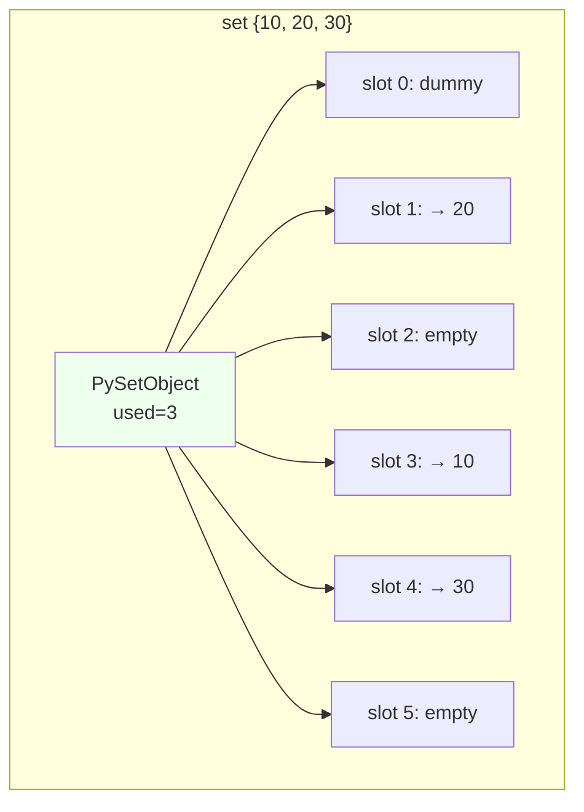
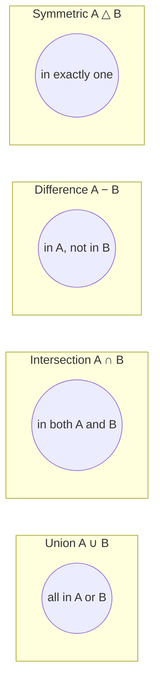
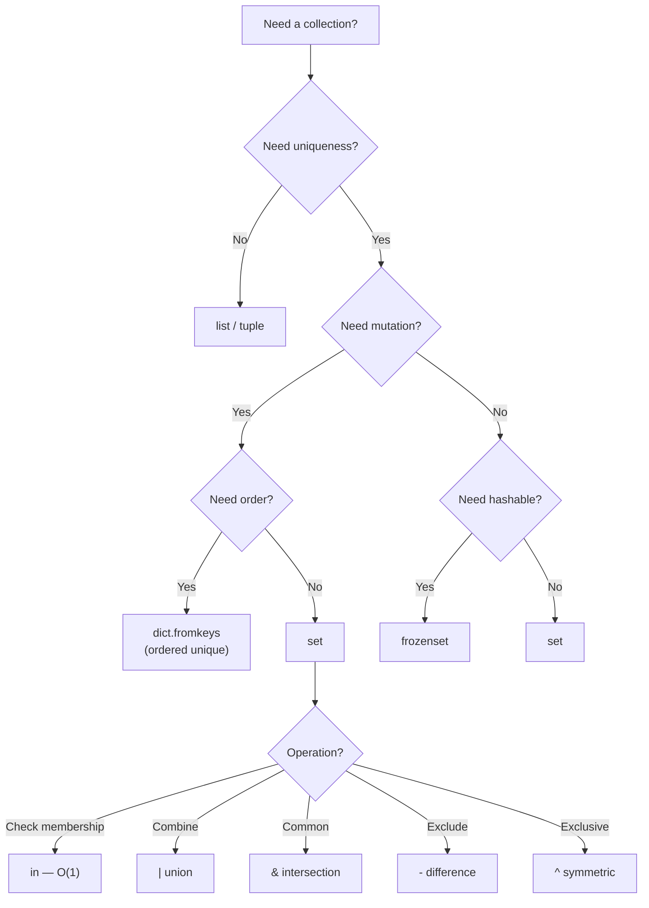

# Sets — Detailed Notes

---

## 1. What Is It? (Concept & Under the Hood)

A **`set`** is an **unordered, mutable collection of unique, hashable objects**. It's Python's implementation of the mathematical set — optimized for **membership testing**, **deduplication**, and **set algebra** (union, intersection, difference, symmetric difference).

Key properties:
- **Unordered** — no indexing, no slicing, no guaranteed iteration order.
- **Unique** — duplicates are silently collapsed at insertion.
- **Mutable** — you can add and remove elements in place.
- **Heterogeneous** — can mix types: `{1, "two", 3.0, (4, 5)}`.
- **Unhashable** — a `set` itself cannot be a dict key or a set member (use `frozenset` instead).
- **Iterable** — supports `for`, comprehensions, `in`.
- **Fast membership** — O(1) average for `in`.

### Under the Hood — CPython's `PySetObject`

A `set` is a **hash table** that stores only keys (no values). It's the same table machinery as `dict`, minus the value slots.

```c
typedef struct {
    PyObject_HEAD
    Py_ssize_t fill;      // number of used + dummy slots
    Py_ssize_t used;      // number of active entries
    Py_ssize_t mask;      // table_size - 1 (for hash → index)
    setentry *table;      // array of setentry
    Py_hash_t hash;       // cached hash if frozenset
    Py_ssize_t finger;    // search finger for pop()
    ...
} PySetObject;

typedef struct {
    PyObject *key;
    Py_hash_t hash;
} setentry;
```

- **Open addressing** with **perturbation probing** (not chaining).
- **Load factor** kept below ~60% — table resizes (usually ×4) when `used * 5 >= fill * 3`.
- **Dummy slots** — after deletion, slots are marked as "dummy" (tombstones), not cleared, so probing chains stay intact.



### Hash → Index Mapping

```python
# CPython essentially does:
index = hash(key) & mask
# then probes: index = (index * 5 + 1 + perturb) & mask
```

Two different keys with the same `hash() & mask` collide; probing finds the next free slot.

### Characteristics

| Aspect | Value |
|---|---|
| Membership (`in`) | O(1) average, O(n) worst |
| Insert | O(1) average |
| Delete | O(1) average |
| Iteration | O(n) |
| Union / intersection | O(len(s) + len(t)) typically |
| Subset / superset | O(len(s)) |
| Length (`len`) | O(1) |
| Memory | Higher than list (hash table overhead) |

### A Set Stores Only Hashable Objects

```python
{1, 2, 3}                    # ✅
{"a", "b"}                   # ✅
{(1, 2), (3, 4)}             # ✅ tuples are hashable
{[1, 2], [3, 4]}             # ❌ TypeError: unhashable type: 'list'
{{1, 2}}                     # ❌ TypeError: unhashable type: 'set'
{frozenset({1, 2})}          # ✅ frozenset is hashable
```

---

## 2. Creating Sets

### Literals and Constructors

```python
empty = set()                # ← NOT {} — that's an empty dict!
nums = {1, 2, 3}
mixed = {1, "two", 3.0, (4, 5)}
from_iter = set("hello")     # {'h', 'e', 'l', 'o'} — order arbitrary
from_list = set([1, 2, 2, 3, 3, 3])  # {1, 2, 3}
from_range = set(range(5))   # {0, 1, 2, 3, 4}

comp = {x * x for x in range(6)}     # {0, 1, 4, 9, 16, 25}
even = {x for x in range(10) if x % 2 == 0}  # {0, 2, 4, 6, 8}
```

### The Empty Set Trap

```python
{}          # dict, not set!
set()       # the only way to create an empty set
type({})    # <class 'dict'>
type(set()) # <class 'set'>
```

### `frozenset` — Immutable, Hashable Set

```python
fs = frozenset([1, 2, 3])        # frozenset({1, 2, 3})
fs = frozenset("abc")            # frozenset({'a', 'b', 'c'})
fs = frozenset()                 # frozenset()

hash(fs)                         # OK — can be dict key
d = {frozenset({1, 2}): "value"} # ✅

fs.add(4)                        # ❌ AttributeError — no add
```

### Deduplication — The #1 Use Case

```python
# Remove duplicates from a list (order lost)
nums = [1, 2, 2, 3, 3, 3, 4]
unique = list(set(nums))         # [1, 2, 3, 4] — arbitrary order

# Order-preserving dedupe
unique = list(dict.fromkeys(nums))   # [1, 2, 3, 4] — insertion order (3.7+)
```

`set()` is faster, `dict.fromkeys()` preserves order.

### Set Comprehension

```python
{x for x in range(10)}                    # {0..9}
{x * 2 for x in range(5)}                 # {0, 2, 4, 6, 8}
{x.lower() for x in ["A", "B", "a"]}      # {'a', 'b'}
{c for c in "hello" if c not in "aeiou"}  # {'h', 'l'}
```

### Repetition Doesn't Exist

```python
{1, 2} * 3      # ❌ TypeError — sets don't support *
```

### Nested Sets — Not Allowed

```python
{{1, 2}, {3, 4}}              # ❌ TypeError: unhashable type: 'set'
{frozenset({1, 2}), frozenset({3, 4})}  # ✅
```

To hold sets inside a set, use `frozenset` inner elements.

---

## 3. Iteration and Basic Operations

### Iteration

```python
for x in {1, 2, 3}:
    print(x)               # order is arbitrary — do NOT rely on it

for i, x in enumerate({"a", "b"}):
    print(i, x)            # index is just position in iteration
```

### No Indexing, No Slicing

```python
s = {10, 20, 30}

s[0]            # ❌ TypeError: 'set' object is not subscriptable
s[1:3]          # ❌ TypeError
```

If you need a specific element, convert to a list:

```python
first = next(iter(s))
lst = list(s)
```

### Membership (O(1) Average)

```python
3 in {1, 2, 3}               # True
"x" in {1, 2, 3}             # False
3 not in {1, 2, 3}           # False
```

This is the operation sets are **optimized for** — far faster than `in` on a list.

```python
import timeit

big_list = list(range(1_000_000))
big_set = set(range(1_000_000))

timeit.timeit("999_999 in big_list", globals=globals(), number=1000)
# ~0.06 s

timeit.timeit("999_999 in big_set", globals=globals(), number=1000)
# ~0.0001 s — hundreds of times faster
```

### Length

```python
len({1, 2, 3})               # 3
len(set())                   # 0
```

### Truthiness

```python
bool(set())                  # False
bool({1})                    # True
bool({0})                    # True — non-empty, regardless of contents
```

### Reversed Iteration (3.8+)

Sets don't support `reversed()` (no ordering), but you can reverse a snapshot:

```python
list(reversed(list({1, 2, 3})))      # order arbitrary anyway
```

---

## 4. Mutating Methods

Sets are **mutable** — you can add and remove elements in place.

### Adding

```python
s = {1, 2, 3}

s.add(4)                # {1, 2, 3, 4}
s.add(4)                # no-op — already present

s.update([5, 6])        # add all from iterable
s.update({7}, [8, 9])   # multiple iterables
```

- `add(x)` — add one element.
- `update(iterable, ...)` — add many (like `extend` for lists). Accepts multiple iterables.

### Removing

```python
s = {1, 2, 3, 4, 5}

s.remove(3)             # {1, 2, 4, 5} — raises KeyError if missing
s.discard(99)           # no-op if missing — safe version of remove
s.pop()                 # removes and returns an ARBITRARY element
s.clear()               # empties in place

del s                   # deletes the whole variable
```

**Key differences:**
- `remove(x)` — raises `KeyError` if `x` not in set.
- `discard(x)` — silently does nothing.
- `pop()` — removes and returns an *arbitrary* element (not necessarily "first" or "last").

```python
s = {1, 2, 3}

s.remove(99)            # ❌ KeyError: 99
s.discard(99)           # ✅ no error

element = s.pop()       # ✅ removes something
```

### `pop()` Removes an Arbitrary Element

```python
s = {1, 2, 3}
x = s.pop()             # x could be 1, 2, or 3 — no guarantee
```

This is not a "queue" — if you need FIFO or LIFO, use `deque` or `list`.

### Mutating Method Summary

| Method | Effect | Raises if missing? |
|---|---|---|
| `add(x)` | Add one element | No |
| `update(it, ...)` | Add all from iterables | No |
| `remove(x)` | Remove x | ✅ KeyError |
| `discard(x)` | Remove x if present | No |
| `pop()` | Remove & return arbitrary element | ✅ KeyError if empty |
| `clear()` | Empty the set | No |

### In-Place vs Non-Mutating Operations

Sets provide both:

```python
a = {1, 2, 3}
b = {3, 4, 5}

# Non-mutating (return new set)
c = a.union(b)           # {1, 2, 3, 4, 5}
c = a.intersection(b)    # {3}
c = a.difference(b)      # {1, 2}
c = a.symmetric_difference(b)  # {1, 2, 4, 5}

# Mutating (modify a in place)
a |= b                   # a.update(b)             → union
a &= b                   # a.intersection_update(b)  → intersection
a -= b                   # a.difference_update(b)     → difference
a ^= b                   # a.symmetric_difference_update(b)

# Method forms of mutating operations
a.update(b)
a.intersection_update(b)
a.difference_update(b)
a.symmetric_difference_update(b)
```

---

## 5. Set Operations — The Algebra

### Union (∪) — All Elements from Both

```python
a = {1, 2, 3}
b = {3, 4, 5}

a | b                    # {1, 2, 3, 4, 5}
a.union(b)               # {1, 2, 3, 4, 5}
a.union(b, {6, 7})       # {1, 2, 3, 4, 5, 6, 7}

a | [3, 4, 5]            # ❌ operator requires set
a.union([3, 4, 5])       # ✅ method accepts any iterable
```

### Intersection (∩) — Common Elements

```python
a = {1, 2, 3, 4}
b = {3, 4, 5, 6}

a & b                    # {3, 4}
a.intersection(b)        # {3, 4}
a.intersection(b, {3, 4, 7})  # {3, 4}

# Common idiom — filter a list
words = ["apple", "banana", "cherry", "avocado"]
vowels = set("aeiou")
starts_with_vowel = [w for w in words if w[0] in vowels]
```

### Difference (−) — In A but Not in B

```python
a = {1, 2, 3, 4}
b = {3, 4, 5, 6}

a - b                    # {1, 2}
b - a                    # {5, 6}  ← order matters!
a.difference(b)          # {1, 2}
a.difference(b, {1})     # {2}  — subtract multiple sets
```

### Symmetric Difference (△) — In Exactly One

```python
a = {1, 2, 3, 4}
b = {3, 4, 5, 6}

a ^ b                             # {1, 2, 5, 6}
a.symmetric_difference(b)         # {1, 2, 5, 6}
```

"A XOR B" — elements in one set, but not both.

### Subset / Superset / Disjoint

```python
a = {1, 2}
b = {1, 2, 3, 4}

a <= b                   # True — a is subset of b
a < b                    # True — proper subset (not equal)
b >= a                   # True — b is superset of a
b > a                    # True — proper superset
a.issubset(b)            # True
b.issuperset(a)          # True

{1, 2} == {2, 1}         # True — order irrelevant

{1, 2}.isdisjoint({3, 4})  # True — no common elements
{1, 2}.isdisjoint({2, 3})  # False — 2 is common
```

### Full Operator Table

| Operation | Operator | Method | In-Place |
|---|---|---|---|
| Union | `\|` | `.union()` | `\|=` |
| Intersection | `&` | `.intersection()` | `&=` |
| Difference | `-` | `.difference()` | `-=` |
| Symmetric diff | `^` | `.symmetric_difference()` | `^=` |
| Subset | `<=` | `.issubset()` | — |
| Proper subset | `<` | — | — |
| Superset | `>=` | `.issuperset()` | — |
| Proper superset | `>` | — | — |
| Equal | `==` | — | — |
| Disjoint | — | `.isdisjoint()` | — |

### Operator vs Method — Key Difference

- **Operators** (`|`, `&`, `-`, `^`) require **both** operands to be sets (or `frozenset`).
- **Methods** accept **any iterable**.

```python
{1, 2} | [2, 3]              # ❌ TypeError
{1, 2}.union([2, 3])         # ✅ {1, 2, 3}
{1, 2} | {2, 3}              # ✅ works
{1, 2}.union({2, 3})         # ✅ works
```

### Mermaid — Set Algebra Visualized



### Visual Reference (ASCII)

```
A ∪ B          A ∩ B          A − B          A △ B
  ___            ___            ___            ___
 /   \          /   \          /   \          /   \
| AAAA|        |     |        | AAAA|        | AAAA|
| A∩BA|        | A∩B |        |     |        |     |
| AAAA|        |     |        |     |        |     |
 \___/          \___/          \___/          \___/

All of A and B. Common only.  A only.       A or B, not both.
```

---

## 6. `frozenset` — The Immutable Sibling

`frozenset` is to `set` what `tuple` is to `list`:
- **Immutable** — no `add`, `remove`, `discard`, `pop`, `clear`.
- **Hashable** — can be a dict key or set member.
- **Same set algebra** — supports `|`, `&`, `-`, `^`, `<=`, `>=`, etc.
- **Can be nested** — frozensets can contain frozensets.

### Creating

```python
fs = frozenset()               # empty
fs = frozenset([1, 2, 3])
fs = frozenset({1, 2, 3})
fs = frozenset("abc")          # frozenset({'a', 'b', 'c'})
fs = frozenset(range(5))
```

### Same Operations (Except Mutation)

```python
a = frozenset({1, 2, 3})
b = frozenset({3, 4, 5})

a | b               # frozenset({1, 2, 3, 4, 5})
a & b               # frozenset({3})
a - b               # frozenset({1, 2})
a ^ b               # frozenset({1, 2, 4, 5})

a.add(4)            # ❌ AttributeError
a.remove(1)         # ❌ AttributeError
```

### Use as Dict Keys

```python
groups = {
    frozenset({"admin", "user"}): "full access",
    frozenset({"user"}): "read-only",
}

groups[frozenset({"admin", "user"})]    # 'full access'
```

### Use Inside Sets (Set of Sets)

```python
# ❌ Can't nest mutable sets
s = {{1, 2}, {3, 4}}         # TypeError

# ✅ Use frozensets
s = {frozenset({1, 2}), frozenset({3, 4})}
```

### Common Pattern — Canonical Grouping

```python
# Group anagrams
from collections import defaultdict

groups = defaultdict(list)
for word in ["eat", "tea", "tan", "ate", "nat", "bat"]:
    key = frozenset(word)
    groups[key].append(word)

dict(groups)
# {
#   frozenset({'e', 'a', 't'}): ['eat', 'tea', 'ate'],
#   frozenset({'t', 'a', 'n'}): ['tan', 'nat'],
#   frozenset({'b', 'a', 't'}): ['bat'],
# }
```

### `set` vs `frozenset`

| | `set` | `frozenset` |
|---|---|---|
| Mutable | ✅ | ❌ |
| Hashable | ❌ | ✅ |
| Dict key | ❌ | ✅ |
| Set member | ❌ | ✅ |
| Methods | add/remove/discard/pop/clear/update | None of those |
| Algebra (`\|`, `&`, `-`, `^`) | ✅ | ✅ |
| Memory | Slightly larger | Slightly smaller |
| Creation | `set(it)` | `frozenset(it)` |
| Literal syntax | `{1, 2, 3}` | None — must call `frozenset(...)` |

---

## 7. Real-World Use Cases

### Use Case 1 — Fast Membership Testing

```python
# ❌ O(n) per lookup
ALLOWED = ["admin", "editor", "viewer"]
if role in ALLOWED:
    ...

# ✅ O(1) per lookup
ALLOWED = {"admin", "editor", "viewer"}
if role in ALLOWED:
    ...
```

For static lists checked at runtime, **always use a set**.

### Use Case 2 — Deduplication

```python
# Order lost — O(n) time
unique = set([1, 2, 2, 3, 3, 3])

# Order preserved — O(n) time
unique_ordered = list(dict.fromkeys([1, 2, 2, 3, 3, 3]))
```

### Use Case 3 — Comparing Collections Ignoring Order

```python
a = ["apple", "banana", "cherry"]
b = ["cherry", "apple", "banana"]

a == b                    # False — order matters for lists
set(a) == set(b)          # True — order irrelevant
```

### Use Case 4 — Finding Differences Between Datasets

```python
yesterday_users = {"alice", "bob", "charlie"}
today_users     = {"alice", "charlie", "dave"}

new_users       = today_users - yesterday_users      # {'dave'}
churned_users   = yesterday_users - today_users      # {'bob'}
active_users    = today_users & yesterday_users      # {'alice', 'charlie'}
all_users       = today_users | yesterday_users      # everyone
```

### Use Case 5 — Removing Stopwords from Text

```python
STOPWORDS = {"the", "a", "an", "and", "or", "but", "in", "of", "to"}

def clean(text):
    tokens = text.lower().split()
    return [t for t in tokens if t not in STOPWORDS]

clean("The Cat Sat On A Mat")
# ['cat', 'sat', 'on', 'mat']
```

### Use Case 6 — Duplicate Detection in Streams

```python
def find_duplicates(items):
    seen = set()
    dups = set()
    for item in items:
        if item in seen:
            dups.add(item)
        else:
            seen.add(item)
    return dups

find_duplicates([1, 2, 3, 2, 4, 1, 5])    # {1, 2}
```

### Use Case 7 — Permissions / Role Checks

```python
user_perms = {"read", "write"}
required = {"read", "admin"}

if required <= user_perms:
    grant()
else:
    missing = required - user_perms     # {'admin'}
    deny(missing)
```

### Use Case 8 — Graph Algorithms (Visited Set)

```python
def bfs(graph, start):
    visited = {start}
    queue = [start]
    while queue:
        node = queue.pop(0)
        for neighbor in graph[node]:
            if neighbor not in visited:    # O(1)
                visited.add(neighbor)
                queue.append(neighbor)
    return visited
```

### Use Case 9 — Unique Hashable Records

```python
# All unique (x, y) coordinates
coords = {(1, 2), (3, 4), (1, 2)}    # {(1, 2), (3, 4)}
```

### Use Case 10 — Set Algebra in Analytics

```python
page_a = {"u1", "u2", "u3", "u4"}
page_b = {"u3", "u4", "u5"}

# Users who visited both pages
shared = page_a & page_b            # {'u3', 'u4'}

# Users who visited only one
exclusive = page_a ^ page_b         # {'u1', 'u2', 'u5'}

# Total reach
reach = len(page_a | page_b)        # 5
```

---

## 8. Common Pitfalls

### Pitfall 1 — `{}` Is a Dict, Not a Set

```python
s = {}                 # ❌ dict
s = set()              # ✅ empty set
```

### Pitfall 2 — Sets Are Unordered

```python
s = {1, 2, 3}
list(s)                # could be [1, 2, 3], [3, 1, 2], etc.

# ❌ Never index or assume order
s[0]                   # TypeError: 'set' object is not subscriptable
```

If order matters, use a `list` or an order-preserving structure.

### Pitfall 3 — Sets Can't Contain Unhashable Objects

```python
{[1, 2]}               # ❌ TypeError: unhashable type: 'list'
{{1, 2}}               # ❌ TypeError: unhashable type: 'set'
{{1: 2}}               # ❌ TypeError: unhashable type: 'dict'

{(1, 2), (3, 4)}       # ✅ tuples ok
{frozenset({1, 2})}    # ✅ frozensets ok
```

### Pitfall 4 — Iteration Order Changes Between Runs

```python
s = {1, 2, 3}
list(s)                # different order across Python processes
```

Because of hash randomization (PEP 456), string sets especially can iterate differently across runs — unless `PYTHONHASHSEED` is fixed.

```bash
$ python -c 'print({1, 2, 3})'
{1, 2, 3}
$ python -c 'print({1, 2, 3})'
{1, 2, 3}    # ints look stable; strings won't

$ python -c 'print({"a", "b", "c"})'
{'c', 'a', 'b'}
$ python -c 'print({"a", "b", "c"})'
{'b', 'a', 'c'}   # different!
```

Never rely on set order — for reproducibility, sort before output.

### Pitfall 5 — Set Operators Require Sets

```python
{1, 2} | [2, 3]                # ❌ TypeError
{1, 2} | {2, 3}                # ✅
{1, 2}.union([2, 3])           # ✅ method works with iterables
```

### Pitfall 6 — `remove` vs `discard`

```python
s = {1, 2, 3}
s.remove(99)           # ❌ KeyError
s.discard(99)          # ✅ silent
```

Choose based on intent: use `remove` when absence is a bug, `discard` when it's fine.

### Pitfall 7 — `pop()` Is Arbitrary

```python
s = {3, 1, 4, 1, 5}
x = s.pop()            # which element? No guarantee.
```

If you need determinism, sort and pick:

```python
smallest = min(s)
s.remove(smallest)
```

### Pitfall 8 — Mutating a Set While Iterating

```python
s = {1, 2, 3, 4}
for x in s:
    if x % 2 == 0:
        s.remove(x)    # ❌ RuntimeError: Set changed size during iteration

# ✅ iterate over a copy
for x in list(s):
    if x % 2 == 0:
        s.remove(x)

# ✅ or build a new set
s = {x for x in s if x % 2}
```

### Pitfall 9 — Equality with Order-Sensitive Types

```python
[1, 2, 3] == [3, 2, 1]             # False
set([1, 2, 3]) == set([3, 2, 1])   # True
```

Converting to set is a common shortcut for "order doesn't matter" comparison — but it also **discards duplicates**:

```python
[1, 1, 2] == [1, 2, 2]             # False
set([1, 1, 2]) == set([1, 2, 2])   # True — both {1, 2}
```

If duplicates matter, don't convert.

### Pitfall 10 — Set Operations Return New Sets

```python
a = {1, 2}
b = {2, 3}
c = a.union(b)         # c is a NEW set — a, b unchanged
a.update(b)            # now a is modified
```

Choose operators/methods based on whether you want in-place semantics.

### Pitfall 11 — `frozenset` vs `set` in Dict Keys

```python
d = {}
d[{1, 2}] = "x"                 # ❌ TypeError
d[frozenset({1, 2})] = "x"      # ✅
```

### Pitfall 12 — Sorting Sets

```python
s = {3, 1, 2}
s.sort()               # ❌ AttributeError — no sort method
sorted(s)              # ✅ [1, 2, 3] — returns a list
```

### Pitfall 13 — Memory Bloat

Sets have **overhead** — each element lives in a hash-table slot, often with dummies. For small, order-insensitive data, a sorted list may be smaller:

```python
import sys
sys.getsizeof({1, 2, 3})        # 216 bytes
sys.getsizeof([1, 2, 3])        # 88 bytes
sys.getsizeof((1, 2, 3))        # 80 bytes
```

For 1M elements, sets still win on lookup — but always trade off memory.

### Pitfall Summary Table

| Pitfall | Symptom | Fix |
|---|---|---|
| `{}` | Creates dict | Use `set()` |
| Indexing set | TypeError | Convert to list |
| Unhashable element | TypeError | Use tuple/frozenset |
| Iteration order | Changes across runs | Sort before output |
| `\|` with list | TypeError | Use `.union()` |
| `remove` missing | KeyError | Use `discard` |
| Mutating while iterating | RuntimeError | Iterate over copy |
| `set()` for dedupe | Order lost | `dict.fromkeys` |
| Nested sets | TypeError | Use frozenset |
| `s.sort()` | AttributeError | `sorted(s)` |

---

## 9. Comparison Tables

### Set vs List vs Tuple vs Dict

| | set | frozenset | list | tuple | dict |
|---|---|---|---|---|---|
| Ordered | ❌ | ❌ | ✅ | ✅ | ✅ (3.7+) |
| Mutable | ✅ | ❌ | ✅ | ❌ | ✅ |
| Hashable | ❌ | ✅ | ❌ | ✅ | ❌ |
| Duplicates | ❌ | ❌ | ✅ | ✅ | keys unique |
| Indexable | ❌ | ❌ | ✅ | ✅ | keys only |
| Lookup | O(1) | O(1) | O(n) | O(n) | O(1) |
| Add | O(1) | — | O(1)* | — | O(1)* |
| Memory | High | High | Medium | Low | High |
| Best for | Membership, algebra | Hashable sets | Sequences | Records | Key→value |

\*Amortized.

### Set vs Sorted List — Membership

| Size | Set `in` | List `in` | Winner |
|---|---|---|---|
| 10 | ~0.1 µs | ~0.5 µs | set |
| 1,000 | ~0.1 µs | ~10 µs | set |
| 100,000 | ~0.1 µs | ~1 ms | set |
| 1,000,000 | ~0.1 µs | ~10 ms | set |

Sets are **hundreds of thousands of times faster** for membership on large collections.

### Operator vs Method — Set Operations

| Task | Operator | Method | In-Place Method |
|---|---|---|---|
| Union | `a \| b` | `a.union(b)` | `a.update(b)` or `a \|= b` |
| Intersection | `a & b` | `a.intersection(b)` | `a.intersection_update(b)` or `a &= b` |
| Difference | `a - b` | `a.difference(b)` | `a.difference_update(b)` or `a -= b` |
| Symmetric diff | `a ^ b` | `a.symmetric_difference(b)` | `a.symmetric_difference_update(b)` or `a ^= b` |

### Removing Elements — Which Method?

| Situation | Method |
|---|---|
| Remove known-present element | `remove(x)` |
| Remove if present | `discard(x)` |
| Remove arbitrary element | `pop()` |
| Remove all | `clear()` |
| Remove several | Loop, set comprehension, or `difference_update` |

---

## 10. Mermaid — Set Operation Decision Flow



---

## 11. Performance Notes

### Membership — The Killer Feature

```python
import timeit

data_list = list(range(1_000_000))
data_set = set(range(1_000_000))

timeit.timeit("500_000 in data_list", globals=globals(), number=100)
# ~0.5 s

timeit.timeit("500_000 in data_set", globals=globals(), number=100)
# ~0.0003 s
```

### Set Operations Complexity

| Operation | Average | Worst |
|---|---|---|
| `x in s` | O(1) | O(n) |
| `s.add(x)` | O(1) | O(n) |
| `s.remove(x)` | O(1) | O(n) |
| `s.discard(x)` | O(1) | O(n) |
| `s.pop()` | O(1) | O(n) |
| `len(s)` | O(1) | O(1) |
| `s \| t` | O(len(s) + len(t)) | — |
| `s & t` | O(min(len(s), len(t))) | — |
| `s - t` | O(len(s)) | — |
| `s ^ t` | O(len(s) + len(t)) | — |
| `s <= t` | O(len(s)) | — |

Worst cases arise from hash collisions — rare but possible with adversarial input. CPython mitigates this with `hash()` randomization (PEP 456).

### Sets Are Faster Than You Think

Because the hash table uses open addressing and caches slot positions, `in` on a set is often **comparable to a pointer dereference** — sub-microsecond.

### Deduplication Timing

```python
import timeit

data = list(range(1_000_000)) + list(range(500_000))

timeit.timeit("list(set(data))", globals=globals(), number=1)
# ~0.05 s

timeit.timeit("list(dict.fromkeys(data))", globals=globals(), number=1)
# ~0.08 s — slightly slower but preserves order
```

### Fast Path for `in` with Constants

When a set literal is used in a loop and its elements are known at compile time, CPython may use **constant-folding for membership**:

```python
if x in {1, 2, 3}:    # frozenset literal — the compiler optimizes
    ...
```

When a set literal appears in a comparison/membership and is never mutated, CPython converts it to a **frozenset** at compile time:

```python
import dis
dis.dis("x in {1, 2, 3}")
```

```
  0 LOAD_NAME    0 (x)
  2 LOAD_CONST   0 (frozenset({1, 2, 3}))   # ← frozenset!
  4 CONTAINS_OP  0
  6 RETURN_VALUE
```

So `x in {1, 2, 3}` is faster than you'd guess — no set is built at runtime.

### Memory Cost

Sets pay for the hash table:

```python
import sys

sys.getsizeof(set(range(10)))      # 216 bytes
sys.getsizeof(set(range(100)))     # 4216 bytes
sys.getsizeof(set(range(10_000)))  # 524,504 bytes
```

The table is over-allocated (~×4 growth) for speed. If memory is tight and you don't need `in`, use a sorted list or array.

### Sets in Hot Loops

```python
# ✅ compute the set once
allowed = set(long_list)
results = [x for x in items if x in allowed]

# ❌ rebuild every iteration
results = [x for x in items if x in set(long_list)]
```

### Complexity Cheat Sheet

| Operation | set | frozenset | list | tuple | dict |
|---|---|---|---|---|---|
| `x in s` | O(1) | O(1) | O(n) | O(n) | O(1) |
| `len(s)` | O(1) | O(1) | O(1) | O(1) | O(1) |
| Iteration | O(n) | O(n) | O(n) | O(n) | O(n) |
| Union `\|` | O(n+m) | O(n+m) | — | — | — |
| Intersection `&` | O(min) | O(min) | — | — | — |
| Add | O(1) | — | O(1)* | — | O(1)* |
| Remove | O(1) | — | O(n) | — | O(1) |

\*Amortized.

---

## 12. Quick Reference Card

```python
# Creation
set()                       # empty
{1, 2, 3}                   # literal
set([1, 2, 2, 3])           # {1, 2, 3}
set("hello")                # {'h', 'e', 'l', 'o'}
frozenset([1, 2, 3])        # immutable, hashable
{x for x in range(5)}       # comprehension

# Membership
x in s                      # O(1)
x not in s
len(s)

# Add / remove
s.add(x)                    # add one
s.update([1, 2])            # add many
s.remove(x)                 # KeyError if absent
s.discard(x)                # silent if absent
s.pop()                     # arbitrary element
s.clear()                   # empty

# Set algebra (non-mutating)
a | b           # union
a & b           # intersection
a - b           # difference
a ^ b           # symmetric difference
a.union(b)      a.intersection(b)     a.difference(b)     a.symmetric_difference(b)

# Set algebra (in-place)
a |= b          a &= b          a -= b          a ^= b
a.update(b)     a.intersection_update(b)     a.difference_update(b)     a.symmetric_difference_update(b)

# Subset / superset
a <= b          # subset
a < b           # proper subset
a >= b          # superset
a > b           # proper superset
a.issubset(b)   a.issuperset(b)
a.isdisjoint(b) # no common elements
a == b          # same elements

# Dict keys / set members
d[frozenset({1, 2})] = "x"       # ✅
{frozenset({1, 2}), frozenset({3})}   # ✅ set of frozensets

# Idioms
unique = set(nums)                            # dedupe (order lost)
unique = list(dict.fromkeys(nums))            # dedupe (order preserved)
common = set(list_a) & set(list_b)            # intersection
only_in_a = set(list_a) - set(list_b)         # difference
has_all = required <= set(user_perms)         # permissions check
```

---

## Summary

- A `set` is an **unordered, mutable, unique, hashable-only** collection backed by a **hash table** — same machinery as `dict`, minus values.
- **Membership is O(1) average** — that's the whole point; use sets whenever you check `in` frequently.
- **`frozenset`** is the immutable, hashable variant — usable as dict keys and set members.
- **`{}` is a dict**, `set()` is the only way to create an empty set.
- **Sets are unordered** — iteration order is not guaranteed and varies across runs for strings (hash randomization). Never rely on it.
- **Only hashable items** go inside — `list`, `dict`, `set` are out; `tuple`, `frozenset`, and immutables are in.
- **Operators require sets** (`|`, `&`, `-`, `^`); **methods accept any iterable** (`.union(list)`).
- **Set algebra**: union, intersection, difference, symmetric difference, subset, superset, disjoint.
- **Dedup idiom**: `set(nums)` (order lost) or `list(dict.fromkeys(nums))` (order preserved).
- **Pitfalls** cluster around the empty-set literal, unhashable elements, iteration order, `remove` vs `discard`, `pop()` being arbitrary, and mutation during iteration.