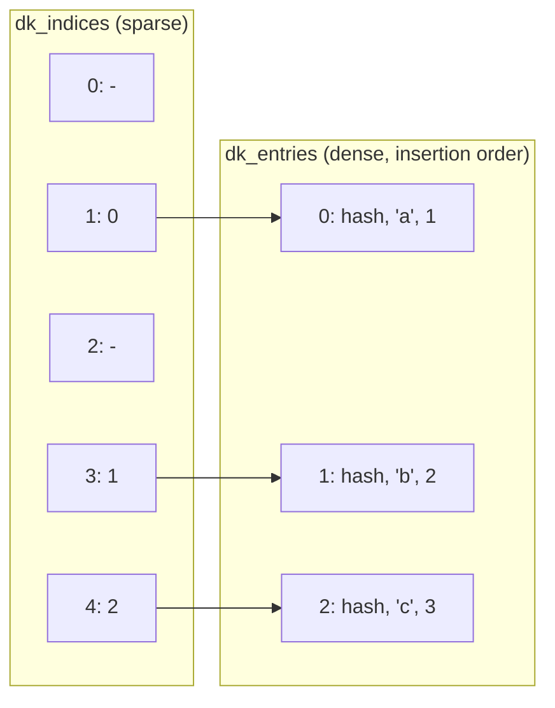
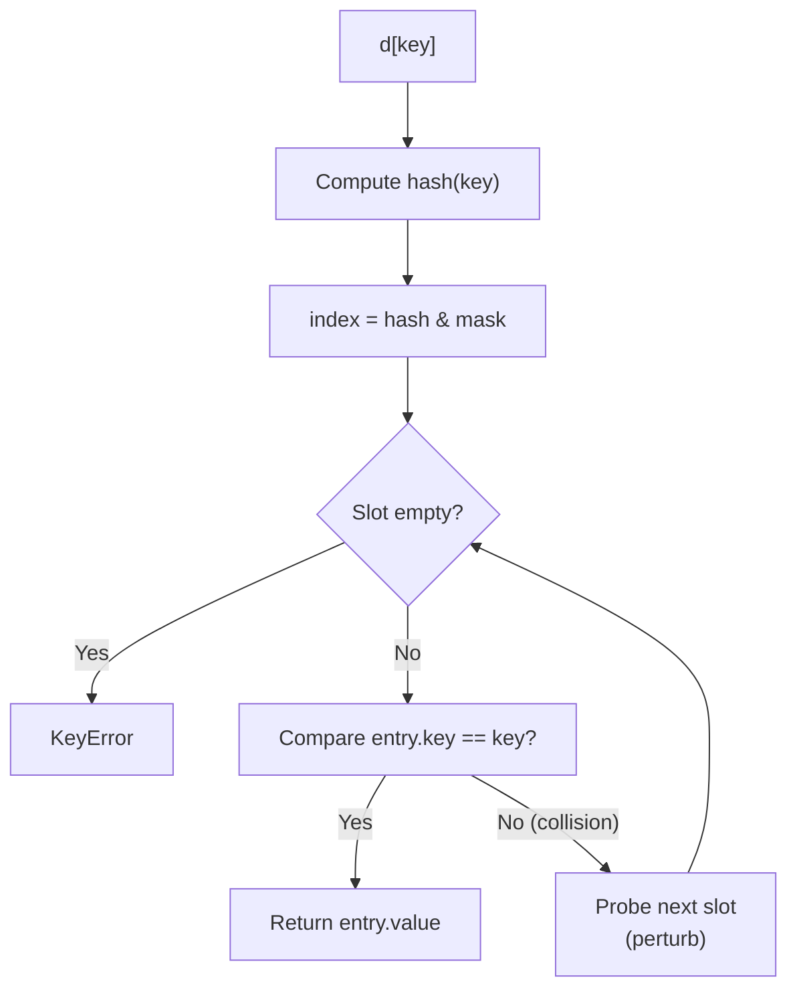
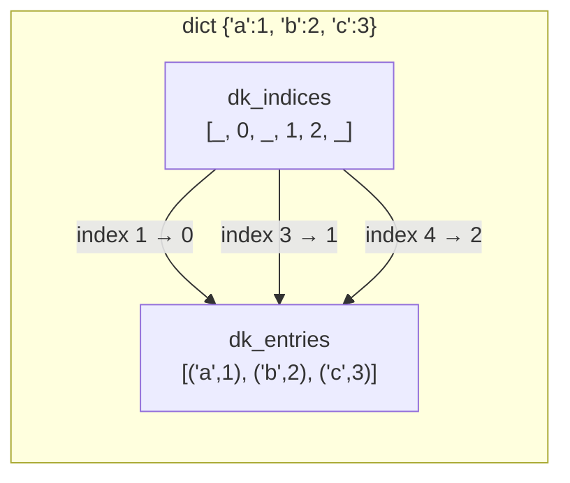

# Dictionaries — Detailed Notes

---

## 1. What Is It? (Concept & Under the Hood)

A **`dict`** is a **mutable, ordered (3.7+), key-value mapping** where keys are unique and hashable. It's the single most important data structure in Python — modules, classes, and even function locals are dicts under the hood.

Key properties:
- **Ordered** — insertion order preserved since Python 3.7 (implementation detail in 3.6, guaranteed in 3.7+).
- **Mutable** — add, update, remove key-value pairs in place.
- **Unique keys** — reassigning a key overwrites the previous value.
- **Hashable keys only** — `int`, `str`, `tuple`, `frozenset` OK; `list`, `dict`, `set` not.
- **Heterogeneous** — keys and values can be any type.
- **Iterable** — iterates over keys by default.
- **O(1) average** lookup, insert, and delete.

### Under the Hood — CPython's `PyDictObject`

Since CPython 3.6 (PEP 509, PEP 468), dicts use a **compact** representation with **two arrays**:

```c
typedef struct {
    PyObject_HEAD
    Py_ssize_t ma_used;          // number of items
    uint64_t ma_version_tag;     // for caching
    PyDictKeysObject *ma_keys;   // shared key table
    PyObject **ma_values;        // values (split table only)
} PyDictObject;

struct _dictkeysobject {
    Py_ssize_t dk_refcnt;
    Py_ssize_t dk_size;          // table size (power of 2)
    dict_lookup_func dk_lookup;
    Py_ssize_t dk_usable;
    Py_ssize_t dk_nentries;
    char dk_indices[];           // index into dk_entries
    PyDictKeyEntry dk_entries[]; // compact array of (hash, key, value)
};
```

Two-array design:



- **`dk_indices`** — a sparse array of small integers (1, 2, or 4 bytes each) that act as pointers into the dense entries array.
- **`dk_entries`** — a **dense, insertion-ordered** array of `(hash, key, value)` triples.
- **Iteration** walks `dk_entries` in insertion order — hence the guarantee.
- **Lookup** hashes the key, probes `dk_indices`, then reads `dk_entries[index]`.

This design:
- **Saves memory** (~20–25% smaller than the old design).
- **Preserves insertion order for free**.
- **Keeps O(1) lookup** with open addressing + perturbation probing.

### Hash → Index in a Dict

```python
# Essentially:
idx = hash(key) & mask
while dk_indices[idx] != EMPTY:
    entry = dk_entries[dk_indices[idx]]
    if entry.hash == hash(key) and entry.key == key:
        return entry.value
    idx = perturb(idx) & mask
```

Values can be mutable and unhashable — only **keys** must be hashable.

### Characteristics

| Aspect | Value |
|---|---|
| Lookup (`d[k]`) | O(1) average, O(n) worst |
| Insert / update | O(1) average |
| Delete | O(1) average |
| Membership (`k in d`) | O(1) average |
| Iteration | O(n) |
| Length | O(1) |
| Memory | Higher than list (hash table overhead) |

### "Hashable" — What Qualifies?

```python
d = {}
d[1] = "int"
d["s"] = "str"
d[(1, 2)] = "tuple"
d[frozenset({1, 2})] = "frozenset"
d[None] = "NoneType"
d[True] = "bool"

d[[1, 2]] = "list"       # ❌ TypeError: unhashable type: 'list'
d[{1, 2}] = "set"        # ❌ TypeError
d[{1: 2}] = "dict"       # ❌ TypeError
```

**Rule:** hashable = has a stable `__hash__` and supports `__eq__`. Immutable types qualify; mutable ones don't.

---

## 2. Creating Dictionaries

### Literals and Constructors

```python
empty = {}
empty = dict()

person = {"name": "Ada", "age": 36, "city": "London"}
mixed  = {1: "one", "two": 2, (3, 4): [5, 6], None: True}

dict(name="Ada", age=36)                # {'name': 'Ada', 'age': 36}
dict([("a", 1), ("b", 2)])              # {'a': 1, 'b': 2}
dict(zip(["a", "b"], [1, 2]))           # {'a': 1, 'b': 2}
dict.fromkeys(["a", "b", "c"], 0)       # {'a': 0, 'b': 0, 'c': 0}
dict.fromkeys("abc")                    # {'a': None, 'b': None, 'c': None}
```

### Dict Comprehension

```python
{x: x * x for x in range(5)}
# {0: 0, 1: 1, 2: 4, 3: 9, 4: 16}

{word: len(word) for word in ["a", "bb", "ccc"]}
# {'a': 1, 'bb': 2, 'ccc': 3}

{k: v for k, v in [("a", 1), ("b", 2)] if v > 1}
# {'b': 2}
```

### From Iterables of Pairs

```python
pairs = [("a", 1), ("b", 2), ("c", 3)]
dict(pairs)                             # {'a': 1, 'b': 2, 'c': 3}

keys = ["a", "b", "c"]
values = [1, 2, 3]
dict(zip(keys, values))                 # {'a': 1, 'b': 2, 'c': 3}
```

### `dict.fromkeys()` Trap — Mutable Defaults

```python
# ❌ ALL keys share the SAME list object
d = dict.fromkeys(["a", "b", "c"], [])
d["a"].append(1)
print(d)         # {'a': [1], 'b': [1], 'c': [1]} — surprise!

# ✅ comprehension
d = {k: [] for k in ["a", "b", "c"]}
d["a"].append(1)
print(d)         # {'a': [1], 'b': [], 'c': []}
```

Use `fromkeys` only when the default is **immutable** (`0`, `None`, `""`, `()`).

### Merging Dicts

```python
a = {"x": 1, "y": 2}
b = {"y": 20, "z": 30}

# 3.9+ — union operator
a | b                # {'x': 1, 'y': 20, 'z': 30} — b wins on conflict
a |= b               # in-place union

# Older styles
merged = {**a, **b}                  # dict unpacking
merged = dict(a); merged.update(b)
```

Order of precedence: **rightmost wins**.

### Ordered Guarantee

```python
d = {"b": 1, "a": 2, "c": 3}
list(d)              # ['b', 'a', 'c'] — insertion order
```

Deleting and re-inserting a key moves it to the **end**:

```python
d = {"a": 1, "b": 2, "c": 3}
del d["a"]
d["a"] = 100
list(d)              # ['b', 'c', 'a'] — 'a' now last
```

---

## 3. Key-Value Access

### Bracket Access

```python
d = {"name": "Ada", "age": 36}

d["name"]            # 'Ada'
d["missing"]         # ❌ KeyError: 'missing'
```

### `.get()` — Safe Access with Default

```python
d.get("name")             # 'Ada'
d.get("missing")          # None
d.get("missing", 0)       # 0
d.get("missing", [])      # [] — fresh list each call
```

`.get()` is the workhorse for optional keys.

### `d[key] = value` — Insert or Update

```python
d = {}
d["x"] = 1              # insert
d["x"] = 100            # update
```

### `del` and `.pop()`

```python
d = {"a": 1, "b": 2, "c": 3}

del d["a"]              # {'b': 2, 'c': 3}
d.pop("b")              # 2 — returns value, removes key
d.pop("missing")        # ❌ KeyError
d.pop("missing", 0)     # 0 — default if missing
d.clear()               # {}
```

### Membership — Checks Keys, Not Values

```python
d = {"a": 1, "b": 2}

"a" in d                # True — key check
1 in d                  # False — value check needs .values()
"a" in d.keys()         # True — same as `in d`
1 in d.values()         # True — O(n)!
```

### Set Default

```python
d = {}
d.setdefault("counter", 0)         # 0 — sets if missing
d.setdefault("counter", 999)       # 0 — already present, unchanged
d["counter"] += 1                  # 1

# Grouping idiom
groups = {}
for name, dept in [("Ada", "Eng"), ("Alan", "Eng"), ("Grace", "Math")]:
    groups.setdefault(dept, []).append(name)
# {'Eng': ['Ada', 'Alan'], 'Math': ['Grace']}
```

`setdefault(k, v)` is atomic — no race condition like `if k not in d: d[k] = v`.

### Merging / Updating

```python
d = {"a": 1}
d.update({"b": 2})              # {'a': 1, 'b': 2}
d.update([("c", 3), ("d", 4)])  # from pairs
d.update(e=5, f=6)              # from kwargs
d |= {"g": 7}                   # 3.9+ in-place union
```

### `__missing__` — Custom Fallback

```python
class DefaultDict(dict):
    def __missing__(self, key):
        return f"<{key}>"

d = DefaultDict()
d["a"]           # '<a>' — __missing__ called
```

### Access Summary Table

| Operation | Missing key behavior | Complexity |
|---|---|---|
| `d[k]` | KeyError | O(1) |
| `d.get(k)` | Returns None | O(1) |
| `d.get(k, default)` | Returns default | O(1) |
| `d.setdefault(k, default)` | Sets and returns default | O(1) |
| `k in d` | Returns False | O(1) |
| `d.pop(k)` | KeyError | O(1) |
| `d.pop(k, default)` | Returns default | O(1) |

---

## 4. Common Methods — The Complete Toolkit

### Views — `keys()`, `values()`, `items()`

Views are **live, dynamic proxies** into the dict. They reflect changes automatically.

```python
d = {"a": 1, "b": 2, "c": 3}

keys   = d.keys()      # dict_keys(['a', 'b', 'c'])
values = d.values()    # dict_values([1, 2, 3])
items  = d.items()     # dict_items([('a', 1), ('b', 2), ('c', 3)])

d["d"] = 4

list(keys)             # ['a', 'b', 'c', 'd'] — updated!
list(values)           # [1, 2, 3, 4]
```

### View Properties

| View | Iterable | Supports `in` | Set-like? |
|---|---|---|---|
| `keys()` | ✅ | ✅ | ✅ (like a set) |
| `values()` | ✅ | ✅ (O(n)) | ❌ |
| `items()` | ✅ | ✅ | ✅ (set of pairs) |

```python
d = {"a": 1, "b": 2}

d.keys() & {"a", "x"}          # {'a'}
d.keys() | {"x"}               # {'a', 'b', 'x'}
d.keys() - {"a"}               # {'b'}
d.items() & {("a", 1)}         # {('a', 1)} — set operations
```

### View Iteration — Order Preserved

```python
for k in d:                    # keys by default
    print(k)

for v in d.values():
    print(v)

for k, v in d.items():         # most common
    print(k, v)
```

### Copying

```python
d = {"a": 1, "b": [2, 3]}

shallow = d.copy()             # or dict(d)
shallow["b"].append(99)
print(d)                       # {'a': 1, 'b': [2, 3, 99]} — shared!

import copy
deep = copy.deepcopy(d)
deep["b"].append(100)
print(d)                       # unchanged
```

### Deleting

```python
d = {"a": 1, "b": 2, "c": 3}

del d["a"]
d.pop("b")                     # returns value
d.popitem()                    # removes & returns LAST inserted pair (LIFO)
d.clear()                      # empties
```

`popitem()` returns a tuple `(key, value)` — and since 3.7 it's **LIFO**:

```python
d = {"a": 1, "b": 2}
d.popitem()                    # ('b', 2)
d.popitem()                    # ('a', 1)
d.popitem()                    # ❌ KeyError: 'popitem(): dictionary is empty'
```

### Method Summary Table

| Method | Purpose | Returns |
|---|---|---|
| `d.get(k, [default])` | Safe read | Value or default |
| `d.setdefault(k, [default])` | Get or insert | Value |
| `d.keys()` | View of keys | `dict_keys` |
| `d.values()` | View of values | `dict_values` |
| `d.items()` | View of pairs | `dict_items` |
| `d.update(other)` | Merge in place | None |
| `d.pop(k, [default])` | Remove + return | Value |
| `d.popitem()` | Remove last | `(k, v)` |
| `d.clear()` | Empty | None |
| `d.copy()` | Shallow copy | New dict |
| `d.fromkeys(it, [v])` | Build from keys | New dict |

---

## 5. Iteration

### Iterating Keys

```python
d = {"a": 1, "b": 2, "c": 3}

for k in d:                    # implied keys
    print(k)

for k in d.keys():
    print(k)
```

Both are the same — `d` is iterable over keys.

### Iterating Values

```python
for v in d.values():
    print(v)
```

### Iterating Items (Most Common)

```python
for k, v in d.items():
    print(k, v)
```

### Iterating with Index

```python
for i, (k, v) in enumerate(d.items()):
    print(i, k, v)
```

### Iterating in Sorted Order

```python
for k in sorted(d):
    print(k, d[k])

for k, v in sorted(d.items(), key=lambda kv: kv[1]):    # by value
    print(k, v)

from operator import itemgetter
for k, v in sorted(d.items(), key=itemgetter(1), reverse=True):
    print(k, v)
```

### Reversed Iteration (3.8+)

```python
for k in reversed(d):
    print(k)
```

Dicts support `reversed()` since 3.8 — walks entries back-to-front.

### Iterating Two Dicts in Parallel

```python
a = {"x": 1, "y": 2}
b = {"x": 10, "y": 20}

for (ka, va), (kb, vb) in zip(a.items(), b.items()):
    print(ka, va, kb, vb)
```

### Membership in Values

```python
1 in d.values()          # O(n) — scans all values
```

### Bulk Operations

```python
d = {"a": 1, "b": 2, "c": 3}

sum(d.values())                  # 6
max(d.values())                  # 3
min(d.values())                  # 1
max(d, key=d.get)                # 'c' — key with max value
any(v > 2 for v in d.values())   # True
all(v > 0 for v in d.values())   # True
```

---

## 6. Nested Dictionaries

```python
users = {
    "alice": {
        "age": 30,
        "email": "alice@example.com",
        "roles": ["admin", "user"],
    },
    "bob": {
        "age": 25,
        "email": "bob@example.com",
        "roles": ["user"],
    },
}
```

### Accessing Nested Values

```python
users["alice"]["age"]                   # 30
users["alice"]["roles"][0]              # 'admin'
users["charlie"]["age"]                 # ❌ KeyError
users.get("charlie", {}).get("age")     # None — safe chain
```

### Deep `get` with a Helper

```python
def deep_get(d, *keys, default=None):
    for k in keys:
        if not isinstance(d, dict):
            return default
        d = d.get(k, default)
    return d

deep_get(users, "alice", "age")            # 30
deep_get(users, "charlie", "age")          # None
deep_get(users, "charlie", "age", default=0)  # 0
```

### Modifying Nested Dicts

```python
users["alice"]["age"] = 31
users["alice"]["roles"].append("superadmin")
users["dave"] = {"age": 22, "email": "dave@example.com", "roles": []}
```

### Initializing Nested Dicts

```python
# ❌ Breaks — KeyError on first access
users = {}
users["alice"]["age"] = 30           # KeyError: 'alice'

# ✅ Initialize manually
users = {}
users.setdefault("alice", {})["age"] = 30

# ✅ Or use defaultdict
from collections import defaultdict
users = defaultdict(dict)
users["alice"]["age"] = 30           # ✅ works!

# ✅ Deep default with a factory
def nested():
    return defaultdict(nested)

tree = nested()
tree["a"]["b"]["c"] = 1              # ✅ works!
```

### Flattening a Nested Dict

```python
def flatten(d, parent=""):
    out = {}
    for k, v in d.items():
        key = f"{parent}.{k}" if parent else k
        if isinstance(v, dict):
            out.update(flatten(v, key))
        else:
            out[key] = v
    return out

flatten({"a": {"b": {"c": 1}}, "d": 2})
# {'a.b.c': 1, 'd': 2}
```

### Deep Merging

```python
def deep_merge(a, b):
    out = dict(a)
    for k, v in b.items():
        if k in out and isinstance(out[k], dict) and isinstance(v, dict):
            out[k] = deep_merge(out[k], v)
        else:
            out[k] = v
    return out

deep_merge({"a": {"x": 1}}, {"a": {"y": 2}})
# {'a': {'x': 1, 'y': 2}}
```

---

## 7. Dictionary Views — Deep Dive

Views are **live windows** into the dict. They are **not copies** — modifying the dict is visible through the view.

### Live Semantics

```python
d = {"a": 1, "b": 2}
keys = d.keys()

print(list(keys))     # ['a', 'b']
d["c"] = 3
print(list(keys))     # ['a', 'b', 'c'] — view updated!
```

### Views Are Iterable, Not Indexable

```python
d = {"a": 1, "b": 2}
keys = d.keys()

keys[0]               # ❌ TypeError: 'dict_keys' object is not subscriptable
list(keys)[0]         # ✅ 'a'
```

### Views Support Set Operations (keys, items)

```python
d1 = {"a": 1, "b": 2}
d2 = {"b": 20, "c": 30}

d1.keys() & d2.keys()               # {'b'} — common keys
d1.keys() | d2.keys()               # {'a', 'b', 'c'}
d1.keys() - d2.keys()               # {'a'}
d1.keys() ^ d2.keys()               # {'a', 'c'}

# Items also support set operations
d1.items() & d2.items()             # set of common pairs
```

### Views Are Mutable-Safe (No Mutation Through View)

```python
d = {"a": 1}
keys = d.keys()
keys.add("b")         # ❌ AttributeError — views are read-only
```

### Iterating Multiple Views Safely

```python
d = {"a": 1, "b": 2, "c": 3}

# ✅ iterating keys and reading values is fine
for k in d:
    print(k, d[k])

# ❌ mutating while iterating raises RuntimeError
for k in d:
    if k == "b":
        del d[k]              # RuntimeError: dictionary changed size during iteration

# ✅ snapshot first
for k in list(d):
    if k == "b":
        del d[k]
```

### Views vs Lists

| | View | List |
|---|---|---|
| Live (updates with dict) | ✅ | ❌ |
| Iterable | ✅ | ✅ |
| Indexable | ❌ | ✅ |
| Set ops (keys, items) | ✅ | ❌ |
| Memory | O(1) — no copy | O(n) — copies all |
| Can mutate dict | ❌ | N/A |

### `dict_items` — Set-Like Pairs

```python
d = {"a": 1, "b": 2}

d.items()                     # dict_items([('a', 1), ('b', 2)])
("a", 1) in d.items()         # True
("a", 99) in d.items()        # False

# Common set operations
d.items() & {("a", 1), ("c", 3)}    # {('a', 1)}
```

### `dict_values` — Not Set-Like (Values May Be Unhashable)

```python
d = {"a": [1], "b": [2]}

d.values()                    # dict_values([[1], [2]])
[1] in d.values()             # True — O(n) linear scan
set(d.values())               # ❌ TypeError — lists unhashable
```

---

## 8. Real-World Use Cases

### Use Case 1 — Counting

```python
# Manual
counts = {}
for word in words:
    counts[word] = counts.get(word, 0) + 1

# With setdefault
counts = {}
for word in words:
    counts.setdefault(word, 0)
    counts[word] += 1

# Best — Counter
from collections import Counter
counts = Counter(words)
counts.most_common(3)              # top 3 words
```

### Use Case 2 — Grouping

```python
from collections import defaultdict

groups = defaultdict(list)
for name, dept in records:
    groups[dept].append(name)
```

### Use Case 3 — Caching / Memoization

```python
cache = {}

def fib(n):
    if n in cache:
        return cache[n]
    if n < 2:
        result = n
    else:
        result = fib(n - 1) + fib(n - 2)
    cache[n] = result
    return result

# Or use functools.lru_cache
from functools import lru_cache

@lru_cache(maxsize=None)
def fib(n):
    if n < 2:
        return n
    return fib(n - 1) + fib(n - 2)
```

### Use Case 4 — Configuration

```python
CONFIG = {
    "database": {
        "host": "localhost",
        "port": 5432,
        "name": "mydb",
    },
    "logging": {
        "level": "INFO",
        "file": "/var/log/app.log",
    },
}

host = CONFIG["database"]["host"]
level = CONFIG["logging"].get("level", "DEBUG")
```

### Use Case 5 — JSON-Like Data

```python
import json

data = {"name": "Ada", "age": 36, "hobbies": ["math", "code"]}

json_str = json.dumps(data, indent=2)
parsed = json.loads(json_str)
parsed["name"]                     # 'Ada'
```

### Use Case 6 — Sparse Data / Encoding Sparse Vectors

```python
# Only non-zero entries stored
vector = {0: 3.5, 100: 1.2, 5000: -2.0}

# Dot product
def sparse_dot(v1, v2):
    return sum(v1[k] * v2[k] for k in v1.keys() & v2.keys())
```

### Use Case 7 — State Machines with Dispatch Tables

```python
def handle_start(ctx): ...
def handle_stop(ctx): ...
def handle_pause(ctx): ...

HANDLERS = {
    "start": handle_start,
    "stop": handle_stop,
    "pause": handle_pause,
}

def dispatch(event, ctx):
    handler = HANDLERS.get(event)
    if handler:
        return handler(ctx)
    raise ValueError(f"unknown event: {event}")
```

### Use Case 8 — Inverted Index

```python
from collections import defaultdict

index = defaultdict(set)
for doc_id, text in documents.items():
    for word in text.lower().split():
        index[word].add(doc_id)

index["python"]        # set of doc IDs containing "python"
```

### Use Case 9 — LRU Cache (Manual)

```python
from collections import OrderedDict

class LRU:
    def __init__(self, capacity):
        self.cap = capacity
        self.data = OrderedDict()

    def get(self, key):
        if key not in self.data:
            return None
        self.data.move_to_end(key)
        return self.data[key]

    def put(self, key, value):
        if key in self.data:
            self.data.move_to_end(key)
        self.data[key] = value
        if len(self.data) > self.cap:
            self.data.popitem(last=False)   # remove oldest
```

### Use Case 10 — Keyword Arguments

```python
def foo(**kwargs):
    return kwargs

foo(a=1, b=2)          # {'a': 1, 'b': 2}
```

`**kwargs` is a dict — the function's runtime representation of keyword arguments.

---

## 9. Common Pitfalls

### Pitfall 1 — Mutable Default in `fromkeys`

```python
d = dict.fromkeys(["a", "b"], [])     # ❌ shared list
d["a"].append(1)
# {'a': [1], 'b': [1]}

d = {k: [] for k in ["a", "b"]}       # ✅
```

### Pitfall 2 — `d.items()` Modified During Iteration

```python
d = {"a": 1, "b": 2, "c": 3}

for k in d:
    if k == "b":
        del d[k]           # ❌ RuntimeError: dictionary changed size

# ✅ Iterate over a snapshot
for k in list(d):
    if k == "b":
        del d[k]
```

### Pitfall 3 — Same Key Type Collision

```python
d = {}
d[1] = "one"
d[1.0] = "one_float"      # SAME key — 1 == 1.0 and hash(1) == hash(1.0)
print(d)                  # {1: 'one_float'}

d[True] = "bool_true"     # SAME key as 1 — True == 1
print(d)                  # {1: 'bool_true'}
```

`1`, `1.0`, `True`, and `1+0j` are all equal and hash-equal — they collide in dict keys.

### Pitfall 4 — `.get()` Returns `None` for Missing, Not Default

```python
d = {"a": None}
d.get("a")                # None — indistinguishable from missing
d.get("b")                # None

# ✅ Use sentinel
MISSING = object()
v = d.get("b", MISSING)
if v is MISSING:
    ...

# ✅ Or check membership
if "b" in d:
    ...
```

### Pitfall 5 — Iteration Order Beyond 3.7

Pre-3.7 dicts were unordered. If you support older Pythons, don't rely on order (or use `OrderedDict`).

```python
# Modern Python (3.7+) — always ordered
d = {"c": 3, "a": 1, "b": 2}
list(d)                   # ['c', 'a', 'b']
```

### Pitfall 6 — `d.update()` Overwrites

```python
d = {"a": 1}
d.update({"a": 100})      # overwrites silently
```

### Pitfall 7 — Copy Is Shallow

```python
d = {"a": [1, 2]}
shallow = d.copy()
shallow["a"].append(3)
print(d)                  # {'a': [1, 2, 3]}
```

### Pitfall 8 — Unhashable Keys

```python
d = {}
d[(1, 2)] = "ok"                   # ✅ tuple
d[(1, [2])] = "no"                 # ❌ list inside
d[frozenset({1})] = "ok"           # ✅
```

### Pitfall 9 — `popitem()` Is LIFO (3.7+), Not FIFO

```python
d = {"a": 1, "b": 2, "c": 3}
d.popitem()               # ('c', 3) — last
d.popitem()               # ('b', 2)
```

If you need FIFO, use `OrderedDict.popitem(last=False)`.

### Pitfall 10 — Dict Comparison Includes Order?

No — `==` compares contents, not order:

```python
{"a": 1, "b": 2} == {"b": 2, "a": 1}    # True
```

### Pitfall 11 — Values Are Not Deduplicated

```python
d = {"a": 1, "b": 1, "c": 2}
set(d.values())           # {1, 2}
list(d.values())          # [1, 1, 2]
```

### Pitfall 12 — Key vs Value in `in`

```python
d = {"a": 1, "b": 2}

"a" in d                  # True — key
1 in d                    # False — value
1 in d.values()           # True — explicit value check (O(n))
```

### Pitfall Summary Table

| Pitfall | Symptom | Fix |
|---|---|---|
| Mutable `fromkeys` | Shared mutable default | Comprehension |
| Modify during iter | RuntimeError | Iterate `list(d)` |
| Int/float/bool collision | Overwrites | Different types if needed |
| `.get` returns None | Can't tell missing | Sentinel / `in` |
| Shallow copy | Nested mutations leak | `deepcopy` |
| `popitem` LIFO | Unexpected key | `OrderedDict` for FIFO |
| `1 in d` | Tests keys only | `in d.values()` |
| Unhashable key | TypeError | Use tuple/frozenset |

---

## 10. Comparison Tables

### Dict vs List vs Set

| | dict | list | set |
|---|---|---|---|
| Ordered | ✅ (3.7+) | ✅ | ❌ |
| Mutable | ✅ | ✅ | ✅ |
| Indexed by | key | int | — |
| Hashable keys | ✅ | N/A | ✅ (members) |
| Duplicates | keys unique | ✅ | unique |
| Lookup | O(1) | O(n) | O(1) |
| Memory | High | Low | High |
| Best for | Mapping | Sequence | Membership |

### Dict vs `OrderedDict` vs `defaultdict` vs `Counter`

| | dict | OrderedDict | defaultdict | Counter |
|---|---|---|---|---|
| Order preserved | ✅ | ✅ | ✅ | ✅ |
| Missing-key default | ❌ | ❌ | ✅ | ✅ (0) |
| Move-to-end | ❌ | ✅ `move_to_end` | ❌ | ❌ |
| Count values | ❌ | ❌ | ❌ | ✅ `most_common` |
| Equality order-sensitive | ❌ | ✅ | ❌ | ❌ |
| Since | 3.7 | 2.7 | 2.5 | 2.7 |
| When to use | Default | FIFO order control | Auto-init | Counting |

### Methods — Quick Compare

| Task | Method |
|---|---|
| Read | `d[k]`, `d.get(k, default)` |
| Write | `d[k] = v`, `d.update(other)` |
| Delete | `del d[k]`, `d.pop(k)`, `d.popitem()`, `d.clear()` |
| Check | `k in d`, `k in d.keys()`, `v in d.values()` |
| Iterate | `d`, `d.keys()`, `d.values()`, `d.items()` |
| Copy | `d.copy()`, `dict(d)`, `copy.deepcopy(d)` |
| Merge | `d \| other`, `{**a, **b}`, `d.update(other)` |

### Creating Dicts — Which Style?

| Task | Best approach |
|---|---|
| Fixed keys | Literal `{"a": 1}` |
| From pairs | `dict(pairs)` |
| From keys + default | `dict.fromkeys(keys, v)` — **immutable v** |
| Compute values | Comprehension `{k: f(k) for k in keys}` |
| Merge | `{**a, **b}` or `a \| b` (3.9+) |
| Empty | `{}` (faster than `dict()`) |

---

## 11. Mermaid — Dictionary Lookup Flow



### Dict as Two-Array Structure



Iteration walks `dk_entries` — that's why insertion order is preserved.

---

## 12. Performance Notes

### O(1) Lookup — Even at Scale

```python
import timeit

data = {i: i * i for i in range(1_000_000)}
timeit.timeit("data[500_000]", globals=globals(), number=1_000_000)
# ~0.15 s — 1M lookups in 150 ms
```

### Membership vs List

```python
big_list = list(range(1_000_000))
big_dict = {i: i for i in range(1_000_000)}

timeit.timeit("500_000 in big_list", globals=globals(), number=100)
# ~5 s

timeit.timeit("500_000 in big_dict", globals=globals(), number=100)
# ~0.0003 s
```

Dicts are orders of magnitude faster for membership.

### Construction Speed

```python
timeit.timeit("{i: i for i in range(1000)}", number=10_000)      # ~0.5 s
timeit.timeit("dict(zip(range(1000), range(1000)))", number=10_000)  # ~0.6 s
timeit.timeit("dict.fromkeys(range(1000))", number=10_000)       # ~0.15 s
```

`fromkeys` is fastest for uniform values; comprehension for arbitrary values.

### `setdefault` vs `if k in d`

```python
# ✅ setdefault — atomic, one lookup
d.setdefault(k, []).append(x)

# ❌ Two lookups
if k not in d:
    d[k] = []
d[k].append(x)
```

`setdefault` is faster (one hash) and cleaner.

### `defaultdict` vs `setdefault`

```python
from collections import defaultdict

# defaultdict — no setdefault needed
groups = defaultdict(list)
for name, dept in records:
    groups[dept].append(name)     # ✅ auto-creates

# setdefault — explicit but slightly slower
groups = {}
for name, dept in records:
    groups.setdefault(dept, []).append(name)
```

`defaultdict` wins for repeated grouping.

### Growth / Resizing

Dicts over-allocate; when the load factor exceeds ~2/3, the table **resizes ×4** (3.6+) — this is why dicts are fast even as they grow.

### Memory Footprint

```python
import sys

sys.getsizeof({})                              # 64 bytes (empty)
sys.getsizeof({"a": 1})                        # 184 bytes
sys.getsizeof({i: i for i in range(100)})      # 4696 bytes
sys.getsizeof({i: i for i in range(10_000)})   # 294,992 bytes
```

Dicts have fixed per-entry overhead. For tiny mappings with known keys, consider a list of tuples or `__slots__` for classes.

### Time Complexity Cheat Sheet

| Operation | dict | list | set |
|---|---|---|---|
| `d[k]` | O(1) | O(n) | — |
| `k in d` | O(1) | O(n) | O(1) |
| `d[k] = v` | O(1) | O(1)* | O(1)* |
| `del d[k]` | O(1) | O(n) | O(1) |
| Iteration | O(n) | O(n) | O(n) |
| `len(d)` | O(1) | O(1) | O(1) |
| `d.copy()` | O(n) | O(n) | O(n) |
| Union `\|` | O(n+m) | — | O(n+m) |

\*Amortized.

---

## 13. Quick Reference Card

```python
# Creation
{}
{"a": 1, "b": 2}
dict(a=1, b=2)
dict([("a", 1), ("b", 2)])
dict(zip(keys, values))
dict.fromkeys(keys, value)             # value must be immutable
{k: v for k, v in pairs}

# Read
d[k]                                    # KeyError if missing
d.get(k)                                # None if missing
d.get(k, default)
d.setdefault(k, default)                # sets if missing, returns value

# Write
d[k] = v
d.update(other)
d |= other                              # 3.9+

# Delete
del d[k]
d.pop(k)                                # KeyError if missing
d.pop(k, default)
d.popitem()                             # LIFO — returns (k, v)
d.clear()

# Iterate
for k in d: ...
for k in d.keys(): ...
for v in d.values(): ...
for k, v in d.items(): ...
for k in sorted(d): ...
for k in reversed(d): ...               # 3.8+

# Membership
k in d                                  # keys
v in d.values()                         # values — O(n)
(k, v) in d.items()                     # pairs

# Views (live)
d.keys()       d.values()       d.items()
d.keys() & other.keys()                 # set ops
d.items() & {("a", 1)}

# Copy
d.copy()                                # shallow
dict(d)                                 # shallow
copy.deepcopy(d)                        # deep

# Merge
{**a, **b}                              # new dict
a | b                                   # 3.9+
a.update(b)                             # in place

# Idioms
groups = {}
for k, v in pairs:
    groups.setdefault(k, []).append(v)

from collections import defaultdict, Counter, OrderedDict
groups = defaultdict(list)
counts = Counter(words)
counts.most_common(10)

# Nice properties
max(d, key=d.get)                       # key with max value
sum(d.values())
{k: v for k, v in d.items() if v > 0}   # filter
{k: v * 2 for k, v in d.items()}        # transform
```

---

## Summary

- A `dict` is an **ordered (3.7+), mutable, hashable-key mapping** — implemented as a **two-array compact hash table** with O(1) average lookup.
- **Insertion order is guaranteed** — iteration follows the dense `dk_entries` array.
- **Keys must be hashable**; values can be anything.
- **`.get()` for safe reads**; **`.setdefault()` for atomic get-or-insert**; **`defaultdict` for repeated grouping**.
- **Views (`keys()`, `values()`, `items()`) are live** — they reflect changes and support set operations for keys/items.
- **`.popitem()` is LIFO** — last inserted, first removed.
- **Nested dicts require careful initialization** — use `defaultdict(dict)` or a recursive factory.
- **`fromkeys` with a mutable default is a trap** — use a comprehension instead.
- **Never mutate while iterating** — snapshot keys with `list(d)`.
- **`1`, `1.0`, `True` collide as the same key** (equal + hash-equal).
- **`dict` outperforms list on membership by orders of magnitude** — use it whenever you need keyed lookup.