# Data Structure Concepts — Detailed Notes

---

## 1. What Is It? (The Big Picture)

This section is a **conceptual synthesis** — it ties together strings, lists, tuples, sets, and dicts by explaining the *principles* that govern all of them: how indexing works, why immutability matters, what "copying" really means, how hashing enables O(1) lookups, and how to choose the right container.

Everything in Python is a **reference to an object**. Data structures are arrangements of references with different:
- **Access patterns** (index, key, membership)
- **Mutability guarantees** (changeable vs frozen)
- **Ordering guarantees** (ordered vs unordered)
- **Performance profiles** (O(1), O(n), O(n log n))
- **Hashability properties** (can they be keys/members?)

### The Object-Reference Model

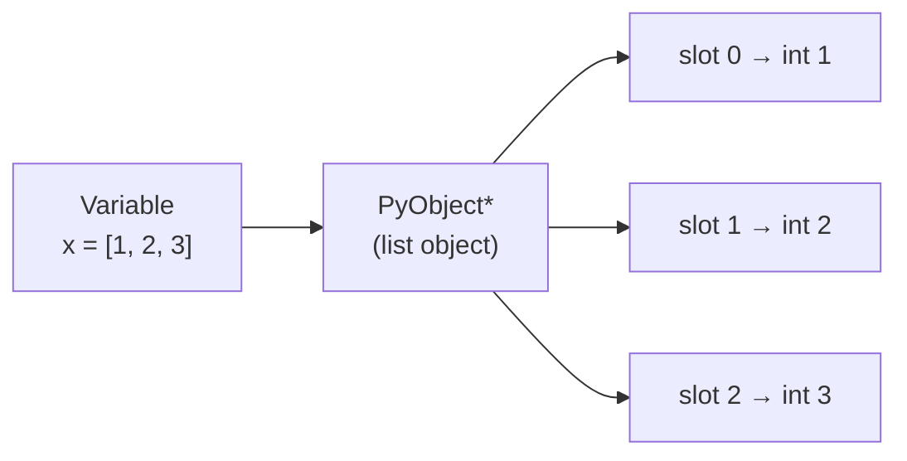

- **Variables are names** bound to objects.
- **Containers hold references**, not values.
- **Assignment binds, never copies** (unless you explicitly copy).

### The Six Mental Models

| Mental model | Key question | Affects |
|---|---|---|
| **Sequence** | Can I index/slice it? | str, list, tuple, range, bytes |
| **Mutability** | Can it change in place? | list ✅, tuple ❌, str ❌ |
| **Ordering** | Is iteration order meaningful? | list/tuple ✅, set/dict-key ❌/✅ |
| **Hashability** | Can it be a dict key? | tuple/frozenset ✅, list/set ❌ |
| **Complexity** | What's the cost of this op? | O(1) vs O(n) vs O(n log n) |
| **Aliasing** | Do two names share the object? | Copy semantics |

---

## 2. Indexing and Slicing

### The Sequence Protocol

Any object that implements `__getitem__` supports indexing and slicing. The **sequence protocol** is what makes `x[i]`, `x[a:b]`, `for item in x`, and `len(x)` all work.

```python
class MySeq:
    def __init__(self, items): self.items = list(items)
    def __getitem__(self, i): return self.items[i]
    def __len__(self): return len(self.items)

s = MySeq([10, 20, 30, 40, 50])
s[0]      # 10
s[-1]     # 50
s[1:4]    # [20, 30, 40]
len(s)    # 5
for x in s: print(x)    # works!
```

### Indexing — O(1) for Sequences

Zero-based, negative indices count from the end:

```python
seq = [10, 20, 30, 40, 50]
#       0   1   2   3   4
#      -5  -4  -3  -2  -1

seq[0]     # 10
seq[-1]    # 50
seq[100]   # IndexError
```

**Under the hood:** `seq[i]` calls `seq.__getitem__(i)`. For lists and tuples, `i` is normalized (`i < 0 → i += len`) and dereferenced — O(1).

### Slicing — O(k) Copy for Sequences

`seq[start:stop:step]` returns a **new object** of the same type (with caveats):

```python
seq = [10, 20, 30, 40, 50]

seq[1:4]      # [20, 30, 40]
seq[:3]       # [10, 20, 30]
seq[2:]       # [30, 40, 50]
seq[:]        # [10, 20, 30, 40, 50]  — copy!
seq[::2]      # [10, 30, 50]
seq[::-1]     # [50, 40, 30, 20, 10]
seq[-3:-1]    # [30, 40]
```

### Slice Rules

| Rule | Behavior |
|---|---|
| Out-of-range | Clamped (no error) |
| `stop` exclusive | `seq[0:3]` gives indices 0, 1, 2 |
| Negative step | Reverses direction |
| Empty result | Valid — `seq[5:2]` → `[]` |
| Returns type | Same type for str/list/tuple; list for `range` |

### Slice Assignment — Lists Only

```python
lst = [1, 2, 3, 4, 5]

lst[1:3] = [20, 30, 40]      # replace slice — length can differ
# [1, 20, 30, 40, 4, 5]

lst[1:3] = []                # delete
# [1, 40, 4, 5]

lst[2:2] = [99]              # insert without removing
# [1, 40, 99, 4, 5]
```

Tuples and strings **do not** support slice assignment — they're immutable.

### The `slice` Object

```python
s = slice(1, 4, 2)           # start=1, stop=4, step=2
lst[s]                       # same as lst[1:4:2]

s.start, s.stop, s.step      # (1, 4, 2)
```

You can create slices programmatically and reuse them.

### `__getitem__` with Slices — Custom Classes

```python
class Matrix:
    def __init__(self, data): self.data = data
    def __getitem__(self, key):
        if isinstance(key, tuple):
            r, c = key
            return self.data[r][c]
        return self.data[key]

m = Matrix([[1, 2], [3, 4]])
m[0, 1]        # 2 — tuple index
m[1]           # [3, 4] — slice index
```

### Indexing vs Slicing — Performance

| Operation | list | tuple | str | dict | set |
|---|---|---|---|---|---|
| `x[i]` | O(1) | O(1) | O(1) | O(1)* | ❌ |
| `x[a:b]` | O(k) | O(k) | O(k) | ❌ | ❌ |
| Slice assignment | ✅ | ❌ | ❌ | ❌ | ❌ |
| Negative index | ✅ | ✅ | ✅ | ❌ | ❌ |

\*By key, not int.

### Mermaid — Slicing Semantics

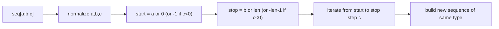

---

## 3. Mutability vs Immutability

### The Definition

- **Immutable** — the object's value cannot change after creation.
- **Mutable** — the object's value can be changed in place.

### Which Types Are Which

| Type | Mutable? | Hashable? |
|---|---|---|
| `int` | ❌ | ✅ |
| `float` | ❌ | ✅ |
| `bool` | ❌ | ✅ |
| `str` | ❌ | ✅ |
| `tuple` | ❌ | ✅ (if elements hashable) |
| `frozenset` | ❌ | ✅ |
| `bytes` | ❌ | ✅ |
| `list` | ✅ | ❌ |
| `dict` | ✅ | ❌ |
| `set` | ✅ | ❌ |
| `bytearray` | ✅ | ❌ |

**Rule of thumb:** hashable ⇒ immutable (usually). Immutable ⇒ hashable (usually).

### What Immutability Really Means

```python
s = "hello"
# s[0] = "H"       # ❌ TypeError
s = "H" + s[1:]    # ✅ — creates a NEW string
# s now refers to a different object
```

**The object never changed — the name was rebound.**

```python
t = (1, 2, 3)
# t[0] = 100       # ❌ TypeError
t = (100, 2, 3)    # ✅ — new tuple
```

### Shallow Immutability — The Tuple Gotcha

Tuples are immutable *structurally* — but they can hold mutable objects, which are themselves mutable:

```python
t = (1, [2, 3], 4)
t[1].append(99)    # ✅ works — mutating the LIST
print(t)           # (1, [2, 3, 99], 4)

t[1] = [2, 3]      # ❌ TypeError — can't rebind element
```

Consequence: a tuple containing mutable items is **unhashable**.

```python
hash((1, [2, 3]))  # ❌ TypeError: unhashable type: 'list'
```

### The id() and Identity

```python
a = "hello"
b = "hello"

id(a) == id(b)     # often True for interned strings

a = [1, 2]
b = [1, 2]
id(a) == id(b)     # False — distinct objects
```

Use `is` to compare identity; `==` to compare value.

### Why Immutability Matters

| Benefit | Explanation |
|---|---|
| **Hashable** | Can be dict keys / set members |
| **Thread-safe** | No locking needed to read |
| **Cacheable** | Safe to share references |
| **Predictable** | No surprising mutations |
| **Constant-foldable** | Compiler can pre-compute |
| **Faster** | No need for version guards |

### Why Mutability Matters

| Benefit | Explanation |
|---|---|
| **Efficient in-place updates** | No new allocation |
| **Natural modeling** | Lists grow; dicts fill |
| **Memory-efficient** | Shared identity, not copies |
| **Flexible** | No need to rebuild containers |

### Mutability in Function Arguments

```python
def modify(lst):
    lst.append(99)         # mutates the caller's list

def rebind(lst):
    lst = [99]             # rebinds the local name

a = [1, 2, 3]
modify(a)
print(a)                   # [1, 2, 3, 99] — changed

a = [1, 2, 3]
rebind(a)
print(a)                   # [1, 2, 3] — unchanged
```

**Key insight:** function arguments are bound by *reference*, but rebinding the parameter doesn't affect the caller.

### Avoiding Mutation Bugs

```python
# ❌ Mutable default — shared across calls
def f(x, target=[]):
    target.append(x)
    return target

f(1)    # [1]
f(2)    # [1, 2] — surprising!

# ✅ Use None sentinel
def f(x, target=None):
    if target is None:
        target = []
    target.append(x)
    return target
```

### Frozen Variants

| Mutable | Frozen Equivalent |
|---|---|
| `list` | `tuple` |
| `set` | `frozenset` |
| `dict` | `types.MappingProxyType` |
| `bytearray` | `bytes` |

```python
from types import MappingProxyType

d = {"a": 1}
frozen = MappingProxyType(d)
frozen["a"]        # 1 — read works
frozen["b"] = 2    # ❌ TypeError — no write
```

### Mermaid — Mutable vs Immutable Semantics

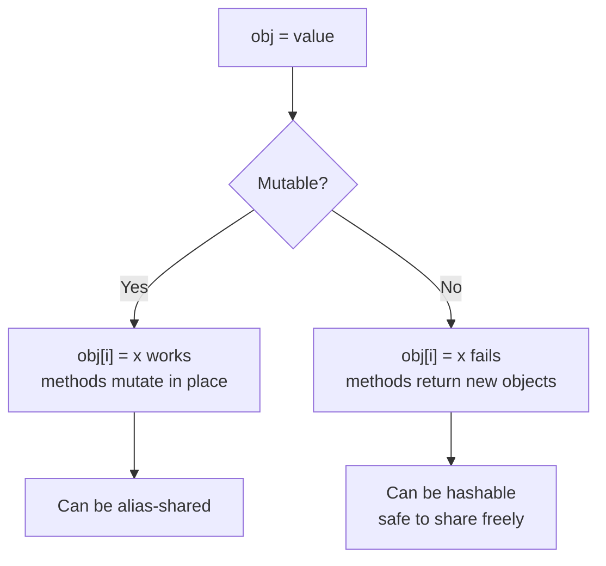

---

## 4. Shallow vs Deep Copy

### The Three Levels of "Copy"

1. **Binding** — `b = a` — no copy; same object.
2. **Shallow copy** — new outer container; inner references shared.
3. **Deep copy** — recursively new throughout.

### Binding (Reference Assignment)

```python
a = [1, 2, 3]
b = a
b.append(4)
print(a)          # [1, 2, 3, 4]
print(a is b)     # True
```

### Shallow Copy

```python
import copy

a = [[1, 2], [3, 4]]
b = a.copy()            # or a[:] or list(a) or copy.copy(a)

b is a                  # False — new outer list
b[0] is a[0]            # True — inner list SHARED

b[0].append(99)
print(a)                # [[1, 2, 99], [3, 4]] — inner mutated!
```

### Deep Copy

```python
import copy

a = [[1, 2], [3, 4]]
b = copy.deepcopy(a)

b is a                  # False
b[0] is a[0]            # False — inner objects also copied

b[0].append(99)
print(a)                # [[1, 2], [3, 4]] — untouched
```

### Ways to Copy

| Method | Type | Depth |
|---|---|---|
| `b = a` | binding | none |
| `b = a.copy()` | method | shallow |
| `b = a[:]` | slice | shallow |
| `b = list(a)` | constructor | shallow |
| `b = dict(a)` | constructor | shallow |
| `b = copy.copy(a)` | module | shallow |
| `b = copy.deepcopy(a)` | module | deep |

### What Each Type's `.copy()` Does

| Type | `.copy()` returns | Depth |
|---|---|---|
| `list` | New list | Shallow |
| `dict` | New dict | Shallow |
| `set` | New set | Shallow |
| `tuple` | Same object (immutable!) | None |
| `frozenset` | Same object | None |
| `str` | Same object | None |
| `bytes` | Same object | None |

```python
t = (1, 2, 3)
t.copy()          # ❌ AttributeError — tuples have no .copy()
t[:]              # returns the SAME tuple
t[:] is t         # True
```

### Shallow Copy — Visual

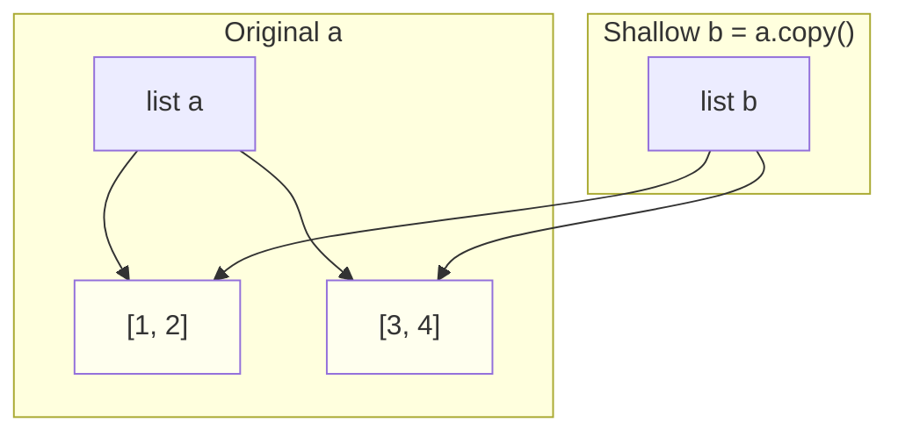

Shared inner objects — mutation propagates.

### Deep Copy — Visual

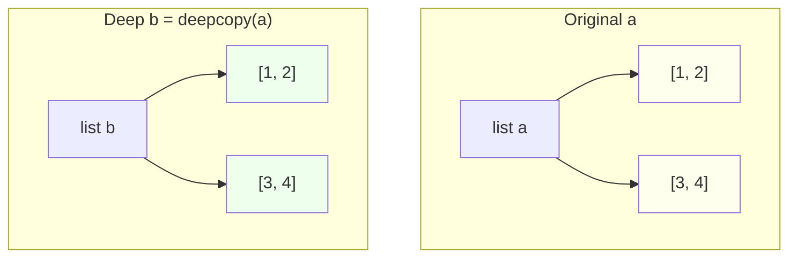

Fully independent.

### Custom Copy Behavior

Classes can override copying:

```python
class Node:
    def __init__(self, value, children=None):
        self.value = value
        self.children = children or []

    def __copy__(self):
        return Node(self.value, self.children)      # shallow

    def __deepcopy__(self, memo):
        return Node(self.value,
                    [copy.deepcopy(c, memo) for c in self.children])  # deep
```

### When to Use Which

| Scenario | Best choice |
|---|---|
| Flat list of immutables | `a.copy()` or `a[:]` |
| Nested lists, need isolation | `copy.deepcopy(a)` |
| Snapshot before iteration | `list(a)` |
| Immutable — no copy needed | `a` (assign directly) |
| Copying inside a hot loop | Avoid — reconsider design |

### Deepcopy — Traps and Costs

- **Slow** — recursive; O(total size).
- **Cycles handled** — `deepcopy` tracks visited objects via a memo dict.
- **Custom objects** — may need `__deepcopy__` for correctness.
- **Un-copyable objects** — sockets, file handles, locks cannot be deep-copied.

```python
import copy

a = [1, 2]
a.append(a)                 # cycle
b = copy.deepcopy(a)        # ✅ handles cycles
b[2] is b                   # True — cycle preserved
```

### Performance

```python
import copy, timeit

a = list(range(1_000_000))

timeit.timeit(lambda: a[:], number=100)                # ~0.1 s
timeit.timeit(lambda: copy.copy(a), number=100)        # ~0.1 s
timeit.timeit(lambda: copy.deepcopy(a), number=100)    # ~10 s
```

Shallow copy is O(n) and fast; deep copy is O(total nodes) and much slower.

---

## 5. Common Methods and Operations

### Cross-Structure Operation Support

| Operation | list | tuple | str | set | dict |
|---|---|---|---|---|---|
| `len(x)` | ✅ | ✅ | ✅ | ✅ | ✅ |
| `x in y` | ✅ | ✅ | ✅ | ✅ | ✅ (keys) |
| `for x in y` | ✅ | ✅ | ✅ | ✅ | ✅ (keys) |
| `x[i]` | ✅ | ✅ | ✅ | ❌ | ✅ (key) |
| `x[a:b]` | ✅ | ✅ | ✅ | ❌ | ❌ |
| `x + y` | ✅ | ✅ | ✅ | ✅ | ❌ |
| `x * n` | ✅ | ✅ | ✅ | ❌ | ❌ |
| `reversed(x)` | ✅ | ✅ | ✅ | ❌* | ✅ (3.8+) |
| `sorted(x)` | ✅ | ✅ | ✅ | ✅ | ✅ (keys) |
| `min/max/sum` | ✅ | ✅ | ✅ | ✅ | ✅ (keys) |
| `x.copy()` | ✅ | ❌ | ❌ | ✅ | ✅ |
| `.append` | ✅ | ❌ | ❌ | ❌ | ❌ |
| `.add` | ❌ | ❌ | ❌ | ✅ | ❌ |
| `x[key] = v` | ✅ (index) | ❌ | ❌ | ❌ | ✅ |

\*Reversed on set is not supported due to lack of ordering.

### Universal Built-ins

```python
seq = [3, 1, 4, 1, 5, 9, 2, 6]

len(seq)               # 8
max(seq)               # 9
min(seq)               # 1
sum(seq)               # 31
sorted(seq)            # [1, 1, 2, 3, 4, 5, 6, 9]
any(x > 5 for x in seq)     # True
all(x > 0 for x in seq)     # True
list(reversed(seq))    # [6, 2, 9, 5, 1, 4, 1, 3]
enumerate(seq)         # iterator of (i, x)
zip(seq, ...)          # pairs
```

### Method Categories

| Category | list | dict | set |
|---|---|---|---|
| Add one | `append` | `d[k]=v` | `add` |
| Add many | `extend` | `update` | `update` |
| Remove one | `remove`, `pop` | `pop`, `popitem` | `remove`, `discard`, `pop` |
| Remove all | `clear` | `clear` | `clear` |
| Search | `index`, `count` | `get`, `setdefault` | — |
| Transform | `sort`, `reverse` | — | — |
| Copy | `copy` | `copy` | `copy` |
| View | — | `keys`, `values`, `items` | — |
| Set algebra | — | — | `union`, `intersection`, etc. |

### Comprehensions Across Types

```python
# list
[x * 2 for x in range(5)]              # [0, 2, 4, 6, 8]

# set
{x * 2 for x in range(5)}              # {0, 2, 4, 6, 8}

# dict
{x: x * 2 for x in range(5)}           # {0: 0, 1: 2, 2: 4, 3: 6, 4: 8}

# generator (lazy)
(x * 2 for x in range(5))              # <generator object>
```

### Conversions

```python
list((1, 2, 3))         # [1, 2, 3]
tuple([1, 2, 3])        # (1, 2, 3)
set([1, 2, 2, 3])       # {1, 2, 3}
dict([("a", 1)])        # {'a': 1}
list({"a": 1})          # ['a']  — keys
list({"a": 1}.items())  # [('a', 1)]
"".join(["a", "b"])     # 'ab'
```

### Idempotent Operations

```python
set(s) == s
sorted(sorted(x)) == sorted(x)
list(tuple(list(x))) == x       # for any list x
```

---

## 6. Time Complexity Basics

### Big-O Notation — What It Measures

Big-O describes how **runtime grows with input size `n`**, ignoring constants. It's a tool for choosing **algorithms and data structures**, not for micro-optimization.

| Notation | Name | Example |
|---|---|---|
| O(1) | Constant | `list[0]`, `dict[k]`, `set.add` |
| O(log n) | Logarithmic | Binary search, heap push |
| O(n) | Linear | `x in list`, iterate a list |
| O(n log n) | Linearithmic | `sort()` |
| O(n²) | Quadratic | Nested loops over data |
| O(2ⁿ) | Exponential | Naive fib recursion |
| O(n!) | Factorial | Brute-force permutations |

### Amortized Complexity

Some operations are **occasionally expensive** but cheap on average:

- `list.append` — usually O(1), occasionally O(n) when resizing.
- **Amortized O(1)** — because reallocations are rare and grow geometrically.

```python
# 1M appends: total time ~O(n), not O(n²)
import timeit
timeit.timeit("for i in range(1_000_000): lst.append(i)",
              setup="lst=[]", number=1)   # ~0.05 s
```

### Complexity Cheat Sheet

| Operation | list | tuple | str | set | dict |
|---|---|---|---|---|---|
| `x[i]` | O(1) | O(1) | O(1) | — | O(1)* |
| `x[a:b]` | O(k) | O(k) | O(k) | — | — |
| `x in y` | O(n) | O(n) | O(n·m) | O(1)* | O(1)* |
| `len(x)` | O(1) | O(1) | O(1) | O(1) | O(1) |
| `x.append(v)` | O(1)* | — | — | — | — |
| `x.add(v)` | — | — | — | O(1)* | — |
| `x[k] = v` | O(1) | — | — | — | O(1)* |
| `del x[i]` | O(n) | — | — | — | O(1)* |
| `del x[k]` | — | — | — | O(1)* | O(1)* |
| `x.sort()` | O(n log n) | — | — | — | — |
| `sorted(x)` | O(n log n) | O(n log n) | O(n log n) | O(n log n) | O(n log n) |
| Iteration | O(n) | O(n) | O(n) | O(n) | O(n) |
| `x.copy()` | O(n) | — | O(1)** | O(n) | O(n) |
| Union (set) | — | — | — | O(n+m) | — |
| Intersection (set) | — | — | — | O(min(n,m)) | — |

\*Average / amortized. \*\*Strings/tuples return the same object if `[:]` — O(1).

### Common Complexity Traps

#### Trap 1 — `x in list` Inside a Loop

```python
# ❌ O(n²)
for item in list_a:
    if item in list_b:       # O(n) each → O(n·m)
        ...

# ✅ O(n + m)
set_b = set(list_b)
for item in list_a:
    if item in set_b:        # O(1) each → O(n)
        ...
```

#### Trap 2 — String Concatenation in a Loop

```python
# ❌ O(n²)
result = ""
for s in strings:
    result += s

# ✅ O(n)
result = "".join(strings)
```

#### Trap 3 — `list.pop(0)` in a Loop

```python
# ❌ O(n²)
while queue:
    item = queue.pop(0)

# ✅ O(n)
from collections import deque
queue = deque(items)
while queue:
    item = queue.popleft()
```

#### Trap 4 — Nested Loops Over Data

```python
# ❌ O(n²)
for i in range(len(a)):
    for j in range(len(b)):
        if a[i] == b[j]:
            ...

# ✅ O(n + m) with a set
set_b = set(b)
matches = [x for x in a if x in set_b]
```

### Sorting — `key` Caching

`sorted(x, key=...)` calls the key function **once per element**, not on every comparison:

```python
data = [("b", 2), ("a", 3), ("c", 1)]
# 3 key calls, not O(n log n) key calls
sorted(data, key=lambda x: x[1])
```

### Timsort — O(n) Best Case

Python's sort is **Timsort** — O(n log n) worst, O(n) best (nearly sorted data):

```python
sorted([1, 2, 3, 4, 5])      # O(n) — already sorted
sorted([5, 4, 3, 2, 1])      # O(n log n) — reversed
```

### Constants Matter

O(n) with a huge constant can lose to O(n²) for small n:

```python
# For tiny lists, linear scan beats set construction
if x in small_list:     # O(n) but tiny constant
    ...

if x in set(small_list): # O(1) but set construction is O(n)
    ...
```

**Profile before optimizing** — use `timeit` and `cProfile`.

### Mermaid — Complexity Scaling

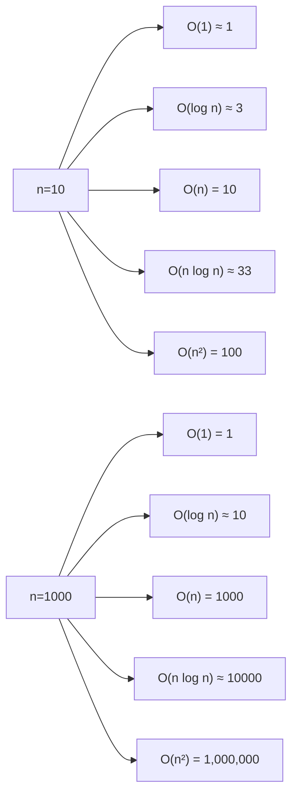

### Amortized vs Worst Case

| Operation | Worst | Amortized |
|---|---|---|
| `list.append` | O(n) on resize | O(1) |
| `set.add` | O(n) on resize | O(1) |
| `dict[k]=v` | O(n) on resize | O(1) |
| `set` lookup | O(n) hash collision | O(1) |

---

## 7. Choosing the Right Structure

### The Decision Tree

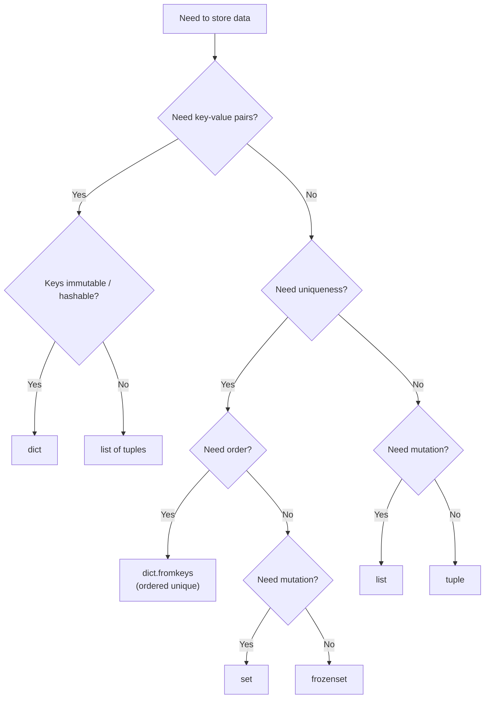

### When to Use Each

#### `list`
- Ordered, mutable collection.
- Homogeneous items.
- **Grow/shrink** over time.
- **Index by integer position.**
- Examples: buffer, queue, stack, results accumulator.

#### `tuple`
- Fixed-size ordered record.
- **Hashable** — usable as dict key / set member.
- **Faster** to create, less memory.
- **Multiple return values**.
- Examples: `(x, y)` coordinates, function return, DB row.

#### `dict`
- Key-value mapping.
- **Ordered by insertion** (3.7+).
- O(1) lookup by key.
- Examples: config, cache, JSON, record.

#### `set`
- Unique membership.
- O(1) `in` tests.
- Set algebra.
- Examples: dedupe, seen-set, permissions.

#### `frozenset`
- Set that needs to be **hashable**.
- Key in another dict/set.
- Example: group key, canonical tag set.

#### `deque`
- **Fast append/pop at both ends** (O(1)).
- Queue, stack, sliding window.
- Example: BFS queue, LRU cache.

#### `Counter`, `defaultdict`, `OrderedDict`
- Task-specific dict variants — see `collections`.

### Choosing by Operation

| Primary op | Best structure |
|---|---|
| Iterate in order | list, tuple |
| Add / remove at end | list |
| Add / remove at start | deque |
| Lookup by key | dict |
| Membership test | set, dict |
| Deduplicate | set, dict.fromkeys |
| Sort | list |
| Immutable record | tuple, NamedTuple, frozen dataclass |
| Hashable container | tuple, frozenset |
| Group by key | defaultdict(list) |
| Count things | Counter |
| FIFO order control | OrderedDict, deque |

### Choosing by Size

| Size | Recommendation |
|---|---|
| 1–5 | tuple or list — simplicity wins |
| 10–1,000 | list if sequential; set if membership |
| 1k–1M | set/dict for lookup; list for ordered iteration |
| >1M | Consider `numpy`, `array`, `pandas` |

### Space vs Speed

| Structure | Memory | Speed |
|---|---|---|
| `tuple` | Lowest | Fast iteration |
| `list` | Low | Fast append/index |
| `set` | High | Fastest membership |
| `dict` | High | Fast lookup/insert |
| `deque` | Medium | Fast both-ends |
| `array.array` | Very low | Numeric ops |
| `numpy.ndarray` | Low | Vectorized |

### Antipattern Gallery

```python
# ❌ Using a list as a set
seen = []
for x in items:
    if x not in seen:       # O(n)
        seen.append(x)
# ✅ Use a set
seen = set()

# ❌ Using a dict when keys are sequential
d = {0: "a", 1: "b", 2: "c"}
# ✅ Use a list
lst = ["a", "b", "c"]

# ❌ Using a list of tuples as a lookup
LOOKUP = [("key1", "val1"), ("key2", "val2")]
for k, v in LOOKUP:
    if k == target:         # O(n)
        ...
# ✅ Use a dict
LOOKUP = {"key1": "val1", "key2": "val2"}

# ❌ Using a set when order matters
events = {"login", "click", "logout"}
# ✅ Use a list or dict.fromkeys
events = ["login", "click", "logout"]
```

### The "Rule of Three" for Container Choice

1. **Default to list** for ordered collections.
2. **Reach for dict** when you need lookup by key.
3. **Reach for set** when you need uniqueness/membership.

Everything else is a specialization.

---

## 8. Hashing Basics

### What Is a Hash?

A **hash function** maps an object to a fixed-size integer — its **hash value** — deterministically:

```python
hash("hello")           # some integer
hash(42)                # 42 (for ints, hash = value, except -1)
hash((1, 2))            # combined hash of elements
hash(3.14)              # some integer
```

### Hash Contract — The Rules

For `hash(x)` to work correctly:

1. **Deterministic** — same object ⇒ same hash within a run.
2. **Consistent with equality** — `a == b` implies `hash(a) == hash(b)`.
3. **Fast** — O(1) ideally (or O(size of object) once, cached).
4. **Immutable-dependent** — objects that can change must not be hashable.

### Why Dicts and Sets Rely on Hashing

A hash table uses `hash(key)` to find the slot where the key lives. If the hash could change, the key would "vanish" from lookup:

```python
# Hypothetical — Python doesn't allow this
lst = [1, 2, 3]
d = {tuple(lst): "value"}

lst.append(4)         # if lst were the key, its hash would change
d[lst]                # would fail to find
```

By making mutable containers **unhashable**, Python prevents this class of bugs.

### The Hash-Eq Contract in Practice

```python
class Point:
    def __init__(self, x, y):
        self.x, self.y = x, y

    def __eq__(self, other):
        return isinstance(other, Point) and (self.x, self.y) == (other.x, other.y)

    def __hash__(self):
        return hash((self.x, self.y))

p1 = Point(1, 2)
p2 = Point(1, 2)
p1 == p2               # True
hash(p1) == hash(p2)   # True

d = {p1: "value"}
d[p2]                  # "value" — found via hash
```

**If you define `__eq__`, define `__hash__` too** — otherwise Python sets `__hash__ = None`, making instances unhashable.

```python
class Bad:
    def __eq__(self, other): return True

Bad() in {Bad()}       # ❌ TypeError: unhashable type: 'Bad'
```

### What Types Are Hashable?

| Hashable | Unhashable |
|---|---|
| `int`, `float`, `bool` | `list` |
| `str`, `bytes` | `dict` |
| `tuple` (if elements hashable) | `set` |
| `frozenset` | `bytearray` |
| `None` | custom mutable objects (without `__hash__`) |
| Custom immutable classes | |

### Hash Collisions

Two different objects can have the **same hash**. This is not a bug — it's expected. The hash table resolves collisions via probing + equality checks.

```python
hash(1) == hash(1.0)   # True — 1 == 1.0
hash(True) == hash(1)  # True — True == 1
hash("a") == hash("b") # False usually, but not guaranteed
```

**Hash collisions ≠ equality.** The dict does an additional `==` check before returning a value.

### Custom `__hash__` — Best Practices

```python
class User:
    def __init__(self, id_, email):
        self.id = id_
        self.email = email

    def __eq__(self, other):
        if not isinstance(other, User):
            return NotImplemented
        return self.id == other.id

    def __hash__(self):
        return hash(self.id)
```

Guidelines:
- Hash a **tuple of the fields used in `__eq__`**.
- Use immutable fields.
- Don't hash mutable state.
- Don't rely on `id(self)` — breaks equality.

### `__hash__ = None` — Disabling Hashability

```python
class Mutable:
    __hash__ = None

hash(Mutable())    # ❌ TypeError: unhashable type: 'Mutable'
```

This is what happens automatically when you define `__eq__` without `__hash__` in a class.

### Python's Hash Randomization

Since Python 3.3, `str` and `bytes` hashes are **randomized per process** (PEP 456) to prevent hash-collision DoS attacks:

```python
$ python -c 'print(hash("hello"))'
1234567890123456789
$ python -c 'print(hash("hello"))'
-9876543210987654321   # different across runs
```

Numeric hashes (`int`, `float`) are stable.

To disable randomization (for reproducibility):

```bash
PYTHONHASHSEED=0 python script.py
```

### Hash for Common Types

| Type | Hash value |
|---|---|
| `int` | The int itself (except `-1` maps to `-2`) |
| `float` | Derived from IEEE 754 bits |
| `bool` | `hash(0)` or `hash(1)` |
| `str` | SipHash of the code points (randomized) |
| `bytes` | Similar to str |
| `tuple` | Combination of element hashes (order-sensitive) |
| `frozenset` | Order-independent combination |
| `None` | A constant |

### `hash(-1)` — The Special Case

```python
hash(-1)     # -2 (not -1 — reserved as error sentinel in CPython)
hash(0)      # 0
hash(1)      # 1
```

### Dict Lookup — Full Flow

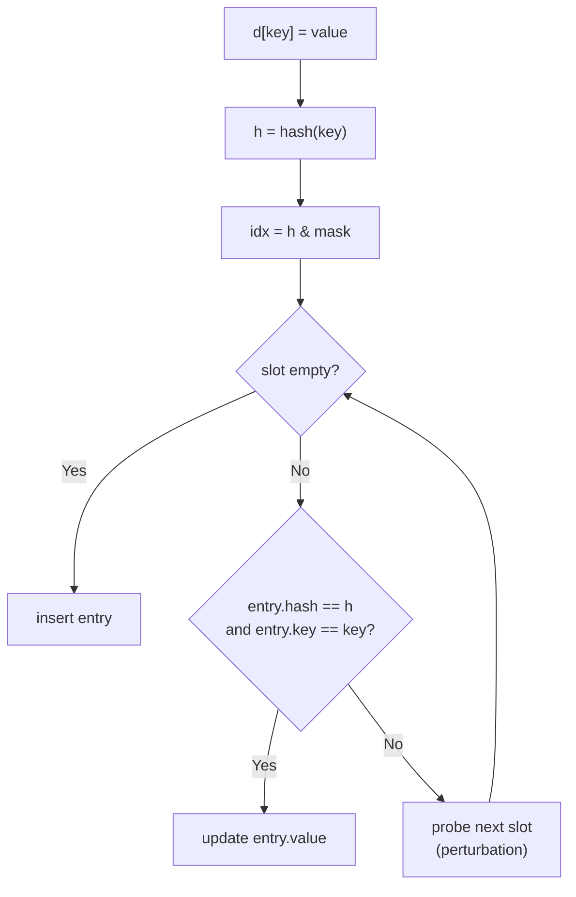

### Why Lists Can't Be Keys

1. Lists are mutable — their content can change.
2. A mutable hash would break lookups.
3. Python conservatively sets `list.__hash__ = None`.
4. You get a clear `TypeError` rather than silent corruption.

Convert to a hashable equivalent:

```python
lst = [1, 2, 3]

# ✅ Tuple
key = tuple(lst)

# ✅ Frozenset (order-independent)
key = frozenset(lst)

# ✅ String representation (careful with collisions)
key = ",".join(map(str, lst))
```

### Uses of Hashing Beyond Dicts/Sets

- **Bloom filters** — probabilistic membership.
- **Content-addressable storage** — hash the content as a key.
- **Caching** — hash inputs to look up memoized results.
- **Password storage** — `hashlib` (SHA-256, bcrypt, argon2) — not `hash()`, which is for hash tables.
- **Deduplication** — hash data to identify duplicates.

### Pitfall — `id()` Is Not a Hash

```python
a = [1, 2, 3]
b = [1, 2, 3]

id(a) == id(b)         # False — different objects
hash(tuple(a)) == hash(tuple(b))   # True — equal content
```

### Pitfall — Mutable Default in Sets/Dicts

```python
bad_keys = set()
for x in items:
    bad_keys.add(x)          # ✅ only if x is hashable

# If x might be a list:
try:
    key = tuple(x)           # ✅ convert
except TypeError:
    raise ValueError(f"unhashable: {x}")
```

### Pitfall — Equality Without Hash

```python
class Point:
    def __init__(self, x, y): self.x, self.y = x, y
    def __eq__(self, other): return (self.x, self.y) == (other.x, other.y)
    # __hash__ not defined — becomes None!

p = Point(1, 2)
{p}                          # ❌ TypeError: unhashable

# ✅ Fix — define both
class Point:
    def __init__(self, x, y): self.x, self.y = x, y
    def __eq__(self, other): return (self.x, self.y) == (other.x, other.y)
    def __hash__(self): return hash((self.x, self.y))
```

### Hashing Summary Table

| Aspect | Value |
|---|---|
| Purpose | O(1) dict/set lookups |
| Contract | `a == b` ⇒ `hash(a) == hash(b)` |
| Mutable ⇒ | Unhashable (usually) |
| Collisions | Allowed; resolved by `==` |
| Randomized | `str`/`bytes` per process (PEP 456) |
| Custom | Define `__hash__` with `__eq__` |
| Disable | `__hash__ = None` |

---

## 9. Real-World Use Cases

### Use Case 1 — Picking the Right Container for a Task

```python
# Task: track unique visitors to a page
visitors = set()                  # O(1) add & contains

# Task: count page views per user
views = {}                        # O(1) lookup by user
for user in log:
    views[user] = views.get(user, 0) + 1

# Task: preserve visit order
ordered_visits = []               # append is O(1)

# Task: quickly test "did user visit?"
visited_set = set(ordered_visits)

# Task: iterate visits in order with dedupe
unique_visits = list(dict.fromkeys(ordered_visits))
```

### Use Case 2 — Memoization

```python
from functools import lru_cache

@lru_cache(maxsize=None)
def fib(n):
    return n if n < 2 else fib(n - 1) + fib(n - 2)

# Under the hood: a dict keyed by tuple of args
```

### Use Case 3 — Cycle Detection with Sets

```python
def has_cycle(graph, start):
    visited = set()
    stack = [start]
    while stack:
        node = stack.pop()
        if node in visited:
            return True
        visited.add(node)
        stack.extend(graph[node])
    return False
```

### Use Case 4 — Two-Sum with Dict

```python
def two_sum(nums, target):
    seen = {}
    for i, n in enumerate(nums):
        complement = target - n
        if complement in seen:
            return [seen[complement], i]
        seen[n] = i
    return None

two_sum([2, 7, 11, 15], 9)   # [0, 1]
```

### Use Case 5 — Shallow vs Deep Copy Decision

```python
# ✅ Shallow — list of ints, safe
config = [1, 2, 3]
backup = config.copy()

# ✅ Deep — nested structure needing isolation
import copy
tree = {"a": {"b": [1, 2]}}
snapshot = copy.deepcopy(tree)
```

### Use Case 6 — Choosing by Access Pattern

```python
# Frequent membership test → set
allowed_hosts = {"a.com", "b.com", "c.com"}

# Frequent lookup by key → dict
users_by_id = {1: "Ada", 2: "Alan"}

# Frequent ordered iteration → list
events = [("login", "alice"), ("logout", "bob")]

# Fixed schema record → tuple
Row = ("Ada", 36, "London")
```

### Use Case 7 — Avoiding Quadratic Algorithms

```python
# ❌ O(n²) — naive
def has_duplicates_naive(items):
    for i in range(len(items)):
        for j in range(i + 1, len(items)):
            if items[i] == items[j]:
                return True
    return False

# ✅ O(n) — with a set
def has_duplicates(items):
    return len(set(items)) < len(items)
```

---

## 10. Common Pitfalls — Cross-Structure

### Pitfall 1 — `is` vs `==`

```python
[1, 2] == [1, 2]     # True
[1, 2] is [1, 2]     # False

a = [1, 2]
b = a
a is b               # True
a == b               # True
```

**Rule:** use `is` only for `None`, `True`, `False`, sentinels.

### Pitfall 2 — Aliasing

```python
a = [1, 2]
b = a
b.append(3)
print(a)             # [1, 2, 3] — surprise!
```

### Pitfall 3 — Shallow Copy Sharing

```python
a = [[1, 2], [3, 4]]
b = a.copy()
b[0].append(99)
print(a)             # [[1, 2, 99], [3, 4]]
```

### Pitfall 4 — Mutable Default Arguments

```python
def f(target=[]):    # ❌ shared
    target.append(1)
    return target
```

### Pitfall 5 — Mutating During Iteration

```python
for k in d:
    del d[k]         # ❌ RuntimeError
```

Fix: iterate over `list(d)`.

### Pitfall 6 — `+=` on Mutable vs Immutable

```python
# Lists mutate in place
a = [1, 2]
b = a
a += [3]
print(b)             # [1, 2, 3]

# Strings/tuples rebind
a = "ab"
b = a
a += "c"
print(b)             # 'ab'
```

### Pitfall 7 — Hashability Assumptions

```python
d = {}
d[[1, 2]] = "no"     # ❌ TypeError
d[(1, 2)] = "yes"    # ✅
```

### Pitfall 8 — O(n) Membership in a Loop

```python
for x in big_list:
    if x in other_big_list:   # ❌ O(n²)
        ...
```

Fix: convert to set.

### Pitfall 9 — Reusing a Consumed Iterator

```python
it = iter([1, 2, 3])
list(it)             # [1, 2, 3]
list(it)             # [] — empty!
```

### Pitfall 10 — Expecting Order from Sets

```python
s = {3, 1, 2}
list(s)              # any order across runs
```

### Pitfall 11 — Assuming Tuple Immutability Is Deep

```python
t = (1, [2, 3])
t[1].append(99)      # ✅ works
```

### Pitfall 12 — Equality Without Hash for Custom Classes

```python
class C:
    def __eq__(self, other): return True

{C()}                # ❌ TypeError
```

### Pitfall Summary Table

| Pitfall | Symptom | Fix |
|---|---|---|
| `is` for values | Wrong results | Use `==` |
| Aliasing | Spooky mutations | Copy explicitly |
| Shallow copy shares | Inner mutated | `deepcopy` |
| Mutable default | Shared state | `None` sentinel |
| Mutate while iter | RuntimeError | `list(d)` snapshot |
| `list in dict` key | TypeError | Use tuple/frozenset |
| `x in list` loop | O(n²) | Use set |
| Set order | Not preserved | Use list/dict |
| Nested mutable in tuple | Hash fails | All-hashable |
| `__eq__` without `__hash__` | Unhashable | Define both |

---

## 11. Comparison Tables

### The Grand Data Structure Table

| Feature | list | tuple | set | frozenset | dict |
|---|---|---|---|---|---|
| Ordered | ✅ | ✅ | ❌ | ❌ | ✅ (3.7+) |
| Mutable | ✅ | ❌ | ✅ | ❌ | ✅ |
| Hashable | ❌ | ✅* | ❌ | ✅ | ❌ |
| Indexable | ✅ | ✅ | ❌ | ❌ | keys only |
| Duplicates | ✅ | ✅ | ❌ | ❌ | keys unique |
| `in` complexity | O(n) | O(n) | O(1) | O(1) | O(1) |
| Insert | O(1)* | — | O(1)* | — | O(1)* |
| Delete | O(n) | — | O(1)* | — | O(1)* |
| Memory | Medium | Low | High | High | High |
| Literal | `[]` | `()` | `{1}` | `frozenset()` | `{}` |
| When to use | Sequences | Records | Membership | Hashable sets | Mapping |

\*If all elements hashable. \*Amortized.

### Copy Operation Matrix

| Operation | New outer | New inner | Preserves identity |
|---|---|---|---|
| `b = a` | ❌ | ❌ | ✅ same object |
| `b = a[:]` | ✅ | ❌ | New outer |
| `b = a.copy()` | ✅ | ❌ | New outer |
| `b = list(a)` | ✅ | ❌ | New outer |
| `b = copy.copy(a)` | ✅ | ❌ | New outer |
| `b = copy.deepcopy(a)` | ✅ | ✅ | Fully new |
| `b = a + []` | ✅ | ❌ | New outer |

### Time Complexity Cheat Sheet

| Operation | list | tuple | str | set | dict |
|---|---|---|---|---|---|
| Access by index | O(1) | O(1) | O(1) | — | O(1)* |
| Slice | O(k) | O(k) | O(k) | — | — |
| Append / Add | O(1)* | — | — | O(1)* | O(1)* |
| Insert at front | O(n) | — | — | — | — |
| Delete by value | O(n) | — | — | O(1)* | O(1)* |
| Delete by index | O(n) | — | — | — | — |
| `x in y` | O(n) | O(n) | O(n·m) | O(1)* | O(1)* |
| Length | O(1) | O(1) | O(1) | O(1) | O(1) |
| Iterate | O(n) | O(n) | O(n) | O(n) | O(n) |
| Sort | O(n log n) | — | — | — | — |
| Copy | O(n) | O(1)** | O(1)** | O(n) | O(n) |

\*Average. \*\*Tuple and string slicing return the same object when possible.

### Choosing by Task

| Task | Best | Alternative |
|---|---|---|
| Ordered sequence | `list` | `tuple` |
| Immutable record | `tuple`, `NamedTuple` | frozen dataclass |
| Membership test | `set` | `dict` |
| Key → value | `dict` | `defaultdict` |
| Count things | `Counter` | `defaultdict(int)` |
| Group by key | `defaultdict(list)` | `dict.setdefault` |
| Unique but ordered | `dict.fromkeys` | — |
| Fast at both ends | `deque` | — |
| Hashable set | `frozenset` | — |
| Numeric array | `numpy.ndarray` | `array.array` |

### Hashability Summary

| Type | Hashable | Notes |
|---|---|---|
| `int`, `float`, `bool` | ✅ | Value-based |
| `str`, `bytes` | ✅ | Randomized per process |
| `tuple` | ✅ if all elements hashable | |
| `frozenset` | ✅ | Order-independent |
| `None` | ✅ | Constant hash |
| `list` | ❌ | Mutable |
| `dict` | ❌ | Mutable |
| `set` | ❌ | Mutable |
| `bytearray` | ❌ | Mutable |
| Custom (with `__hash__`) | ✅ | User-defined |
| Custom (only `__eq__`) | ❌ | `__hash__ = None` |

---

## 12. Mermaid — Master Decision Diagram

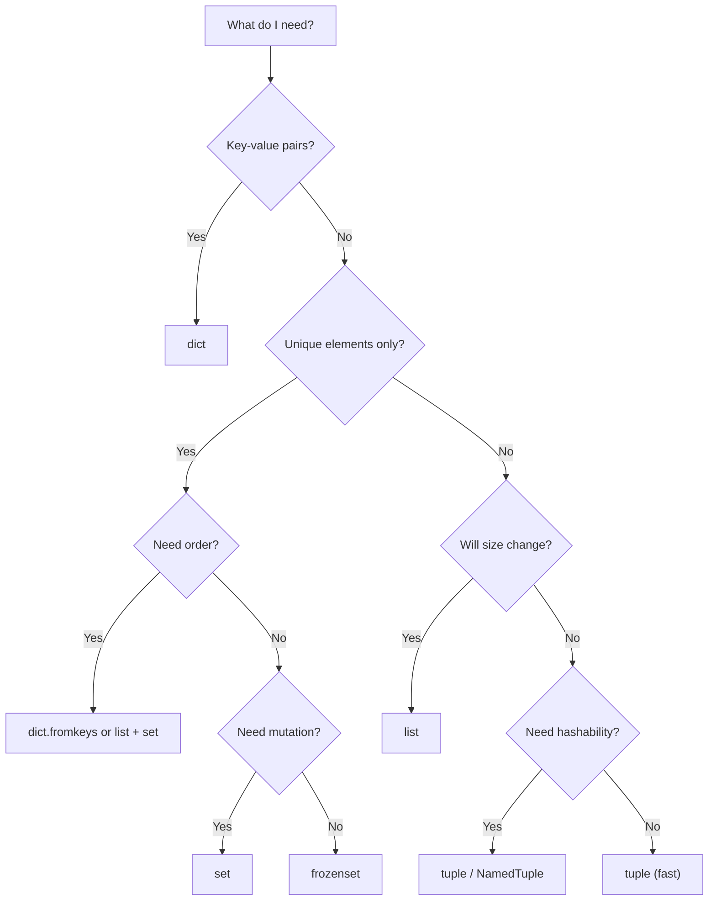

### Hashing — Where It Powers Everything

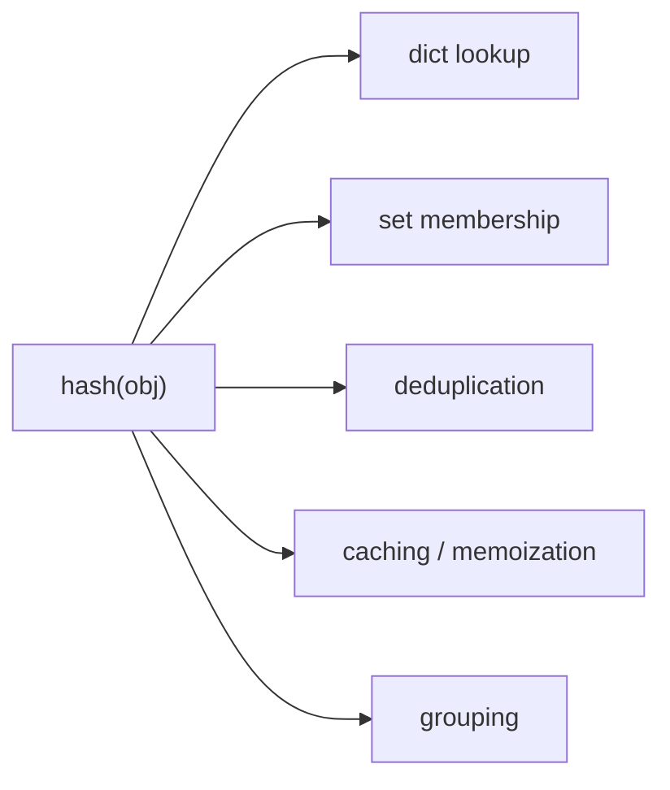

### Copying — Depth Levels

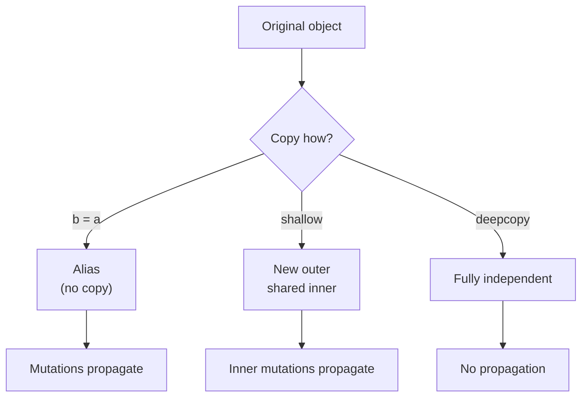

---

## 13. Performance Notes

### Measure, Don't Guess

```python
import timeit

timeit.timeit("x in list_", globals=globals(), number=1000)
timeit.timeit("x in set_", globals=globals(), number=1000)
```

Use `timeit` for micro-benchmarks; `cProfile` for full programs.

### `cProfile` Example

```python
import cProfile, pstats

def slow():
    total = 0
    for i in range(100_000):
        total += sum(range(i % 100))
    return total

cProfile.run("slow()", "profile.out")
pstats.Stats("profile.out").sort_stats("cumulative").print_stats(10)
```

### Memory Comparison

```python
import sys

sys.getsizeof([])                       # 56
sys.getsizeof([0] * 100)                # 856
sys.getsizeof(())                       # 40
sys.getsizeof(tuple([0] * 100))         # 840
sys.getsizeof(set())                    # 216
sys.getsizeof({"a": 1})                 # 184
sys.getsizeof("")                       # 49
sys.getsizeof("x" * 100)                # 149
```

Rules of thumb:
- **Tuples < lists < sets/dicts** in memory.
- **Sets/dicts** have higher per-item overhead due to hash-table slots.
- **`__slots__`** reduces per-instance memory for classes.

### Amortized Resizing — Visual

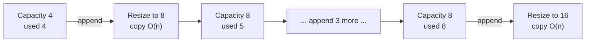

Amortized: **n appends = O(n)** total, despite occasional O(n) resizes.

### Trade-offs Table

| Data structure | Speed | Memory | Flexibility |
|---|---|---|---|
| `tuple` | ⚡ | 🟢 | 🔴 |
| `list` | ⚡⚡ | 🟡 | 🟢 |
| `set` | ⚡⚡ (membership) | 🔴 | 🟡 |
| `dict` | ⚡⚡ (lookup) | 🔴 | 🟢 |
| `deque` | ⚡ (both ends) | 🟡 | 🟡 |
| `numpy` | ⚡⚡⚡ (numeric) | 🟢 | 🔴 |

---

## 14. Quick Reference Card

```python
# SEQUENCES — indexing & slicing
seq[i]                        # O(1)
seq[a:b:c]                    # O(k), new object
seq[::-1]                     # reversed
seq[:]                        # copy (or same obj for tuple/str)

# MUTABILITY
# Immutable: int, float, bool, str, tuple, frozenset, bytes
# Mutable:   list, dict, set, bytearray
# Hashable ⇒ usually immutable

# COPYING
b = a                         # alias
b = a[:]                      # shallow copy (list/tuple/str)
b = a.copy()                  # shallow copy (list/dict/set)
import copy
b = copy.copy(a)              # shallow
b = copy.deepcopy(a)          # deep

# TIME COMPLEXITY (avg)
# list:  x[i] O(1) | append O(1) | in O(n) | del O(n) | sort O(n log n)
# dict:  d[k] O(1) | in O(1) | del O(1) | iterate O(n)
# set:   in O(1) | add O(1) | remove O(1) | iterate O(n)
# str:   s[i] O(1) | in O(n·m) | concat via join O(n)

# CHOOSING
# Ordered collection           → list
# Fixed record, hashable       → tuple
# Membership / dedupe          → set
# Immutable set                → frozenset
# Key→value lookup             → dict
# Fast at both ends            → collections.deque
# Counting                     → collections.Counter
# Auto-initializing values     → collections.defaultdict

# HASHING
# hash(x) = integer, deterministic per run
# a == b ⇒ hash(a) == hash(b)
# Keys: hashable ⇒ immutable (usually)
# hash(-1) = -2 (special case)
# str/bytes hashes randomized per process (PEP 456)
# Define __hash__ with __eq__; or set __hash__ = None

# IDIOMS
unique_ordered = list(dict.fromkeys(seq))
fast_membership = set(seq)
lookup = dict(zip(keys, values))
groups = defaultdict(list)
counts = Counter(items)
```

---

## Summary

- **Every Python container is a reference structure** — variables bind, containers hold references, and assignment never copies.
- **Sequence protocol** (`__getitem__`, `__len__`) enables indexing, slicing, and iteration across `list`, `tuple`, `str`, `range`, and custom classes.
- **Slicing returns new objects** (except tuple/str with `[:]`) — O(k), never in-place; **slice assignment** mutates lists only.
- **Mutability vs immutability** determines hashability, thread-safety, and whether operations return new objects or mutate in place.
- **Shallow copy** duplicates the outer container but shares inner objects; **deep copy** recurses — use `copy.deepcopy` for true isolation.
- **Time complexity is the language of choice**: O(1) lookup with `dict`/`set`, O(n) membership with `list`, O(n log n) sorting, O(n²) from nested loops over data.
- **Choose by access pattern**: ordered iteration → `list`; fixed record → `tuple`; membership → `set`; key lookup → `dict`; both-ends → `deque`.
- **Hashing is the engine** behind `dict` and `set` — the contract `a == b ⇒ hash(a) == hash(b)` guarantees correct lookups; mutable types are unhashable by design.
- **Define `__eq__` and `__hash__` together** in custom classes — otherwise Python sets `__hash__ = None`.
- **Pitfalls cluster around aliasing, shallow copies, mutable defaults, mutation-during-iteration, and assuming order on unordered types.**