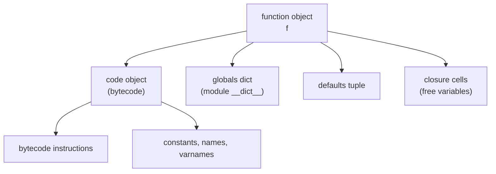
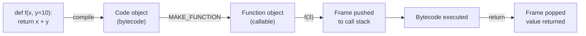
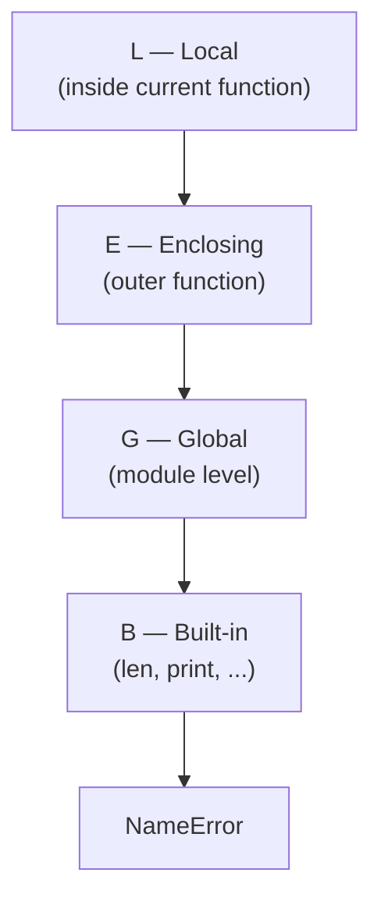
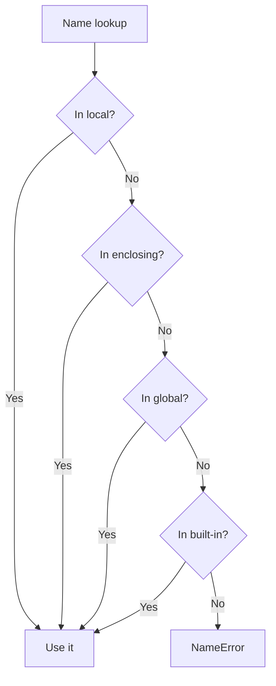
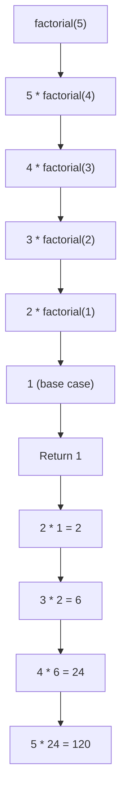
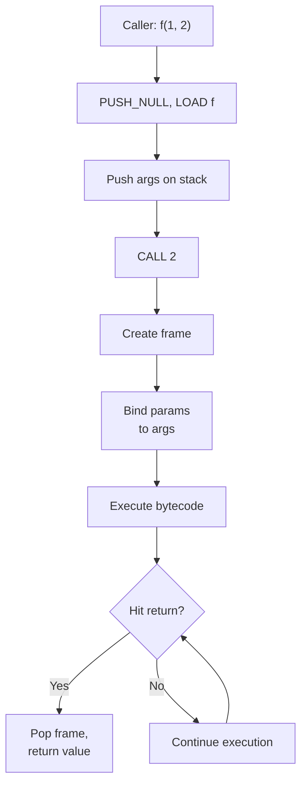
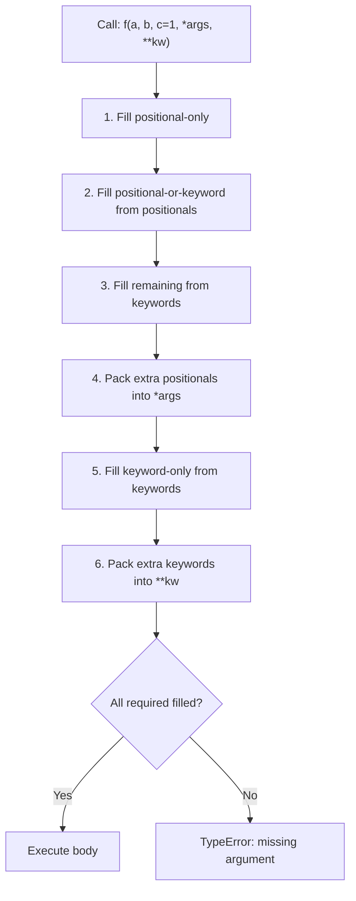
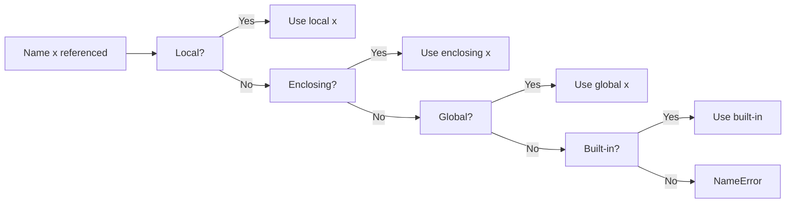

# Functions — Detailed Notes

---

## 1. What Is It? (Concept & Under the Hood)

A **function** is a **reusable, named block of code** that takes inputs (arguments), performs work, and optionally returns outputs. In Python, functions are **first-class objects** — they can be assigned to variables, passed as arguments, returned from other functions, and stored in data structures.

Key properties:
- **First-class** — functions are objects, just like ints and strings.
- **Callable** — invoking `f(...)` executes the function body.
- **Namespaced** — each function has its own local scope.
- **Closure-capable** — can capture variables from enclosing scopes.
- **Decoratable** — can be wrapped to add behavior.
- **Introspectable** — has attributes like `__name__`, `__doc__`, `__annotations__`.

### Under the Hood — CPython's `PyFunctionObject`

A function is a **compiled code object** wrapped in a runtime object:

```c
typedef struct {
    PyObject_HEAD
    PyObject *func_code;        // PyCodeObject — the bytecode
    PyObject *func_globals;     // reference to module globals
    PyObject *func_defaults;    // tuple of default values
    PyObject *func_kwdefaults;  // dict of keyword-only defaults
    PyObject *func_closure;     // tuple of cell objects (free vars)
    PyObject *func_doc;         // docstring
    PyObject *func_name;        // name
    PyObject *func_dict;        // arbitrary attributes (__dict__)
    PyObject *func_annotations; // type hints
    PyObject *func_qualname;    // qualified name (Class.method)
} PyFunctionObject;
```

Three key pieces:



- **Code object** — immutable; shared across functions created from the same `def`.
- **Globals dict** — the module's namespace at definition time.
- **Closure cells** — captured values from enclosing scopes.
- **Defaults** — evaluated once at `def` time (this matters!).

### The Function Lifecycle



Each call pushes a **frame** onto the Python call stack, executes bytecode, and pops when done.

### How a Call Compiles

```python
import dis
dis.dis("f(1, 2)")
```

```
  0 PUSH_NULL
  2 LOAD_NAME    0 (f)
  4 LOAD_CONST   1 (1)
  6 LOAD_CONST   2 (2)
  8 CALL         2
 10 RETURN_VALUE
```

Key opcode: **`CALL`** — passes positional args as a tuple-like sequence on the stack.

### Characteristics

| Aspect | Value |
|---|---|
| Call overhead | ~50–200 ns (small but not free) |
| Scope | Local, enclosing, global, built-in (LEGB) |
| Attributes | `__name__`, `__doc__`, `__dict__`, `__annotations__` |
| Types | Named (`def`), anonymous (`lambda`), bound methods, built-ins |
| Callable check | `callable(x)` → `bool` |

---

## 2. Defining Functions

### Basic Form

```python
def greet(name):
    """Return a greeting for name."""
    return f"Hello, {name}!"

greet("Ada")        # 'Hello, Ada!'
```

### The `def` Statement

```python
def function_name(parameters):
    """Optional docstring."""
    # body
    return value    # optional
```

- **`def`** — keyword that starts the definition.
- **`function_name`** — becomes a name bound to the function object.
- **`parameters`** — comma-separated names.
- **Body** — indented block, runs on each call.
- **`return`** — optional; without it, returns `None`.

### Functions Are Objects

```python
def add(a, b):
    return a + b

print(add)           # <function add at 0x...>
print(add.__name__)  # 'add'
print(add.__doc__)   # None
print(type(add))     # <class 'function'>

f = add              # assign to variable
f(1, 2)              # 3

funcs = [add, len, print]    # store in list
funcs[0](1, 2)               # 3
```

### Nested Functions

```python
def outer(x):
    def inner(y):
        return y * 2
    return inner(x) + 1

outer(5)     # 11
```

`inner` is only visible inside `outer` — it's a local name in `outer`'s scope.

### Returning Functions (Higher-Order)

```python
def make_multiplier(n):
    def multiply(x):
        return x * n
    return multiply

double = make_multiplier(2)
triple = make_multiplier(3)

double(5)     # 10
triple(5)     # 15
```

The returned `multiply` closes over `n` — a **closure**.

### Multiple Return Values (Actually a Tuple)

```python
def min_max(nums):
    return min(nums), max(nums)

lo, hi = min_max([3, 1, 4, 1, 5])
# lo=1, hi=5
```

Python returns one object; a tuple is idiomatically "multiple values".

### `pass`, Empty Bodies

```python
def placeholder():
    pass

def raise_not_implemented():
    raise NotImplementedError

def empty():
    ...                # Ellipsis literal — same as pass (style)
```

### Function Attributes

```python
def f():
    pass

f.custom = "value"
f.custom             # 'value'
f.__dict__           # {'custom': 'value'}
```

Every function has a mutable `__dict__` for attaching metadata.

### `del` a Function

```python
def f(): pass
del f
f()                  # ❌ NameError
```

### Re-Defining a Function

```python
def f(): return 1
def f(): return 2    # silently replaces the previous binding
f()                  # 2
```

This is legal — the name is just rebound. Decorators rely on this behavior.

---

## 3. Arguments — The Complete Toolkit

### Positional Arguments

```python
def power(base, exp):
    return base ** exp

power(2, 3)          # 8  — arguments matched left to right
power(3, 2)          # 9
```

### Keyword Arguments

```python
power(exp=3, base=2)  # 8 — matched by name, order irrelevant
power(2, exp=3)       # 8 — mix positional + keyword
```

**Rule:** positional args must come **before** keyword args in a call.

```python
power(exp=3, 2)       # ❌ SyntaxError
```

### Default Arguments

```python
def greet(name, greeting="Hello"):
    return f"{greeting}, {name}!"

greet("Ada")                    # 'Hello, Ada!'
greet("Ada", "Hi")              # 'Hi, Ada!'
greet("Ada", greeting="Hey")    # 'Hey, Ada!'
```

**Defaults are evaluated ONCE at `def` time** — the classic mutable default trap:

```python
def bad(item, target=[]):        # ❌ shared list across calls
    target.append(item)
    return target

bad(1)       # [1]
bad(2)       # [1, 2] — surprise!
bad(3)       # [1, 2, 3]

def good(item, target=None):     # ✅
    if target is None:
        target = []
    target.append(item)
    return target
```

### `*args` — Variadic Positional

Collects extra positional args into a **tuple**:

```python
def total(*args):
    return sum(args)

total()              # 0
total(1, 2, 3)       # 6
total(*[1, 2, 3])    # 6 — unpacking a list
total(*(1, 2, 3))    # 6
```

The name `args` is conventional; `*nums` works too.

### `**kwargs` — Variadic Keyword

Collects extra keyword args into a **dict**:

```python
def describe(**kwargs):
    for k, v in kwargs.items():
        print(f"{k} = {v}")

describe(name="Ada", age=36)
# name = Ada
# age = 36

describe(**{"name": "Ada", "age": 36})   # unpacking a dict
```

### `*args` and `**kwargs` Together

```python
def wrapper(*args, **kwargs):
    print("args:", args)
    print("kwargs:", kwargs)

wrapper(1, 2, 3, x=4, y=5)
# args: (1, 2, 3)
# kwargs: {'x': 4, 'y': 5}
```

The canonical decorator signature.

### Ordering Rules

When defining a function, parameters must appear in this order:

```
def f(pos_only, /, normal, *args, kw_only, **kwargs):
      └─ position only    └─ var-pos   └─ kw-only   └─ var-kw
```

Full example:

```python
def complex_func(a, b, /, c, d, *args, e, f, **kwargs):
    return (a, b, c, d, args, e, f, kwargs)

complex_func(1, 2, 3, 4, 5, 6, e=7, f=8, g=9)
# (1, 2, 3, 4, (5, 6), 7, 8, {'g': 9})
```

### Unpacking in Calls

```python
def f(a, b, c):
    return a + b + c

args = [1, 2, 3]
f(*args)             # 6

kwargs = {"a": 1, "b": 2, "c": 3}
f(**kwargs)          # 6

f(*[1, 2], **{"c": 3})   # 6 — mixed
```

### Default vs None vs Sentinel

```python
# Default value is fine if immutable
def f(x=0, y="", z=None):
    ...

# If you need to distinguish "not provided" from "None"
_MISSING = object()

def f(x=_MISSING):
    if x is _MISSING:
        x = compute_default()
    ...
```

### Argument Summary Table

| Syntax | Purpose | Type received |
|---|---|---|
| `def f(a, b):` | Positional or keyword | Any |
| `def f(a, b=1):` | Default value | Any |
| `def f(*args):` | Variadic positional | Tuple |
| `def f(**kwargs):` | Variadic keyword | Dict |
| `def f(a, /, b):` | `a` is positional-only | Any |
| `def f(*, b):` | `b` is keyword-only | Any |
| `def f(a, *args, b=1):` | Mix — `b` keyword-only | Any |

---

## 4. Keyword-Only and Positional-Only Arguments

### Positional-Only (`/`) — Python 3.8+

Parameters **before** `/` can only be passed positionally:

```python
def divide(a, b, /):
    return a / b

divide(10, 2)        # 5.0
divide(a=10, b=2)    # ❌ TypeError: divide() got some positional-only arguments passed as keyword arguments
```

Useful for:
- Preventing parameter names from becoming part of the public API.
- Allowing `*args` to share names with keywords (`def f(name, /, **kwargs)`).
- Performance — positional-only avoids kwarg dict construction.

### Keyword-Only (`*`) — Python 3.0+

Parameters **after** `*` must be passed by keyword:

```python
def configure(*, debug=False, verbose=False):
    ...

configure(debug=True)              # ✅
configure(True)                    # ❌ TypeError: takes 0 positional arguments
```

Useful for:
- Self-documenting call sites (`f(debug=True)` vs `f(True)`).
- Preventing accidental positional misuse.
- Forcing clarity for boolean flags.

### Combining Both

```python
def f(a, b, /, c, d, *, e, f):
    return a, b, c, d, e, f

f(1, 2, 3, 4, e=5, f=6)      # ✅
f(1, 2, 3, d=4, e=5, f=6)    # ✅
f(1, 2, c=3, d=4, e=5, f=6)  # ✅
f(1, 2, 3, 4, 5, 6)          # ❌ e, f must be keyword
f(a=1, b=2, c=3, d=4, e=5, f=6)  # ❌ a, b are positional-only
```

### Why Positional-Only?

```python
def log(message, /, *, level="INFO"):
    print(f"[{level}] {message}")

log("starting")                    # ✅
log("starting", level="DEBUG")     # ✅
log(message="starting")            # ❌ — message is positional-only
```

Benefit: refactor `message` to a different name internally without breaking callers.

### Why Keyword-Only?

```python
def plot(x, y, *, color="black", width=1):
    ...

# Call site is unambiguous
plot(1, 2, color="red", width=2)
```

Without `*`, callers might pass `plot(1, 2, "red", 2)` — easy to confuse.

### Named Parameters vs `**kwargs`

```python
# ✅ Explicit — self-documenting
def configure(*, debug=False, verbose=False, timeout=30):
    ...

# ❌ Opaque — reader must check docs
def configure(**options):
    debug = options.get("debug", False)
    verbose = options.get("verbose", False)
```

Prefer explicit keyword-only over `**kwargs` when you know the option names.

### Compatibility Signature — Python 3.7 and Earlier

Before `/` existed, positional-only was simulated by using `*args`:

```python
def divide(*args):
    a, b = args
    return a / b
```

Ugly — `/` fixes this cleanly (3.8+).

### Argument Form Comparison

| Form | Syntax | Callers can pass |
|---|---|---|
| Positional-only | `def f(a, /):` | `f(1)` only |
| Positional-or-keyword | `def f(a):` | `f(1)` or `f(a=1)` |
| Keyword-only | `def f(*, a):` | `f(a=1)` only |
| Variadic positional | `def f(*args):` | `f(1, 2, 3)` |
| Variadic keyword | `def f(**kw):` | `f(a=1, b=2)` |

---

## 5. Return Values

### `return` — Exit With a Value

```python
def add(a, b):
    return a + b

result = add(2, 3)   # 5
```

### Implicit `None`

```python
def log(msg):
    print(msg)       # no return

x = log("hi")
print(x)             # None
```

Every function returns something — if `return` is absent or bare, `None` is returned.

### Bare `return` — Early Exit

```python
def find_first(items, pred):
    for x in items:
        if pred(x):
            return x
    return None
```

### Returning Multiple Values

Return a tuple and unpack:

```python
def divmod_ext(a, b):
    return a // b, a % b, (a // b, a % b)

q, r, t = divmod_ext(17, 5)
```

### Early Return vs Else

```python
# ❌ Deeply nested
def process(x):
    if x > 0:
        if x < 100:
            if x != 50:
                return x * 2
            else:
                return None
        else:
            return None
    else:
        return None

# ✅ Guard clauses
def process(x):
    if x <= 0:
        return None
    if x >= 100:
        return None
    if x == 50:
        return None
    return x * 2
```

### `return` in Try/Except/Finally

```python
def f():
    try:
        return 1
    finally:
        print("cleanup")   # runs even after return

f()      # prints "cleanup", returns 1
```

A `return` inside `finally` overrides the one in `try`:

```python
def g():
    try:
        return 1
    finally:
        return 2       # ⚠️ dangerous — swallows exceptions

g()      # 2
```

Avoid `return` in `finally`.

### Return Type Consistency

```python
# ❌ Inconsistent — returns int or None
def find(key):
    if key in cache:
        return cache[key]
    # implicit None

# ✅ Documented as Optional
from typing import Optional

def find(key) -> Optional[int]:
    return cache.get(key)
```

### Returning `self` for Chaining

```python
class Query:
    def filter(self, cond):
        # ... apply filter
        return self

    def order_by(self, field):
        # ... apply order
        return self

result = Query().filter("x > 0").order_by("y").all()
```

### Returning Functions (Higher-Order)

```python
def adder(n):
    def add(x):
        return x + n
    return add

add5 = adder(5)
add5(3)      # 8
```

### `yield` Instead of `return` — Generators

```python
def countdown(n):
    while n > 0:
        yield n
        n -= 1

list(countdown(3))   # [3, 2, 1]
```

`yield` makes a function a **generator** — returns values lazily.

### Return Summary

| Situation | Returns |
|---|---|
| `return value` | `value` |
| `return` | `None` |
| no `return` | `None` |
| `return a, b` | `(a, b)` |
| `yield x` | generator object |

---

## 6. Scope — The LEGB Rule

### The Four Scopes

Python resolves names by looking in **four levels**, in order:



### Local Scope

```python
def f():
    x = 10      # local to f
    return x

f()             # 10
x               # ❌ NameError — x doesn't exist outside f
```

### Enclosing Scope (Closures)

```python
def outer():
    x = 10
    def inner():
        return x    # captures x from enclosing scope
    return inner()

outer()             # 10
```

### Global Scope

```python
x = 10              # module-level

def f():
    return x        # reads global x

f()                 # 10
```

### `global` — Assign to Global

```python
counter = 0

def increment():
    global counter      # declare intent
    counter += 1

increment()
counter                 # 1
```

Without `global`, `counter += 1` raises `UnboundLocalError` — because the assignment makes `counter` local throughout the function.

### `nonlocal` — Assign to Enclosing

```python
def make_counter():
    count = 0
    def increment():
        nonlocal count      # refer to enclosing scope
        count += 1
        return count
    return increment

c = make_counter()
c()     # 1
c()     # 2
c()     # 3
```

### `global` vs `nonlocal`

| | `global` | `nonlocal` |
|---|---|---|
| Target scope | Module | Nearest enclosing function |
| Must exist? | No (creates) | Yes (must exist in outer function) |
| Use case | Module-level state | Closures, counters |

### The `UnboundLocalError` Trap

```python
x = 10

def f():
    print(x)     # ❌ UnboundLocalError
    x = 20       # makes x local throughout the function

f()
```

**Rule:** If a name is assigned anywhere in a function, it's local everywhere in that function.

Fix: `global x` or rename.

### Built-in Scope

```python
len          # <built-in function len>

def f():
    len = 5  # shadows the built-in locally!
    return len

f()          # 5
```

Shadowing built-ins is legal but discouraged.

### `globals()` and `locals()`

```python
x = 10

def f():
    y = 20
    print(globals())    # module namespace
    print(locals())     # {'y': 20}

f()
```

Useful for debugging, but modifying these dicts is fragile.

### Scope Chain — Visual

```python
x = "global"

def outer():
    x = "enclosing"
    def inner():
        x = "local"
        print(x)         # "local"
    inner()
    print(x)             # "enclosing"

outer()
print(x)                 # "global"
```

### LEGB — Mermaid



### Common Scope Patterns

**Closure counter:**

```python
def counter():
    n = 0
    def inc():
        nonlocal n
        n += 1
        return n
    return inc

c = counter()
c(), c(), c()      # (1, 2, 3)
```

**Memoization with closure:**

```python
def memoize(f):
    cache = {}
    def wrapper(*args):
        if args not in cache:
            cache[args] = f(*args)
        return cache[args]
    return wrapper

@memoize
def fib(n):
    return n if n < 2 else fib(n - 1) + fib(n - 2)
```

**Late binding trap:**

```python
funcs = [lambda: i for i in range(3)]
[f() for f in funcs]    # [2, 2, 2] — all capture same `i`

# ✅ Fix with default arg
funcs = [lambda i=i: i for i in range(3)]
[f() for f in funcs]    # [0, 1, 2]
```

### Scope Pitfalls Summary

| Pitfall | Cause | Fix |
|---|---|---|
| `UnboundLocalError` | Assignment makes name local | `global` / `nonlocal` |
| Late binding in loop | Closures capture variable, not value | Default arg `lambda i=i:` |
| Shadowing built-in | Local `list = [...]` | Rename variable |
| `global` state | Hard to test | Pass as argument |
| Closure cell mutation | Sharing mutable state | Return new values |

---

## 7. Lambda Functions

### Syntax

```python
lambda parameters: expression
```

A lambda is an **expression**, not a statement — its body must be a single expression, and the result is returned implicitly.

```python
square = lambda x: x * x
square(5)              # 25

add = lambda a, b: a + b
add(2, 3)              # 5

# No arguments
hello = lambda: "hello"
hello()                # 'hello'

# Default arguments
greet = lambda name, greeting="Hi": f"{greeting}, {name}"

# *args
total = lambda *args: sum(args)
total(1, 2, 3)         # 6
```

### Lambda vs `def`

```python
# def version
def square(x):
    return x * x

# lambda version
square = lambda x: x * x
```

Both create the same kind of callable. Lambdas are **syntactically restricted** — single expression only.

### Common Uses

**Sort keys:**

```python
words = ["banana", "Apple", "cherry"]
sorted(words, key=lambda w: w.lower())
# ['Apple', 'banana', 'cherry']

people = [("Ada", 36), ("Alan", 41)]
sorted(people, key=lambda p: p[1])
# [('Ada', 36), ('Alan', 41)]
```

**`map`, `filter`, `reduce`:**

```python
nums = [1, 2, 3, 4]

list(map(lambda x: x * 2, nums))            # [2, 4, 6, 8]
list(filter(lambda x: x % 2 == 0, nums))    # [2, 4]

from functools import reduce
reduce(lambda a, b: a + b, nums)            # 10
```

Comprehensions are usually clearer than `map`/`filter` with lambdas:

```python
[x * 2 for x in nums]                       # ✅ idiomatic
list(map(lambda x: x * 2, nums))            # works, but less Pythonic
```

**Callback arguments:**

```python
import tkinter as tk

button = tk.Button(root, text="Click", command=lambda: print("clicked"))
```

### Lambda Limitations

- **Single expression** — no statements, no assignments, no `return`.
- **No annotations** — cannot write `lambda x: int -> ...`.
- **No docstring** — no way to attach one.
- **Harder to debug** — tracebacks show `<lambda>`.

```python
# ❌ SyntaxError — lambda can't have statements
lambda x: if x > 0: x else -x

# ✅ Use conditional expression
lambda x: x if x > 0 else -x

# ❌ No assignments
lambda x: (y := x + 1, y)      # works in 3.8+ but confusing
```

### When to Use Lambda

| Situation | Lambda? |
|---|---|
| Inline `key=` for sort | ✅ |
| Simple one-liner callback | ✅ |
| `map`/`filter`/`reduce` | Sometimes — comprehension usually clearer |
| Complex logic | ❌ Use `def` |
| Debugging visibility | ❌ Use `def` — named functions in tracebacks |

### Anti-Patterns

```python
# ❌ Assigning lambda to a name — use def
f = lambda x: x + 1

# ✅
def f(x):
    return x + 1

# ❌ Complicated lambda
f = lambda x: x * 2 if x > 0 else x ** 2 if x < -10 else 0

# ✅ Named function
def f(x):
    if x > 0:
        return x * 2
    if x < -10:
        return x ** 2
    return 0
```

### Comparison Table

| Feature | `def` | `lambda` |
|---|---|---|
| Statement vs expression | Statement | Expression |
| Multiple statements | ✅ | ❌ |
| Return keyword | Needed | Implicit |
| Docstring | ✅ | ❌ |
| Annotations | ✅ | ❌ |
| Name in traceback | Function name | `<lambda>` |
| Assignable to variable | ✅ | ✅ |
| Inline in expressions | ❌ | ✅ |

---

## 8. Recursion

### What Is It?

A **recursive function** calls itself, with a **base case** to stop.

```python
def factorial(n):
    if n <= 1:                # base case
        return 1
    return n * factorial(n - 1)    # recursive case

factorial(5)                  # 120
```

### Anatomy

Every recursion needs:
1. **Base case** — a condition that returns without recursing.
2. **Recursive case** — the function calls itself with a smaller input.
3. **Progress toward the base case** — each call must get closer.



### Classic Examples

**Fibonacci:**

```python
def fib(n):
    if n < 2:
        return n
    return fib(n - 1) + fib(n - 2)
```

Exponential — each call spawns two. Use memoization:

```python
from functools import lru_cache

@lru_cache(maxsize=None)
def fib(n):
    if n < 2:
        return n
    return fib(n - 1) + fib(n - 2)
```

**Binary search:**

```python
def binary_search(arr, target, lo=0, hi=None):
    if hi is None:
        hi = len(arr) - 1
    if lo > hi:
        return -1
    mid = (lo + hi) // 2
    if arr[mid] == target:
        return mid
    if arr[mid] < target:
        return binary_search(arr, target, mid + 1, hi)
    return binary_search(arr, target, lo, mid - 1)
```

**Tree traversal:**

```python
def inorder(node):
    if node is None:
        return []
    return inorder(node.left) + [node.value] + inorder(node.right)
```

**Flatten nested list:**

```python
def flatten(seq):
    for item in seq:
        if isinstance(item, list):
            yield from flatten(item)
        else:
            yield item

list(flatten([1, [2, [3, [4]]]]))    # [1, 2, 3, 4]
```

### The Recursion Limit

Python has a **default recursion limit of 1000** to prevent C-stack overflow:

```python
import sys
sys.getrecursionlimit()    # 1000

def recurse(n):
    if n <= 0:
        return
    recurse(n - 1)

recurse(999)               # OK
recurse(10_000)            # ❌ RecursionError
```

You can raise it, but you risk a **hard crash** (segfault) if you exceed the C stack:

```python
sys.setrecursionlimit(10000)   # risky for deep recursion
```

Better: **rewrite recursively with an explicit stack**.

### Recursion → Iteration

**Manual stack:**

```python
def factorial_iter(n):
    result = 1
    for i in range(2, n + 1):
        result *= i
    return result
```

**Explicit stack for DFS:**

```python
def dfs_iter(graph, start):
    visited = set()
    stack = [start]
    while stack:
        node = stack.pop()
        if node in visited:
            continue
        visited.add(node)
        stack.extend(graph[node])
    return visited
```

### Tail Recursion — Not Optimized

Python does **not** perform tail-call optimization (TCO):

```python
def fact(n, acc=1):
    if n <= 1:
        return acc
    return fact(n - 1, n * acc)   # tail call — but Python still recurses

fact(1000)                        # RecursionError
```

Scheme and other functional languages optimize this; Python does not.

### Memoization — Caching Recursive Results

```python
from functools import lru_cache

@lru_cache(maxsize=None)
def fib(n):
    return n if n < 2 else fib(n - 1) + fib(n - 2)

fib(100)     # instant
```

Without caching, `fib(100)` would take longer than the age of the universe.

### When to Use Recursion

| Use recursion | Use iteration |
|---|---|
| Tree/graph traversal | Linear scans |
| Divide & conquer (quicksort, mergesort) | Simple loops |
| Backtracking (N-queens, sudoku) | Counters |
| Parsing nested structures | Flat data |
| Naturally recursive problems | Deep recursion required |

### Recursion Summary Table

| Aspect | Value |
|---|---|
| Base case | Required |
| Recursive case | Calls self |
| Progress | Must reduce input |
| Depth limit | ~1000 default |
| TCO | Not optimized |
| Alternative | Explicit stack, iteration |
| Caching | `lru_cache` |

---

## 9. Docstrings

### What Is a Docstring?

A **docstring** is a string literal as the **first statement** in a function, class, or module. It becomes the object's `__doc__` attribute.

```python
def add(a, b):
    """Return the sum of a and b."""
    return a + b

print(add.__doc__)     # 'Return the sum of a and b.'
help(add)              # formatted help output
```

### Single-Line Docstrings

```python
def square(n):
    """Return n squared."""
    return n * n
```

Rule: **imperative mood**, ends with a period, no blank line before code.

### Multi-Line Docstrings

```python
def divide(a, b):
    """Divide a by b.

    Args:
        a: The numerator.
        b: The denominator (must be non-zero).

    Returns:
        The quotient a / b as a float.

    Raises:
        ZeroDivisionError: If b is zero.
    """
    if b == 0:
        raise ZeroDivisionError("division by zero")
    return a / b
```

Conventions:
- **Summary line** — one line, ends with period.
- **Blank line** after summary.
- **Details** — args, returns, raises, examples.
- **Consistent style** — Google, NumPy, or reStructuredText.

### Docstring Styles

**Google style:**

```python
def f(a, b):
    """Do something.

    Args:
        a (int): The first argument.
        b (int): The second argument.

    Returns:
        int: The result.
    """
```

**NumPy style:**

```python
def f(a, b):
    """Do something.

    Parameters
    ----------
    a : int
        The first argument.
    b : int
        The second argument.

    Returns
    -------
    int
        The result.
    """
```

**reStructuredText (Sphinx) style:**

```python
def f(a, b):
    """Do something.

    :param a: The first argument.
    :type a: int
    :param b: The second argument.
    :type b: int
    :returns: The result.
    :rtype: int
    """
```

### Where Docstrings Live

```python
def f():
    """Function docstring."""
    pass

class C:
    """Class docstring."""

    def method(self):
        """Method docstring."""
        pass

module_docstring = __doc__    # first string in a .py file
```

### `help()` Uses Docstrings

```python
help(len)
# Help on built-in function len in module builtins:
#
# len(obj, /)
#     Return the number of items in a container.

help(str.split)
# Help on method_descriptor:
#
# split(self, /, sep=None, maxsplit=-1)
#     Return a list of the words in the string...
```

### `__doc__` Attribute

```python
def f():
    """My doc."""

f.__doc__                # 'My doc.'

# Setting dynamically
f.__doc__ = "Updated doc"
f.__doc__                # 'Updated doc'
```

### Empty Docstring

```python
def f():
    pass
f.__doc__                # None
```

### Docstring Best Practices

- **Always document public functions** — the summary line is worth the effort.
- **Use imperative mood** — "Return x" not "Returns x" (PEP 257).
- **Don't restate the obvious** — the function name and signature already say a lot.
- **Include examples** — doctests can run as tests.
- **Document exceptions** — what callers need to catch.
- **Keep it current** — stale docstrings are worse than none.

### Doctests — Runnable Examples

```python
def add(a, b):
    """Add two numbers.

    >>> add(2, 3)
    5
    >>> add(-1, 1)
    0
    """
    return a + b

# Run with:
# python -m doctest module.py -v
```

Doctests double as documentation and tests — great for small pure functions.

### Anti-Pattern — Redundant Docstrings

```python
def add(a, b):
    """Add a and b."""
    return a + b
```

Better:

```python
def add(a, b):
    """Return the sum of a and b.

    Equivalent to ``a + b``; supports ints, floats, and other
    objects with ``__add__``.
    """
    return a + b
```

### Docstring Conventions Summary

| Rule | Description |
|---|---|
| First statement | Must be a string literal |
| Summary line | Imperative, one line, ends with period |
| Blank line | After summary if multi-line |
| Args/Returns/Raises | Document each |
| Examples | Use doctest format |
| Style | Pick one (Google/NumPy/Sphinx) and stay consistent |
| Trailing whitespace | PEP 257 — none |

---

## 10. Type Hints

### What Are Type Hints?

**Type hints** (PEP 484, 526, 604, etc.) are **optional annotations** that describe the expected types of parameters, return values, and variables. Python **does not enforce them at runtime** — they're for tools (`mypy`, `pyright`), IDEs, and readers.

```python
def add(a: int, b: int) -> int:
    return a + b
```

The function still runs even if you pass strings:

```python
add("x", "y")    # 'xy' — no runtime error
```

Tools catch it:

```bash
$ mypy example.py
example.py:5: error: Argument 1 to "add" has incompatible type "str"; expected "int"
```

### Basic Annotations

```python
def greet(name: str) -> str:
    return f"Hello, {name}"

def total(nums: list[int]) -> int:
    return sum(nums)

def find(d: dict[str, int], key: str) -> int | None:
    return d.get(key)
```

### Variables and Attributes

```python
x: int = 10
name: str = "Ada"
items: list[int] = []

class User:
    age: int
    name: str

    def __init__(self, age: int, name: str) -> None:
        self.age = age
        self.name = name
```

### The `typing` Module — Key Names

| Type | Meaning |
|---|---|
| `int`, `str`, `float`, `bool` | Built-in types |
| `list[int]`, `dict[str, int]`, `tuple[int, str]`, `set[int]` | Generic containers (3.9+) |
| `Optional[X]` | `X | None` |
| `Union[X, Y]` | `X | Y` (3.10+) |
| `Any` | Any type |
| `Callable[[int], str]` | Function from int to str |
| `Iterable[X]`, `Iterator[X]` | Iterables / iterators |
| `Sequence[X]`, `Mapping[K, V]` | Generic protocols |
| `TypeVar("T")` | Generic placeholder |
| `Protocol` | Structural typing |
| `Literal["a", "b"]` | Specific literal values |
| `TypedDict` | Typed dictionary |
| `NamedTuple` | Typed tuple |

### Modern Syntax (3.10+)

Use `|` instead of `Union` / `Optional`:

```python
def find(key: str) -> str | None:
    ...

def process(x: int | float) -> None:
    ...
```

Pre-3.10:

```python
from typing import Optional, Union

def find(key: str) -> Optional[str]: ...
def process(x: Union[int, float]) -> None: ...
```

### Generics — `TypeVar`

```python
from typing import TypeVar

T = TypeVar("T")

def first(items: list[T]) -> T:
    return items[0]

first([1, 2, 3])          # T = int
first(["a", "b"])         # T = str
```

### `Callable`

```python
from typing import Callable

def apply(f: Callable[[int], int], x: int) -> int:
    return f(x)

apply(lambda n: n * 2, 5)     # 10
```

`Callable[[Arg1Type, Arg2Type], ReturnType]`.

### `Protocol` — Structural Typing

```python
from typing import Protocol

class Drawable(Protocol):
    def draw(self) -> None: ...

def render(item: Drawable) -> None:
    item.draw()
```

Any class with a `draw()` method satisfies `Drawable` — no inheritance required.

### `TypedDict`

```python
from typing import TypedDict

class User(TypedDict):
    name: str
    age: int

u: User = {"name": "Ada", "age": 36}
u["email"]      # ❌ mypy error — key not defined
```

### `Literal`

```python
from typing import Literal

def set_mode(mode: Literal["r", "w", "a"]) -> None: ...

set_mode("r")     # ✅
set_mode("x")     # ❌ mypy error
```

### Runtime Introspection

Type hints are stored in `__annotations__`:

```python
def f(a: int, b: str) -> bool:
    return True

f.__annotations__
# {'a': int, 'b': str, 'return': bool}
```

Use `typing.get_type_hints(f)` for resolved hints (handles forward references).

### Forward References

Annotate with a class before it's defined:

```python
class Node:
    def __init__(self, next: "Node | None" = None):
        self.next = next
```

Quote it or add `from __future__ import annotations` to defer evaluation:

```python
from __future__ import annotations

class Node:
    def __init__(self, next: Node | None = None):   # no quotes needed
        self.next = next
```

### Type Checking Tools

| Tool | Purpose |
|---|---|
| `mypy` | Classic static type checker |
| `pyright` | Fast, VS Code integrated |
| `pyre` | Facebook's checker |
| `pytype` | Google's checker |
| `pydantic` | Runtime validation from hints |
| `beartype` | Runtime type checking |

Run mypy:

```bash
mypy script.py
pyright script.py
```

### Why Type Hints?

| Benefit | Explanation |
|---|---|
| **Documentation** | Signatures become self-describing |
| **IDE support** | Autocomplete, refactor safely |
| **Static analysis** | Catch bugs before runtime |
| **Refactoring** | Rename/change with confidence |
| **Runtime validation** | `pydantic`, `beartype` |

### When to Annotate

| Situation | Annotate? |
|---|---|
| Public API | ✅ Always |
| Internal helpers | ✅ If non-obvious |
| Trivial locals | ❌ Usually redundant |
| Complex generics | ✅ Especially |
| Quick scripts | Optional |

### Common Patterns

```python
from typing import Any, Iterable, Iterator

def process(items: Iterable[int]) -> Iterator[str]:
    for item in items:
        yield str(item)

def dump(data: Any) -> None:
    print(repr(data))

def merge(a: dict[str, int], b: dict[str, int]) -> dict[str, int]:
    return {**a, **b}

def parse(data: bytes, encoding: str = "utf-8") -> str:
    return data.decode(encoding)
```

### Type Hint Summary Table

| Feature | Syntax |
|---|---|
| Parameter | `def f(x: int):` |
| Return | `def f() -> int:` |
| Variable | `x: int = 10` |
| Optional | `X \| None` (3.10+) / `Optional[X]` |
| Union | `X \| Y` / `Union[X, Y]` |
| Generic list | `list[int]` (3.9+) / `List[int]` |
| Generic dict | `dict[str, int]` / `Dict[str, int]` |
| Callable | `Callable[[int], str]` |
| Literal | `Literal["r", "w"]` |
| Type variable | `T = TypeVar("T")` |
| Forward ref | `"ClassName"` / `from __future__ import annotations` |

---

## 11. First-Class Functions

### What "First-Class" Means

A **first-class function** can be:
1. **Assigned** to a variable.
2. **Passed** as an argument.
3. **Returned** from a function.
4. **Stored** in data structures.
5. **Inspected** (name, args, docstring).
6. **Created** at runtime.

Python has all of these.

### Assigning

```python
def greet(name):
    return f"Hi, {name}"

say_hi = greet
say_hi("Ada")            # 'Hi, Ada'
greet is say_hi          # True
```

### Passing as Arguments

```python
def apply(f, x):
    return f(x)

apply(len, "hello")             # 5
apply(str.upper, "hello")       # 'HELLO'
apply(lambda n: n * 2, 5)       # 10
```

### Returning Functions

```python
def make_adder(n):
    def add(x):
        return x + n
    return add

add5 = make_adder(5)
add5(10)                # 15
```

### Storing in Data Structures

```python
HANDLERS = {
    "add": lambda a, b: a + b,
    "sub": lambda a, b: a - b,
    "mul": lambda a, b: a * b,
}

HANDLERS["add"](2, 3)    # 5
```

### Built-in Higher-Order Functions

```python
nums = [1, 2, 3, 4]

list(map(lambda x: x * 2, nums))           # [2, 4, 6, 8]
list(filter(lambda x: x % 2 == 0, nums))   # [2, 4]
sorted(nums, key=lambda x: -x)             # [4, 3, 2, 1]
```

### `functools.reduce`

```python
from functools import reduce

reduce(lambda a, b: a + b, [1, 2, 3, 4])   # 10
reduce(lambda a, b: a * b, [1, 2, 3, 4])   # 24
```

### Key Functions in `functools`

```python
import functools

functools.partial(f, x=1)           # freeze some args
functools.lru_cache(maxsize=None)   # memoization
functools.singledispatch            # type-based dispatch
functools.wraps                     # preserve metadata in decorators
functools.reduce                    # fold
functools.cmp_to_key                # old-style comparators
```

### `functools.partial`

```python
from functools import partial

def power(base, exp):
    return base ** exp

square = partial(power, exp=2)
cube   = partial(power, exp=3)

square(5)     # 25
cube(3)       # 27
```

### Callbacks and Event Handlers

```python
def on_click(callback):
    # ... user clicks ...
    callback()

on_click(lambda: print("clicked"))
on_click(handle_event)
```

### Decorators — Functions That Wrap Functions

```python
def timing(f):
    import time
    def wrapper(*args, **kwargs):
        start = time.perf_counter()
        result = f(*args, **kwargs)
        elapsed = time.perf_counter() - start
        print(f"{f.__name__} took {elapsed:.4f}s")
        return result
    return wrapper

@timing
def slow():
    import time
    time.sleep(1)

slow()
# slow took 1.0003s
```

Decorators are covered in depth in Advanced Python.

### Functional Programming Idioms

```python
# Currying with partial
from functools import partial

def add(a, b, c):
    return a + b + c

add5 = partial(add, 5)
add5_10 = partial(add5, 10)
add5_10(20)     # 35
```

```python
# Pipe (via reduce)
def pipe(*funcs):
    return lambda x: reduce(lambda acc, f: f(acc), funcs, x)

process = pipe(str.strip, str.lower, str.split)
process("  Hello World  ")      # ['hello', 'world']
```

### First-Class Functions — Summary

| Operation | Example |
|---|---|
| Assign | `f = len` |
| Pass | `map(f, data)` |
| Return | `return inner` |
| Store | `HANDLERS["key"] = fn` |
| Inspect | `f.__name__`, `f.__doc__` |
| Create at runtime | `lambda x: x * 2` |
| Compose | `functools.partial`, decorators |

---

## 12. Real-World Use Cases

### Use Case 1 — Validation with HOFs

```python
def validator(*rules):
    def validate(value):
        return all(rule(value) for rule in rules)
    return validate

is_email = validator(
    lambda s: "@" in s,
    lambda s: "." in s.split("@")[-1],
    lambda s: len(s) < 254,
)

is_email("ada@example.com")    # True
is_email("bad")                # False
```

### Use Case 2 — Retry Decorator

```python
import time
from functools import wraps

def retry(attempts=3, delay=1):
    def decorator(f):
        @wraps(f)
        def wrapper(*args, **kwargs):
            for i in range(attempts):
                try:
                    return f(*args, **kwargs)
                except Exception as e:
                    if i == attempts - 1:
                        raise
                    time.sleep(delay * 2 ** i)
        return wrapper
    return decorator

@retry(attempts=5, delay=0.5)
def fetch(url):
    ...
```

### Use Case 3 — Dispatch Table

```python
def cmd_add(args): ...
def cmd_remove(args): ...
def cmd_list(args): ...

COMMANDS = {
    "add": cmd_add,
    "remove": cmd_remove,
    "list": cmd_list,
}

def dispatch(argv):
    cmd, *args = argv
    handler = COMMANDS.get(cmd)
    if handler is None:
        print(f"unknown: {cmd}")
        return 1
    return handler(args)
```

### Use Case 4 — Memoization

```python
from functools import lru_cache

@lru_cache(maxsize=128)
def fetch_user(user_id: int) -> dict:
    return db.query("SELECT * FROM users WHERE id = ?", user_id)

fetch_user(1)      # hits DB
fetch_user(1)      # from cache
```

### Use Case 5 — Sorting with Custom Keys

```python
records = [
    {"name": "Ada", "score": 99, "age": 36},
    {"name": "Alan", "score": 87, "age": 41},
]

sorted(records, key=lambda r: (-r["score"], r["age"]))
# Highest score first, then youngest
```

### Use Case 6 — Closure-Based State

```python
def make_account(balance=0):
    def deposit(amount):
        nonlocal balance
        balance += amount
        return balance

    def withdraw(amount):
        nonlocal balance
        if amount > balance:
            raise ValueError("insufficient")
        balance -= amount
        return balance

    return deposit, withdraw

deposit, withdraw = make_account(100)
deposit(50)          # 150
withdraw(30)         # 120
```

### Use Case 7 — Recursive Directory Walk

```python
from pathlib import Path

def walk(path: Path):
    for child in path.iterdir():
        if child.is_dir():
            yield from walk(child)
        else:
            yield child

list(walk(Path(".")))
```

### Use Case 8 — Generic Reducer

```python
from functools import reduce

def group_by(items, key_func):
    def reducer(acc, item):
        acc.setdefault(key_func(item), []).append(item)
        return acc
    return reduce(reducer, items, {})

group_by(["apple", "banana", "avocado"], key_func=lambda s: s[0])
# {'a': ['apple', 'avocado'], 'b': ['banana']}
```

### Use Case 9 — Callback Registration

```python
class EventEmitter:
    def __init__(self):
        self.handlers = {}

    def on(self, event, handler):
        self.handlers.setdefault(event, []).append(handler)

    def emit(self, event, *args):
        for handler in self.handlers.get(event, []):
            handler(*args)

emitter = EventEmitter()
emitter.on("login", lambda user: print(f"{user} logged in"))
emitter.emit("login", "ada")
```

### Use Case 10 — `functools.singledispatch` for Polymorphism

```python
from functools import singledispatch

@singledispatch
def render(x):
    raise TypeError(f"cannot render {type(x)}")

@render.register
def _(x: int) -> str:
    return f"int: {x}"

@render.register
def _(x: list) -> str:
    return "\n".join(map(str, x))

render(42)             # 'int: 42'
render([1, 2, 3])      # '1\n2\n3'
```

---

## 13. Common Pitfalls

### Pitfall 1 — Mutable Default Arguments

```python
def bad(item, target=[]):          # ❌ shared across calls
    target.append(item)
    return target

# ✅
def good(item, target=None):
    if target is None:
        target = []
    target.append(item)
    return target
```

### Pitfall 2 — `UnboundLocalError`

```python
x = 10

def f():
    print(x)      # ❌ UnboundLocalError
    x = 20        # makes x local throughout

# ✅
def f():
    global x
    print(x)
    x = 20
```

### Pitfall 3 — Late Binding in Closures

```python
funcs = [lambda: i for i in range(3)]
[f() for f in funcs]      # ❌ [2, 2, 2]

# ✅ default-arg trick
funcs = [lambda i=i: i for i in range(3)]
[f() for f in funcs]      # [0, 1, 2]
```

### Pitfall 4 — Functions Are Objects; Comparisons Use Identity

```python
def f(): pass
def g(): pass

f == g          # False — different objects
f is f          # True
```

### Pitfall 5 — Default Evaluated at Def Time

```python
import time

def log(msg, timestamp=time.time()):    # ❌ timestamp is FROZEN
    print(timestamp, msg)

# ✅
def log(msg, timestamp=None):
    if timestamp is None:
        timestamp = time.time()
    print(timestamp, msg)
```

### Pitfall 6 — Shadowing Built-ins

```python
def f(list):        # ❌ shadows the built-in
    return list[0]

# ✅ rename
def f(items):
    return items[0]
```

### Pitfall 7 — Recursion Limit

```python
def factorial(n):
    return 1 if n <= 1 else n * factorial(n - 1)

factorial(10_000)   # ❌ RecursionError
```

Convert to iteration or raise the limit carefully.

### Pitfall 8 — Return in `finally` Swallows Exceptions

```python
def f():
    try:
        raise ValueError("boom")
    finally:
        return 42      # ⚠️ swallows the exception

f()      # 42 — exception silently lost
```

Never `return` in `finally` unless you really mean it.

### Pitfall 9 — Order of Positional and Keyword Arguments

```python
f(a=1, 2)          # ❌ SyntaxError
f(2, a=1)          # ✅
```

### Pitfall 10 — Missing `self` on Methods

```python
class C:
    def method():           # ❌ no self
        return 42

C().method()                # ❌ TypeError: method() takes 0 positional arguments but 1 was given

# ✅
class C:
    def method(self):
        return 42
```

### Pitfall 11 — Reassigning a Parameter's Name

```python
def f(x):
    x = x + 1         # rebinds local — no effect on caller
    return x

a = 5
f(a)                  # 6
a                     # 5 — unchanged (ints are immutable)
```

Rebinding a parameter never affects the caller's variable — only mutating a mutable object does.

### Pitfall 12 — Type Hints Aren't Enforced

```python
def add(a: int, b: int) -> int:
    return a + b

add("x", "y")     # 'xy' — no runtime error!
```

Use `pydantic` or `beartype` for runtime validation.

### Pitfall 13 — Lambda Late Binding

```python
adders = [lambda x: x + n for n in range(3)]
[add(10) for add in adders]     # ❌ [12, 12, 12]

# ✅
adders = [lambda x, n=n: x + n for n in range(3)]
[add(10) for add in adders]     # [10, 11, 12]
```

### Pitfall 14 — Docstrings Overwritten

```python
def f():
    "real doc"
    pass

f.__doc__ = "stale"
```

Keep docstrings in sync — stale documentation misleads readers.

### Pitfall Summary Table

| Pitfall | Symptom | Fix |
|---|---|---|
| Mutable default | Shared state across calls | `None` sentinel |
| `UnboundLocalError` | Assignment makes name local | `global` / `nonlocal` |
| Late binding | Closures capture variable | Default arg trick |
| Recursion limit | `RecursionError` at ~1000 | Iterate or raise limit |
| `return` in `finally` | Swallows exceptions | Avoid unless intentional |
| Shadowed built-in | Confusing bugs | Rename parameter |
| Type hints not enforced | Silent misuse | Static checker, `pydantic` |
| Missing `self` | `TypeError` on call | Define with `self` |
| Positional after keyword | `SyntaxError` | Reorder |
| Docstring overwritten | Stale docs | Regenerate from source |

---

## 14. Comparison Tables

### `def` vs `lambda` vs `functools.partial`

| Feature | `def` | `lambda` | `partial` |
|---|---|---|---|
| Full body | ✅ | ❌ | ✅ |
| Named | ✅ | ❌ | Depends |
| Return | Explicit | Implicit | Calls wrapped |
| Freeze args | ❌ | ❌ | ✅ |
| Introspectable | ✅ | Partial | ✅ |
| Debuggable | ✅ | `<lambda>` | `partial(...)` |

### Argument Forms

| Form | Position | Keyword | Default | Multiple |
|---|---|---|---|---|
| `def f(a)` | ✅ | ✅ | ❌ | — |
| `def f(a=1)` | ✅ | ✅ | ✅ | — |
| `def f(*args)` | ✅ | ❌ | ❌ | ✅ |
| `def f(**kwargs)` | ❌ | ✅ | ❌ | ✅ |
| `def f(a, /)` | ✅ | ❌ | Optional | — |
| `def f(*, a)` | ❌ | ✅ | Optional | — |

### Scope Keywords

| Keyword | Refers to | Must exist? |
|---|---|---|
| (none) | Local | Created locally |
| `global x` | Module level | No — creates |
| `nonlocal x` | Enclosing function | Yes |

### Functional Tools

| Tool | Purpose |
|---|---|
| `map(f, it)` | Apply f to each item |
| `filter(pred, it)` | Keep items where pred True |
| `reduce(f, it)` | Fold to single value |
| `functools.partial` | Freeze some args |
| `functools.lru_cache` | Memoize |
| `functools.singledispatch` | Type-based dispatch |
| `functools.wraps` | Preserve metadata in decorators |
| `sorted(key=...)` | Sort with key function |
| `min/max(key=...)` | Extremum with key |

### Recursion vs Iteration

| Aspect | Recursion | Iteration |
|---|---|---|
| Stack depth | Limited (~1000) | Unlimited |
| Readability | Natural for trees | Natural for linear |
| Performance | Slower (frame overhead) | Faster |
| State | Implicit (call stack) | Explicit |
| Memoization | `lru_cache` | Manual cache |

### Type Hinting Syntax — Old vs New

| Concept | Old (pre-3.9/3.10) | New |
|---|---|---|
| List | `List[int]` | `list[int]` |
| Dict | `Dict[str, int]` | `dict[str, int]` |
| Tuple | `Tuple[int, str]` | `tuple[int, str]` |
| Optional | `Optional[int]` | `int \| None` |
| Union | `Union[int, str]` | `int \| str` |
| Callable | `Callable[[int], str]` | Same |

---

## 15. Mermaid — Function Call Architecture



### Argument Binding Flow



### LEGB Resolution



---

## 16. Performance Notes

### Function Call Overhead

Every function call has overhead:

```python
import timeit

def f(x):
    return x + 1

timeit.timeit("f(1)", globals=globals(), number=1_000_000)
# ~0.1 s — 100 ns per call in CPython 3.11

timeit.timeit("1 + 1", number=1_000_000)
# ~0.005 s — 5 ns per inline operation
```

A function call is ~20× the cost of an inline `+`.

### Inline vs Function Call

```python
# ❌ Function call inside a hot loop
def double(x):
    return x * 2

result = [double(x) for x in range(1_000_000)]

# ✅ Inline in comprehension
result = [x * 2 for x in range(1_000_000)]
```

But readability usually wins — don't inline just for speed.

### `lru_cache` — Exponential → Linear

```python
# ❌ O(2^n)
def fib(n):
    return n if n < 2 else fib(n - 1) + fib(n - 2)

fib(35)   # ~seconds

# ✅ O(n)
from functools import lru_cache

@lru_cache(maxsize=None)
def fib(n):
    return n if n < 2 else fib(n - 1) + fib(n - 2)

fib(500)  # instant
```

### Local Variable Access Is Faster

```python
# ✅ Local — fast
def f(items):
    append = items.append
    for x in range(1000):
        append(x)

# ❌ Attribute lookup each iteration
def g(items):
    for x in range(1000):
        items.append(x)
```

CPython's `LOAD_FAST` for locals is faster than `LOAD_METHOD` for attribute access.

### Function Attributes — Cheap vs Expensive

| Operation | Cost |
|---|---|
| `f.__name__` | O(1) |
| `f.__doc__` | O(1) |
| `f.__annotations__` | O(1) |
| `inspect.signature(f)` | O(n) — build signature |
| `f.__code__` | O(1) |

### `functools.partial` vs Closure

```python
from functools import partial

# ✅ partial — C-implemented, faster
double = partial(pow, exp=2)

# ❌ closure — Python-level
def double(x):
    return pow(x, exp=2)
```

`partial` avoids Python frame overhead.

### Recursion vs Iteration Performance

```python
import timeit

def fact_rec(n):
    return 1 if n <= 1 else n * fact_rec(n - 1)

def fact_iter(n):
    r = 1
    for i in range(2, n + 1):
        r *= i
    return r

timeit.timeit("fact_rec(500)", globals=globals(), number=1000)
# ~0.5 s

timeit.timeit("fact_iter(500)", globals=globals(), number=1000)
# ~0.05 s — 10× faster
```

### Optimizations by CPython 3.11+

- **Adaptive specialization** (PEP 659) — hot functions get faster opcodes at runtime.
- **Inlined Python-to-Python calls** (3.11+) — less overhead.
- **Zero-cost exceptions** (3.11+) — `try` blocks are free until exceptions fire.

### Complexity of Common Operations

| Operation | Complexity |
|---|---|
| Function call | O(1) + body |
| Recursion depth n | O(n) stack |
| `lru_cache` lookup | O(1) |
| `partial` call | O(1) |
| `map`/`filter`/`reduce` | O(n) |
| Decorator | +1 frame per call |

---

## 17. Quick Reference Card

```python
# Definition
def f(a, b=1, *args, c, d=2, **kwargs):
    """Docstring."""
    return a + b

# Call forms
f(1)                        # a=1, b=1
f(1, 2)                     # a=1, b=2
f(1, 2, 3, 4, c=5, d=6)     # args=(3, 4)
f(1, c=5, x=10)             # kwargs={'x': 10}
f(*[1, 2], **{'c': 5})      # unpacking

# Positional-only
def f(a, /, b): ...          # a must be positional

# Keyword-only
def f(*, a): ...             # a must be keyword

# Return
def f():
    return 1, 2              # returns tuple

def g():
    return                   # returns None

# Scope
x = 10                       # global

def outer():
    x = 20                   # enclosing
    def inner():
        nonlocal x
        x = 30
    inner()

def inc():
    global x
    x += 1

# Lambda
square = lambda x: x * x
sorted(items, key=lambda x: x[0])

# Recursion
def fact(n):
    return 1 if n <= 1 else n * fact(n - 1)

# Docstring
def f():
    """Summary.

    Args:
        ...
    Returns:
        ...
    """

# Type hints
def add(a: int, b: int) -> int: ...
def find(key: str) -> str | None: ...
x: list[int] = []

# Higher-order
def apply(f, x):
    return f(x)

def make_adder(n):
    def add(x):
        return x + n
    return add

# functools
from functools import (
    partial, lru_cache, reduce, wraps,
    singledispatch, cmp_to_key,
)

@lru_cache(maxsize=128)
def cached(n): ...

double = partial(pow, exp=2)

@singledispatch
def render(x): ...

@render.register
def _(x: int): ...

# Idioms
def min_max(nums):
    return min(nums), max(nums)

lo, hi = min_max([1, 2, 3])

# Guard clauses
def process(x):
    if x < 0:
        return None
    return x * 2
```

---

## Summary

- Functions in Python are **first-class objects** — assignable, passable, returnable, storable, inspectable.
- Under the hood, a function is a **code object + globals + defaults + closure cells**; each call pushes a **frame** onto the call stack.
- **Argument forms**: positional, keyword, defaults, `*args`, `**kwargs`, positional-only (`/`), keyword-only (`*`) — combine for expressive APIs.
- **Defaults are evaluated once at `def` time** — never use mutable defaults; use `None` sentinel.
- **Return values** are always one object; multiple returns are tuples. `yield` makes generators instead.
- **Scope follows LEGB** — Local → Enclosing → Global → Built-in. Use `global`/`nonlocal` to rebind outer names.
- **Closures** capture enclosing variables — beware late-binding in loops; use default-arg trick.
- **Lambdas** are single-expression inline functions — great for `key=`, less so for named functions.
- **Recursion** needs a base case + progress; Python's limit is ~1000 and no TCO — memoize or iterate for depth.
- **Docstrings** are first-statement string literals; write imperative summaries and document args/returns/raises.
- **Type hints** are optional but valuable — static checkers (mypy, pyright) catch bugs before runtime.
- **Higher-order functions** (`map`, `filter`, `reduce`, `partial`, decorators) make functions composable and reusable.
- **Pitfalls** cluster around mutable defaults, `UnboundLocalError`, late binding, missing `self`, and non-enforced type hints.