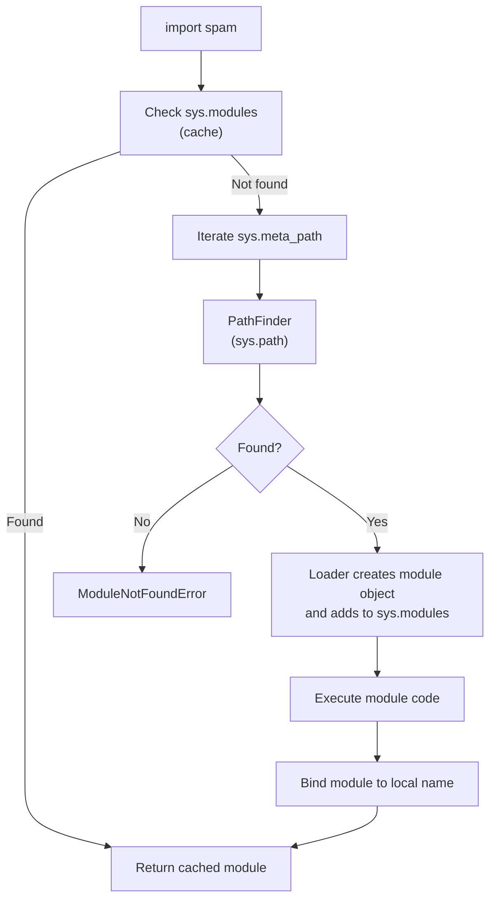
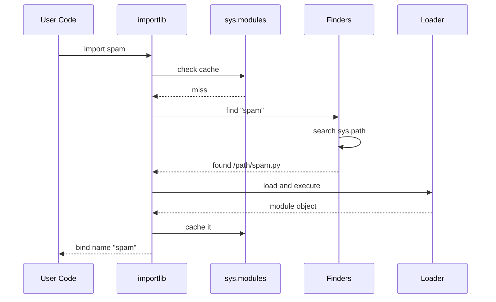
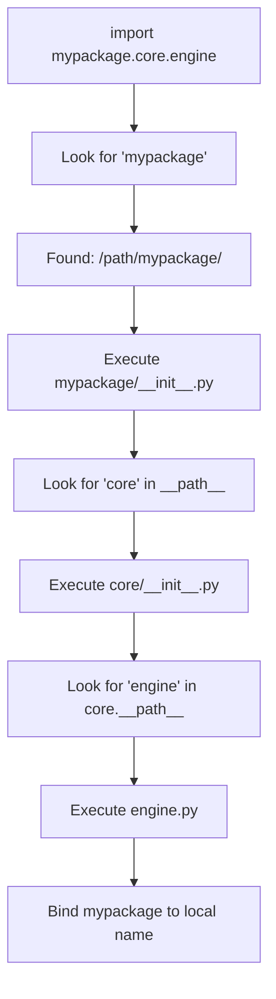
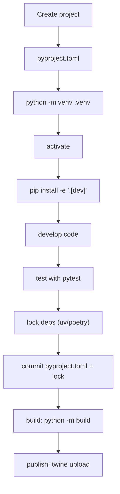
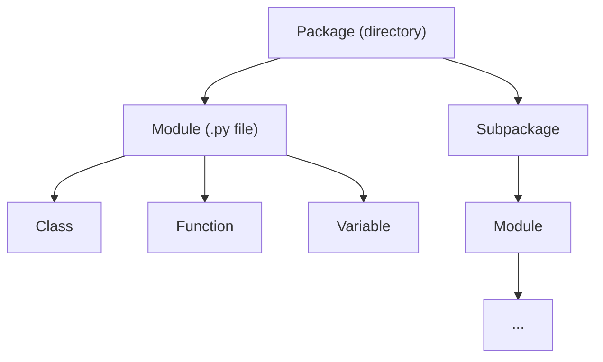
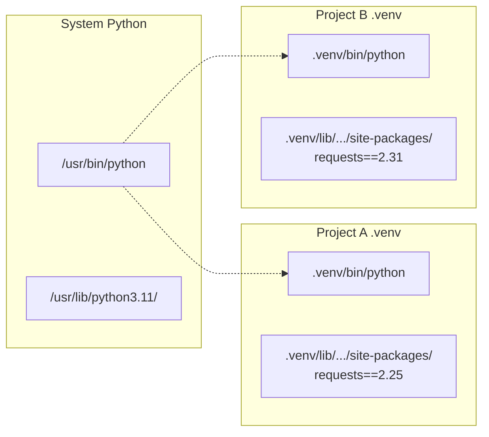

# Modules, Packages & Environments — Detailed Notes

---

## 1. What Is It? (Concept & Under the Hood)

A **module** is a `.py` file containing Python definitions and statements. A **package** is a directory of modules (traditionally with an `__init__.py`). A **virtual environment** is an isolated Python installation with its own set of installed packages. Together, these three concepts govern how Python code is **organized, distributed, and executed** at scale.

Key ideas:
- **Module** = one `.py` file — the basic unit of code organization.
- **Package** = directory of modules — the basic unit of distribution.
- **Namespace package** — a package without `__init__.py` (PEP 420).
- **Environment** = isolated Python + site-packages directory.
- **Distribution** = installable artifact (wheel/sdist), installed into an environment.

### Under the Hood — The Import System

Python's import system is driven by **`sys.meta_path`** — a list of *finders* that locate modules, and *loaders* that execute them.



Four key data structures:

| Structure | Purpose |
|---|---|
| `sys.modules` | Cache of already-imported modules |
| `sys.path` | List of directories to search |
| `sys.meta_path` | List of finders (built-in, frozen, path) |
| `sys.path_hooks` | Loaders for paths (zip, directory) |

### The Three Finder Layers

```python
import sys
for finder in sys.meta_path:
    print(finder)
```

```
<class '_frozen_importlib.BuiltinImporter'>   # built-in modules (sys, math)
<class '_frozen_importlib.FrozenImporter'>    # frozen modules (importlib, zipimport)
<class '_frozen_importlib_external.PathFinder'>  # sys.path-based
```

1. **BuiltinImporter** — C modules baked into the interpreter (`sys`, `time`).
2. **FrozenImporter** — Python modules compiled into the binary (`importlib`).
3. **PathFinder** — searches `sys.path` for `.py`, `.pyc`, packages.

### The Module Object

Every imported module is a `types.ModuleType` instance:

```python
import math
type(math)                # <class 'module'>
math.__name__             # 'math'
math.__file__             # '/usr/lib/python3.11/lib-dynload/math.so'
math.__dict__             # module namespace (mutable!)
```

Modules are essentially **namespaces** backed by a dict. All module-level names live in `module.__dict__`.

### Characteristics

| Aspect | Value |
|---|---|
| Import caching | In `sys.modules` — imported once per process |
| Execution | Module code runs **once**, at import |
| Cost | First import is expensive; subsequent are O(1) dict lookups |
| Loading | Bytecode compiled to `.pyc` in `__pycache__/` |
| Isolation | Modules have their own `__dict__` namespace |

---

## 2. `import` — All the Forms

### Basic Form

```python
import math
math.sqrt(16)             # 4.0
```

Binds the **module object** to a local name.

### Import With Rename

```python
import numpy as np
import pandas as pd
import matplotlib.pyplot as plt

np.array([1, 2, 3])
```

### `from ... import ...` — Import Specific Names

```python
from math import sqrt, pi
sqrt(16)                  # 4.0 — no `math.` prefix
pi                        # 3.14159...
```

This binds names directly into the current namespace.

### `from ... import ... as ...`

```python
from math import sqrt as square_root
square_root(16)           # 4.0
```

### Wildcard Import (Avoid)

```python
from math import *        # imports ALL public names
sqrt(16)                  # 4.0
```

Problems:
- Pollutes namespace — hard to know where names come from.
- Overwrites existing names silently.
- Bad for static analysis.
- **Only** acceptable in interactive REPL sessions.

### Relative Imports — Within a Package

```python
# Inside package/subpackage/module.py

from . import sibling          # current package
from .sibling import helper    # same package
from .. import parent_module   # parent package
from ..other import thing      # sibling of parent
```

Relative imports require the module to be **part of a package** — they fail in scripts run directly.

### Absolute Imports — Preferred

```python
from mypackage.subpackage import module
from mypackage.subpackage.module import function
```

Python 3 **defaults to absolute** imports (PEP 328). Relative imports must be explicit.

### Conditional Imports

```python
try:
    import ujson as json     # faster C-accelerated
except ImportError:
    import json
```

Common for optional dependencies.

### Lazy Imports (Inside Functions)

```python
def process(data):
    import pandas as pd      # only imported if function called
    return pd.DataFrame(data)
```

Useful for:
- Heavy imports not always needed.
- Avoiding circular imports.
- Faster startup.

### Import Forms Summary

| Form | Binds | Use case |
|---|---|---|
| `import mod` | `mod` | Standard |
| `import mod as m` | `m` | Avoid conflicts, shorten |
| `from mod import name` | `name` | Frequent access |
| `from mod import name as n` | `n` | Rename |
| `from mod import *` | Many names | Avoid (except REPL) |
| `from . import x` | `x` (relative) | Inside packages |
| `from .. import x` | `x` (parent) | Inside nested packages |

### Import Resolution Order

When you write `import spam`, Python:

1. Checks `sys.modules["spam"]` — if cached, return.
2. Iterates `sys.meta_path` finders.
3. Finds and loads the module.
4. Executes module code.
5. Adds to `sys.modules`.
6. Binds name in the calling namespace.

### Mermaid — Import Flow



### `importlib` — Programmatic Imports

```python
import importlib

mod = importlib.import_module("math")
mod.sqrt(16)              # 4.0

# Reload a module (useful during development)
importlib.reload(mod)

# Import a submodule dynamically
mod = importlib.import_module("os.path")
```

### Import Performance

- **First import** — parses source, compiles to bytecode, executes.
- **Subsequent imports** — read `.pyc` from `__pycache__/`.
- **Cache hit** — `sys.modules` lookup — nanoseconds.

```python
import timeit

timeit.timeit("import math", number=1_000_000)
# ~0.05 s — very fast after first
```

---

## 3. `__name__ == "__main__"`

### What Is `__name__`?

Every module has a `__name__` attribute:

- When a module is **imported**, `__name__` is the module's name (`"mymodule"`).
- When a module is **run as a script** (`python mymodule.py`), `__name__` is `"__main__"`.

This lets a module know whether it's being used or executed.

### The Idiom

```python
# mymodule.py

def greet(name):
    return f"Hello, {name}!"

def main():
    print(greet("World"))

if __name__ == "__main__":
    main()
```

Behavior:

```bash
$ python mymodule.py
Hello, World!

$ python -c "import mymodule"
# nothing runs
```

### Why It Matters

| Scenario | `__name__` | Body runs? |
|---|---|---|
| `python mymodule.py` | `"__main__"` | ✅ |
| `import mymodule` | `"mymodule"` | ❌ |
| `python -m mymodule` | `"__main__"` | ✅ |

### Standard Structure

```python
#!/usr/bin/env python3
"""Module docstring."""

import sys
from typing import Optional


# Constants
MAX_RETRIES = 3


# Classes
class Client:
    ...


# Functions
def connect(host: str, port: int) -> "Client":
    ...


def main(argv: list[str]) -> int:
    """Entry point."""
    if not argv:
        print("usage: ...", file=sys.stderr)
        return 1
    ...
    return 0


if __name__ == "__main__":
    sys.exit(main(sys.argv[1:]))
```

Key conventions:
- All logic lives in functions/classes.
- `main()` is the entry point.
- The `if` block is the *only* code that runs when executed directly.
- `sys.exit(main(...))` propagates exit codes.

### `python -m` vs `python file.py`

```bash
python -m package.module     # run as __main__, with package context
python path/to/module.py     # run as a script
```

`-m` differences:
- Sets `__name__ == "__main__"`.
- Adds **current directory** to `sys.path` correctly.
- Supports **relative imports** inside the module's package.
- Runs the module **inside its package context** — the module is imported, not read from disk.

### Recommended Pattern — CLI Entry

```python
# myapp/cli.py

import argparse
import sys

def parse_args(argv):
    parser = argparse.ArgumentParser(prog="myapp")
    parser.add_argument("--verbose", "-v", action="store_true")
    parser.add_argument("path", nargs="?")
    return parser.parse_args(argv)

def main(argv=None):
    args = parse_args(argv if argv is not None else sys.argv[1:])
    if args.verbose:
        print("verbose mode")
    return 0

if __name__ == "__main__":
    sys.exit(main())
```

Run with:

```bash
python -m myapp.cli --verbose /tmp
```

### Reimporting a Module — `__name__` Effect

```python
# a.py
print(f"__name__ = {__name__}")

# b.py
import a              # prints: __name__ = a
```

The module's code executes at import — but with `__name__` set to the module name, not `"__main__"`.

### Package `__main__.py`

A package can define a `__main__.py` to make `python -m package` run it:

```
mypackage/
├── __init__.py
├── __main__.py     # entry point for `python -m mypackage`
└── cli.py
```

```python
# mypackage/__main__.py
from .cli import main
import sys

if __name__ == "__main__":
    sys.exit(main())
```

```bash
python -m mypackage       # runs __main__.py
```

### Common Mistakes

```python
# ❌ Forgetting the guard
print("runs on import")

# ✅
def run():
    print("runs when executed")
if __name__ == "__main__":
    run()
```

```python
# ❌ Comparing to wrong string
if __name__ == "main":        # missing underscores
    main()

# ✅
if __name__ == "__main__":
    main()
```

```python
# ❌ Importing in the guard
if __name__ == "__main__":
    import heavy_lib           # only imports when run — but usually fine
    heavy_lib.run()
```

---

## 4. Creating Modules

### A Module Is Just a File

```
project/
├── main.py
└── utils.py
```

```python
# utils.py
"""Utility functions for the project."""

def add(a, b):
    return a + b

def multiply(a, b):
    return a * b

CONSTANT = 42
```

```python
# main.py
import utils

print(utils.add(1, 2))          # 3
print(utils.CONSTANT)           # 42

from utils import multiply
print(multiply(3, 4))           # 12
```

### Module Attributes

Every module exposes:

| Attribute | Value |
|---|---|
| `__name__` | Module name |
| `__file__` | Path to source (or None for built-ins) |
| `__doc__` | Module docstring |
| `__package__` | Package name (or None) |
| `__dict__` | Module namespace |
| `__loader__` | Loader that created it |
| `__spec__` | Import spec |
| `__path__` | Package search path (packages only) |

```python
import utils
print(utils.__name__)      # 'utils'
print(utils.__file__)      # '/path/to/utils.py'
print(utils.__doc__)       # 'Utility functions...'
```

### `__all__` — Public API

By default, `from module import *` imports all names **not starting with underscore**. To control this, define `__all__`:

```python
# utils.py
__all__ = ["add", "multiply"]

def add(a, b):
    return a + b

def multiply(a, b):
    return a * b

def _internal():
    pass
```

```python
from utils import *
add(1, 2)         # ✅
multiply(3, 4)    # ✅
_internal()       # ❌ NameError — not exported
```

`__all__` also documents the public API.

### Module Docstrings

```python
"""Utility functions for arithmetic operations.

This module provides basic math helpers used across the project.
"""

def add(a, b):
    return a + b
```

Module docstrings go at the **top of the file** — before any code.

### Module Execution — Side Effects

```python
# config.py
import os

DEBUG = os.environ.get("DEBUG", "0") == "1"
DATABASE_URL = os.environ["DATABASE_URL"]      # runs on import!
```

The first `import config` executes the top-level code. If it raises, the import fails — and the module is **removed from `sys.modules`** so a retry can re-execute.

### The `if __name__ == "__main__"` Guard in Modules

```python
# utils.py

def add(a, b):
    return a + b

if __name__ == "__main__":
    # Only runs when `python utils.py`
    print(add(2, 3))
```

### Private Convention

Names starting with `_` are **conventionally private** — not enforced:

```python
# utils.py
def _helper():        # meant for internal use
    pass

def public():
    _helper()
```

### Module `__getattr__` (PEP 562, 3.7+)

Modules can define a `__getattr__` to lazily resolve missing attributes:

```python
# lazy.py
def __getattr__(name):
    if name == "heavy":
        import heavy_module
        return heavy_module
    raise AttributeError(f"module {__name__!r} has no attribute {name!r}")
```

Useful for lazy loading or deprecating names.

### Module `__dir__`

```python
def __dir__():
    return ["public_api", "other_thing"]
```

Controls what `dir(module)` returns.

### Example — Well-Structured Module

```python
"""user_service.py — user CRUD operations."""

from __future__ import annotations

import logging
from dataclasses import dataclass
from typing import Optional

logger = logging.getLogger(__name__)

__all__ = ["User", "create_user", "find_user"]


@dataclass
class User:
    id: int
    name: str
    email: str


def create_user(name: str, email: str) -> User:
    """Create a new user record."""
    logger.info("creating user %s", email)
    ...


def find_user(user_id: int) -> Optional[User]:
    """Look up a user by ID; returns None if missing."""
    ...


if __name__ == "__main__":
    print(find_user(1))
```

---

## 5. Creating Packages

### What Is a Package?

A **regular package** is a directory containing an `__init__.py` file. The file can be empty, but its presence marks the directory as a package.

```
mypackage/
├── __init__.py
├── module_a.py
├── module_b.py
└── subpackage/
    ├── __init__.py
    └── module_c.py
```

### Importing From a Package

```python
import mypackage.module_a
mypackage.module_a.func()

from mypackage import module_a
module_a.func()

from mypackage.module_a import func
func()

from mypackage.subpackage import module_c
from mypackage.subpackage.module_c import helper
```

### `__init__.py` — Package Initializer

Runs when the package is first imported. Use it to:

1. **Mark the directory as a package** (required in older Pythons).
2. **Re-export** submodules for convenience.
3. **Set up package-level state**.
4. **Define `__all__`**.

```python
# mypackage/__init__.py
"""My package."""

from .module_a import func_a
from .module_b import func_b

__all__ = ["func_a", "func_b"]
__version__ = "1.0.0"
```

Now consumers can do:

```python
from mypackage import func_a, func_b
```

### `__version__` Convention

```python
# mypackage/__init__.py
__version__ = "1.2.3"
```

Not enforced but widely used:

```python
import mypackage
print(mypackage.__version__)
```

### Subpackages

```
mypackage/
├── __init__.py
├── core/
│   ├── __init__.py
│   ├── engine.py
│   └── parser.py
└── utils/
    ├── __init__.py
    └── helpers.py
```

```python
from mypackage.core import engine
from mypackage.core.engine import run
from mypackage.utils.helpers import clean
```

### Relative Imports Inside Packages

```python
# mypackage/core/engine.py

from . import parser              # mypackage.core.parser
from ..utils import helpers       # mypackage.utils.helpers
from ..utils.helpers import clean # direct import
```

Rule:
- `.` — current package.
- `..` — parent package.
- `...` — grandparent.

### Namespace Packages (PEP 420)

Since Python 3.3, directories **without** `__init__.py` can still be packages — **namespace packages**. They're useful for splitting a package across multiple directories or distributions.

```
project-a/
└── mypackage/
    └── a.py

project-b/
└── mypackage/
    └── b.py
```

Both contribute to `mypackage`. If both are on `sys.path`:

```python
import mypackage.a
import mypackage.b
```

Both work — `mypackage` is a namespace package spanning both locations.

**Trade-offs:**

| Regular package | Namespace package |
|---|---|
| `__init__.py` required | No `__init__.py` |
| Single directory | Can span directories |
| `__init__.py` code runs | No automatic init code |
| Easy to reason about | Subtle interactions |

Prefer regular packages for most projects.

### Package `__path__`

Packages have a `__path__` attribute — a list of directories:

```python
import mypackage
print(mypackage.__path__)
# ['/path/to/mypackage']
```

Plugins can append to `__path__` to extend packages dynamically.

### `python -m package.module`

Running a module **inside** a package:

```bash
python -m mypackage.module_a
```

Differs from `python mypackage/module_a.py`:
- Imports as `mypackage.module_a`, not `__main__` module from a file.
- Relative imports inside work.
- `__package__` is set correctly.

### The Package `__main__.py`

For `python -m mypackage`:

```
mypackage/
├── __init__.py
├── __main__.py
└── cli.py
```

```python
# mypackage/__main__.py
import sys
from .cli import main

if __name__ == "__main__":
    sys.exit(main(sys.argv[1:]))
```

### Package Layout — Common Patterns

**Flat layout:**

```
myproject/
├── pyproject.toml
├── README.md
├── src/
│   └── mypackage/
│       ├── __init__.py
│       └── core.py
└── tests/
    └── test_core.py
```

**Src layout** (recommended — avoids import shadowing):

```
myproject/
├── pyproject.toml
├── README.md
├── src/
│   └── mypackage/
│       ├── __init__.py
│       └── core.py
└── tests/
    └── test_core.py
```

The `src/` layout forces tests to import the *installed* package rather than the local source — catches packaging bugs.

### Mermaid — Package Resolution



---

## 6. `pip` — The Package Installer

### What Is `pip`?

`pip` is the standard package installer for Python. It resolves dependencies, downloads wheels/sdists from PyPI, and installs them into the current environment.

```bash
pip install requests
pip install "requests>=2.28,<3"
pip install requests==2.31.0
```

### Common Commands

| Command | Purpose |
|---|---|
| `pip install PACKAGE` | Install |
| `pip install PACKAGE==VERSION` | Install specific version |
| `pip install -U PACKAGE` | Upgrade |
| `pip uninstall PACKAGE` | Remove |
| `pip list` | List installed |
| `pip show PACKAGE` | Show details |
| `pip freeze` | Output pinned versions |
| `pip search` | **Removed** — use PyPI website |
| `pip download` | Download without installing |
| `pip check` | Verify consistency |

### `pip install` — Common Forms

```bash
pip install requests
pip install requests==2.31.0
pip install "requests>=2.28"
pip install "requests>=2.28,<3"
pip install requests[security]                 # extras
pip install -e .                               # editable local install
pip install -e ".[dev]"                        # editable + dev extras
pip install -r requirements.txt
pip install --user PACKAGE                     # user site-packages
pip install --target=./vendor PACKAGE          # custom dir
pip install --no-deps PACKAGE                  # skip dependencies
pip install --index-url https://... PACKAGE    # custom index
```

### `pip freeze` — Pin Versions

```bash
pip freeze > requirements.txt
```

Produces:

```
certifi==2024.2.2
charset-normalizer==3.3.2
idna==3.6
requests==2.31.0
urllib3==2.2.1
```

Every dependency, pinned to exact versions.

### `requirements.txt` — The Classic Format

```
# Comments with #
requests==2.31.0
flask>=3.0,<4.0
pydantic~=2.6                 # compatible release (>=2.6, <3.0)
numpy
pandas; python_version < "3.12"
black; extra == "dev"
-r other-requirements.txt     # include another file
-e ./local-package            # editable local
```

### Requirement Specifiers

| Specifier | Meaning |
|---|---|
| `==1.2.3` | Exact |
| `!=1.2.3` | Not equal |
| `>=1.2` | Minimum |
| `<=2.0` | Maximum |
| `>1.0,<2.0` | Range |
| `~=1.4.2` | Compatible release: `>=1.4.2, ==1.4.*` |
| `*` | Any |

### `requirements.txt` — Layered Files

```
requirements/
├── base.txt
├── dev.txt          # includes base
├── test.txt         # includes base
└── prod.txt
```

```
# requirements/base.txt
requests==2.31.0
pydantic==2.6.1

# requirements/dev.txt
-r base.txt
black==24.2.0
pytest==8.0.0

# requirements/prod.txt
-r base.txt
gunicorn==21.2.0
```

Install:

```bash
pip install -r requirements/dev.txt
```

### `pip freeze` vs Manual `requirements.txt`

| Style | Use case |
|---|---|
| `pip freeze` | Reproducible deployments, lockfiles |
| Manual | Libraries (loose version bounds) |
| Manual (pinned) | Applications (tight control) |

Libraries should use **loose** bounds (`>=1.0,<2.0`) — let downstream choose. Applications should use **tight** pins — reproducible.

### Editable Install

```bash
pip install -e .
```

Creates a `.pth` file pointing at your source — edits take effect immediately. Great for development.

### Constraint Files

```bash
pip install -r requirements.txt -c constraints.txt
```

`constraints.txt` pins transitive dependencies:

```
# constraints.txt
urllib3==2.2.1
certifi==2024.2.2
```

Unlike `requirements.txt`, constraints can't introduce new packages — they only constrain existing ones.

### Caching

```bash
pip cache dir        # show cache location
pip cache list       # list cached wheels
pip cache purge      # clear
pip install --no-cache-dir PACKAGE
```

### `pip` Is Not the Only Installer

- **`uv`** — extremely fast Rust-based installer (2024+).
- **`poetry`** — full dependency resolver + virtual env manager.
- **`pipenv`** — combines pip + venv (less popular now).
- **`conda`** — cross-language package manager (heavy scientific use).
- **`pdm`** — modern PEP 582 implementation.

---

## 7. `pyproject.toml` — The Modern Standard

### What Is It?

`pyproject.toml` (PEP 518, PEP 621) is the **modern** config file for Python projects. It replaces `setup.py`, `setup.cfg`, `requirements.txt` (partially), `tox.ini`, and others — one file for build config, metadata, and tool settings.

### Minimal Example

```toml
[build-system]
requires = ["setuptools>=68", "wheel"]
build-backend = "setuptools.build_meta"

[project]
name = "mypackage"
version = "1.0.0"
description = "My awesome package"
readme = "README.md"
requires-python = ">=3.9"
license = { text = "MIT" }
authors = [
    { name = "Ada Lovelace", email = "ada@example.com" },
]
dependencies = [
    "requests>=2.28",
    "pydantic>=2.0,<3.0",
]

[project.optional-dependencies]
dev = ["pytest>=8", "black>=24", "mypy>=1.8"]

[project.scripts]
my-cli = "mypackage.cli:main"

[project.urls]
Homepage = "https://github.com/example/mypackage"
Documentation = "https://mypackage.readthedocs.io"
```

### `[build-system]` — The Build Backend

```toml
[build-system]
requires = ["hatchling"]
build-backend = "hatchling.build"
```

Common backends:

| Backend | Notes |
|---|---|
| `setuptools.build_meta` | Classic, widely supported |
| `hatchling` | Modern, clean |
| `poetry-core` | Poetry projects |
| `flit_core` | Simple, pure-Python |

### `[project]` — PEP 621 Metadata

| Key | Meaning |
|---|---|
| `name` | Distribution name (PyPI) |
| `version` | PEP 440 version |
| `description` | One-line summary |
| `readme` | Path to README |
| `requires-python` | Minimum Python version |
| `license` | SPDX identifier or file |
| `authors` / `maintainers` | Contact list |
| `dependencies` | Runtime deps |
| `optional-dependencies` | Extras (`[project.optional-dependencies]`) |
| `scripts` | CLI entry points |
| `entry-points` | Plugin groups |
| `classifiers` | Trove classifiers |
| `urls` | Project links |

### Dynamic Version

```toml
[project]
dynamic = ["version"]

[tool.setuptools.dynamic]
version = { attr = "mypackage.__version__" }
```

Or read from git tags with `hatch-vcs` / `setuptools-scm`.

### `[tool.*]` — Tool Configuration

Each tool gets its own section:

```toml
[tool.black]
line-length = 100
target-version = ["py311"]

[tool.ruff]
line-length = 100
select = ["E", "F", "I", "W"]

[tool.mypy]
python_version = "3.11"
strict = true

[tool.pytest.ini_options]
testpaths = ["tests"]
addopts = "-ra"

[tool.coverage.run]
source = ["mypackage"]
```

One file configures the whole toolchain.

### `pyproject.toml` vs `setup.py`

| | `setup.py` | `pyproject.toml` |
|---|---|---|
| Format | Python code | TOML |
| Executes on install | ✅ (dangerous) | ❌ (declarative) |
| Modern | Legacy | ✅ Standard |
| Tool config | Separate files | All in one |
| Build isolation | No | ✅ |

`setup.py` is **still supported** but discouraged for new projects.

### Migration Example

Old `setup.py`:

```python
from setuptools import setup, find_packages

setup(
    name="mypackage",
    version="1.0.0",
    packages=find_packages(),
    install_requires=["requests>=2.28"],
)
```

New `pyproject.toml`:

```toml
[build-system]
requires = ["setuptools>=68"]
build-backend = "setuptools.build_meta"

[project]
name = "mypackage"
version = "1.0.0"
dependencies = ["requests>=2.28"]

[tool.setuptools.packages.find]
where = ["src"]
```

### Building Distributions

```bash
python -m build               # creates sdist + wheel in dist/
python -m build --wheel       # wheel only
python -m build --sdist       # sdist only
```

Publish to PyPI:

```bash
python -m twine upload dist/*
```

Or to TestPyPI:

```bash
python -m twine upload --repository testpypi dist/*
```

### Project Structure — Modern

```
myproject/
├── pyproject.toml
├── README.md
├── LICENSE
├── src/
│   └── mypackage/
│       ├── __init__.py
│       ├── cli.py
│       └── core.py
├── tests/
│   ├── test_core.py
│   └── conftest.py
└── docs/
    └── index.md
```

---

## 8. Virtual Environments

### Why Virtual Environments?

Without them, all packages install globally, causing:

- **Version conflicts** — project A needs `requests==2.25`, project B needs `2.31`.
- **Dependency leaks** — projects accidentally depend on globally installed packages.
- **System breakage** — messing with the OS's Python can break system tools.

A **virtual environment** is an isolated directory containing:

- A symlink or copy of the Python interpreter.
- Its own `site-packages` for installed packages.
- Its own `pip`.
- An activation script to configure `PATH` and `sys.prefix`.

### `venv` — The Standard Library Way

```bash
python -m venv .venv
source .venv/bin/activate         # macOS / Linux
.venv\Scripts\activate            # Windows

pip install requests
deactivate
```

### What `venv` Creates

```
.venv/
├── bin/               # (Scripts\ on Windows)
│   ├── python         # symlink to system python
│   ├── pip
│   └── activate
├── lib/
│   └── python3.11/
│       └── site-packages/     # isolated packages
├── include/
└── pyvenv.cfg
```

### Activation vs Direct Execution

You don't **need** to activate — you can call the interpreter directly:

```bash
.venv/bin/python script.py
.venv/bin/pip install requests
```

Activation just updates `PATH`, `VIRTUAL_ENV`, and shell prompt.

### `pyvenv.cfg`

```ini
home = /usr/bin
include-system-site-packages = false
version = 3.11.7
```

Set `include-system-site-packages = true` to also see global packages (rarely desired).

### `.gitignore` for venvs

```gitignore
.venv/
venv/
env/
ENV/
```

**Never commit virtual environments** — they contain platform-specific binaries.

### `venv` Options

```bash
python -m venv .venv --system-site-packages       # include global
python -m venv .venv --without-pip                # no pip
python -m venv .venv --upgrade                    # upgrade in place
```

### When to Use `venv`

- **Any project** with third-party dependencies.
- **Reproducible builds** — record in `requirements.txt`.
- **CI/CD pipelines** — one env per job.
- **Local development** — one env per project.

Rule: **one virtual environment per project**.

### `virtualenv` — Faster Alternative

```bash
pip install virtualenv
virtualenv .venv
```

Historically faster than `venv` and supports Python 2 — now mostly superseded.

### `conda` — Data Science Environments

```bash
conda create -n myenv python=3.11
conda activate myenv
conda install numpy pandas
conda env export > environment.yml
```

Manages **non-Python** dependencies too (BLAS, CUDA, R). Heavy but powerful for scientific stacks.

### `poetry` — Dependency + Environment Manager

```bash
pip install poetry
poetry new myproject
poetry add requests
poetry add --group dev pytest
poetry install
poetry run python script.py
```

Poetry uses `pyproject.toml` for dependencies and `poetry.lock` for exact versions. It **creates a virtual env per project** automatically.

### `uv` — The New Fast Option

```bash
pip install uv
uv venv
uv pip install requests
uv pip compile requirements.in -o requirements.txt
uv pip sync requirements.txt
```

**10–100× faster** than pip — implemented in Rust. Compatible with pip's ecosystem. Increasingly the default choice in 2024+.

### `pipenv`

```bash
pip install pipenv
pipenv install requests
pipenv shell
```

Combines pip + virtualenv, uses `Pipfile` and `Pipfile.lock`. Less popular now — poetry/uv generally preferred.

### Environment Manager Comparison

| Tool | Speed | Uses | Lockfile | Notes |
|---|---|---|---|---|
| `venv` | Slow | stdlib | ❌ | Just the interpreter |
| `virtualenv` | Medium | 3rd party | ❌ | Legacy speedup |
| `conda` | Slow | Any lang | ✅ `environment.yml` | Scientific |
| `poetry` | Medium | Python | ✅ `poetry.lock` | Full-featured |
| `uv` | ⚡ Fast | Python | ✅ `uv.lock` | New, Rust |
| `pipenv` | Slow | Python | ✅ `Pipfile.lock` | Declining |

### Global Tools — `pipx`

For CLI tools that shouldn't be installed in any project env:

```bash
pip install pipx
pipx install black
pipx install ruff
pipx install poetry
```

`pipx` creates an isolated venv per tool, but exposes the CLI globally.

### `sys.prefix` and `sys.base_prefix`

Inside a virtual environment:

```python
import sys

sys.prefix             # '/path/to/.venv'
sys.base_prefix        # '/usr' — the real Python
sys.executable         # '/path/to/.venv/bin/python'

# Detect if inside a venv
in_venv = sys.prefix != sys.base_prefix
```

### Activation Failures

| Symptom | Fix |
|---|---|
| `activate: command not found` | Use `source .venv/bin/activate` |
| Permissions denied | Use `. .venv/bin/activate` or `chmod +x` |
| Windows activation script blocked | `Set-ExecutionPolicy -Scope Process Bypass` |

### Deleting a Virtual Environment

Just delete the directory:

```bash
rm -rf .venv
```

Then recreate.

---

## 9. Dependency Management

### Semantic Versioning — `MAJOR.MINOR.PATCH`

```
2.31.0
│ │ │
│ │ └── PATCH — bug fixes, backwards compatible
│ └──── MINOR — new features, backwards compatible
└────── MAJOR — breaking changes
```

Specifiers like `~=2.31` mean "compatible with 2.31" — allow patch and minor but not major.

### Pinning Strategies

| Strategy | Example | Use case |
|---|---|---|
| Exact pin | `==2.31.0` | Applications, deployments |
| Range | `>=2.28,<3` | Libraries |
| Compatible | `~=2.31` | Libraries, slightly loose |
| Minimum | `>=2.28` | Very loose (risky) |
| Wildcard | `==2.31.*` | Bugfix updates only |

### Lockfiles

A **lockfile** records the **exact** versions of all transitive dependencies:

- `poetry.lock`
- `uv.lock`
- `Pipfile.lock`
- `requirements.txt` produced by `pip freeze` or `pip-compile`

Commit lockfiles to version control. Use them for **reproducible** installs:

```bash
pip install -r requirements.txt
poetry install --sync
uv pip sync uv.lock
```

### `pip-tools` — Compile Requirements

```bash
pip install pip-tools

# requirements.in — loose spec
echo "requests>=2.28" > requirements.in

# Compile to locked requirements.txt
pip-compile requirements.in

# Install
pip-sync requirements.txt
```

Resulting `requirements.txt` has every transitive dep pinned, with comments showing who pulled it in.

### Transitive Dependencies

```bash
pip install requests
```

`requests` depends on `certifi`, `charset-normalizer`, `idna`, `urllib3`. All are installed automatically.

Use `pip show -f requests` or `pipdeptree`:

```bash
pip install pipdeptree
pipdeptree
```

```
requests==2.31.0
├── certifi [required: >=2017.4.17, installed: 2024.2.2]
├── charset-normalizer [required: >=2,<4, installed: 3.3.2]
├── idna [required: >=2.5,<4, installed: 3.6]
└── urllib3 [required: >=1.21.1,<3, installed: 2.2.1]
```

### Dependency Confusion / Supply Chain

- **Typosquatting** — malicious packages with similar names (`reqeusts`).
- **Dependency confusion** — internal packages accidentally published to PyPI.
- **Malicious maintainers** — popular packages hijacked.

Mitigations:
- Pin versions and use lockfiles.
- Use internal index (`--index-url`, `--extra-index-url`).
- Review diffs of new dependencies.
- Use `pip-audit` or `safety` for vulnerability scans.

```bash
pip install pip-audit
pip-audit
```

### Private Indexes

```bash
pip install --index-url https://private.example.com/simple PACKAGE
```

Or in `pip.conf` / `pyproject.toml`:

```toml
[[tool.uv.index]]
name = "private"
url = "https://private.example.com/simple"
```

### Reproducible Builds

For a fully reproducible environment:

1. Pin Python version (`requires-python`).
2. Pin all dependencies (`lockfile`).
3. Pin transitive dependencies.
4. Pin build tools (`build-system.requires`).
5. Use hashes in requirements:

```
requests==2.31.0 \
    --hash=sha256:58cd2187c01e70e6e26505bca751777aa9f2ee0b7f4300988b709f44e013003f
```

Generate hashes with `pip-compile --generate-hashes`.

### `pip freeze` — Pitfalls

```bash
pip freeze > requirements.txt
```

- Includes **everything** in the environment — even dev tools.
- Loses information about **what was explicitly required**.
- Not directly usable for libraries.
- Recommended: use `pip-tools` or `uv pip compile` instead.

### Dependency Management Summary

| Task | Tool |
|---|---|
| Install one package | `pip install` |
| Install from list | `pip install -r` |
| Lock transitive deps | `pip-compile`, `uv pip compile` |
| Check vulnerabilities | `pip-audit`, `safety` |
| Visualize tree | `pipdeptree` |
| Isolate per project | `venv`, `poetry`, `uv` |
| Global CLI tools | `pipx` |

---

## 10. Real-World Use Cases

### Use Case 1 — CLI Project with `pyproject.toml`

```toml
[build-system]
requires = ["hatchling"]
build-backend = "hatchling.build"

[project]
name = "mycli"
version = "0.1.0"
requires-python = ">=3.9"
dependencies = ["click>=8", "rich>=13"]

[project.scripts]
mycli = "mycli.cli:main"
```

```python
# src/mycli/cli.py
import click
from rich.console import Console

@click.command()
@click.argument("name")
def main(name: str) -> None:
    Console().print(f"[bold]Hello, {name}![/bold]")

if __name__ == "__main__":
    main()
```

Install editable:

```bash
pip install -e .
mycli World
```

### Use Case 2 — Library with Extras

```toml
[project]
name = "mylib"
version = "1.0.0"
dependencies = []

[project.optional-dependencies]
fast = ["orjson>=3"]
yaml = ["pyyaml>=6"]
dev = ["pytest>=8", "black>=24", "mypy>=1.8"]
```

```bash
pip install mylib          # minimal
pip install "mylib[fast]"  # with orjson
pip install "mylib[dev]"   # for contributors
pip install "mylib[fast,yaml,dev]"  # everything
```

### Use Case 3 — Monorepo with Multiple Packages

```
monorepo/
├── packages/
│   ├── core/
│   │   ├── pyproject.toml
│   │   └── src/core/...
│   ├── api/
│   │   ├── pyproject.toml
│   │   └── src/api/...
│   └── cli/
│       ├── pyproject.toml
│       └── src/cli/...
└── pyproject.toml         # workspace root
```

With `uv`:

```toml
[tool.uv.workspace]
members = ["packages/*"]
```

### Use Case 4 — Dev vs Prod Requirements

```
requirements/
├── base.txt
├── dev.txt       # -r base.txt + pytest/black/mypy
├── test.txt      # -r base.txt + pytest
└── prod.txt      # -r base.txt + gunicorn
```

```bash
# Local dev
pip install -r requirements/dev.txt

# CI
pip install -r requirements/test.txt

# Production
pip install -r requirements/prod.txt
```

### Use Case 5 — Detecting Environment in Code

```python
import os
import sys

def is_venv() -> bool:
    return sys.prefix != sys.base_prefix

def is_docker() -> bool:
    return os.path.exists("/.dockerenv")

def env_name() -> str:
    return os.environ.get("VIRTUAL_ENV", "none")
```

### Use Case 6 — Deferred Imports for Faster Startup

```python
def render_report(path):
    import pandas as pd          # only imported on demand
    import matplotlib.pyplot as plt
    ...
```

CLI startups become faster when heavy deps load lazily.

### Use Case 7 — Plugin Architecture with `entry_points`

```toml
[project.entry-points."myapp.plugins"]
myplugin = "myplugin:Plugin"
```

```python
from importlib.metadata import entry_points

def load_plugins():
    eps = entry_points(group="myapp.plugins")
    for ep in eps:
        plugin_cls = ep.load()
        yield plugin_cls()
```

Plugins are discovered across installed packages — no manual registration.

### Use Case 8 — Private PyPI Mirror

```bash
pip install \
  --index-url https://pypi.example.com/simple \
  --trusted-host pypi.example.com \
  my-private-package
```

Or configure globally:

```ini
# ~/.config/pip/pip.conf
[global]
index-url = https://pypi.example.com/simple
trusted-host = pypi.example.com
```

---

## 11. Common Pitfalls

### Pitfall 1 — Circular Imports

```python
# a.py
import b
def func_a():
    return b.func_b()

# b.py
import a
def func_b():
    return a.func_a()
```

**Fixes:**

```python
# ✅ Lazy import inside function
def func_b():
    import a
    return a.func_a()

# ✅ Use type hints with future annotations
from __future__ import annotations
```

### Pitfall 2 — `from module import *` Polluting Namespace

```python
from os import *
from sys import *
# Now `path` might be os.path OR sys.path — ambiguous!
```

Avoid wildcards outside the REPL.

### Pitfall 3 — Shadowing Standard Library Modules

```
myproject/
├── json.py              # ❌ shadows stdlib json!
├── random.py            # ❌ shadows stdlib random!
└── main.py
```

```python
import json       # imports YOUR json.py, not stdlib!
```

Rename local files to avoid stdlib collisions.

### Pitfall 4 — Running a Package File Directly

```bash
python mypackage/module.py
```

Relative imports fail:

```
ImportError: attempted relative import with no known parent package
```

**Fix:**

```bash
python -m mypackage.module
```

### Pitfall 5 — Forgetting the `__main__` Guard

```python
# utils.py
print("running tests...")    # ❌ runs on every import
```

Always guard top-level side effects.

### Pitfall 6 — Installing Globally

```bash
sudo pip install requests    # ❌ pollutes system Python
```

Use `--user` or a virtual environment:

```bash
pip install --user requests
python -m venv .venv && source .venv/bin/activate
pip install requests
```

### Pitfall 7 — Not Committing `lockfile`

```gitignore
# ❌ ignoring the lock
poetry.lock
uv.lock
```

**Always** commit lockfiles — they ensure reproducibility.

### Pitfall 8 — Committing `venv/`

```gitignore
# ✅ ignore the environment
.venv/
venv/
__pycache__/
*.pyc
```

Environments are machine-specific — recreate them from lockfiles.

### Pitfall 9 — Mixing `pip` and `conda`

```bash
conda install numpy
pip install scipy              # ❌ can break conda state
```

Prefer one manager per environment. Use `conda` for everything, or `pip` only after `conda`.

### Pitfall 10 — Blind `pip freeze`

```bash
pip freeze > requirements.txt
```

Captures dev tools, docs, and everything else installed. Use `pip-tools` or `uv` for clean lockfiles.

### Pitfall 11 — Trusting Untyped `requirements.txt`

```
requests
numpy
```

No versions — every install may pull a different release. **Always pin in applications.**

### Pitfall 12 — Import Cost in Hot Paths

```python
def process(data):
    import json              # ❌ re-lookup every call (though cached)
    return json.loads(data)
```

Move imports to module level for hot functions.

### Pitfall 13 — Module-Level Side Effects

```python
# config.py
database.connect()           # ❌ fails on import if DB unreachable
```

Import-time failure is harsh. Defer connections to a `get_client()` function.

### Pitfall 14 — Editing Installed Packages

```bash
# ❌ editing /usr/lib/python3.11/site-packages/requests/...
```

Use **editable installs** (`pip install -e .`) or fork and patch properly.

### Pitfall Summary Table

| Pitfall | Symptom | Fix |
|---|---|---|
| Circular imports | `ImportError` | Lazy imports, `from __future__` |
| `import *` | Name collisions | Avoid outside REPL |
| Shadowed stdlib | Wrong module imported | Rename files |
| Direct package run | Relative import error | `python -m` |
| Missing `__main__` guard | Side effects on import | Guard |
| `sudo pip` | System breakage | `--user` or venv |
| Uncommitted lockfile | Non-reproducible | Commit `*.lock` |
| Committed venv | Platform binaries | `.gitignore` |
| Blind `pip freeze` | Bloated deps | `pip-tools`, `uv` |
| Unpinned deps | Unstable builds | Pin in apps |
| Hot-path import | Slower loops | Module-level imports |

---

## 12. Comparison Tables

### Import Forms — When to Use

| Form | Readability | Namespace | Best for |
|---|---|---|---|
| `import mod` | High | Clean | Most cases |
| `import mod as m` | High | Clean | Common aliases (np, pd) |
| `from mod import name` | High | Polluted | Frequent use of one name |
| `from mod import *` | Low | Very polluted | REPL only |
| `from . import sib` | High | Clean | Inside packages |

### Package Types

| | Regular | Namespace | Subpackage |
|---|---|---|---|
| `__init__.py` | Required | Absent | Required |
| Single dir | ✅ | ❌ | ✅ |
| Init code runs | ✅ | ❌ | ✅ |
| Recommended | ✅ | Only when needed | ✅ |

### Environment Tools

| Feature | venv | virtualenv | conda | poetry | uv |
|---|---|---|---|---|---|
| Stdlib | ✅ | ❌ | ❌ | ❌ | ❌ |
| Speed | Slow | Medium | Slow | Medium | ⚡ |
| Cross-language | ❌ | ❌ | ✅ | ❌ | ❌ |
| Lockfile | ❌ | ❌ | ✅ | ✅ | ✅ |
| Resolver | ❌ | ❌ | ✅ | ✅ | ✅ |
| Modern | ✅ | ✅ | ✅ | ✅ | ✅ |

### Requirement Specifiers

| Specifier | Meaning | Example |
|---|---|---|
| `==X.Y.Z` | Exact | `==2.31.0` |
| `~=X.Y` | Compatible | `~=2.31` → `>=2.31,<3.0` |
| `~=X.Y.Z` | Compatible patch | `~=2.31.0` → `>=2.31.0,<2.32.0` |
| `>=X` | Minimum | `>=2.28` |
| `<=X` | Maximum | `<=2.31` |
| `>X,<Y` | Range | `>2.0,<3.0` |
| `!=X` | Exclusion | `!=2.30` |
| `X; marker` | Environment marker | `pandas; python_version<"3.12"` |

### `venv` vs `poetry` vs `uv`

| Scenario | Recommended |
|---|---|
| Quick prototype | `venv` + `pip` |
| Simple app, no lockfile | `venv` + `pip-compile` |
| Complex app, strict deps | `poetry` or `uv` |
| CI/CD with cache | `uv` (fastest) |
| Scientific stack | `conda` or `uv` |
| Library (published) | `pyproject.toml` + any |

---

## 13. Mermaid — Project Lifecycle



### Package vs Module Hierarchy



### Virtual Environment Isolation



Each `.venv` uses the system interpreter but has its own `site-packages`.

---

## 14. Performance Notes

### Import Time Is Startup Time

```python
import time
start = time.perf_counter()
import pandas
print(time.perf_counter() - start)
# ~0.6 s on typical hardware
```

Heavy imports slow down CLI tools. Use `python -X importtime` to profile:

```bash
python -X importtime -c "import pandas" 2>&1 | tail -20
```

### Lazy Imports

```python
# ❌ Loads pandas on every CLI run
import pandas as pd

def cmd_convert(path):
    df = pd.read_csv(path)
    ...

# ✅ Load only when needed
def cmd_convert(path):
    import pandas as pd
    df = pd.read_csv(path)
    ...
```

CLI startup drops from ~1s to ~50ms.

### Bytecode Cache

When you import a module for the first time, Python compiles to `.pyc` and caches it in `__pycache__/`. Subsequent imports skip compilation.

```bash
__pycache__/
├── module.cpython-311.pyc
└── module.cpython-311.opt-1.pyc
```

Skip the cache with:

```bash
python -B script.py
# or
PYTHONDONTWRITEBYTECODE=1 python script.py
```

Useful for CI / Docker where caching adds noise.

### Frozen Modules

Since Python 3.11, some core modules (`os`, `site`, `importlib`) are **frozen** — compiled into the binary. Startup is measurably faster.

### Precompilation

```bash
python -m compileall src/
```

Precompiles all modules in `src/`. Useful in production images.

### `__pycache__` in `.gitignore`

```gitignore
__pycache__/
*.py[cod]
```

Never commit bytecode — platform and version specific.

### Site-packages Size

```bash
du -sh .venv/lib/python3.11/site-packages
```

Packages like `pandas`, `torch`, `numpy` can take hundreds of MB. Prefer slim alternatives when possible.

### Startup Time — Real Numbers

| Import | Cold start |
|---|---|
| `import sys` (built-in) | ~0 ns |
| `import json` | ~5 ms |
| `import requests` | ~50 ms |
| `import pandas` | ~600 ms |
| `import torch` | ~2–5 s |

Lazy loading matters enormously for CLI tools.

---

## 15. Quick Reference Card

```bash
# ─── venv ───────────────────────────────────────
python -m venv .venv
source .venv/bin/activate
deactivate

# ─── pip ────────────────────────────────────────
pip install requests
pip install "requests>=2.28,<3"
pip install -e ".[dev]"
pip install -r requirements.txt
pip install -c constraints.txt
pip uninstall requests
pip list
pip show requests
pip freeze > requirements.txt
pip check
pip cache purge

# ─── pip-tools ──────────────────────────────────
pip-compile requirements.in
pip-sync requirements.txt

# ─── pipx (global CLI) ──────────────────────────
pipx install ruff
pipx list

# ─── uv (fast) ──────────────────────────────────
uv venv
uv pip install requests
uv pip compile requirements.in -o requirements.txt
uv pip sync requirements.txt
uv lock

# ─── poetry ─────────────────────────────────────
poetry new myproject
poetry add requests
poetry add --group dev pytest
poetry install
poetry run python script.py
poetry build
poetry publish

# ─── build & publish ────────────────────────────
python -m build
python -m twine upload dist/*
python -m twine upload --repository testpypi dist/*

# ─── running ────────────────────────────────────
python script.py
python -m package.module         # module inside a package
python -m package                # runs __main__.py
```

```python
# ─── import forms ───────────────────────────────
import os
import os.path as p
from os import path
from os import path as osp
from . import sibling
from .. import parent_module
from .sibling import helper

# ─── __main__ guard ─────────────────────────────
def main():
    ...

if __name__ == "__main__":
    main()

# ─── module attributes ──────────────────────────
import mymodule
mymodule.__name__            # 'mymodule'
mymodule.__file__            # path
mymodule.__doc__             # docstring
mymodule.__dict__            # namespace
mymodule.__all__             # public API list

# ─── dynamic import ─────────────────────────────
import importlib
mod = importlib.import_module("pkg.sub")
importlib.reload(mod)

# ─── entry points (plugins) ─────────────────────
from importlib.metadata import entry_points
eps = entry_points(group="myapp.plugins")
for ep in eps:
    cls = ep.load()

# ─── venv detection ─────────────────────────────
import sys
in_venv = sys.prefix != sys.base_prefix
```

```toml
# ─── pyproject.toml ─────────────────────────────
[build-system]
requires = ["hatchling"]
build-backend = "hatchling.build"

[project]
name = "mypackage"
version = "1.0.0"
requires-python = ">=3.9"
dependencies = ["requests>=2.28"]

[project.optional-dependencies]
dev = ["pytest>=8", "black>=24", "mypy>=1.8"]

[project.scripts]
my-cli = "mypackage.cli:main"

[tool.black]
line-length = 100

[tool.ruff]
line-length = 100

[tool.pytest.ini_options]
testpaths = ["tests"]
```

---

## Summary

- A **module** is a `.py` file; a **package** is a directory (usually with `__init__.py`); a **namespace package** skips `__init__.py` (PEP 420).
- **Import resolution** walks `sys.modules` → `sys.meta_path` finders → `sys.path` directories; the result is cached in `sys.modules`.
- **Import forms**: `import mod`, `import mod as m`, `from mod import name`, `from . import sib` — prefer absolute imports except within a package.
- **`if __name__ == "__main__":`** guards code that should only run when the file is executed directly; use `python -m package.module` to run a module inside its package context.
- **`__all__`** controls what `from module import *` exports.
- **`pip`** installs packages; **`pip-tools`** and **`uv pip compile`** generate pinned lockfiles.
- **`pyproject.toml`** is the modern config: build system, metadata, dependencies, and per-tool settings in one file.
- **Virtual environments** isolate dependencies per project — use `venv` + `pip` for simple cases, `poetry` or `uv` for richer workflows.
- **Lockfiles** (`poetry.lock`, `uv.lock`, compiled `requirements.txt`) guarantee reproducibility — always commit them.
- **`.gitignore`** should exclude `.venv/`, `__pycache__/`, and `*.pyc`.
- **Pitfalls** cluster around circular imports, stdlib shadowing, missing `__main__` guards, global installs, uncommitted lockfiles, and running package files directly.