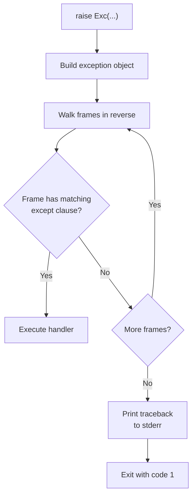
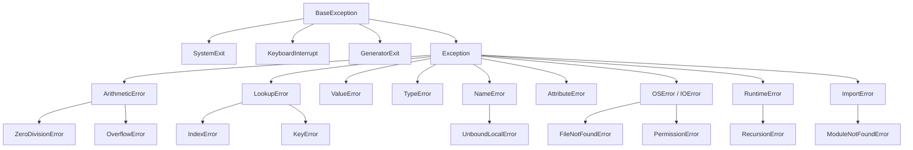
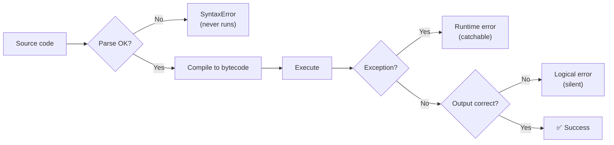
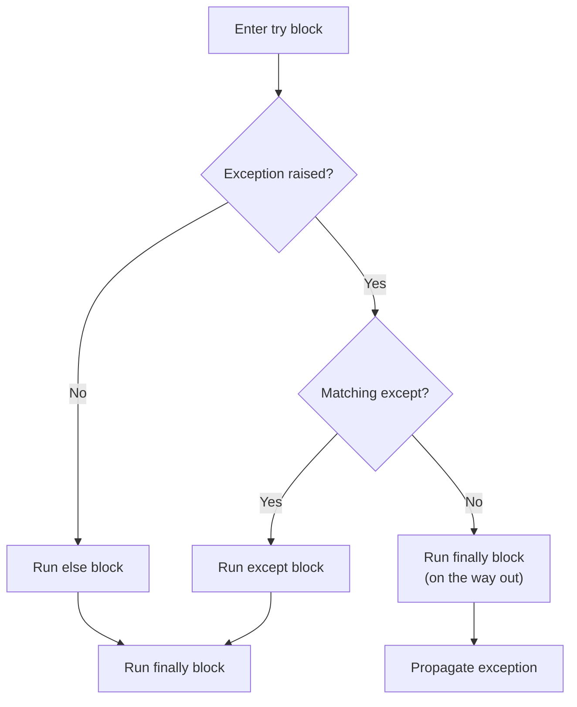
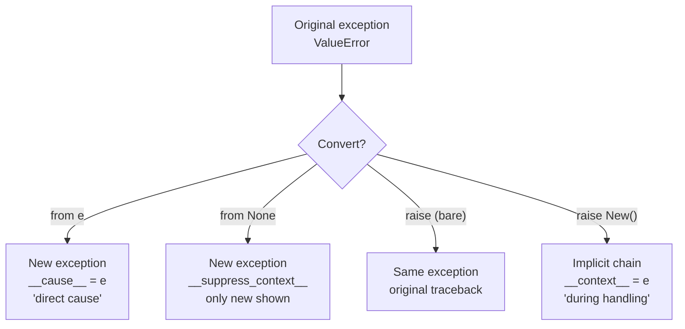
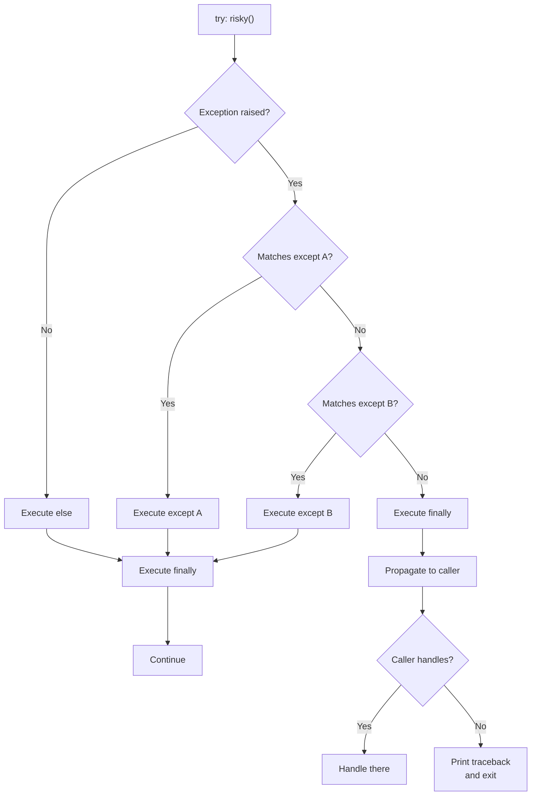
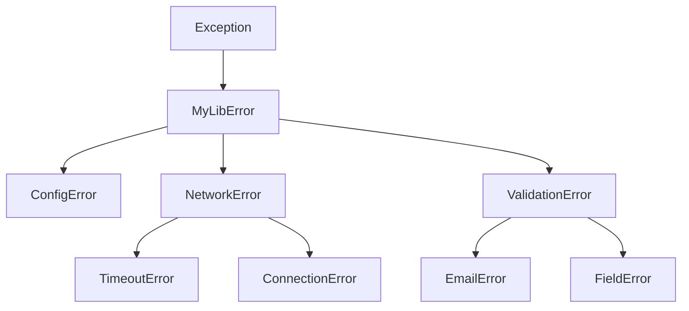

# Errors & Exceptions — Detailed Notes

---

## 1. What Is It? (Concept & Under the Hood)

An **error** is a condition that prevents code from completing as intended. Python distinguishes three broad categories:

1. **Syntax errors** — the parser cannot build an AST; the code never runs.
2. **Runtime errors (exceptions)** — the code parses and starts executing, then something goes wrong.
3. **Logical errors** — the code runs fine but produces wrong results (no exception).

An **exception** is a runtime event that disrupts normal flow. When one occurs, Python **raises** it, unwinding the call stack until a matching `except` handler is found — or the interpreter terminates with a traceback.

Key properties:
- **Exceptions are objects** — instances of classes inheriting from `BaseException`.
- **Raised explicitly** (`raise`) or implicitly (by the interpreter).
- **Caught by `try`/`except`** — the only mechanism for handling them.
- **Hierarchical** — catching a base class catches all subclasses.
- **Chainable** — a new exception can reference the one that triggered it.

### Under the Hood — CPython's Exception Machinery

Exceptions live in two places:

```c
typedef struct {
    PyObject_HEAD
    PyObject *dict;
    PyObject *args;
    PyObject *traceback;
    PyObject *context;   // implicit chaining (during handling)
    PyObject *cause;     // explicit chaining (raise ... from ...)
    PyObject *suppress_context;
} PyBaseExceptionObject;
```

The interpreter maintains an **exception state** on each thread and per-frame. When `raise` executes:



Every frame that gets unwound has its `f_lasti` (last instruction index) recorded for the traceback.

### The Exception Hierarchy (Top Level)



**Important:** `BaseException` and `Exception` are different. Catch `Exception` (not `BaseException`) unless you have a very good reason — `SystemExit`, `KeyboardInterrupt`, and `GeneratorExit` should usually propagate.

### Characteristics

| Aspect | Value |
|---|---|
| Raise cost | ~1–5 µs |
| Catch cost | ~0.1 µs (no match) — cheap until raise |
| Traceback cost | Proportional to depth |
| Frame unwinding | Every frame has `f_lasti` |
| Chaining | `__context__` (implicit), `__cause__` (explicit) |

---

## 2. Three Kinds of Errors

### Syntax Errors

Detected **before execution** — the parser can't produce an AST.

```python
# ❌ SyntaxError
if x = 5:
    print(x)
# SyntaxError: invalid syntax

# ❌ SyntaxError — missing colon
def f()
    pass

# ❌ IndentationError (a subclass of SyntaxError)
def f():
print("bad")

# ❌ TabError — mixed tabs and spaces
```

Syntax errors never reach runtime — you can't catch them with `try`/`except` in the same file. Tools like `compile()`, `exec()`, and `eval()` may raise `SyntaxError` dynamically.

```python
code = "if x = 5: pass"
try:
    compile(code, "<string>", "exec")
except SyntaxError as e:
    print(f"Syntax error: {e}")
```

### Runtime Errors (Exceptions)

Occur during execution:

```python
1 / 0                # ZeroDivisionError
int("abc")           # ValueError
d = {}; d["missing"] # KeyError
lst = [1]; lst[5]    # IndexError
"a" + 1              # TypeError
None.foo             # AttributeError
import nosuch        # ModuleNotFoundError
```

### Logical Errors

No exception — just wrong output:

```python
def average(nums):
    return sum(nums) / len(nums)

average([1, 2, 3])            # 2.0 ✅
average([1, 2, 3, 4])         # 2.5 ✅

# ❌ Logical error — mean is 2.5, this returns 2
def average_wrong(nums):
    return sum(nums) // len(nums)
```

Logical errors are the hardest to find because **nothing raises**. Defense: tests, assertions, and careful review.

### Comparison Table

| Error type | Detected | Catchable? | Example |
|---|---|---|---|
| Syntax | Parse time | No (in same file) | `if x = 5:` |
| Runtime (exception) | During execution | Yes (`try`/`except`) | `1 / 0` |
| Logical | Never | N/A | Off-by-one, wrong formula |

### Mermaid — Error Timing



---

## 3. `try` / `except` / `else` / `finally`

### Basic Form

```python
try:
    risky()
except SomeError:
    handle()
```

The `try` block runs; if an exception matching `SomeError` is raised, the `except` block runs; otherwise execution continues after the `try`/`except`.

### Full Form

```python
try:
    result = risky()
except ValueError as e:
    handle_value_error(e)
except (TypeError, KeyError) as e:
    handle_other(e)
except Exception as e:
    log_and_reraise(e)
else:
    # Runs only if NO exception occurred in `try`
    use(result)
finally:
    # Always runs, exception or not
    cleanup()
```

### Execution Order



### Each Clause Explained

#### `try`
Contains code that might raise. Keep it **narrow** — only lines that can genuinely raise should be inside.

```python
# ❌ Too broad — hides unrelated errors
try:
    data = load_file(path)
    parsed = parse(data)
    result = transform(parsed)
except FileNotFoundError:
    print("file missing")
```

```python
# ✅ Narrow — only the risky call
try:
    data = load_file(path)
except FileNotFoundError:
    print("file missing")
else:
    parsed = parse(data)
    result = transform(parsed)
```

#### `except`
Catches exceptions by class. Multiple clauses are tried top-to-bottom; **first match wins**.

```python
try:
    n = int(input())
except ValueError:
    print("not a number")
except KeyboardInterrupt:
    print("interrupted")
```

#### `except ... as e`
Binds the exception instance to `e`. The binding is **deleted at the end of the block** in Python 3:

```python
try:
    int("x")
except ValueError as e:
    print(e)

print(e)         # ❌ NameError — `e` is unbound after the except block
```

This prevents reference cycles (exception → traceback → frame → exception). To keep it:

```python
try:
    int("x")
except ValueError as e:
    saved = e            # ✅ keep a reference
```

#### `except (A, B)` — Multiple Types

```python
try:
    data[key]
except (KeyError, IndexError, TypeError):
    print("bad access")
```

#### Bare `except`
Catches everything — including `KeyboardInterrupt`, `SystemExit`. **Avoid**:

```python
# ❌ Never do this
try:
    work()
except:
    pass
```

At minimum, catch `Exception`:

```python
# ✅ Better — allows Ctrl+C, sys.exit() to work
try:
    work()
except Exception as e:
    log.exception("unexpected error")
    raise
```

#### `else`
Runs only if `try` completed without exception. Placing non-risky code here keeps the `try` narrow and prevents accidentally catching exceptions from it.

```python
try:
    f = open(path)
except OSError:
    return None
else:
    # This runs only on success — not covered by the except
    data = f.read()
    f.close()
    return data
```

#### `finally`
Always runs — even on exception, `return`, `break`, `continue`, or `sys.exit()`. Use for cleanup.

```python
f = None
try:
    f = open(path)
    data = f.read()
finally:
    if f is not None:
        f.close()      # ✅ always closes
```

Modern Python: `with` handles this more cleanly, but `finally` still has its place for arbitrary cleanup.

### `finally` and `return`

`return` in `finally` **overrides** the `try` block's return — and **swallows exceptions**:

```python
def f():
    try:
        return 1
    finally:
        return 2

f()      # 2 — the try's return is discarded
```

```python
def g():
    try:
        raise ValueError("boom")
    finally:
        return 42

g()      # 42 — the exception is silently lost
```

**Rule:** never `return` (or `break`/`continue`) inside `finally` unless you really mean to swallow.

### `try`/`except` Short Forms

```python
# Single statement
try: x = int(s)
except ValueError: x = 0
```

Discouraged — always use blocks for readability.

### Full-Form Summary Table

| Clause | Runs when | Purpose |
|---|---|---|
| `try` | Always (first) | Risky code |
| `except X` | Exception of type X | Handle / recover |
| `except X as e` | Same, binds instance | Access to exception |
| `else` | `try` succeeded | Post-success logic |
| `finally` | Always (last) | Cleanup |

---

## 4. `raise` — Raising Exceptions

### Basic Raise

```python
raise ValueError("invalid value")
```

### Raise Existing Exception

```python
err = ValueError("saved earlier")
raise err
```

### Re-Raise — Inside an `except` Block

```python
try:
    work()
except Exception:
    log.exception("failed")
    raise              # re-raises the current exception
```

Bare `raise` re-raises the **currently-handled** exception — preserves the original traceback.

```python
try:
    work()
except Exception as e:
    log.exception("failed")
    raise e            # ❌ resets the traceback to this line
```

The difference is subtle but visible in tracebacks: `raise` preserves the original point, `raise e` rewrites it.

### Raise a Different Exception

```python
try:
    int(text)
except ValueError:
    raise TypeError("expected a number")
```

By default, this **chains** — the new exception's `__context__` points to the old one.

### Raise From — Explicit Chaining

```python
try:
    int(text)
except ValueError as e:
    raise ValueError("bad config") from e
```

The traceback shows:

```
ValueError: bad config

The above exception was the direct cause of the following exception:

Traceback (most recent call last):
  ...
```

### Suppress Chaining

```python
try:
    int(text)
except ValueError:
    raise TypeError("bad input") from None
```

`from None` sets `__suppress_context__ = True` — the original exception is hidden.

### Exception Chaining — Comparison

| Form | `__cause__` | `__context__` | `__suppress_context__` | Traceback shows |
|---|---|---|---|---|
| `raise NewError()` in except | None | Old error | False | Both (implicit) |
| `raise NewError() from old` | old | old | False | Both (explicit) |
| `raise NewError() from None` | None | old | True | Only new |
| `raise` (bare) | None | None | False | Original |

### When to Chain

| Situation | Use |
|---|---|
| Translating low-level error to domain error | `from e` |
| Replacing with a cleaner public API error | `from None` |
| Logging and propagating | bare `raise` |
| Adding context | `from e` |

### `assert` — Conditional Raise

```python
assert x > 0, "x must be positive"
```

Roughly equivalent to:

```python
if not (x > 0):
    raise AssertionError("x must be positive")
```

Assertions are **removed** when Python runs with `-O` (optimized mode). Never use assertions for runtime validation of user input — use explicit `if ... raise`.

```python
# ❌ Wrong — vanishes under -O
def transfer(amount):
    assert amount > 0
    ...

# ✅ Right — always enforced
def transfer(amount):
    if amount <= 0:
        raise ValueError("amount must be positive")
    ...
```

### Raising Class vs Instance

```python
raise ValueError              # class — Python instantiates it
raise ValueError("message")   # instance
```

Both work — the first form creates an instance with no args.

### Common Built-in Exceptions to Raise

| Exception | When |
|---|---|
| `ValueError` | Right type, wrong value |
| `TypeError` | Wrong type |
| `KeyError` | Missing key (usually implicit) |
| `IndexError` | Bad index (usually implicit) |
| `RuntimeError` | Generic runtime failure |
| `NotImplementedError` | Abstract method |
| `FileNotFoundError` | Missing file |
| `PermissionError` | Access denied |
| `ZeroDivisionError` | Division by zero |

---

## 5. Custom Exceptions

### Why Custom Exceptions?

- **Distinguishable errors** — callers can catch precisely.
- **Attach context** — carry structured data (error codes, IDs).
- **Domain modeling** — exceptions document failure modes.
- **API clarity** — a library's exceptions form part of its interface.

### Defining a Custom Exception

```python
class MyError(Exception):
    pass
```

That's it — a class inheriting from `Exception` (directly or indirectly).

### With Docstrings and `__init__`

```python
class ConfigError(Exception):
    """Raised when configuration is invalid."""

    def __init__(self, message, key=None):
        super().__init__(message)
        self.key = key
```

Usage:

```python
try:
    load_config()
except ConfigError as e:
    print(f"bad key: {e.key}")
    print(f"message: {e}")
```

`str(e)` gives the message passed to `super().__init__(message)`.

### Exception Hierarchies — The Right Way

Build a tree rooted at one base class per library:

```python
class MyLibError(Exception):
    """Base exception for MyLib."""

class ConfigError(MyLibError):
    """Configuration problem."""

class ConnectionError(MyLibError):      # shadows builtin! rename
    """Connection problem."""

class TimeoutError(ConnectionError):
    """Connection timed out."""
```

Now callers can catch at any level:

```python
try:
    mylib.do_work()
except MyLibError:
    # Catch any MyLib error
    handle()

except TimeoutError:
    # Specific
    retry()
```

**Best practice:** one base class per library, subclasses for specifics. Document this hierarchy.

### Attaching Structured Data

```python
class APIError(Exception):
    def __init__(self, status_code, message, url=None):
        super().__init__(f"HTTP {status_code}: {message}")
        self.status_code = status_code
        self.message = message
        self.url = url
```

Callers can inspect `e.status_code` to decide behavior.

### `__str__` for Custom Messages

```python
class ValidationError(Exception):
    def __init__(self, field, reason):
        self.field = field
        self.reason = reason

    def __str__(self):
        return f"{self.field}: {self.reason}"

raise ValidationError("email", "invalid format")
# str: "email: invalid format"
```

### Exceptions with `dataclass`

```python
from dataclasses import dataclass

@dataclass
class ValidationError(Exception):
    field: str
    reason: str

    def __str__(self):
        return f"{self.field}: {self.reason}"
```

Concise and type-hint-friendly — but note: `dataclass` sets `__eq__`, so two errors with equal fields compare equal.

### Naming Convention

- End with **`Error`** (e.g., `ConfigError`, `TimeoutError`).
- Avoid clashing with built-in names — prefix with library: `MyLibTimeoutError`.
- One file (`exceptions.py`) for the whole hierarchy.

### Example — Library Exception Module

```python
# mylib/exceptions.py
"""Exception hierarchy for MyLib."""

class MyLibError(Exception):
    """Base class for all MyLib exceptions."""

class ConfigurationError(MyLibError):
    """Invalid or missing configuration."""

class AuthenticationError(MyLibError):
    """Authentication failed."""

class RateLimitError(MyLibError):
    """Rate limit exceeded."""

    def __init__(self, retry_after):
        super().__init__(f"retry after {retry_after}s")
        self.retry_after = retry_after

class TimeoutError_(MyLibError):        # avoid shadowing builtin
    """Operation timed out."""
```

### Custom vs Built-in — Decision Table

| Use built-in | Use custom |
|---|---|
| `ValueError` for bad values | Domain-specific errors |
| `TypeError` for wrong types | Library-specific hierarchies |
| `KeyError` for missing keys | Attach structured data |
| `NotImplementedError` for abstract | Group errors under one base |

Don't invent custom exceptions when a built-in clearly fits — built-ins are familiar and less code.

---

## 6. Exception Hierarchy Deep Dive

### The Full Tree (Selected)

```
BaseException
├── SystemExit                 — sys.exit()
├── KeyboardInterrupt          — Ctrl+C
├── GeneratorExit              — generator.close()
└── Exception                  — everything else
    ├── StopIteration
    ├── StopAsyncIteration
    ├── ArithmeticError
    │   ├── ZeroDivisionError
    │   ├── OverflowError
    │   └── FloatingPointError
    ├── AssertionError
    ├── AttributeError
    ├── BufferError
    ├── EOFError
    ├── ImportError
    │   └── ModuleNotFoundError
    ├── LookupError
    │   ├── IndexError
    │   └── KeyError
    ├── MemoryError
    ├── NameError
    │   └── UnboundLocalError
    ├── OSError (= IOError, EnvironmentError)
    │   ├── FileNotFoundError
    │   ├── FileExistsError
    │   ├── PermissionError
    │   ├── IsADirectoryError
    │   ├── NotADirectoryError
    │   ├── InterruptedError
    │   ├── BlockingIOError
    │   ├── ChildProcessError
    │   ├── ConnectionError
    │   │   ├── BrokenPipeError
    │   │   ├── ConnectionAbortedError
    │   │   ├── ConnectionRefusedError
    │   │   └── ConnectionResetError
    │   ├── TimeoutError
    │   └── ProcessLookupError
    ├── ReferenceError
    ├── RuntimeError
    │   ├── NotImplementedError
    │   └── RecursionError
    ├── StopIteration
    ├── SyntaxError
    │   └── IndentationError
    │       └── TabError
    ├── SystemError              — internal error
    ├── TypeError
    ├── ValueError
    │   └── UnicodeError
    │       ├── UnicodeEncodeError
    │       ├── UnicodeDecodeError
    │       └── UnicodeTranslateError
    └── Warning
        ├── DeprecationWarning
        ├── UserWarning
        └── ...
```

### `BaseException` vs `Exception`

**Never** catch `BaseException` unless you're implementing a system-level tool:

```python
# ❌ Bad — swallows Ctrl+C and sys.exit()
try:
    long_running()
except BaseException:
    pass

# ✅ Good — allows Ctrl+C to work
try:
    long_running()
except Exception:
    pass
```

**Rule of thumb:** catch the **narrowest** class you can handle; if you must catch broadly, catch `Exception` (not `BaseException`).

### `OSError` — The Family

Modern `OSError` subsumes old names (`IOError`, `EnvironmentError`, `WindowsError`):

```python
try:
    open("missing.txt")
except FileNotFoundError:            # ✅ specific
    ...

try:
    open("missing.txt")
except OSError:                      # ✅ broad — catches all OS errors
    ...
```

`OSError` exposes `errno`, `strerror`, `filename`:

```python
try:
    open("/root/secret")
except OSError as e:
    print(e.errno)       # 13
    print(e.strerror)    # 'Permission denied'
    print(e.filename)    # '/root/secret'
```

### Matching Best Practices

```python
# ✅ Catch what you can handle, in specificity order
try:
    result = process(data)
except KeyError as e:
    log.warning("missing key %s", e)
    result = default
except (ValueError, TypeError) as e:
    log.error("invalid input: %s", e)
    raise
except Exception:
    log.exception("unexpected")     # logs traceback
    raise
```

Place **specific** handlers first. Once caught, the exception is considered handled — later clauses won't run.

### MRO — Catching a Class Catches Subclasses

```python
class VehicleError(Exception): pass
class CarError(VehicleError): pass
class EngineError(CarError): pass

try:
    start_car()
except VehicleError:        # catches all three
    ...
```

Because `EngineError` is a subclass of `VehicleError` via MRO.

### Which to Catch — Cheat Sheet

| Symptom | Likely exception |
|---|---|
| `int("abc")` | `ValueError` |
| `1 / 0` | `ZeroDivisionError` |
| `d["missing"]` | `KeyError` |
| `lst[100]` | `IndexError` |
| `"a" + 1` | `TypeError` |
| `None.foo` | `AttributeError` |
| `import nosuch` | `ModuleNotFoundError` |
| `open("missing")` | `FileNotFoundError` |
| `iter([]).__next__()` | `StopIteration` |
| Recursion too deep | `RecursionError` |
| Ctrl+C | `KeyboardInterrupt` (BaseException) |

---

## 7. Assertions

### What Is `assert`?

A debugging aid — a statement that checks an invariant and raises `AssertionError` if it fails.

```python
assert x > 0
assert x > 0, "x must be positive"
```

Equivalent to:

```python
if __debug__:
    if not (x > 0):
        raise AssertionError("x must be positive")
```

### `__debug__`

`__debug__` is `True` by default; it becomes `False` when Python is run with `-O` or `-OO`. Assertions disappear:

```bash
python -O script.py      # assertions removed
python -OO script.py     # assertions + docstrings removed
```

### When to Use Assertions

✅ **Use for:**
- Internal invariants ("this should never happen").
- Documenting assumptions in tests and prototypes.
- Sanity checks during development.

❌ **Don't use for:**
- Validating user input — use `if ... raise ValueError`.
- Checking file existence, network responses, etc.
- Enforcing security constraints.
- Public API contracts.

```python
# ❌ Bad — disappears under -O
def withdraw(account, amount):
    assert amount > 0
    assert amount <= account.balance
    ...

# ✅ Good — always enforced
def withdraw(account, amount):
    if amount <= 0:
        raise ValueError("amount must be positive")
    if amount > account.balance:
        raise InsufficientFunds()
    ...
```

### `assert` with Messages

```python
assert len(items) > 0, f"empty list, expected at least one element"
```

The message is evaluated only if the assertion fails.

### `assert` Doesn't Catch — It Raises

```python
try:
    assert False, "boom"
except AssertionError as e:
    print(e)     # 'boom'
```

### Assertions in Tests

`pytest` uses plain `assert`:

```python
def test_add():
    assert add(2, 3) == 5
    assert add(-1, 1) == 0
```

`pytest` introspects the assertion to give rich failure messages — a good use case for `assert`.

### Comparison: `assert` vs `raise`

| Aspect | `assert` | `raise` |
|---|---|---|
| Removed under `-O` | ✅ | ❌ |
| Intent | Debug | Runtime |
| Catchable | `AssertionError` | Any exception |
| Message | Optional | Optional |
| Use for | Internal invariant | Public contract |

---

## 8. Reading Tracebacks

### What Is a Traceback?

A **traceback** is the stack trace printed when an unhandled exception reaches the top. It shows the call chain from the entry point to the point of failure.

### Anatomy

```
Traceback (most recent call last):
  File "script.py", line 15, in <module>
    main()
  File "script.py", line 10, in main
    process(data)
  File "script.py", line 6, in process
    return 1 / 0
ZeroDivisionError: division by zero
```

Three parts:

1. **Header:** `Traceback (most recent call last):`.
2. **Frames:** one `File ...` line per call, outermost first.
3. **Exception line:** `ExceptionType: message`.

### The Golden Rule

**Read from the bottom up:**

1. The last line tells you **what** failed — `ZeroDivisionError`.
2. The last frame tells you **where** — `script.py`, line 6.
3. The frames above tell you **how you got there**.

### A More Complex Example

```python
# app.py
def main():
    data = load()
    return parse(data)

def load():
    return open("missing.txt").read()

def parse(data):
    return int(data)

main()
```

```
Traceback (most recent call last):
  File "app.py", line 13, in <module>
    main()
  File "app.py", line 3, in main
    data = load()
  File "app.py", line 6, in load
    return open("missing.txt").read()
FileNotFoundError: [Errno 2] No such file or directory: 'missing.txt'
```

Reading:
- **Bottom line:** `FileNotFoundError`.
- **Failing frame:** `load`, line 6.
- **Caller chain:** `main` (line 3) ← `<module>` (line 13).

### Chained Exceptions

```
Traceback (most recent call last):
  File "app.py", line 5, in main
    parse(config)
ValueError: invalid literal for int(): 'abc'

The above exception was the direct cause of the following exception:

Traceback (most recent call last):
  File "app.py", line 10, in parse
    raise ConfigError("invalid port") from e
ConfigError: invalid port
```

The **first traceback** is the original cause; the **second** is the raised exception. `raise ... from e` creates this layout.

### `__suppress_context__` — `from None`

```
Traceback (most recent call last):
  File "app.py", line 10, in parse
    raise ConfigError("invalid port") from None
ConfigError: invalid port
```

Only the new exception is shown.

### Traceback Objects

Inside an `except` block, `e.__traceback__` is a traceback object:

```python
import traceback

try:
    1 / 0
except Exception as e:
    tb = e.__traceback__
    traceback.print_tb(tb)
    traceback.print_exception(type(e), e, tb)
```

Walk the frames manually:

```python
def walk_tb(tb):
    while tb is not None:
        frame = tb.tb_frame
        print(f"{frame.f_code.co_filename}:{tb.tb_lineno} in {frame.f_code.co_name}")
        tb = tb.tb_next

try:
    1 / 0
except Exception as e:
    walk_tb(e.__traceback__)
```

### Custom Tracebacks

You can raise with a custom traceback:

```python
raise ValueError("msg").with_traceback(tb)
```

Rare but useful for re-raising with preserved context.

### Logging Tracebacks

```python
import logging
logger = logging.getLogger(__name__)

try:
    work()
except Exception:
    logger.exception("unexpected error")     # logs full traceback
    raise
```

`logger.exception` is equivalent to `logger.error(..., exc_info=True)` — the traceback is attached automatically.

### Tracebacks in Production

- **Log them** — don't print to stdout.
- **Include context** — user ID, request ID, inputs (sanitized).
- **Use structured logging** — parse into JSON for log aggregation.
- **Don't leak secrets** — sanitize before logging.

### Reading Tips — Summary

| Step | What to look for |
|---|---|
| 1 | Last line — exception type + message |
| 2 | Last frame — file, line, function |
| 3 | Above frames — caller chain |
| 4 | Chained exceptions — "direct cause" section |
| 5 | `from None` — only newest shown |

---

## 9. `raise ... from ...` — Exception Chaining

### The Problem

Without chaining, converting one exception to another **loses context**:

```python
try:
    port = int(config["port"])
except ValueError:
    raise ConfigError("invalid port")
```

The original `ValueError` is gone from the traceback — a debugging nightmare.

### Implicit Chaining — `__context__`

Python automatically chains — `ConfigError.__context__` is the `ValueError`:

```python
try:
    int("abc")
except ValueError as e:
    new = ConfigError("bad")
    try:
        raise new
    except ConfigError as ce:
        print(ce.__context__)     # ValueError('invalid literal...')
```

Traceback shows both:

```
During handling of the above exception, another exception occurred:
```

The **"During handling"** wording indicates an **implicit** chain (context).

### Explicit Chaining — `__cause__`

```python
try:
    port = int(config["port"])
except ValueError as e:
    raise ConfigError("invalid port") from e
```

Traceback:

```
The above exception was the direct cause of the following exception:
```

The **"direct cause"** wording indicates an **explicit** chain.

### Why Prefer `from e`?

- **Clearer intent** — you *chose* to convert.
- **Better traceback wording** — "direct cause" (not "during handling").
- **`__cause__` attribute** — explicitly set for introspection.
- **Best practice** — recommended by PEP 3134.

### When to Use `from None`

When the original error is **irrelevant or misleading** to the caller:

```python
try:
    value = settings["timeout"]
except KeyError:
    raise ConfigError("timeout not configured") from None
```

The `KeyError` was incidental; the caller only needs to know the config is incomplete.

### Chaining Across API Boundaries

```python
# Low-level library
def raw_query(sql):
    try:
        return db.execute(sql)
    except DBDriverError as e:
        raise QueryError(f"failed: {sql}") from e

# Application
try:
    raw_query("SELECT ...")
except QueryError as e:
    print(f"query failed: {e}")
    print(f"underlying: {e.__cause__}")
```

Callers see the domain error but can dig into the cause.

### Re-Raising with Enrichment

```python
try:
    parse(data)
except ValueError as e:
    e.add_note(f"input was: {data!r}")     # PEP 678 (3.11+)
    raise
```

`add_note` attaches extra context without replacing the exception.

### Chaining Patterns Table

| Pattern | Syntax | Purpose |
|---|---|---|
| Re-raise | `raise` | Preserve original traceback |
| Explicit chain | `raise New(...) from e` | Convert with cause |
| Suppress chain | `raise New(...) from None` | Hide internal error |
| Add context | `e.add_note(...); raise` | Preserve + annotate |
| Implicit chain | `raise New(...)` inside except | Fallback chaining |

### Mermaid — Chaining Flow



---

## 10. Real-World Use Cases

### Use Case 1 — Retry with Backoff

```python
import time, random

def retry(fn, attempts=5, base=0.5):
    for i in range(attempts):
        try:
            return fn()
        except (ConnectionError, TimeoutError) as e:
            if i == attempts - 1:
                raise
            delay = base * 2 ** i + random.random()
            time.sleep(delay)
```

### Use Case 2 — File Reading with Fallback

```python
from pathlib import Path

def load_config(path):
    try:
        return Path(path).read_text()
    except FileNotFoundError:
        return ""
    except PermissionError as e:
        raise ConfigError(f"cannot read {path}") from e
```

### Use Case 3 — Parsing with Chained Errors

```python
def parse_port(value):
    try:
        port = int(value)
    except ValueError as e:
        raise ConfigError(f"invalid port: {value!r}") from e
    if not 0 < port < 65536:
        raise ConfigError(f"port out of range: {port}")
    return port
```

### Use Case 4 — API Client with Structured Errors

```python
class APIError(Exception):
    def __init__(self, status, body, url):
        super().__init__(f"HTTP {status} from {url}")
        self.status = status
        self.body = body
        self.url = url

def get(url):
    resp = http.request("GET", url)
    if resp.status >= 400:
        raise APIError(resp.status, resp.text, url)
    return resp.json()

try:
    data = get("https://api.example.com/users")
except APIError as e:
    if e.status == 404:
        data = []
    elif e.status >= 500:
        raise
    else:
        log.error("api error: %s", e)
```

### Use Case 5 — Validation with Multiple Rules

```python
class ValidationError(Exception):
    def __init__(self, errors):
        super().__init__(f"{len(errors)} validation errors")
        self.errors = errors

def validate(data):
    errors = []
    if not data.get("name"):
        errors.append("name is required")
    if "@" not in data.get("email", ""):
        errors.append("email is invalid")
    if data.get("age", 0) < 0:
        errors.append("age must be non-negative")
    if errors:
        raise ValidationError(errors)
    return data
```

### Use Case 6 — Context Manager Instead of `try`/`finally`

```python
from contextlib import contextmanager

@contextmanager
def transaction(conn):
    try:
        yield conn
        conn.commit()
    except Exception:
        conn.rollback()
        raise

with transaction(conn) as c:
    c.execute("INSERT ...")
    c.execute("UPDATE ...")
```

### Use Case 7 — Suppressing Specific Exceptions

```python
from contextlib import suppress

with suppress(FileNotFoundError):
    os.remove("temp.txt")
```

Cleaner than `try`/`except`/`pass`:

```python
try:
    os.remove("temp.txt")
except FileNotFoundError:
    pass
```

### Use Case 8 — Cleanup in `finally`

```python
lock = threading.Lock()
lock.acquire()
try:
    critical_section()
finally:
    lock.release()

# ✅ Better — use `with`
with lock:
    critical_section()
```

### Use Case 9 — Guarding Test Assertions

```python
def test_division():
    assert divide(10, 2) == 5
    with pytest.raises(ZeroDivisionError):
        divide(10, 0)
```

### Use Case 10 — Global Error Handler

```python
def main():
    try:
        run_app()
    except KeyboardInterrupt:
        print("\ninterrupted", file=sys.stderr)
        return 130
    except Exception as e:
        logger.exception("unexpected error")
        return 1
    return 0

if __name__ == "__main__":
    sys.exit(main())
```

---

## 11. Common Pitfalls

### Pitfall 1 — Bare `except`

```python
try:
    work()
except:                # ❌ swallows KeyboardInterrupt, SystemExit
    pass
```

Fix: catch `Exception` explicitly.

### Pitfall 2 — Broad `except Exception` Without Re-Raise

```python
try:
    process()
except Exception:
    print("oops")       # ❌ hides real bug, no traceback
```

Fix: log with traceback + re-raise, or catch narrower.

### Pitfall 3 — Swallowing

```python
try:
    parse(data)
except ValueError:
    pass                # ❌ silent failure
```

Fix: at minimum log; usually recover or re-raise.

### Pitfall 4 — Catching Too Much

```python
try:
    config = load()
    result = compute(config)
    save(result)
except Exception:
    return None         # ❌ which step failed?
```

Fix: narrow each `try` to one operation.

### Pitfall 5 — `return` in `finally`

```python
def f():
    try:
        return 1
    finally:
        return 2        # ❌ returns 2, discards 1
```

Fix: never return/break/continue in `finally`.

### Pitfall 6 — Losing the Traceback

```python
try:
    work()
except Exception as e:
    raise RuntimeError("failed")   # ❌ original context lost (implicit at best)
```

Fix: `from e` or bare `raise`.

```python
try:
    work()
except Exception as e:
    raise RuntimeError("failed") from e   # ✅
```

### Pitfall 7 — `raise e` Instead of Bare `raise`

```python
try:
    work()
except Exception as e:
    log(e)
    raise e             # ❌ resets the traceback to this line

# ✅
try:
    work()
except Exception:
    log.exception("failed")
    raise
```

### Pitfall 8 — Using `assert` for Validation

```python
def withdraw(account, amount):
    assert amount > 0   # ❌ vanishes under -O
    ...
```

Fix: use `if amount <= 0: raise ValueError(...)`.

### Pitfall 9 — Custom Exception Without Base

```python
class MyError:          # ❌ not an Exception
    pass

raise MyError()         # TypeError: exceptions must derive from BaseException
```

Fix: inherit from `Exception`.

### Pitfall 10 — Shadowing Built-in Exceptions

```python
class TimeoutError(Exception):      # ❌ shadows builtin
    pass
```

Fix: prefix with your library or use a distinct name.

### Pitfall 11 — Forgetting `finally` Cleanup

```python
f = open("data.txt")
data = f.read()          # if this raises, f never closes
f.close()
```

Fix: `with open(...) as f:` or `try`/`finally`.

### Pitfall 12 — Catching and Not Handling

```python
try:
    do_work()
except Exception:
    raise ValueError("failed")   # ❌ loses original type
```

Fix: preserve the original type when possible, or chain.

### Pitfall 13 — `except` Order Matters

```python
try:
    work()
except Exception:           # ❌ catches everything — the next clause is dead
    ...
except ValueError:
    ...
```

Fix: list specific exceptions first.

### Pitfall 14 — Exception in `except` Block

```python
try:
    work()
except Exception as e:
    int(e)                  # ❌ may raise a new exception
```

The new exception replaces the current one (though chained). Keep handlers simple.

### Pitfall Summary Table

| Pitfall | Symptom | Fix |
|---|---|---|
| Bare `except` | Ctrl+C swallowed | Catch `Exception` |
| Swallowing | Silent failure | Log or re-raise |
| `return` in `finally` | Swallows exceptions | Never return there |
| `raise e` | Traceback reset | Bare `raise` |
| `assert` for input | Vanishes under `-O` | `if ... raise` |
| Bad custom base | `TypeError` at raise | Inherit `Exception` |
| Shadowed builtin | Confusing | Rename |
| Missing cleanup | Leaks | `with` / `finally` |
| Order wrong | Unreachable clauses | Specific first |

---

## 12. Comparison Tables

### Exception vs Warning

| | Exception | Warning |
|---|---|---|
| Base class | `Exception` | `Warning` (subclass of `Exception`) |
| Default | Propagates | Printed, ignored by default |
| Raises on | Any error | Rarely — usually filtered |
| Handling | `try`/`except` | `warnings.catch_warnings` |
| Use | Errors | Deprecations, questionable usage |

### `assert` vs `raise`

| Aspect | `assert` | `raise` |
|---|---|---|
| Removed under `-O` | ✅ | ❌ |
| Intended use | Internal invariant | Public contract |
| Message eval | Lazy | Always |
| Common in | Tests | Production code |

### `try`/`finally` vs `with`

| Feature | `try`/`finally` | `with` |
|---|---|---|
| Verbosity | High | Low |
| Handles multiple resources | Manual | Nested/`ExitStack` |
| Custom cleanup | Any code | `__exit__` |
| Reusable | No | Yes |
| Exception suppression | Manual | `return True` |

### `except X` vs `except (X, Y)`

| | Single | Tuple |
|---|---|---|
| Syntax | `except ValueError:` | `except (ValueError, TypeError):` |
| Handler | One type | Multiple types |
| Alias | `as e` | `as e` |

### Chaining Forms

| Form | Attribute | Traceback |
|---|---|---|
| `raise` (bare) | — | Original |
| `raise New()` in except | `__context__` | "During handling" |
| `raise New() from e` | `__cause__` | "Direct cause" |
| `raise New() from None` | suppressed | Only new |

---

## 13. Mermaid — Full Exception Flow



### Custom Exception Hierarchy



Catch `MyLibError` to catch everything the library raises.

---

## 14. Performance Notes

### `try` Is Nearly Free

```python
import timeit

timeit.timeit("""
try:
    x = 1 + 1
except Exception:
    pass
""", number=1_000_000)
# ~0.05 s — try block is essentially free
```

Since Python 3.11 (PEP 659, "zero-cost exceptions"), the `try` block itself has no runtime cost — only *raising* is expensive.

### Raising Is Expensive

```python
def raise_every_time():
    for i in range(1_000_000):
        try:
            raise ValueError()
        except ValueError:
            pass

# ~2–5 s (Python 3.11) — raising is ~2–5 µs per raise
```

Raising involves:
- Creating an exception object.
- Capturing the traceback.
- Unwinding frames.

### Avoiding Exceptions in Hot Loops

```python
# ❌ Slow — uses KeyError for control flow
def get(d, k, default=None):
    try:
        return d[k]
    except KeyError:
        return default

# ✅ Fast — check first
def get(d, k, default=None):
    return d[k] if k in d else default

# ✅ Fastest — use the built-in
def get(d, k, default=None):
    return d.get(k, default)
```

Exceptions are for **exceptions**, not normal control flow.

### `try`/`except` vs `if` Predicate

```python
# If predicate is cheap, prefer it
try:
    x = a / b
except ZeroDivisionError:
    x = 0

# For hot loops, check explicitly
x = a / b if b != 0 else 0     # ~3× faster
```

### Traceback Cost

Capturing a traceback is proportional to stack depth. Deep recursion → expensive raises.

```python
def deep(n):
    if n == 0:
        raise ValueError("bottom")
    return deep(n - 1)

# Deep call → expensive traceback capture
```

Set `exc.__traceback__ = None` or use `raise ... from None` to suppress — but that's rarely the real fix.

### `sys.setrecursionlimit` — Warning

```python
import sys
sys.setrecursionlimit(100_000)   # ⚠️ can crash — C stack overflows
```

The C stack limit is separate. Deep recursion can segfault even if Python's counter allows it.

### Exception Performance Table

| Operation | Cost |
|---|---|
| Enter `try` | ~0 ns (3.11+) |
| Match `except` (no raise) | ~0 ns |
| Raise + catch | ~2–5 µs |
| Raise + log | ~50 µs (I/O dominated) |
| Raise in tight loop | Kills performance |

---

## 15. Quick Reference Card

```python
# ─── TRY / EXCEPT ──────────────────────────────
try:
    risky()
except ValueError as e:
    handle(e)
except (TypeError, KeyError) as e:
    handle_multi(e)
except Exception as e:
    log.exception("unexpected")
    raise
else:
    # runs only if no exception
    success()
finally:
    # always runs
    cleanup()

# ─── RAISE ─────────────────────────────────────
raise ValueError("message")
raise ValueError              # class — no args
raise                         # bare — re-raise current

# ─── CHAINING ──────────────────────────────────
try:
    x = int(s)
except ValueError as e:
    raise ConfigError("bad") from e       # explicit cause
    raise ConfigError("bad") from None    # suppress context

# ─── ASSERTIONS ────────────────────────────────
assert x > 0                          # raises AssertionError
assert x > 0, "x must be positive"
# ⚠️ removed under python -O

# ─── CUSTOM EXCEPTIONS ─────────────────────────
class MyLibError(Exception):
    """Base for library errors."""

class ConfigError(MyLibError):
    """Invalid config."""

class APIError(MyLibError):
    def __init__(self, status, url):
        super().__init__(f"HTTP {status} at {url}")
        self.status = status
        self.url = url

# ─── TRACEBACK INTROSPECTION ───────────────────
import traceback
try:
    work()
except Exception as e:
    traceback.print_exc()
    print(e.__traceback__)         # traceback object
    print(e.__cause__)             # explicit cause
    print(e.__context__)           # implicit context

# ─── CONTEXTLIB HELPERS ────────────────────────
from contextlib import suppress
with suppress(FileNotFoundError):
    os.remove("temp")

# ─── COMMON BUILT-IN EXCEPTIONS ────────────────
ValueError        # right type, wrong value
TypeError         # wrong type
KeyError          # missing dict key
IndexError        # bad sequence index
AttributeError    # missing attribute
NameError         # undefined name
FileNotFoundError # missing file
PermissionError   # access denied
OSError           # generic OS error
RuntimeError      # generic runtime error
NotImplementedError  # abstract method
AssertionError    # failed assert

# ─── PATTERNS ──────────────────────────────────
# Re-raise after logging
except Exception:
    logger.exception("failed")
    raise

# Guard clauses
if not user:
    raise ValueError("user required")

# Validate input
try:
    n = int(input())
except ValueError:
    raise SystemExit("not a number") from None
```

---

## Summary

- **Three error kinds**: syntax (parse-time), runtime (catchable exceptions), logical (silent bugs).
- **Exceptions are objects** in the `BaseException` hierarchy; catch `Exception` (not `BaseException`) to keep Ctrl+C and `sys.exit` working.
- **`try`/`except`/`else`/`finally`**: keep `try` narrow, use `else` for post-success, `finally` for cleanup — and never `return` inside `finally`.
- **`raise` re-raises the current exception** and preserves its traceback; `raise e` resets it.
- **Custom exceptions** derive from `Exception` (or a library base) and carry structured data; name them `...Error` and give each library one base class.
- **Exception chaining**: `raise New from e` sets `__cause__` ("direct cause"); `from None` suppresses; implicit chaining sets `__context__` ("during handling").
- **`assert`** is for internal invariants — removed under `-O`; never use it for user input validation.
- **Read tracebacks bottom-up**: last line = what failed, last frame = where, frames above = how you got there.
- **`try` is nearly free** (zero-cost exceptions in 3.11+), but **raising is expensive** — don't use exceptions for normal control flow.
- **Pitfalls** cluster around bare `except`, swallowing, `return` in `finally`, `raise e`, `assert` for validation, shadowing built-ins, and wrong `except` order.