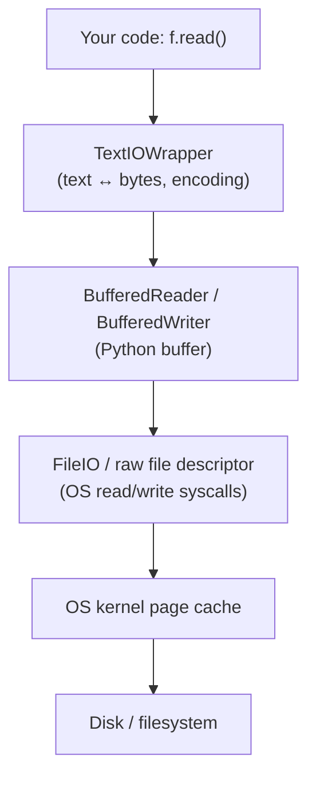
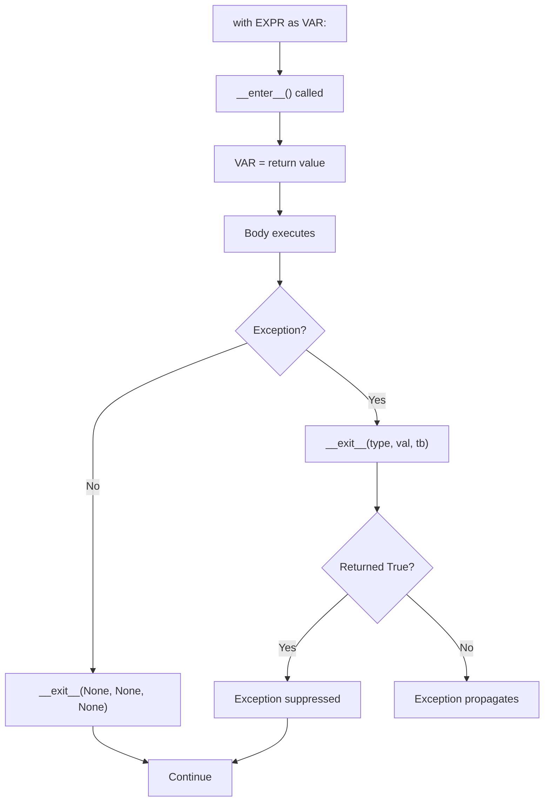
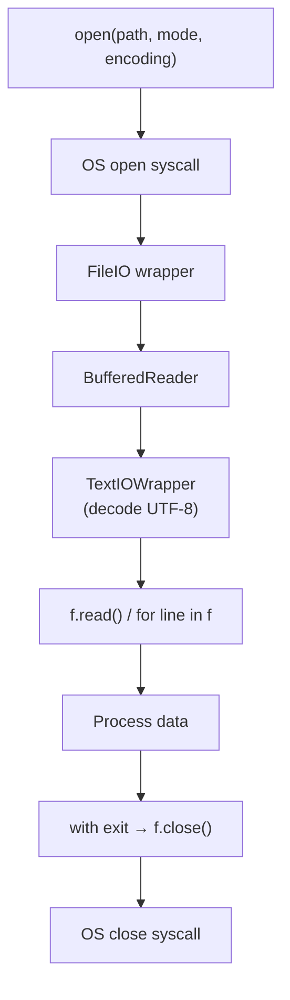
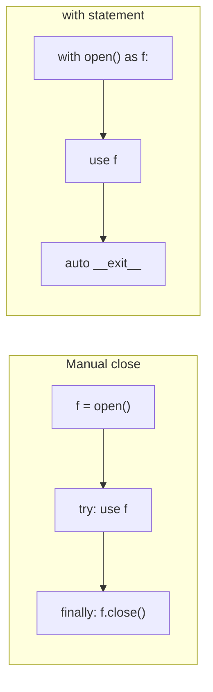

# File Handling & I/O — Detailed Notes

---

## 1. What Is It? (Concept & Under the Hood)

**File I/O** is how Python programs read from and write to persistent storage — text files, binary files, configuration, logs, and data formats like CSV/JSON. Python provides a layered stack: high-level helpers (`pathlib`, `csv`, `json`) on top of low-level file objects returned by `open()`.

Key concepts:
- **File object** — a buffered stream of bytes or text returned by `open()`.
- **Mode** — read/write/append, text/binary.
- **Encoding** — how bytes map to characters (critical for portability).
- **Buffering** — OS-level and Python-level caching for performance.
- **Context manager (`with`)** — guarantees the file closes, even on error.
- **Paths** — strings vs `pathlib.Path` objects (modern, preferred).

### Under the Hood — The I/O Stack

Python's file I/O has **three layers**:



1. **`TextIOWrapper`** — text mode: decodes bytes to `str`, encodes `str` to bytes, handles newline translation.
2. **`BufferedReader` / `BufferedWriter`** — buffers in memory to reduce syscalls.
3. **`FileIO`** — thin wrapper over `os.read` / `os.write` system calls.

In binary mode, `TextIOWrapper` is skipped — you get raw bytes from the buffer.

### File Object Classes

```python
import io

f = open("file.txt")           # default: TextIOWrapper(BufferedReader(FileIO))
type(f)                        # <class '_io.TextIOWrapper'>
f.buffer                       # BufferedReader
f.buffer.raw                   # FileIO
```

Binary mode:

```python
f = open("file.bin", "rb")
type(f)                        # <class '_io.BufferedReader'>
```

### What `open()` Really Does

```python
import os
fd = os.open("file.txt", os.O_RDONLY)     # system call — returns int fd
raw = io.FileIO(fd, "r", closefd=True)    # wraps fd
buf = io.BufferedReader(raw)              # adds buffering
text = io.TextIOWrapper(buf, encoding="utf-8")  # adds text layer
```

`open()` composes these for you.

### Characteristics

| Aspect | Value |
|---|---|
| Default mode | `"r"` — text, read-only |
| Default encoding | `locale.getpreferredencoding(False)` — usually UTF-8 on Linux/macOS, may be cp1252 on Windows |
| Buffer size | 8 KiB default (`io.DEFAULT_BUFFER_SIZE`) |
| `with` statement | Guarantees `__exit__` → `f.close()` |
| File handle limit | OS-dependent (often 1024–65536 per process) |

---

## 2. `open()` — Modes and Options

### Signature

```python
open(file, mode="r", buffering=-1, encoding=None, errors=None, newline=None, closefd=True, opener=None)
```

Only `file` and `mode` are commonly used.

### Mode Strings

| Mode | Meaning |
|---|---|
| `"r"` | Read text (default) — error if missing |
| `"w"` | Write text — **truncates** existing file |
| `"a"` | Append text — creates if missing |
| `"x"` | Exclusive create — error if exists |
| `"r+"` | Read + write, file must exist |
| `"w+"` | Read + write, truncates |
| `"a+"` | Read + append |
| `"rb"` | Read binary |
| `"wb"` | Write binary |
| `"ab"` | Append binary |
| `"r+b"` or `"rb+"` | Read + write binary |
| `"w+b"` | Read + write, truncates, binary |

Add `t` explicitly for text (`"rt"`) — rarely needed since it's the default.

### The `w` Trap — Truncation

```python
with open("data.txt", "w") as f:
    f.write("new content")
# ⚠️ The file's previous content is GONE — even if you never call write()
```

Even opening with `"w"` **truncates immediately**. Use `"a"` to append.

```python
# ❌
with open("log.txt", "w") as f:
    pass                    # file is now empty

# ✅
with open("log.txt", "a") as f:
    f.write("entry\n")
```

### `x` Mode — Safe Create

```python
try:
    with open("config.json", "x") as f:
        f.write("{}")
except FileExistsError:
    print("already exists")
```

Useful for "create only if absent" semantics.

### Text vs Binary

```python
# Text mode
with open("data.txt", "r") as f:
    text = f.read()             # str
    print(type(text))           # <class 'str'>

# Binary mode
with open("data.bin", "rb") as f:
    data = f.read()             # bytes
    print(type(data))           # <class 'bytes'>
    print(data[0])              # int (0–255)
```

### Encoding — Critical for Portability

```python
# Explicit encoding — recommended
with open("data.txt", "r", encoding="utf-8") as f:
    text = f.read()

with open("out.txt", "w", encoding="utf-8") as f:
    f.write("héllo 😀")

# ❌ Implicit — uses locale default, breaks across systems
with open("data.txt") as f:
    text = f.read()
```

**Always specify `encoding="utf-8"`** unless you have a specific reason not to.

### Encoding Error Modes

```python
with open("data.txt", "r", encoding="utf-8", errors="strict") as f:
    ...
```

| `errors=` | Behavior |
|---|---|
| `"strict"` (default) | Raise `UnicodeDecodeError` |
| `"ignore"` | Drop bad bytes |
| `"replace"` | Replace with `�` |
| `"backslashreplace"` | Use `\xNN` escapes |
| `"surrogateescape"` | Round-trip arbitrary bytes |

### Newline Handling

`newline=None` (default) — universal newlines:
- Reading: `\n`, `\r\n`, `\r` all become `\n`.
- Writing: `\n` becomes `os.linesep` (`\r\n` on Windows).

```python
# Preserve newlines exactly
with open("data.txt", "r", newline="") as f:
    text = f.read()
```

| `newline=` | Reading | Writing |
|---|---|---|
| `None` | Universal → `\n` | `\n` → `os.linesep` |
| `""` | No translation | No translation |
| `"\n"` | Only `\n` | Only `\n` |
| `"\r\n"` | Only `\r\n` | Only `\r\n` |

For **CSV files**, use `newline=""` to avoid double newlines.

### Buffering

```python
open("f.txt", "r", buffering=-1)   # default: buffered (8 KiB)
open("f.txt", "r", buffering=0)    # unbuffered (binary only!)
open("f.txt", "r", buffering=1)    # line buffered (text only)
open("f.txt", "r", buffering=65536) # custom size
```

- `-1` — default (buffer size from `io.DEFAULT_BUFFER_SIZE`).
- `0` — unbuffered (binary only; text mode forbids it).
- `1` — line-buffered (text only).

### Mode Summary Table

| Task | Mode | Notes |
|---|---|---|
| Read text | `"r"` | Error if missing |
| Write new text | `"w"` | Truncates! |
| Append text | `"a"` | Creates if missing |
| Create-only | `"x"` | Fails if exists |
| Read binary | `"rb"` | Bytes, no encoding |
| Write binary | `"wb"` | Bytes only |
| Read + write | `"r+"` | Must exist |
| Read + write + truncate | `"w+"` | Truncates |

---

## 3. Reading Files

### `read()` — Entire File as One String

```python
with open("data.txt", encoding="utf-8") as f:
    content = f.read()
```

⚠️ **Loads the whole file into memory** — dangerous for large files.

### `read(size)` — Read up to `size` Chars/Bytes

```python
with open("data.txt", encoding="utf-8") as f:
    chunk = f.read(1024)        # 1024 characters (text) or bytes (binary)
```

### `readline()` — Read One Line

```python
with open("data.txt", encoding="utf-8") as f:
    line = f.readline()          # includes trailing '\n'
    while line:
        process(line)
        line = f.readline()
```

### `readlines()` — List of Lines

```python
with open("data.txt", encoding="utf-8") as f:
    lines = f.readlines()        # ['line1\n', 'line2\n', ...]
```

⚠️ Loads everything — use for small files only.

### Iteration — The Idiomatic Way

```python
with open("data.txt", encoding="utf-8") as f:
    for line in f:
        process(line.rstrip("\n"))
```

Iterating reads line by line — **memory-efficient**. This is the idiomatic approach for large files.

### Streaming with a Buffer

```python
def read_in_chunks(f, size=8192):
    while chunk := f.read(size):
        yield chunk

with open("huge.bin", "rb") as f:
    for chunk in read_in_chunks(f):
        process(chunk)
```

### Comparison of Read Methods

| Method | Returns | Memory | Use case |
|---|---|---|---|
| `f.read()` | `str` / `bytes` (whole file) | Whole file | Small files |
| `f.read(n)` | `str` / `bytes` (n chars) | n | Streaming |
| `f.readline()` | `str` / `bytes` (one line) | One line | Line-by-line |
| `f.readlines()` | `list[str]` | Whole file | Small files |
| `for line in f:` | Each line | One line | **Preferred** |

### Example — Count Words

```python
from collections import Counter

def word_count(path):
    counter = Counter()
    with open(path, encoding="utf-8") as f:
        for line in f:
            counter.update(line.lower().split())
    return counter

word_count("book.txt").most_common(10)
```

### Example — Read a File with Fallback

```python
from pathlib import Path

def read_config(path, default=""):
    p = Path(path)
    if not p.exists():
        return default
    try:
        return p.read_text(encoding="utf-8")
    except (OSError, UnicodeDecodeError) as e:
        raise ConfigError(f"cannot read {p}") from e
```

---

## 4. Writing Files

### `write()` — Write a String

```python
with open("out.txt", "w", encoding="utf-8") as f:
    f.write("line 1\n")
    f.write("line 2\n")
```

`write()` returns the number of characters (or bytes) written.

```python
n = f.write("hello")     # n = 5
```

### `writelines()` — Write an Iterable of Strings

```python
lines = ["line 1\n", "line 2\n", "line 3\n"]

with open("out.txt", "w", encoding="utf-8") as f:
    f.writelines(lines)
```

Note: `writelines` does **not** add newlines — you must include them.

```python
# ❌ Wrong — lines run together
f.writelines(["a", "b", "c"])     # writes "abc"

# ✅ Right
f.writelines(["a\n", "b\n", "c\n"])
```

### `print(..., file=f)` — Alternative to `write`

```python
with open("out.txt", "w", encoding="utf-8") as f:
    print("line 1", file=f)
    print("line 2", file=f)
```

`print` adds a newline automatically.

### Appending

```python
with open("log.txt", "a", encoding="utf-8") as f:
    f.write("event occurred\n")
```

### Flushing

Writes go to an in-memory buffer; `flush()` forces them to the OS:

```python
f.write("data")
f.flush()                # now in OS page cache
```

`f.close()` (or exiting `with`) flushes automatically.

To force to disk (rare):

```python
import os
f.flush()
os.fsync(f.fileno())     # durable write
```

### Atomic Writes — Write to Temp, Then Rename

Writing directly to a file risks corruption if the program crashes mid-write. Write to a temp file and atomically rename:

```python
import os
from pathlib import Path
import tempfile

def atomic_write(path, content):
    path = Path(path)
    fd, tmp = tempfile.mkstemp(dir=path.parent, prefix=".tmp-")
    try:
        with os.fdopen(fd, "w", encoding="utf-8") as f:
            f.write(content)
            f.flush()
            os.fsync(f.fileno())
        os.replace(tmp, path)     # atomic on POSIX
    except Exception:
        os.unlink(tmp)
        raise
```

`os.replace` is atomic on the same filesystem.

### Writing Binary

```python
with open("image.png", "wb") as f:
    f.write(b"\x89PNG\r\n\x1a\n")
    f.write(png_data)
```

### Reading + Writing (`r+`)

```python
with open("data.txt", "r+", encoding="utf-8") as f:
    content = f.read()
    f.seek(0)                # rewind to start
    f.write(content.upper())
    f.truncate()             # shrink to current position
```

### Comparison of Write Methods

| Method | Adds newline? | Accepts | Use case |
|---|---|---|---|
| `f.write(s)` | ❌ | `str` / `bytes` | Full control |
| `f.writelines(it)` | ❌ | Iterable of `str`/`bytes` | Bulk write |
| `print(..., file=f)` | ✅ | Anything (`str()`-ed) | Convenience |

---

## 5. `with` Statement — Context Managers

### Why `with`?

File handles must be **closed** — otherwise:
- Data in the buffer is lost.
- File descriptors leak (OS limit ~1024–65536).
- Locks / OS resources aren't released.

`with` guarantees `close()` runs, **even if an exception occurs**.

### Basic Form

```python
with open("data.txt", encoding="utf-8") as f:
    content = f.read()
# f is closed here, even on exception
```

### Equivalent `try`/`finally`

```python
f = open("data.txt", encoding="utf-8")
try:
    content = f.read()
finally:
    f.close()
```

`with` is shorter, clearer, and less error-prone.

### Multiple Context Managers

```python
with open("in.txt") as infile, open("out.txt", "w") as outfile:
    outfile.write(infile.read())
```

Or with backslashes (3.10+ parenthesized form):

```python
with (
    open("in.txt") as infile,
    open("out.txt", "w") as outfile,
):
    outfile.write(infile.read())
```

### Nested `with`

```python
with open("a.txt") as a:
    with open("b.txt") as b:
        for line in a:
            b.write(line)
```

### Custom Context Managers

Any object with `__enter__` and `__exit__` works:

```python
class Timer:
    def __enter__(self):
        import time
        self.start = time.perf_counter()
        return self

    def __exit__(self, exc_type, exc, tb):
        import time
        self.elapsed = time.perf_counter() - self.start
        return False    # don't suppress exceptions

with Timer() as t:
    do_work()
print(f"took {t.elapsed:.3f}s")
```

### `contextlib.contextmanager` — Function-Based

```python
from contextlib import contextmanager

@contextmanager
def temp_file(suffix=""):
    import tempfile, os
    fd, path = tempfile.mkstemp(suffix=suffix)
    os.close(fd)
    try:
        yield path
    finally:
        os.unlink(path)

with temp_file(".tmp") as path:
    with open(path, "w") as f:
        f.write("temp data")
# file deleted here
```

The code before `yield` is `__enter__`; after is `__exit__`.

### Suppressing Exceptions

If `__exit__` returns `True`, the exception is **swallowed**:

```python
from contextlib import suppress

with suppress(FileNotFoundError):
    os.remove("missing.txt")
```

### `ExitStack` — Dynamic Number of Contexts

```python
from contextlib import ExitStack

with ExitStack() as stack:
    files = [stack.enter_context(open(f"f{i}.txt")) for i in range(10)]
    # all files closed when the block exits
    for f in files:
        print(f.read())
```

### Comparison — `with` vs `try`/`finally`

| Feature | `with` | `try`/`finally` |
|---|---|---|
| Verbosity | Low | High |
| Resource closing | Automatic | Manual |
| Multiple resources | `with a, b:` | Nested |
| Custom cleanup | `__exit__` / generator | Inline code |
| Reusable | ✅ | ❌ |
| Exception suppression | `return True` | Manual |

### Mermaid — `with` Lifecycle



---

## 6. `pathlib` — Modern Path Handling

### Why `pathlib`?

Before `pathlib` (3.4+, PEP 428), paths were plain strings combined with `os.path`. `pathlib` treats paths as **objects** with methods, which is cleaner, more readable, and cross-platform.

```python
# ❌ Old style — string concatenation
import os
path = os.path.join("data", "users", "ada.txt")
if os.path.exists(path):
    with open(path) as f:
        content = f.read()

# ✅ Modern — pathlib
from pathlib import Path
path = Path("data") / "users" / "ada.txt"
if path.exists():
    content = path.read_text()
```

### Creating Paths

```python
from pathlib import Path

Path("data")                             # relative path
Path("/etc/hosts")                       # absolute path
Path("data") / "users" / "ada.txt"       # join with /
Path.home()                              # user home
Path.cwd()                               # current directory
Path(__file__).parent                    # directory of this script
```

### Path vs String

```python
p = Path("/tmp/data.txt")
str(p)                 # '/tmp/data.txt'
repr(p)                # PosixPath('/tmp/data.txt')
p.name                 # 'data.txt'
p.stem                 # 'data'
p.suffix               # '.txt'
p.suffixes             # ['.txt']
p.parent               # PosixPath('/tmp')
p.parents              # chain of parent paths
p.parts                # ('/', 'tmp', 'data.txt')
p.anchor               # '/'
```

### Checking and Inspecting

```python
p.exists()
p.is_file()
p.is_dir()
p.is_symlink()
p.stat()               # os.stat_result
p.stat().st_size       # bytes
```

### Reading and Writing (Shortcuts)

```python
p = Path("data.txt")

# Read
text = p.read_text(encoding="utf-8")
data = p.read_bytes()

# Write
p.write_text("hello", encoding="utf-8")
p.write_bytes(b"\x00\x01")

# Open (same as builtin)
with p.open("r", encoding="utf-8") as f:
    ...
```

These are convenience wrappers around `open()` — no `with` needed since they open+close internally.

### Manipulating Paths

```python
p = Path("data/users/ada.txt")

p.with_suffix(".json")           # data/users/ada.json
p.with_name("alan.txt")          # data/users/alan.txt
p.with_stem("bob")               # data/users/bob.txt
p.rename("new.txt")              # rename on disk
p.replace("other.txt")           # atomic rename
```

### Creating and Deleting

```python
p.mkdir()                        # single dir
p.mkdir(parents=True)            # create parents
p.mkdir(exist_ok=True)           # ignore if exists
p.rmdir()                        # remove empty dir
p.unlink()                       # delete file
p.touch()                        # create empty file
```

### Iterating Directories

```python
p = Path(".")

for child in p.iterdir():        # immediate children
    print(child)

for py in p.glob("*.py"):        # glob pattern
    print(py)

for py in p.rglob("*.py"):       # recursive glob
    print(py)

# Recursive directory walk
for child in p.rglob("*"):
    if child.is_file():
        print(child)
```

### Path Arithmetic

```python
base = Path("/var/log")

base / "app" / "error.log"       # /var/log/app/error.log
base / "app" / ".." / "x.log"    # /var/log/app/../x.log (not normalized!)

# Resolve to absolute + normalized
(base / "app" / ".." / "x.log").resolve()
```

### `os.path` vs `pathlib`

| Task | `os.path` | `pathlib` |
|---|---|---|
| Join | `os.path.join(a, b)` | `Path(a) / b` |
| Basename | `os.path.basename(p)` | `Path(p).name` |
| Dirname | `os.path.dirname(p)` | `Path(p).parent` |
| Exists | `os.path.exists(p)` | `Path(p).exists()` |
| Read | `open(p).read()` | `Path(p).read_text()` |
| Glob | `glob.glob(...)` | `Path(".").glob(...)` |
| Split ext | `os.path.splitext(p)` | `Path(p).suffix` |

### When to Use `pathlib` vs Strings

- **`pathlib`** — new code, cross-platform paths, filesystem operations.
- **Strings** — when APIs demand them (`os.fspath`, `subprocess` args).

Convert between them:

```python
from pathlib import Path
import os

p = Path("data.txt")
str(p)                 # 'data.txt'
os.fspath(p)           # 'data.txt'  — recommended
```

Most stdlib APIs now accept `Path` objects directly.

### Windows vs POSIX Paths

```python
from pathlib import PurePosixPath, PureWindowsPath

PurePosixPath("data/file.txt").parts      # ('data', 'file.txt')
PureWindowsPath(r"C:\data\file.txt").parts  # ('C:\\', 'data', 'file.txt')
```

`Path` automatically picks the right flavor for the current OS. Use `PurePath` variants for paths that never touch disk.

### `pathlib.Path` — Example

```python
from pathlib import Path
import json

class Config:
    def __init__(self, path):
        self.path = Path(path)

    def load(self):
        if not self.path.exists():
            return {}
        return json.loads(self.path.read_text(encoding="utf-8"))

    def save(self, data):
        self.path.parent.mkdir(parents=True, exist_ok=True)
        self.path.write_text(json.dumps(data, indent=2), encoding="utf-8")
```

---

## 7. `os` and `shutil` — Filesystem Operations

### `os` — Operating System Interface

```python
import os

os.getcwd()                       # current working directory
os.chdir("/tmp")                  # change directory
os.listdir(".")                   # list directory contents
os.mkdir("dir")                   # create directory
os.makedirs("a/b/c", exist_ok=True)  # recursive
os.rmdir("dir")                   # remove empty dir
os.remove("file.txt")             # remove file
os.rename("a.txt", "b.txt")       # rename/move
os.replace("a.txt", "b.txt")      # atomic rename
os.stat("file.txt")               # file metadata
os.chmod("file.txt", 0o644)       # change permissions
os.walk(".")                      # recursive directory walk
os.environ["KEY"]                 # environment variables
```

### `os.walk` — Recursive Directory Traversal

```python
for root, dirs, files in os.walk("project"):
    print(f"Directory: {root}")
    print(f"  Subdirs: {dirs}")
    print(f"  Files:   {files}")
```

Yields `(root, dirs, files)` for each directory. `pathlib.rglob("*")` is often simpler.

### `os.path` — Legacy Path Helpers

```python
import os.path

os.path.join("a", "b", "c")       # 'a/b/c'
os.path.basename("/a/b/c.txt")    # 'c.txt'
os.path.dirname("/a/b/c.txt")     # '/a/b'
os.path.abspath("./x")            # '/current/dir/x'
os.path.exists("/etc/hosts")      # True
os.path.isfile("/etc/hosts")      # True
os.path.isdir("/tmp")             # True
os.path.getsize("file.txt")       # bytes
os.path.splitext("file.tar.gz")   # ('file.tar', '.gz')
```

Still useful inside performance-critical code or when interoperating with strings.

### `shutil` — High-Level File Operations

```python
import shutil

shutil.copy("src.txt", "dst.txt")         # copy file (metadata not preserved)
shutil.copy2("src.txt", "dst.txt")        # copy file + metadata
shutil.copyfile("src", "dst")             # content only
shutil.copytree("src_dir", "dst_dir")     # recursive copy
shutil.move("a.txt", "dir/")              # move/rename
shutil.rmtree("dir")                      # recursive delete
shutil.disk_usage("/")                    # disk stats
shutil.which("python")                    # locate executable
shutil.make_archive("backup", "zip", "dir")   # create archive
shutil.unpack_archive("backup.zip")       # extract
```

### Deleting a Directory Tree

```python
from pathlib import Path
import shutil

# ✅ Modern — one call
shutil.rmtree("build/")

# ❌ Never use os.system("rm -rf")
import os
os.system("rm -rf build/")                # security + portability issues
```

### Copying with Progress

```python
import shutil

def copy_with_progress(src, dst, buffer=1024 * 1024):
    with open(src, "rb") as fsrc, open(dst, "wb") as fdst:
        while chunk := fsrc.read(buffer):
            fdst.write(chunk)
```

### `os` vs `pathlib` vs `shutil`

| Task | `os` | `pathlib` | `shutil` |
|---|---|---|---|
| Path join | `os.path.join` | `/` operator | — |
| Read file | `open()` | `read_text()` | — |
| Create dir | `os.mkdir` | `Path.mkdir` | — |
| Remove file | `os.remove` | `Path.unlink` | — |
| Remove tree | `os.walk`+`rmdir` | — | `shutil.rmtree` |
| Copy file | — | — | `shutil.copy` |
| Copy tree | — | — | `shutil.copytree` |
| Walk tree | `os.walk` | `rglob` | — |
| Disk usage | `os.statvfs` | — | `shutil.disk_usage` |

### `os` and `pathlib` — Example

```python
from pathlib import Path
import shutil

def sync_dir(src, dst):
    src, dst = Path(src), Path(dst)
    dst.mkdir(parents=True, exist_ok=True)
    for item in src.iterdir():
        target = dst / item.name
        if item.is_dir():
            shutil.copytree(item, target, dirs_exist_ok=True)
        else:
            shutil.copy2(item, target)
```

---

## 8. CSV — Structured Tabular Data

### The `csv` Module

Handles quoting, escaping, and dialects correctly. Never manually split on commas.

```python
import csv

with open("data.csv", "r", encoding="utf-8", newline="") as f:
    reader = csv.reader(f)
    for row in reader:
        print(row)          # list of strings
```

### `csv.DictReader` — Row as Dict

```python
with open("users.csv", encoding="utf-8", newline="") as f:
    reader = csv.DictReader(f)
    for row in reader:
        print(row["name"], row["email"])
```

Uses the first line as field names.

### Writing CSV

```python
with open("out.csv", "w", encoding="utf-8", newline="") as f:
    writer = csv.writer(f)
    writer.writerow(["name", "age"])
    writer.writerow(["Ada", 36])
    writer.writerows([["Alan", 41], ["Grace", 45]])
```

`DictWriter`:

```python
with open("out.csv", "w", encoding="utf-8", newline="") as f:
    writer = csv.DictWriter(f, fieldnames=["name", "age"])
    writer.writeheader()
    writer.writerow({"name": "Ada", "age": 36})
    writer.writerows([
        {"name": "Alan", "age": 41},
        {"name": "Grace", "age": 45},
    ])
```

### Always Use `newline=""`

```python
# ✅ Correct
with open("data.csv", "w", newline="", encoding="utf-8") as f:
    writer = csv.writer(f)
    ...

# ❌ Wrong — adds blank lines on Windows
with open("data.csv", "w") as f:
    writer = csv.writer(f)
```

Without `newline=""`, `csv` writes `\r\n` and Python's newline translation adds another `\r` — double newlines.

### Dialects and Dialect Options

```python
csv.reader(f, delimiter=";", quotechar='"', quoting=csv.QUOTE_MINIMAL)
```

| Option | Default | Meaning |
|---|---|---|
| `delimiter` | `,` | Field separator |
| `quotechar` | `"` | Quote character |
| `quoting` | `QUOTE_MINIMAL` | When to quote |
| `escapechar` | None | Escape character |
| `lineterminator` | `\r\n` | Row terminator (writer) |
| `skipinitialspace` | False | Skip space after delimiter |

### Reading Numbers from CSV

`csv` returns strings — convert manually:

```python
with open("data.csv") as f:
    reader = csv.DictReader(f)
    for row in reader:
        age = int(row["age"])
        salary = float(row["salary"])
```

### `csv.field_size_limit` — For Very Large Fields

```python
import csv, sys

csv.field_size_limit(sys.maxsize)     # lift the 131072-char limit
```

### Comparison — `csv` Module vs Manual Splitting

| Aspect | `csv` module | `line.split(",")` |
|---|---|---|
| Handles quoted commas | ✅ | ❌ |
| Handles escaped quotes | ✅ | ❌ |
| Dialect support | ✅ | ❌ |
| Speed | Fast (C-optimized) | Fast |
| Correctness | ✅ | Broken for real data |

**Never** hand-roll CSV parsing.

---

## 9. JSON — Human-Readable Structured Data

### The `json` Module

Encodes/decodes Python objects to/from JSON text.

```python
import json
```

### Reading JSON from a File

```python
with open("config.json", encoding="utf-8") as f:
    data = json.load(f)                # parse from file
```

### Reading JSON from a String

```python
data = json.loads('{"name": "Ada", "age": 36}')
```

### Writing JSON to a File

```python
with open("out.json", "w", encoding="utf-8") as f:
    json.dump(data, f, indent=2, ensure_ascii=False)
```

### Writing to a String

```python
text = json.dumps({"name": "Ada", "age": 36}, indent=2)
```

### Dump Options

| Option | Purpose |
|---|---|
| `indent=2` | Pretty-print with 2-space indent |
| `ensure_ascii=False` | Keep Unicode chars (é, 😀) as-is |
| `sort_keys=True` | Sort keys alphabetically |
| `separators=(",", ":")` | Compact separators |
| `default=str` | Fallback for non-serializable types |

```python
json.dumps(data, indent=2, ensure_ascii=False, sort_keys=True)
```

### Type Mapping

| Python | JSON |
|---|---|
| `dict` | object |
| `list`, `tuple` | array |
| `str` | string |
| `int`, `float` | number |
| `True` / `False` | true / false |
| `None` | null |

**Reverse mappings** are similar, except JSON objects become `dict`, arrays become `list`.

### Non-Serializable Types

```python
import datetime, json

data = {"created": datetime.datetime.now()}

# ❌ TypeError: Object of type datetime is not JSON serializable
json.dumps(data)

# ✅ Convert manually
data = {"created": datetime.datetime.now().isoformat()}
json.dumps(data)

# ✅ Or provide a default
def default(o):
    if isinstance(o, datetime.datetime):
        return o.isoformat()
    raise TypeError

json.dumps({"created": datetime.datetime.now()}, default=default)
```

### Custom Encoder

```python
class CustomEncoder(json.JSONEncoder):
    def default(self, o):
        if isinstance(o, datetime.datetime):
            return {"__type__": "datetime", "value": o.isoformat()}
        if isinstance(o, set):
            return list(o)
        return super().default(o)

json.dumps(data, cls=CustomEncoder)
```

### Reading with Type Conversion

```python
def parse_date_hook(d):
    for k, v in d.items():
        if k == "created":
            d[k] = datetime.datetime.fromisoformat(v)
    return d

json.loads(text, object_hook=parse_date_hook)
```

### Pretty-Printing

```python
data = {"name": "Ada", "hobbies": ["math", "code"]}
print(json.dumps(data, indent=2))
```

```json
{
  "name": "Ada",
  "hobbies": [
    "math",
    "code"
  ]
}
```

### Comparison — `json` vs `csv` vs `pickle`

| | JSON | CSV | Pickle |
|---|---|---|---|
| Format | Text | Text | Binary |
| Human-readable | ✅ | ✅ | ❌ |
| Cross-language | ✅ | ✅ | ❌ (Python only) |
| Complex objects | Nested structures | Tables | Any Python object |
| Type-preserving | Limited | No | ✅ (Python) |
| Safe | ✅ | ✅ | ❌ (arbitrary code exec) |

### Security Warning — Never `pickle` Untrusted Data

```python
# ❌ Dangerous — unpickling arbitrary data can execute code
import pickle
data = pickle.loads(untrusted_bytes)

# ✅ Use JSON for untrusted data
import json
data = json.loads(untrusted_str)
```

---

## 10. Encoding and Newlines

### Bytes vs Characters

- A **byte** is 8 bits (0–255).
- A **character** is a Unicode code point.
- **Encoding** maps characters to bytes: `str.encode("utf-8")`.
- **Decoding** reverses: `bytes.decode("utf-8")`.

```python
"héllo".encode("utf-8")        # b'h\xc3\xa9llo' — 6 bytes for 5 chars
"héllo".encode("latin-1")      # b'h\xe9llo' — 5 bytes
"héllo".encode("ascii")        # ❌ UnicodeEncodeError
```

### Common Encodings

| Encoding | Notes |
|---|---|
| `utf-8` | Default, universal, variable-width |
| `utf-16` | Fixed width, BOM, Windows |
| `utf-32` | Fixed 4-byte |
| `ascii` | 7-bit only |
| `latin-1` | 8-bit, 1 byte/char |
| `cp1252` | Windows Western |
| `shift_jis` | Japanese |

**Always use UTF-8** for new files unless there's a specific reason.

### BOM — Byte Order Mark

Some Windows tools add a BOM (`EF BB BF` at the start of UTF-8 files). Python reads it as `\ufeff`:

```python
# Read a file that may have a BOM
with open("data.txt", encoding="utf-8-sig") as f:
    text = f.read()        # strips BOM if present
```

To write with BOM (rare):

```python
with open("data.txt", "w", encoding="utf-8-sig") as f:
    f.write("data")
```

### Newlines

- **POSIX** (Linux/macOS): `\n`
- **Windows**: `\r\n`
- **Old Mac**: `\r`

Python's universal newlines (default `newline=None`):
- Reading: all variants become `\n` in memory.
- Writing: `\n` becomes `os.linesep`.

For consistent files:

```python
with open("out.txt", "w", encoding="utf-8", newline="\n") as f:
    f.write("line\n")
```

Use `newline=""` for CSV.

### Encoding Detection

```python
# ❌ Don't guess
with open("data.txt") as f:                # locale-dependent
    ...

# ✅ Be explicit
with open("data.txt", encoding="utf-8") as f:
    ...

# ✅ Or fallback
def read_text(path):
    for enc in ("utf-8", "cp1252", "latin-1"):
        try:
            return path.read_text(encoding=enc), enc
        except UnicodeDecodeError:
            continue
    raise ValueError(f"cannot decode {path}")
```

For real detection, use `charset-normalizer` or `chardet`:

```python
from charset_normalizer import from_path

best = from_path("data.txt").best()
print(best.encoding)
text = str(best)
```

### Encoding Pitfalls Table

| Issue | Symptom | Fix |
|---|---|---|
| Implicit encoding | Works on your machine, fails elsewhere | Specify `encoding="utf-8"` |
| Wrong encoding | `UnicodeDecodeError` | Detect / try alternatives |
| BOM in file | `\ufeff` prefix | `encoding="utf-8-sig"` |
| Mixed newlines | Inconsistent output | `newline="\n"` or `""` |
| CSV double newline | Blank lines | `newline=""` |
| Non-ASCII writes | `UnicodeEncodeError` | `errors="replace"` or UTF-8 |

### Binary vs Text Mode

| Aspect | Text | Binary |
|---|---|---|
| Data type | `str` | `bytes` |
| Encoding applied | ✅ | ❌ |
| Newline translation | ✅ | ❌ |
| Size on disk vs in memory | Different | Same |
| Use for | Human text | Images, zips, protocol |

Golden rule: **decode on read, encode on write, work in `str`**.

---

## 11. Real-World Use Cases

### Use Case 1 — Reading Config Files

```python
from pathlib import Path
import json

def load_config(path="config.json"):
    p = Path(path)
    if not p.exists():
        return {}
    try:
        return json.loads(p.read_text(encoding="utf-8"))
    except json.JSONDecodeError as e:
        raise ConfigError(f"invalid JSON in {p}: {e}") from e
```

### Use Case 2 — Appending Logs

```python
from datetime import datetime
from pathlib import Path

LOG = Path("app.log")

def log(msg):
    ts = datetime.now().isoformat(timespec="seconds")
    with LOG.open("a", encoding="utf-8") as f:
        f.write(f"{ts} {msg}\n")
```

### Use Case 3 — Streaming Large Files

```python
def count_lines(path):
    with open(path, "rb") as f:
        return sum(1 for _ in f)

# Or counting with a buffer for very large files
def count_lines_fast(path, chunk_size=1 << 20):
    count = 0
    with open(path, "rb") as f:
        while chunk := f.read(chunk_size):
            count += chunk.count(b"\n")
    return count
```

### Use Case 4 — Processing CSV in Batches

```python
import csv
from itertools import islice

def batched(iterable, size):
    it = iter(iterable)
    while batch := list(islice(it, size)):
        yield batch

with open("big.csv", encoding="utf-8", newline="") as f:
    reader = csv.DictReader(f)
    for batch in batched(reader, 1000):
        process(batch)
```

### Use Case 5 — Safe JSON Round-Trip

```python
import json
from pathlib import Path

def update_json(path, updates):
    p = Path(path)
    data = json.loads(p.read_text(encoding="utf-8")) if p.exists() else {}
    data.update(updates)
    tmp = p.with_suffix(p.suffix + ".tmp")
    tmp.write_text(json.dumps(data, indent=2, ensure_ascii=False), encoding="utf-8")
    tmp.replace(p)     # atomic
```

### Use Case 6 — Reading a ZIP of CSVs

```python
import zipfile, csv, io

with zipfile.ZipFile("data.zip") as z:
    with z.open("users.csv") as f:
        text = io.TextIOWrapper(f, encoding="utf-8")
        reader = csv.DictReader(text)
        for row in reader:
            print(row)
```

### Use Case 7 — Temporary Files

```python
import tempfile
from pathlib import Path

with tempfile.TemporaryDirectory() as tmpdir:
    tmp = Path(tmpdir) / "work.txt"
    tmp.write_text("data")
    # tmpdir is deleted when the block exits

# NamedTemporaryFile — auto-deletes on close
with tempfile.NamedTemporaryFile("w", suffix=".txt", delete=True) as f:
    f.write("data")
    f.flush()
    # f.name is the path
```

### Use Case 8 — Atomic File Writes

```python
import os, tempfile
from pathlib import Path

def atomic_write(path, data, encoding="utf-8"):
    path = Path(path)
    fd, tmp = tempfile.mkstemp(dir=path.parent, prefix=f".{path.name}.")
    try:
        with os.fdopen(fd, "w", encoding=encoding) as f:
            f.write(data)
        os.replace(tmp, path)
    except Exception:
        os.unlink(tmp)
        raise
```

### Use Case 9 — Watching a File for Changes

```python
import time
from pathlib import Path

def tail(path, interval=1.0):
    p = Path(path)
    with p.open("r", encoding="utf-8") as f:
        f.seek(0, 2)             # seek to end
        while True:
            line = f.readline()
            if line:
                yield line
            else:
                time.sleep(interval)

for line in tail("app.log"):
    print(line, end="")
```

### Use Case 10 — Directory Cleanup

```python
from pathlib import Path
from datetime import datetime, timedelta

def cleanup_old_files(directory, days=30):
    cutoff = datetime.now() - timedelta(days=days)
    for path in Path(directory).rglob("*.tmp"):
        mtime = datetime.fromtimestamp(path.stat().st_mtime)
        if mtime < cutoff:
            path.unlink()
```

---

## 12. Common Pitfalls

### Pitfall 1 — Forgetting to Close

```python
# ❌ Leaks — file may not be flushed
f = open("data.txt")
content = f.read()
# ... exception later → f never closed

# ✅
with open("data.txt") as f:
    content = f.read()
```

### Pitfall 2 — Accidental Truncation

```python
with open("data.txt", "w") as f:
    pass            # file is now empty — even if you didn't write
```

Use `"a"` to append, `"x"` to create-if-absent.

### Pitfall 3 — Reading Whole File into Memory

```python
# ❌ Loads 10 GB into RAM
with open("huge.log") as f:
    text = f.read()

# ✅ Stream line by line
with open("huge.log") as f:
    for line in f:
        process(line)
```

### Pitfall 4 — Implicit Encoding

```python
# ❌ Works on this machine, breaks elsewhere
with open("data.txt") as f:
    text = f.read()

# ✅ Explicit
with open("data.txt", encoding="utf-8") as f:
    text = f.read()
```

### Pitfall 5 — Missing `newline=""` for CSV

```python
# ❌ Blank lines on Windows
with open("data.csv", "w") as f:
    writer = csv.writer(f)

# ✅
with open("data.csv", "w", newline="", encoding="utf-8") as f:
    writer = csv.writer(f)
```

### Pitfall 6 — String Concatenation in a Loop

```python
# ❌ O(n²)
out = ""
for line in lines:
    out += line + "\n"

# ✅
with open("out.txt", "w", encoding="utf-8") as f:
    f.writelines(line + "\n" for line in lines)
```

### Pitfall 7 — Comparing Bytes to Strings

```python
with open("data.bin", "rb") as f:
    data = f.read()

if data == "hello":        # ❌ always False — bytes vs str
    ...
if data == b"hello":       # ✅
    ...
```

### Pitfall 8 — Not Handling Encoding Errors

```python
# ❌ Fails on bad bytes
with open("mixed.txt", encoding="utf-8") as f:
    text = f.read()

# ✅ Tolerant
with open("mixed.txt", encoding="utf-8", errors="replace") as f:
    text = f.read()
```

### Pitfall 9 — Path Concatenation with Strings

```python
# ❌ Breaks on Windows, breaks with trailing slashes
path = "data/" + "users/" + name + ".txt"

# ✅
from pathlib import Path
path = Path("data") / "users" / f"{name}.txt"
```

### Pitfall 10 — Assuming a File Exists

```python
# ❌
with open("config.json") as f:
    ...

# ✅
from pathlib import Path
p = Path("config.json")
if not p.exists():
    return default
with p.open() as f:
    ...
```

### Pitfall 11 — `os.remove` on Missing File

```python
import os
os.remove("missing.txt")     # ❌ FileNotFoundError

# ✅
from pathlib import Path
p = Path("missing.txt")
if p.exists():
    p.unlink()
# Or use suppress
from contextlib import suppress
with suppress(FileNotFoundError):
    p.unlink()
```

### Pitfall 12 — Reading Binary as Text

```python
# ❌ Crashes on non-UTF-8 bytes
with open("image.png", "r") as f:
    data = f.read()

# ✅
with open("image.png", "rb") as f:
    data = f.read()
```

### Pitfall 13 — `shutil.rmtree` on a Symlink

```python
# ❌ Deletes the target, not just the symlink
shutil.rmtree("link")

# ✅
Path("link").unlink()
```

### Pitfall 14 — Trailing Newline Differences

```python
with open("a.txt") as f1, open("b.txt") as f2:
    if f1.read() == f2.read():       # ❌ one may have trailing \n
        ...
```

Compare normalized content:

```python
text1 = Path("a.txt").read_text(encoding="utf-8").rstrip("\n")
text2 = Path("b.txt").read_text(encoding="utf-8").rstrip("\n")
```

### Pitfall Summary Table

| Pitfall | Symptom | Fix |
|---|---|---|
| Missing close | Leaks, lost data | `with` |
| `"w"` truncates | Data loss | Use `"a"` / `"x"` |
| Read whole file | Out of memory | Iterate/stream |
| Implicit encoding | Cross-platform bug | `encoding="utf-8"` |
| CSV without `newline=""` | Blank lines | Always add it |
| `str +=` in loop | Quadratic | `writelines` |
| Bytes == str | Always False | Match types |
| String path concat | Windows breaks | `pathlib` |
| No existence check | `FileNotFoundError` | `Path.exists()` |
| `rmtree` on symlink | Deletes target | `unlink` |

---

## 13. Comparison Tables

### Text vs Binary

| | Text mode | Binary mode |
|---|---|---|
| Type returned | `str` | `bytes` |
| Type written | `str` | `bytes` |
| Encoding applied | ✅ | ❌ |
| Newline translation | ✅ | ❌ |
| Use for | Human text | Images, archives, protocols |

### Methods to Open

| | `open()` | `pathlib.Path.open()` | `read_text`/`write_text` |
|---|---|---|---|
| Returns | File object | File object | `str` / writes |
| `with` needed | ✅ | ✅ | ❌ |
| Encoding option | ✅ | ✅ | ✅ |
| Best for | Low-level | Full API | Small read/write |

### Read Methods

| Method | Memory | Use case |
|---|---|---|
| `f.read()` | Whole file | Small files |
| `f.read(n)` | n chars | Streaming |
| `f.readline()` | One line | Line loop |
| `f.readlines()` | Whole file | Small files |
| `for line in f` | One line | **Idiomatic** |

### Write Methods

| Method | Newline | Type | Notes |
|---|---|---|---|
| `f.write(s)` | Manual | `str`/`bytes` | Full control |
| `f.writelines(it)` | Manual | Iterable | Bulk |
| `print(..., file=f)` | Auto | Any | Convenient |

### Data Formats

| | JSON | CSV | Pickle | YAML | TOML |
|---|---|---|---|---|---|
| Text | ✅ | ✅ | ❌ | ✅ | ✅ |
| Human-readable | ✅ | ✅ | ❌ | ✅ | ✅ |
| Cross-language | ✅ | ✅ | ❌ | ✅ | ✅ |
| Complex objects | ✅ | ❌ | ✅ | ✅ | ❌ |
| Safe on untrusted | ✅ | ✅ | ❌ | ⚠️ | ✅ |
| Built-in | ✅ | ✅ | ✅ | ❌ (`pyyaml`) | ✅ (3.11+) |

### `os` vs `pathlib` vs `shutil`

| Task | `os.path` | `pathlib` | `shutil` |
|---|---|---|---|
| Join paths | `os.path.join` | `/` | — |
| Basename | `os.path.basename` | `.name` | — |
| Glob | `glob.glob` | `.glob` / `.rglob` | — |
| Copy file | — | — | `shutil.copy` |
| Copy tree | — | — | `shutil.copytree` |
| Remove tree | — | — | `shutil.rmtree` |
| Disk usage | `os.statvfs` | — | `shutil.disk_usage` |
| Move | `os.rename` | `.rename` | `shutil.move` |

---

## 14. Mermaid — File Reading Flow



### `with` vs Manual



### I/O Decode/Encode Boundary


Golden rule: **decode at the boundary, work in `str`, encode at the boundary.**

---

## 15. Performance Notes

### Buffering Is Fast

```python
import timeit

def unbuffered():
    with open("data.txt", "r") as f:
        return f.read()

def buffered():
    with open("data.txt", "r", buffering=1 << 20) as f:
        return f.read()

# Custom larger buffer helps for big files
```

Default 8 KiB buffer is usually fine. Increase for very large sequential reads.

### Read Line by Line Is Memory-Bounded

```python
# ✅ O(1) memory — reads one line at a time
with open("huge.log") as f:
    for line in f:
        process(line)

# ❌ O(n) memory
with open("huge.log") as f:
    lines = f.readlines()
```

### Binary Is Faster Than Text

```python
# Text mode does decode + newline translation per line
# Binary mode skips both — 2-3× faster for large files
with open("log.txt", "rb") as f:
    for line in f:
        pass    # line is bytes
```

For pass-through processing (grep-like), binary mode wins.

### `shutil.copyfileobj` — Fast File Copy

```python
import shutil

with open("src", "rb") as src, open("dst", "wb") as dst:
    shutil.copyfileobj(src, dst, length=1 << 20)   # 1 MiB chunks
```

Uses `sendfile` on supported platforms — very fast.

### `mmap` — Memory-Mapped Files

For random access to large files:

```python
import mmap

with open("big.bin", "r+b") as f:
    mm = mmap.mmap(f.fileno(), 0)
    print(mm[0:10])              # read slice
    mm[0:5] = b"hello"           # write in place
    mm.close()
```

The OS pages data in on demand — reads feel instant.

### `os.scandir` — Faster Than `os.listdir`

```python
import os

# ❌ Two syscalls per entry (listdir + stat)
for name in os.listdir("."):
    if os.path.isfile(name):
        ...

# ✅ One syscall, uses cached stat
with os.scandir(".") as it:
    for entry in it:
        if entry.is_file():
            ...
```

`os.scandir` is 2–10× faster for directory traversal.

### JSON vs Pickle

```python
import json, pickle, timeit

data = {"a": list(range(1000))}

timeit.timeit(lambda: json.dumps(data), number=1000)
# ~0.5 s

timeit.timeit(lambda: pickle.dumps(data), number=1000)
# ~0.1 s — pickle is ~5× faster
```

But pickle is Python-only and unsafe on untrusted data. Use JSON for external interfaces.

### `csv` Is C-Accelerated

The `csv` module is implemented in C. Manual string parsing is **slower and incorrect**. Always use `csv`.

### File I/O Cost Model

| Operation | Approximate cost |
|---|---|
| `open()` + `close()` | ~10–100 µs |
| `read(8192)` from page cache | ~1 µs |
| `read(8192)` from disk | ~100 µs–10 ms |
| `write` to page cache | ~1 µs |
| `flush` + `fsync` | ~1–20 ms (disk) |

Reduce syscalls: read bigger chunks, use buffering.

---

## 16. Quick Reference Card

```python
# ─── OPEN ──────────────────────────────────────
with open("f.txt", "r", encoding="utf-8") as f: ...
with open("f.txt", "w", encoding="utf-8") as f: ...
with open("f.txt", "a", encoding="utf-8") as f: ...
with open("f.txt", "x", encoding="utf-8") as f: ...
with open("f.bin", "rb") as f: ...
with open("f.bin", "wb") as f: ...

# ─── READ ──────────────────────────────────────
text = f.read()                 # whole file (str)
chunk = f.read(1024)            # up to 1024 chars
line = f.readline()             # one line
lines = f.readlines()           # list of lines
for line in f: ...              # ✅ idiomatic

# ─── WRITE ─────────────────────────────────────
f.write("text")                 # no newline added
f.writelines(["a\n", "b\n"])    # no newline added
print("text", file=f)           # adds newline
f.flush()                       # force buffer to OS

# ─── PATHLIB ───────────────────────────────────
from pathlib import Path
p = Path("data") / "users" / "ada.txt"
p.exists()                      # bool
p.is_file() / p.is_dir()
p.read_text(encoding="utf-8")
p.write_text("data", encoding="utf-8")
p.read_bytes()
p.write_bytes(b"\x00")
p.parent, p.name, p.stem, p.suffix
p.mkdir(parents=True, exist_ok=True)
p.unlink()                      # delete file
p.glob("*.py")                  # non-recursive
p.rglob("*.py")                 # recursive

# ─── OS / SHUTIL ───────────────────────────────
import os, shutil
os.getcwd(), os.chdir("/tmp")
os.listdir(".")                 # names only
with os.scandir(".") as it: ... # faster, with stat
os.remove("f"); os.rename("a","b"); os.replace("a","b")
shutil.copy("src", "dst")
shutil.copy2("src", "dst")      # preserves metadata
shutil.copytree("src", "dst")
shutil.rmtree("dir")
shutil.move("a", "b/")

# ─── CSV ───────────────────────────────────────
import csv
with open("f.csv", "r", encoding="utf-8", newline="") as f:
    reader = csv.reader(f)
    for row in reader: ...      # list of strings
    reader = csv.DictReader(f)
    for row in reader: ...      # dict

with open("f.csv", "w", encoding="utf-8", newline="") as f:
    writer = csv.writer(f)
    writer.writerow(["a", "b"])
    writer.writerows([["1","2"]])

# ─── JSON ──────────────────────────────────────
import json
data = json.load(open("f.json", encoding="utf-8"))
data = json.loads(text)
json.dump(data, open("f.json", "w"), indent=2, ensure_ascii=False)
text = json.dumps(data, indent=2)
# Options: indent, ensure_ascii, sort_keys, default, separators

# ─── ENCODING ──────────────────────────────────
with open("f.txt", encoding="utf-8") as f: ...
with open("f.txt", encoding="utf-8-sig") as f: ...   # strip BOM
with open("f.txt", encoding="utf-8", errors="replace") as f: ...
with open("f.txt", "w", newline="\n") as f: ...      # force \n
with open("f.csv", "w", newline="") as f: ...        # for CSV

# ─── ATOMIC WRITE ──────────────────────────────
import os, tempfile
fd, tmp = tempfile.mkstemp(dir=".")
with os.fdopen(fd, "w", encoding="utf-8") as f:
    f.write(data)
os.replace(tmp, "target.txt")

# ─── TEMP FILES ────────────────────────────────
import tempfile
with tempfile.TemporaryDirectory() as d: ...
with tempfile.NamedTemporaryFile("w", delete=True) as f: ...

# ─── ENCODING / DECODING ───────────────────────
"héllo".encode("utf-8")        # b'h\xc3\xa9llo'
b"h\xc3\xa9llo".decode("utf-8") # 'héllo'
```

---

## Summary

- File I/O in Python is a **layered stack**: `FileIO` → `BufferedReader` → `TextIOWrapper` — each adds buffering or encoding.
- **`open(file, mode, encoding=...)`** returns a file object; **always specify `encoding="utf-8"`** for portable code.
- **Modes**: `r`/`w`/`a`/`x`, `t`/`b`, `+` variants. **`"w"` truncates immediately** — use `"a"` to append.
- **Read efficiently**: `for line in f` is memory-bounded and idiomatic; `f.read()` loads everything.
- **Write efficiently**: `f.writelines(...)` or `print(..., file=f)`; avoid string concatenation in loops.
- **Always use `with`** — it guarantees `close()` and flushes buffers, even on exception.
- **`pathlib.Path`** is the modern way to handle paths — object methods, `/` operator, `read_text`/`write_text`, `glob`/`rglob`.
- **`os`** provides low-level filesystem operations; **`shutil`** handles high-level copy/move/remove.
- **CSV**: always use `csv` module + `newline=""` + explicit encoding.
- **JSON**: `json.dump`/`load` for files, `dumps`/`loads` for strings — options for pretty-print, Unicode, custom encoders.
- **Never `pickle` untrusted data** — arbitrary code execution risk.
- **Atomic writes** — write to temp + `os.replace` — prevent corruption.
- **Encoding and newlines** are the two portability traps: decode on read, encode on write, and use `newline=""` for CSV.
- **Pitfalls** cluster around missing `with`, `"w"` truncation, implicit encoding, reading whole files, CSV `newline`, and string path concatenation.