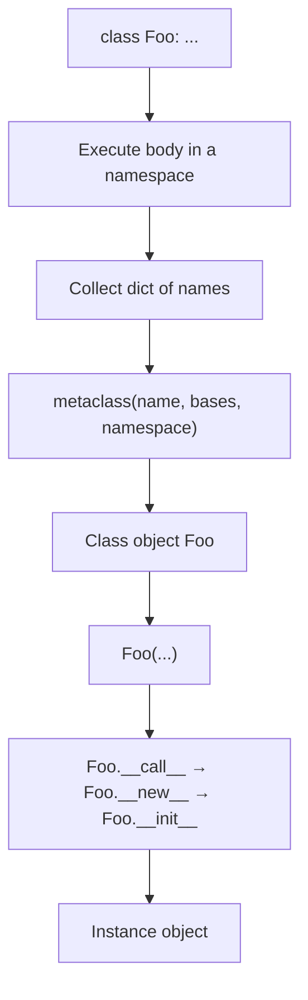
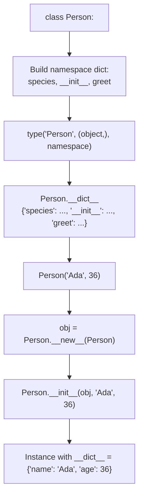
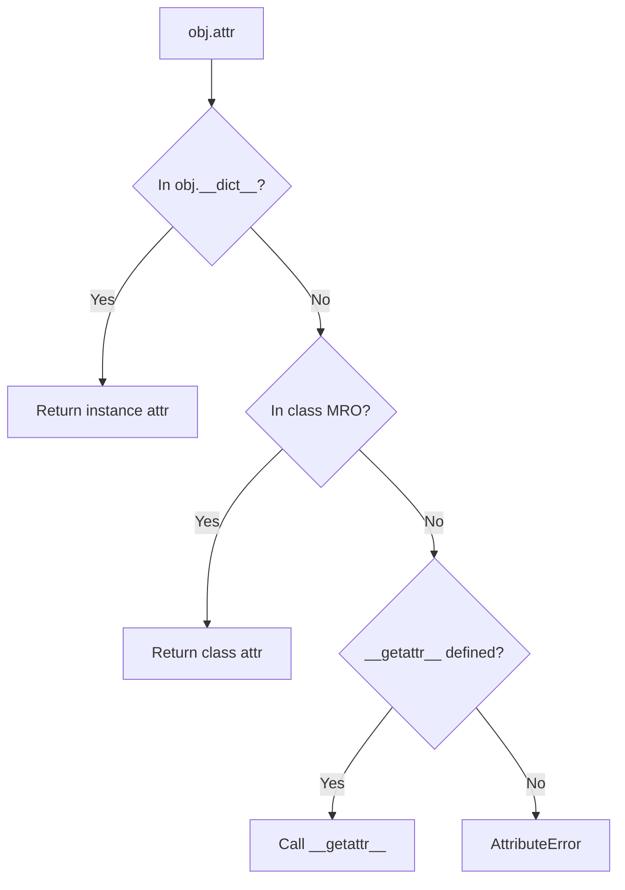
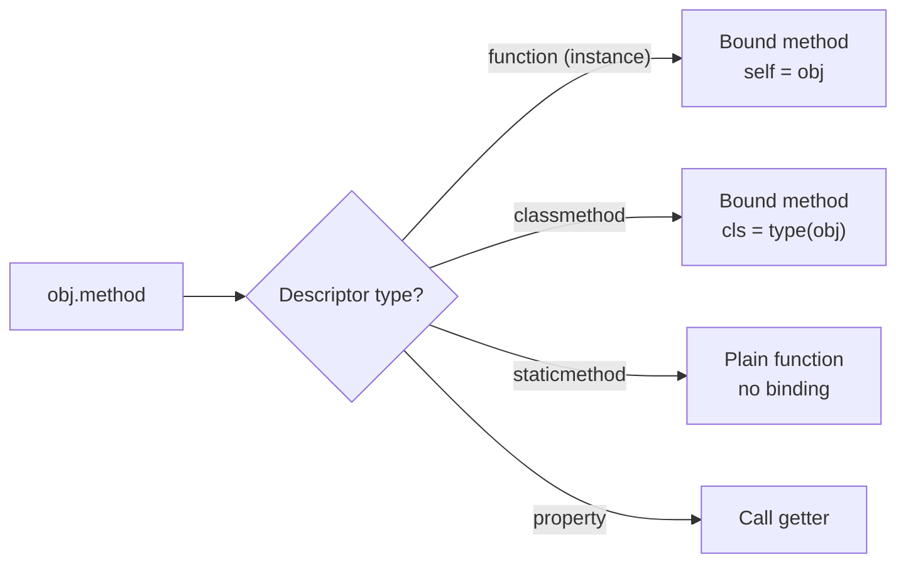
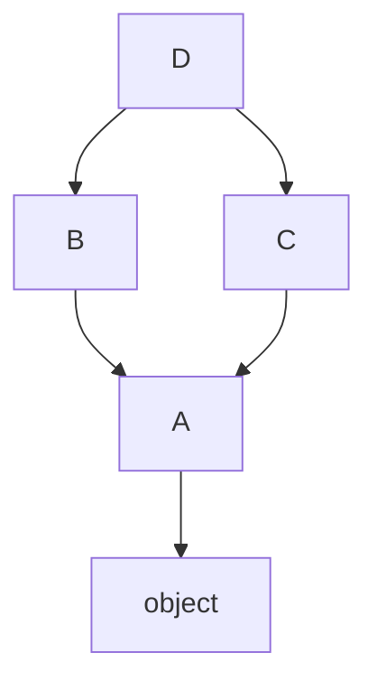
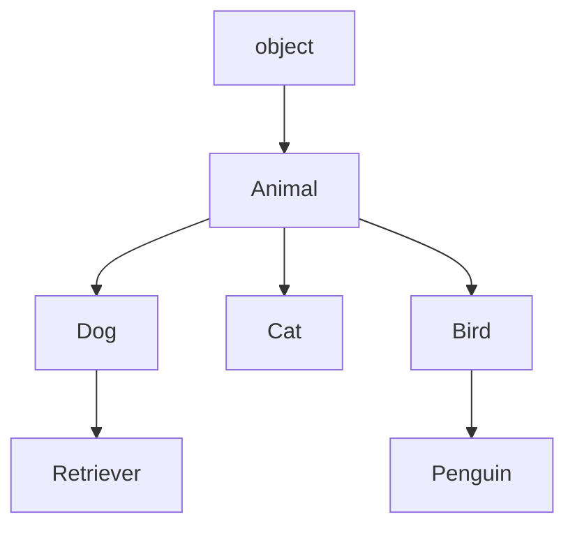
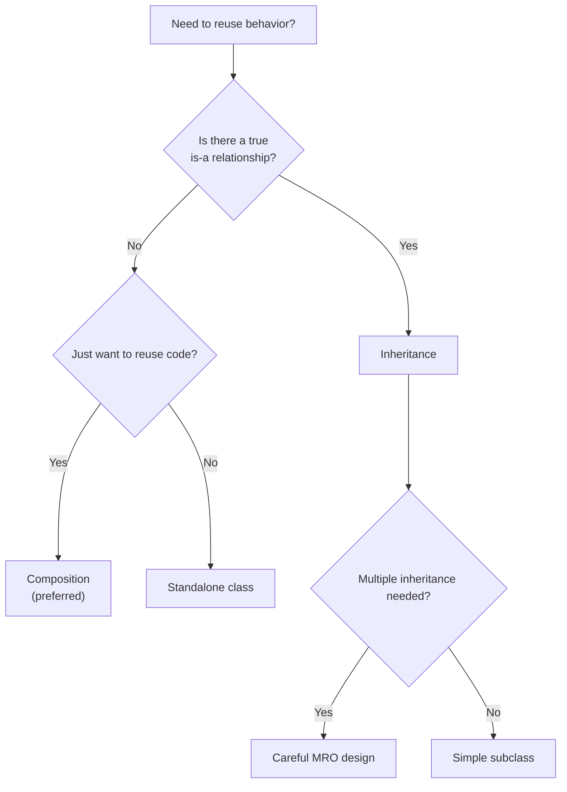
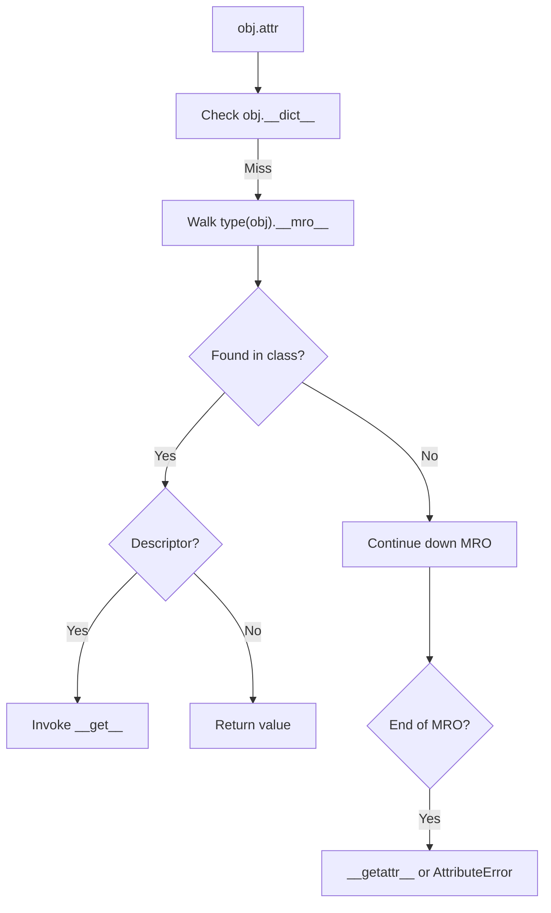
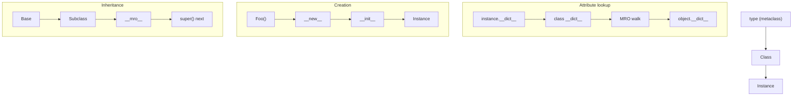
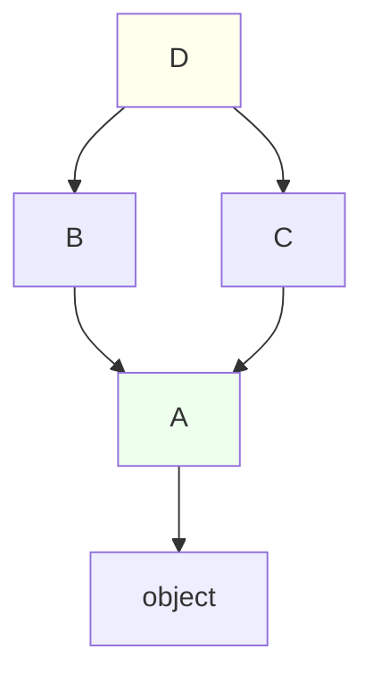

# Object-Oriented Programming — Detailed Notes

---

## 1. What Is It? (Concept & Under the Hood)

**Object-Oriented Programming (OOP)** organizes code around **objects** — bundles of **state** (attributes) and **behavior** (methods). A **class** is a blueprint; an **instance** is a concrete object created from that blueprint.

Python is **thoroughly object-oriented**: everything is an object — integers, strings, functions, classes, modules, even `type` itself is an object (and its own metaclass is `type`).

Key pillars:
- **Encapsulation** — bundle state + behavior; hide internals.
- **Inheritance** — reuse and specialize behavior via subclassing.
- **Polymorphism** — same interface, different implementations.
- **Abstraction** — expose what, hide how.

### Under the Hood — `type` and Instance Creation

When Python executes `class Foo: ...`, it builds a **class object** via `type()`:



Two kinds of relationships:

- **`isinstance(x, Foo)`** — x is an instance of Foo (or a subclass).
- **`issubclass(Bar, Foo)`** — Bar is a subclass of Foo.

A class is itself an instance of its **metaclass**:

```python
class Foo: pass

type(Foo)         # <class 'type'>
type(3)           # <class 'int'>
isinstance(3, int)       # True
isinstance(int, type)    # True
isinstance(Foo, type)    # True
```

### The Class Object Anatomy

```python
class Person:
    species = "Homo sapiens"          # class attribute
    __slots__ = ("name", "age")       # optional memory optimization

    def __init__(self, name, age):
        self.name = name              # instance attribute
        self.age = age

    def greet(self):
        return f"Hi, I'm {self.name}"
```

What the interpreter does:



### Class vs Instance Dictionaries

```python
class Person:
    species = "Homo sapiens"
    def __init__(self, name):
        self.name = name

p = Person("Ada")
p.__dict__                 # {'name': 'Ada'}       — instance state
Person.__dict__            # mappingproxy({...})   — class namespace
p.species                  # 'Homo sapiens'        — fallback to class
```

Attribute lookup on an instance:

1. Check `p.__dict__` — instance attributes.
2. Check `type(p).__dict__` and MRO — class attributes and methods.
3. Raise `AttributeError` if not found.

### Characteristics

| Aspect | Value |
|---|---|
| Instance creation | `Foo(...)` → `__new__` → `__init__` |
| Class object | Created by its metaclass (default `type`) |
| Attribute lookup | Instance `__dict__` → MRO |
| Method binding | Functions become bound methods on access |
| Mutability | Classes and instances are mutable |
| Identity | `id(obj)`, `obj is other` |

---

## 2. Defining Classes

### Basic Class

```python
class Dog:
    """A simple dog class."""

    species = "Canis familiaris"       # class attribute

    def __init__(self, name, age):
        self.name = name               # instance attributes
        self.age = age

    def bark(self):
        return f"{self.name} says woof!"

    def __repr__(self):
        return f"Dog(name={self.name!r}, age={self.age})"


rex = Dog("Rex", 3)
rex.bark()                # 'Rex says woof!'
rex.age                   # 3
rex.species               # 'Canis familiaris'
```

### Class Body Is Just a Namespace

```python
class Config:
    DEBUG = True
    TIMEOUT = 30

    def describe():
        return f"debug={Config.DEBUG}"
```

Class body runs once, at class definition, and binds names in the class namespace.

### `__init__` — Initializer (Not Constructor!)

`__init__` is the **initializer** — it runs after `__new__` creates the instance and is responsible for setting up state.

```python
class Point:
    def __init__(self, x, y):
        self.x = x
        self.y = y

p = Point(1, 2)
p.x, p.y                  # (1, 2)
```

### `__new__` — The Actual Constructor

`__new__` is a **static method** that returns the instance. `__init__` is called **only if `__new__` returns an instance of the class**.

```python
class Singleton:
    _instance = None

    def __new__(cls, *args, **kwargs):
        if cls._instance is None:
            cls._instance = super().__new__(cls)
        return cls._instance

    def __init__(self, name="default"):
        # Called EVERY time Singleton() is called
        self.name = name

a = Singleton("first")
b = Singleton("second")
a is b                    # True
a.name                    # 'second' — __init__ ran again
```

### When to Override `__new__`

| Use `__new__` | Use `__init__` |
|---|---|
| Subclassing immutable types (`int`, `str`, `tuple`) | Normal setup |
| Implementing singletons / object pools | Setting instance attributes |
| Returning instances of other classes | Validation |
| Metaprogramming | Most common case |

Example — subclassing `tuple`:

```python
class Point(tuple):
    def __new__(cls, x, y):
        return super().__new__(cls, (x, y))

    @property
    def x(self): return self[0]

    @property
    def y(self): return self[1]

p = Point(3, 4)
p.x, p.y                  # (3, 4)
```

### `__init__` vs `__new__` — Comparison

| | `__new__` | `__init__` |
|---|---|---|
| Type | Static method | Instance method |
| Purpose | Create instance | Initialize instance |
| Returns | Instance (or other) | `None` (return value ignored) |
| Called | Always | Only if `__new__` returns instance of `cls` |
| First param | `cls` | `self` |
| Override for | Immutable subclasses, singletons | Normal setup |

### Instance Attributes vs Class Attributes

```python
class Person:
    species = "Homo sapiens"        # class attribute — shared

    def __init__(self, name):
        self.name = name            # instance attribute — per instance


p1 = Person("Ada")
p2 = Person("Alan")

p1.species        # 'Homo sapiens'
Person.species    # 'Homo sapiens'

p1.species = "mutant"             # creates INSTANCE attribute shadowing class
p1.species        # 'mutant'
p2.species        # 'Homo sapiens' — unchanged
Person.species    # 'Homo sapiens' — unchanged
```

### Class Attribute Mutation — Shared State Trap

```python
class Team:
    members = []                    # ❌ shared across ALL instances

    def add(self, name):
        self.members.append(name)


t1 = Team()
t2 = Team()
t1.add("Ada")
t2.members                      # ['Ada'] — leaked!

# ✅ Use __init__ for per-instance state
class Team:
    def __init__(self):
        self.members = []           # per instance
```

### Attribute Resolution — Visual



### Comparison Table

| | Instance attribute | Class attribute |
|---|---|---|
| Defined in | `__init__` (`self.x = ...`) | Class body |
| Stored in | `obj.__dict__` | `cls.__dict__` |
| Shared | ❌ | ✅ (until shadowed) |
| Mutating the class attr affects | one instance | all instances (if not shadowed) |
| Common for | Per-object state | Constants, defaults, counters |

### Example — Class Counter

```python
class Widget:
    count = 0

    def __init__(self):
        Widget.count += 1           # update the class attribute
        self.id = Widget.count

w1, w2, w3 = Widget(), Widget(), Widget()
w3.id                            # 3
Widget.count                     # 3
```

---

## 3. Methods — Instance, Class, Static

### Instance Methods

Take `self`, operate on the instance:

```python
class Circle:
    def __init__(self, radius):
        self.radius = radius

    def area(self):
        return 3.14159 * self.radius ** 2
```

Accessed via `obj.method()` — Python passes `obj` as `self` automatically.

### Class Methods

Take `cls`, operate on the class. Declared with `@classmethod`:

```python
class Circle:
    def __init__(self, radius):
        self.radius = radius

    @classmethod
    def unit(cls):
        return cls(1)

    @classmethod
    def from_diameter(cls, d):
        return cls(d / 2)

c = Circle.unit()                # Circle(radius=1)
c2 = Circle.from_diameter(10)    # Circle(radius=5.0)
```

Common uses:
- **Alternate constructors** (`from_json`, `from_dict`, `from_...`).
- Class-level factory methods.
- Polymorphism across subclasses (`cls` is the actual subclass).

### Static Methods

Take neither `self` nor `cls`. Declared with `@staticmethod`:

```python
class Math:
    @staticmethod
    def add(a, b):
        return a + b

Math.add(2, 3)                   # 5
Math().add(2, 3)                 # 5 — works via instance too
```

Uses:
- Utility functions logically grouped with the class.
- No access to class or instance state needed.

### Comparison

| Aspect | Instance | Class | Static |
|---|---|---|---|
| Decorator | (none) | `@classmethod` | `@staticmethod` |
| First param | `self` | `cls` | (none) |
| Access instance? | ✅ | ❌ | ❌ |
| Access class? | ✅ (via `type(self)`) | ✅ | ❌ |
| Called on class? | ❌ | ✅ | ✅ |
| Called on instance? | ✅ | ✅ | ✅ |
| Common for | Behavior on data | Alt constructors | Utility helpers |

### Example — All Three Together

```python
class Temperature:
    unit = "C"

    def __init__(self, value):
        self.value = value

    def to_fahrenheit(self):                # instance method
        return self.value * 9 / 5 + 32

    @classmethod
    def from_fahrenheit(cls, value):        # alternate constructor
        return cls((value - 32) * 5 / 9)

    @staticmethod
    def is_valid(value):                    # utility
        return -273.15 <= value <= 1e9

t = Temperature(100)
t.to_fahrenheit()                        # 212.0

t2 = Temperature.from_fahrenheit(32)     # Temperature(0.0)
Temperature.is_valid(-300)               # False
```

### `@property` — Computed Attribute

```python
class Circle:
    def __init__(self, radius):
        self.radius = radius

    @property
    def area(self):
        return 3.14159 * self.radius ** 2

c = Circle(5)
c.area                    # 78.53975 — no parentheses!
```

See §7 for full treatment.

### Mermaid — Method Binding



---

## 4. Inheritance and Polymorphism

### Basic Inheritance

```python
class Animal:
    def __init__(self, name):
        self.name = name

    def speak(self):
        raise NotImplementedError

    def describe(self):
        return f"{self.name} says {self.speak()}"


class Dog(Animal):
    def speak(self):
        return "woof"


class Cat(Animal):
    def speak(self):
        return "meow"


Dog("Rex").describe()      # 'Rex says woof'
Cat("Whiskers").describe() # 'Whiskers says meow'
```

`Animal` is the **base** (superclass); `Dog` and `Cat` are **derived** (subclasses).

### `super()` — Calling Parent Methods

```python
class Animal:
    def __init__(self, name):
        self.name = name


class Dog(Animal):
    def __init__(self, name, breed):
        super().__init__(name)          # call parent __init__
        self.breed = breed
```

Modern form: `super()` — no arguments needed (Python 3).

### Multiple Inheritance

```python
class Walker:
    def walk(self):
        return "walking"

class Swimmer:
    def swim(self):
        return "swimming"

class Amphibian(Walker, Swimmer):
    pass

a = Amphibian()
a.walk()      # 'walking'
a.swim()      # 'swimming'
```

### MRO — Method Resolution Order

Python uses the **C3 linearization** algorithm to compute a class's MRO. Attribute/method lookup walks the MRO left-to-right, depth-first.

```python
class A: pass
class B(A): pass
class C(A): pass
class D(B, C): pass

D.__mro__
# (<class 'D'>, <class 'B'>, <class 'C'>, <class 'A'>, <class 'object'>)
```



MRO is the **linear order** in which Python searches for methods:

```python
D.mro() == [D, B, C, A, object]
```

### Diamond Problem — C3 Solves It

```python
class A:
    def greet(self): return "A"

class B(A):
    def greet(self): return "B"

class C(A):
    def greet(self): return "C"

class D(B, C):
    pass

D().greet()               # 'B' — B is first in MRO
D.__mro__                 # (D, B, C, A, object)
```

### `super()` — Cooperating Multiple Inheritance

```python
class A:
    def __init__(self):
        print("A")
        super().__init__()

class B(A):
    def __init__(self):
        print("B")
        super().__init__()

class C(A):
    def __init__(self):
        print("C")
        super().__init__()

class D(B, C):
    def __init__(self):
        print("D")
        super().__init__()

D()
# D
# B
# C
# A
```

`super()` follows the **MRO** — it doesn't mean "the parent class" but "the next class in the MRO chain".

### Polymorphism — Same Interface, Different Behavior

```python
class Shape:
    def area(self):
        raise NotImplementedError

class Circle(Shape):
    def __init__(self, r): self.r = r
    def area(self): return 3.14 * self.r ** 2

class Square(Shape):
    def __init__(self, s): self.s = s
    def area(self): return self.s ** 2

for shape in [Circle(5), Square(4)]:
    print(shape.area())      # 78.5, 16
```

Polymorphism lets callers write `shape.area()` without knowing the concrete type.

### Duck Typing

"If it walks like a duck and quacks like a duck, it's a duck."

```python
class Dog:
    def speak(self): return "woof"

class Robot:
    def speak(self): return "beep"

def make_it_speak(thing):
    return thing.speak()                # no type check

make_it_speak(Dog())                    # 'woof'
make_it_speak(Robot())                  # 'beep'
```

Python doesn't require inheritance — only that the object has the method.

### `isinstance` and `issubclass`

```python
isinstance(Dog("Rex"), Animal)          # True — subclass counts
isinstance(3, int)                      # True
issubclass(Dog, Animal)                 # True
issubclass(bool, int)                   # True
```

Caveat: **avoid isinstance checks** when duck typing suffices.

### Abstract Base Classes

```python
from abc import ABC, abstractmethod

class Shape(ABC):
    @abstractmethod
    def area(self): ...

    def describe(self):
        return f"area = {self.area():.2f}"


class Circle(Shape):
    def __init__(self, r): self.r = r
    def area(self): return 3.14 * self.r ** 2


Shape()          # ❌ TypeError: can't instantiate abstract class
Circle(5).describe()  # 'area = 78.50'
```

### Inheritance vs Composition

| | Inheritance (is-a) | Composition (has-a) |
|---|---|---|
| Relationship | `Dog is an Animal` | `Car has an Engine` |
| Coupling | Tight | Loose |
| Reuse | Via subclassing | Via delegation |
| Flexibility | Rigid hierarchy | Flexible swapping |
| Multiple sources | Multiple inheritance (MRO) | Compose many |
| Testing | Harder (inherited behavior) | Easier (isolated) |
| Preferred when | True subtype relationship | Behavior/feature reuse |

**Rule of thumb:** prefer composition unless there's a genuine is-a relationship.

### Example — Composition Over Inheritance

```python
# ❌ Inheritance for reuse only
class Engine:
    def start(self): ...

class Car(Engine):         # Car IS-NOT an Engine
    pass

# ✅ Composition
class Car:
    def __init__(self):
        self.engine = Engine()

    def start(self):
        return self.engine.start()
```

### Mermaid — Inheritance and MRO



Lookup for `Penguin().speak()` walks `Penguin → Bird → Animal → object`.

---

## 5. Encapsulation

### Python's Conventions

Python has **no true private members** — it relies on conventions:

| Convention | Meaning | Enforced? |
|---|---|---|
| `name` | Public | N/A |
| `_name` | Internal — don't touch | Convention only |
| `__name` | Name-mangled | Semi-enforced |
| `__name__` | Python-reserved | N/A |

### Underscore Prefix — Soft Privacy

```python
class Account:
    def __init__(self):
        self.balance = 0
        self._history = []          # internal — please don't touch
```

Anything with a single underscore is a **hint** to other programmers.

### Double Underscore — Name Mangling

```python
class Account:
    def __init__(self):
        self.__balance = 0          # name-mangled to _Account__balance

a = Account()
a.__balance                        # ❌ AttributeError
a._Account__balance                # 0 — not actually private
```

Mangling **does not prevent access** — it just makes it awkward. Its primary purpose is to avoid accidental name collisions in subclasses.

### Property-Based Encapsulation

The Pythonic way: expose attributes, add **computed accessors** via `@property` when needed.

```python
class Temperature:
    def __init__(self, celsius):
        self._celsius = celsius

    @property
    def celsius(self):
        return self._celsius

    @celsius.setter
    def celsius(self, value):
        if value < -273.15:
            raise ValueError("below absolute zero")
        self._celsius = value

    @property
    def fahrenheit(self):
        return self._celsius * 9 / 5 + 32
```

### Properties — Computed, Cached, Read-Only

```python
class Circle:
    def __init__(self, radius):
        self.radius = radius

    @property
    def diameter(self):
        return self.radius * 2

    @diameter.setter
    def diameter(self, value):
        self.radius = value / 2

    @property
    def area(self):
        return 3.14159 * self.radius ** 2

c = Circle(5)
c.diameter                     # 10
c.diameter = 20
c.radius                       # 10.0

c.area = 100                   # ❌ AttributeError — no setter
```

### Property Patterns

```python
class User:
    def __init__(self, first, last):
        self.first = first
        self.last = last

    @property
    def full_name(self):
        return f"{self.first} {self.last}"

    @full_name.setter
    def full_name(self, value):
        self.first, self.last = value.split(" ", 1)
```

### Cached Property

```python
from functools import cached_property

class Data:
    def __init__(self, values):
        self.values = values

    @cached_property
    def stats(self):
        # computed once, cached on instance
        return {
            "mean": sum(self.values) / len(self.values),
            "max": max(self.values),
            "min": min(self.values),
        }
```

### Comparison of Privacy Techniques

| Technique | Effect | Enforced? | Best for |
|---|---|---|---|
| `name` | Public | N/A | Normal attrs |
| `_name` | Convention | No | Internal helpers |
| `__name` | Name-mangled | Partially | Avoid subclass collisions |
| `@property` | Accessor | Yes | Validation, computed |
| `__slots__` | Prevents new attrs | Yes | Memory, layout |

### `__slots__` — Memory Optimization

```python
class Point:
    __slots__ = ("x", "y")

    def __init__(self, x, y):
        self.x = x
        self.y = y

p = Point(1, 2)
p.z = 3                             # ❌ AttributeError

import sys
p_noslots.__dict__                  # no __dict__
```

Benefits:
- **Smaller instances** — no `__dict__` per object (saves ~50–100 bytes).
- **Faster attribute access** — direct slots, no dict lookup.
- **Fixed schema** — prevents typos.

Costs:
- No dynamic attributes.
- Multiple inheritance interactions.
- Pickling requires `__getstate__`/`__setstate__`.

### Encapsulation Example — A Defensive Class

```python
class BankAccount:
    def __init__(self, balance=0):
        self._balance = balance
        self._history = []

    @property
    def balance(self):
        return self._balance

    def deposit(self, amount):
        if amount <= 0:
            raise ValueError("deposit must be positive")
        self._balance += amount
        self._history.append(("deposit", amount))

    def withdraw(self, amount):
        if amount <= 0:
            raise ValueError("withdraw must be positive")
        if amount > self._balance:
            raise ValueError("insufficient funds")
        self._balance -= amount
        self._history.append(("withdraw", amount))

    @property
    def history(self):
        return tuple(self._history)         # immutable snapshot
```

Note: consumers read `account.balance` (property) but mutate via methods — the **API surface is controlled**.

---

## 6. Dunder Methods (Magic Methods)

### What Are Dunders?

Methods with `__double_underscores__` — called **implicitly** by Python in response to operators, built-ins, and syntax.

```python
class Vector:
    def __init__(self, x, y):
        self.x, self.y = x, y

    def __repr__(self):
        return f"Vector({self.x}, {self.y})"

    def __add__(self, other):
        return Vector(self.x + other.x, self.y + other.y)

    def __eq__(self, other):
        return (self.x, self.y) == (other.x, other.y)

v = Vector(1, 2) + Vector(3, 4)
print(v)                   # Vector(4, 6)
v == Vector(4, 6)          # True
```

### Categories of Dunder Methods

| Category | Methods | Operators/Behavior |
|---|---|---|
| Object lifecycle | `__new__`, `__init__`, `__del__` | Creation, destruction |
| Representation | `__repr__`, `__str__`, `__format__` | `repr()`, `str()`, f-strings |
| Comparison | `__eq__`, `__ne__`, `__lt__`, `__le__`, `__gt__`, `__ge__` | `==`, `<`, etc. |
| Arithmetic | `__add__`, `__sub__`, `__mul__`, `__truediv__`, `__floordiv__`, `__mod__`, `__pow__` | `+ - * / // % **` |
| Reflected | `__radd__`, `__rsub__`, ... | Right operand |
| In-place | `__iadd__`, `__isub__`, ... | `+=` etc. |
| Unary | `__neg__`, `__pos__`, `__abs__`, `__invert__` | `-x`, `+x`, `abs(x)`, `~x` |
| Container | `__len__`, `__getitem__`, `__setitem__`, `__delitem__`, `__contains__`, `__iter__`, `__next__` | `len`, `[]`, `in`, `for` |
| Conversion | `__int__`, `__float__`, `__bool__`, `__hash__` | `int()`, `float()`, `bool()`, `hash()` |
| Context | `__enter__`, `__exit__` | `with` |
| Attribute | `__getattr__`, `__setattr__`, `__delattr__`, `__getattribute__` | Attribute access |
| Call | `__call__` | `obj(...)` |
| Class | `__class_getitem__`, `__init_subclass__` | `Foo[int]`, subclass hooks |

### `__repr__` vs `__str__`

```python
class Point:
    def __init__(self, x, y):
        self.x, self.y = x, y

    def __repr__(self):
        return f"Point({self.x}, {self.y})"      # unambiguous, for devs

    def __str__(self):
        return f"({self.x}, {self.y})"           # readable, for users

p = Point(1, 2)
repr(p)          # 'Point(1, 2)'
str(p)           # '(1, 2)'
print(p)         # (1, 2)
p                # Point(1, 2) — REPL uses __repr__
```

Rule: always define `__repr__`; define `__str__` if user-facing.

### `__eq__` and `__hash__`

```python
class Point:
    def __init__(self, x, y):
        self.x, self.y = x, y

    def __eq__(self, other):
        if not isinstance(other, Point):
            return NotImplemented
        return (self.x, self.y) == (other.x, other.y)

    def __hash__(self):
        return hash((self.x, self.y))
```

**Rule:** if you define `__eq__`, you must define `__hash__` — otherwise instances become unhashable (Python sets `__hash__ = None`).

### Container Protocol

```python
class Playlist:
    def __init__(self, songs=None):
        self._songs = list(songs or [])

    def __len__(self):
        return len(self._songs)

    def __getitem__(self, i):
        return self._songs[i]

    def __setitem__(self, i, value):
        self._songs[i] = value

    def __delitem__(self, i):
        del self._songs[i]

    def __contains__(self, item):
        return item in self._songs

    def __iter__(self):
        return iter(self._songs)


p = Playlist(["a", "b", "c"])
len(p)               # 3
p[1]                 # 'b'
p[0:2]               # ['a', 'b'] — works via __getitem__ slice
"b" in p             # True
for s in p: ...
```

### `__call__` — Instances Callable Like Functions

```python
class Multiplier:
    def __init__(self, factor):
        self.factor = factor

    def __call__(self, x):
        return x * self.factor

double = Multiplier(2)
double(5)                 # 10
callable(double)          # True
```

### `__enter__` / `__exit__` — Context Managers

```python
class Timer:
    def __enter__(self):
        import time
        self.start = time.perf_counter()
        return self

    def __exit__(self, exc_type, exc, tb):
        import time
        self.elapsed = time.perf_counter() - self.start
        return False      # don't suppress exceptions

with Timer() as t:
    do_work()

print(f"took {t.elapsed:.3f}s")
```

### `__getattr__` vs `__getattribute__`

```python
class Lazy:
    def __getattr__(self, name):
        # Called only when normal lookup FAILS
        return f"computed {name}"

l = Lazy()
l.foo                 # 'computed foo'
```

`__getattribute__` is called on **every** attribute access — rarely overridden.

### Complete Dunder Example — A Money Class

```python
from functools import total_ordering

@total_ordering
class Money:
    def __init__(self, amount, currency="USD"):
        self.amount = amount
        self.currency = currency

    def __repr__(self):
        return f"Money({self.amount!r}, {self.currency!r})"

    def __str__(self):
        return f"{self.amount:.2f} {self.currency}"

    def __eq__(self, other):
        if not isinstance(other, Money):
            return NotImplemented
        return (self.amount, self.currency) == (other.amount, other.currency)

    def __lt__(self, other):
        if not isinstance(other, Money):
            return NotImplemented
        if self.currency != other.currency:
            raise ValueError("cannot compare different currencies")
        return self.amount < other.amount

    def __hash__(self):
        return hash((self.amount, self.currency))

    def __add__(self, other):
        if not isinstance(other, Money):
            return NotImplemented
        if self.currency != other.currency:
            raise ValueError("currency mismatch")
        return Money(self.amount + other.amount, self.currency)

    def __mul__(self, factor):
        return Money(self.amount * factor, self.currency)

    def __neg__(self):
        return Money(-self.amount, self.currency)


a = Money(10) + Money(5)
print(a)                    # 15.00 USD
print(a * 2)                # 30.00 USD
Money(5) < Money(10)        # True
```

### Dunder Summary Table

| Operator | Method | Notes |
|---|---|---|
| `repr(x)` | `__repr__` | Always define |
| `str(x)` | `__str__` | Falls back to `__repr__` |
| `x == y` | `__eq__` | Define `__hash__` too |
| `x < y` | `__lt__` | Use `@total_ordering` |
| `x + y` | `__add__` | Also `__radd__`, `__iadd__` |
| `len(x)` | `__len__` | |
| `x[i]` | `__getitem__` | Slices use `slice` objects |
| `x[i] = v` | `__setitem__` | |
| `del x[i]` | `__delitem__` | |
| `i in x` | `__contains__` | Falls back to `__iter__` |
| `for i in x` | `__iter__` | Returns iterator |
| `with x:` | `__enter__`/`__exit__` | |
| `x(...)` | `__call__` | Makes instances callable |
| `bool(x)` | `__bool__` | Or `__len__` |
| `hash(x)` | `__hash__` | Must match `__eq__` |
| `x.attr` | `__getattr__` | Called only on missing |
| `x.attr = v` | `__setattr__` | |
| `Foo[...]` | `__class_getitem__` | Generic aliases |

---

## 7. Properties

### `@property` — Getter

```python
class Circle:
    def __init__(self, radius):
        self.radius = radius

    @property
    def area(self):
        return 3.14159 * self.radius ** 2

c = Circle(5)
c.area            # 78.53975 — no parentheses
```

### Setter — `@name.setter`

```python
class Circle:
    def __init__(self, radius):
        self._radius = radius

    @property
    def radius(self):
        return self._radius

    @radius.setter
    def radius(self, value):
        if value < 0:
            raise ValueError("radius must be non-negative")
        self._radius = value
```

Now `circle.radius = 5` triggers validation.

### Deleter — `@name.deleter`

```python
class Cached:
    @property
    def data(self):
        return self._data

    @data.deleter
    def data(self):
        del self._data
```

### Read-Only Property

Just omit the setter:

```python
class Temperature:
    @property
    def kelvin(self):
        return self._celsius + 273.15

t.kelvin = 300       # ❌ AttributeError: can't set attribute
```

### Computed vs Stored Properties

```python
class Rectangle:
    def __init__(self, width, height):
        self.width = width
        self.height = height

    @property
    def area(self):
        return self.width * self.height     # computed each access

    @cached_property
    def expensive(self):
        return compute_something()
```

### `__set_name__` — Descriptor-Aware Property

```python
class Field:
    def __set_name__(self, owner, name):
        self.name = f"_{name}"

    def __get__(self, obj, objtype=None):
        if obj is None:
            return self
        return getattr(obj, self.name, None)

    def __set__(self, obj, value):
        setattr(obj, self.name, value)


class User:
    name = Field()
    age = Field()
```

### Property vs Plain Attribute

| | Plain attribute | Property |
|---|---|---|
| Storage | `obj.__dict__` | Custom |
| Validation | On assignment only if `__setattr__` | On every set |
| Computed | ❌ | ✅ |
| Access speed | Fastest | Slightly slower |
| Read-only | ❌ | ✅ (omit setter) |
| Refactor safety | Breaking | Transparent |

### `@cached_property`

```python
from functools import cached_property

class Data:
    @cached_property
    def parsed(self):
        return expensive_parse(self.raw)

d = Data()
d.parsed           # computed once
d.parsed           # cached
```

### `property()` Function Form

```python
class C:
    def get_x(self): return self._x
    def set_x(self, v): self._x = v

    x = property(get_x, set_x)
```

The decorator form is preferred — it's more readable.

---

## 8. Dataclasses

### What Are Dataclasses?

`@dataclass` (PEP 557) auto-generates `__init__`, `__repr__`, and `__eq__` from class-level annotations.

```python
from dataclasses import dataclass

@dataclass
class Point:
    x: int
    y: int

p = Point(1, 2)
p                       # Point(x=1, y=2)
p == Point(1, 2)        # True
```

### Field Defaults

```python
@dataclass
class Config:
    host: str = "localhost"
    port: int = 8080
    debug: bool = False
```

### `field()` — Advanced Field Options

```python
from dataclasses import dataclass, field

@dataclass
class User:
    name: str
    email: str
    tags: list[str] = field(default_factory=list)       # ✅ per instance
    id: int = field(default=0, repr=False)              # excluded from repr
    password: str = field(default="", compare=False)    # excluded from eq
```

### The Mutable Default Trap

```python
# ❌ Shared list across instances
@dataclass
class Bad:
    items: list = []                # ValueError: mutable default not allowed

# ✅
@dataclass
class Good:
    items: list = field(default_factory=list)
```

Dataclasses **reject mutable defaults** — you must use `field(default_factory=...)`.

### Frozen (Immutable) Dataclasses

```python
@dataclass(frozen=True)
class Point:
    x: int
    y: int

p = Point(1, 2)
p.x = 5                    # ❌ FrozenInstanceError
hash(p)                    # ✅ hashable
```

Frozen dataclasses are hashable → usable as dict keys.

### `order=True` — Comparison Methods

```python
@dataclass(order=True)
class Version:
    major: int
    minor: int
    patch: int

Version(1, 2, 3) < Version(2, 0, 0)     # True
```

Fields are compared in declaration order.

### Post-Init Processing

```python
@dataclass
class Rectangle:
    width: float
    height: float
    area: float = field(init=False)      # not in __init__

    def __post_init__(self):
        self.area = self.width * self.height
```

### `asdict` and `astuple`

```python
from dataclasses import asdict, astuple

p = Point(1, 2)
asdict(p)          # {'x': 1, 'y': 2}
astuple(p)         # (1, 2)
```

### `replace` — Create Modified Copy

```python
from dataclasses import replace

p = Point(1, 2)
q = replace(p, x=10)       # Point(x=10, y=2)
```

### Inheritance with Dataclasses

```python
@dataclass
class Person:
    name: str
    age: int

@dataclass
class Employee(Person):
    salary: float

Employee("Ada", 36, 50000.0)     # Employee(name='Ada', age=36, salary=50000.0)
```

Fields from parent come first.

### `__slots__` with Dataclasses

```python
@dataclass(slots=True)      # Python 3.10+
class Point:
    x: int
    y: int
```

Uses `__slots__` under the hood — smaller instances, faster access.

### Dataclass vs Manual Class

| Feature | Manual class | `@dataclass` |
|---|---|---|
| `__init__` | Write manually | Auto-generated |
| `__repr__` | Write manually | Auto-generated |
| `__eq__` | Write manually | Auto-generated |
| `__hash__` | Manual | `frozen=True` → auto |
| Comparison ops | Manual | `order=True` |
| Boilerplate | High | Low |
| Flexibility | Full | Declarative |

### Dataclass vs `NamedTuple` vs `dict`

| | dataclass | NamedTuple | dict |
|---|---|---|---|
| Mutable | ✅ (default) | ❌ | ✅ |
| Hashable | `frozen=True` | ✅ | ❌ |
| Type hints | ✅ | ✅ | Manual |
| Methods | ✅ | Limited | ❌ |
| Memory | Larger | Small | Largest |
| Attributes | Named | Named | Keys |

### Full Example — API Response Model

```python
from dataclasses import dataclass, field
from typing import Optional
from datetime import datetime

@dataclass
class User:
    id: int
    name: str
    email: str
    created_at: datetime
    tags: list[str] = field(default_factory=list)
    bio: Optional[str] = None

    @classmethod
    def from_dict(cls, data: dict) -> "User":
        return cls(
            id=data["id"],
            name=data["name"],
            email=data["email"],
            created_at=datetime.fromisoformat(data["created_at"]),
            tags=data.get("tags", []),
            bio=data.get("bio"),
        )
```

---

## 9. Enum

### What Is `Enum`?

An `Enum` is a class whose instances are **singletons** — each member is created once and identified by name and value.

```python
from enum import Enum

class Color(Enum):
    RED = 1
    GREEN = 2
    BLUE = 3

Color.RED                # <Color.RED: 1>
Color.RED.name           # 'RED'
Color.RED.value          # 1
Color(1)                 # Color.RED
Color["RED"]             # Color.RED
```

### Auto Values

```python
from enum import Enum, auto

class Direction(Enum):
    NORTH = auto()
    SOUTH = auto()
    EAST = auto()
    WEST = auto()

Direction.NORTH.value    # 1
```

### Iterating and Comparing

```python
for c in Color:
    print(c.name, c.value)

Color.RED == Color.RED          # True
Color.RED == Color.GREEN        # False
Color.RED is Color.RED          # True — singletons
```

### `IntEnum` — Interoperable With Ints

```python
from enum import IntEnum

class Priority(IntEnum):
    LOW = 1
    MEDIUM = 2
    HIGH = 3

Priority.HIGH > Priority.LOW    # True
Priority.HIGH + 1               # 4
```

Useful when you need the enum to act like an integer (JSON, DB).

### `StrEnum` (3.11+)

```python
from enum import StrEnum

class Status(StrEnum):
    PENDING = "pending"
    ACTIVE = "active"
    DONE = "done"

Status.PENDING == "pending"     # True
```

### `Flag` and `IntFlag` — Bitfields

```python
from enum import Flag, auto

class Permissions(Flag):
    READ = auto()
    WRITE = auto()
    EXECUTE = auto()
    ALL = READ | WRITE | EXECUTE

p = Permissions.READ | Permissions.WRITE
p & Permissions.READ            # Permissions.READ
Permissions.READ in p           # True
```

### `@unique` — Enforce Uniqueness

```python
from enum import Enum, unique

@unique
class Status(Enum):
    A = 1
    B = 2
    C = 1        # ❌ ValueError: duplicate values
```

### Enum with Methods

```python
class Status(Enum):
    PENDING = "pending"
    ACTIVE = "active"

    def is_terminal(self):
        return self in {Status.ACTIVE}

    @classmethod
    def from_str(cls, s):
        return cls(s)
```

### Why Enums?

- **Named constants** — replace magic numbers/strings.
- **Type safety** — no typos, no invalid values.
- **Iterable** — enumerate all options.
- **Compared by identity** — `is` works.

### Enum vs Constants vs `Literal`

| | `Enum` | Constants | `Literal` |
|---|---|---|---|
| Named | ✅ | ✅ | ✅ |
| Validated | ✅ | ❌ | Static only |
| Iterable | ✅ | Manual | ❌ |
| Runtime check | ✅ | ❌ | ❌ |
| Type-hint friendly | ✅ | ✅ | ✅ |

### Example — HTTP Methods

```python
class HTTPMethod(Enum):
    GET = "GET"
    POST = "POST"
    PUT = "PUT"
    DELETE = "DELETE"

def handle(method: HTTPMethod):
    if method is HTTPMethod.GET:
        ...

handle(HTTPMethod.GET)          # ✅
handle("GET")                   # ⚠️ string — use HTTPMethod("GET")
```

---

## 10. Composition vs Inheritance

### The Two Axes

- **Inheritance** — *"is-a"* relationship. `Dog` is an `Animal`.
- **Composition** — *"has-a"* relationship. `Car` has an `Engine`.

### Inheritance — When It Fits

```python
class Shape:
    def area(self): ...

class Circle(Shape):
    def __init__(self, r): self.r = r
    def area(self): return 3.14 * self.r ** 2
```

Subclasses are **specializations** of the base — they truly are that kind of thing.

### Composition — When It Fits

```python
class Engine:
    def start(self): return "vroom"

class Car:
    def __init__(self):
        self.engine = Engine()

    def start(self):
        return self.engine.start()
```

The `Car` **delegates** to its parts.

### Delegation Example

```python
class Stack:
    def __init__(self):
        self._items = []

    def push(self, item):
        self._items.append(item)

    def pop(self):
        return self._items.pop()

    def __len__(self):
        return len(self._items)
```

`Stack` **has-a** list — not "is-a" list. This avoids inheriting list methods that break the abstraction (`insert`, `sort`, slicing).

### Why Prefer Composition

1. **Loose coupling** — swapping parts is easy.
2. **No inheritance hierarchy** — avoids MRO complexity.
3. **Easier to test** — mock the parts.
4. **No fragile base class** — changes to the base don't break subclasses.
5. **Reuse without shared state**.

### When Inheritance Is Right

- **True subtype** — `Dog is-an Animal`.
- **Framework contract** — overriding hooks (e.g., `Django View`).
- **Small taxonomies** — few levels.
- **Abstract base classes** — defining interfaces.

### Comparison Table

| | Inheritance | Composition |
|---|---|---|
| Relationship | is-a | has-a |
| Coupling | Tight | Loose |
| Reuse | Subclassing | Delegation |
| Multiple sources | Multiple inheritance | Many parts |
| Fragility | Fragile base class | Robust |
| Tests | Harder | Easier |
| When to choose | True subtype | Feature/behavior reuse |

### Mixed Example — Inheritance + Composition

```python
class Logger:
    def log(self, msg): print(msg)

class Service:
    def __init__(self, logger: Logger):
        self.logger = logger           # composition

    def run(self):
        self.logger.log("running")

class HTTPService(Service):            # inheritance
    def run(self):
        self.logger.log("HTTP running")
```

### Mermaid — When to Use Which



---

## 11. MRO and `super()`

### MRO — The Linear Order

Every class has an `__mro__` — the linearized list of ancestors:

```python
class A: pass
class B(A): pass
class C(A): pass
class D(B, C): pass

D.__mro__
# (D, B, C, A, object)

D.mro()                  # same
```

### C3 Linearization

The C3 algorithm combines parent MROs while preserving:

1. **Local precedence order** — a class precedes its bases.
2. **Monotonicity** — a subclass MRO extends each parent MRO.

```python
def mro(cls):
    if not cls.__bases__:
        return [cls]
    parent_mros = [mro(b) for b in cls.__bases__]
    result = [cls]
    while any(parent_mros):
        for m in parent_mros:
            if not m:
                continue
            candidate = m[0]
            # No other list has this candidate beyond position 0
            if all(candidate not in other[1:] for other in parent_mros if other):
                break
        result.append(candidate)
        for m in parent_mros:
            if m and m[0] is candidate:
                m.pop(0)
    return result
```

### `super()` — The Next in MRO

`super()` returns a proxy that delegates attribute lookup to the next class in the MRO (relative to the **current class**, not the instance's type).

```python
class A:
    def greet(self):
        return "A"

class B(A):
    def greet(self):
        return "B → " + super().greet()

class C(A):
    def greet(self):
        return "C → " + super().greet()

class D(B, C):
    def greet(self):
        return "D → " + super().greet()

D().greet()
# 'D → B → C → A'
```

Each `super()` call walks the **MRO of `type(self)`**, not of the current class's parent.

### `super()` — Common Mistakes

```python
# ❌ Classic Python 2 style — don't
class A(Base):
    def method(self):
        Base.method(self)          # hard-coded parent
```

```python
# ✅ Python 3
class A(Base):
    def method(self):
        super().method()
```

Hard-coding the parent breaks cooperation with multiple inheritance.

### Diamond Problem Illustrated

```python
class A:
    def go(self): print("A")

class B(A):
    def go(self):
        print("B")
        super().go()

class C(A):
    def go(self):
        print("C")
        super().go()

class D(B, C):
    def go(self):
        print("D")
        super().go()

D().go()
# D
# B
# C
# A
```

Each `go()` runs **once** — cooperative multiple inheritance via `super()`.

### `super()` in `__init__`

```python
class Base:
    def __init__(self, **kwargs):
        super().__init__(**kwargs)

class A(Base):
    def __init__(self, a, **kwargs):
        self.a = a
        super().__init__(**kwargs)

class B(Base):
    def __init__(self, b, **kwargs):
        self.b = b
        super().__init__(**kwargs)

class C(A, B):
    def __init__(self, a, b, **kwargs):
        super().__init__(a=a, b=b, **kwargs)

c = C(a=1, b=2)
c.a, c.b             # (1, 2)
```

The `**kwargs` pattern lets each class accept its own args and pass the rest up the chain.

### MRO with `ABCMeta`

```python
from abc import ABC, abstractmethod

class Shape(ABC):
    @abstractmethod
    def area(self): ...

Shape.__mro__
# (Shape, ABC, object)
```

`ABC` is itself a class with `ABCMeta` as its metaclass.

### MRO and Attribute Lookup



### `__init_subclass__` — Hook for Subclass Creation

```python
class Plugin:
    registry = {}

    def __init_subclass__(cls, **kwargs):
        super().__init_subclass__(**kwargs)
        Plugin.registry[cls.__name__] = cls

class MyPlugin(Plugin): pass
class OtherPlugin(Plugin): pass

Plugin.registry          # {'MyPlugin': ..., 'OtherPlugin': ...}
```

Called automatically when a subclass is defined.

### MRO Summary Table

| Concept | Meaning |
|---|---|
| MRO | Linear order for attribute lookup |
| C3 | Algorithm producing the MRO |
| `super()` | Next class in `type(self).__mro__` |
| Cooperating methods | `super().method()` in each |
| Diamond | D(B, C) — both inherit A |
| Pitfall | Hard-coded parent calls break MRO |

---

## 12. Real-World Use Cases

### Use Case 1 — Plugin Architecture

```python
class Plugin(ABC):
    name: str = ""

    def __init_subclass__(cls, **kwargs):
        super().__init_subclass__(**kwargs)
        REGISTRY[cls.name] = cls

    @abstractmethod
    def run(self, ctx): ...


REGISTRY: dict[str, type[Plugin]] = {}


class EmailPlugin(Plugin):
    name = "email"
    def run(self, ctx): print("sending email")


class SMSPlugin(Plugin):
    name = "sms"
    def run(self, ctx): print("sending SMS")


REGISTRY["email"]().run({})       # sending email
```

### Use Case 2 — Domain Models with Dataclasses

```python
from dataclasses import dataclass, field
from datetime import datetime

@dataclass(frozen=True, slots=True)
class Order:
    id: str
    customer_id: str
    items: tuple[str, ...]
    created_at: datetime
    total_cents: int
    tags: tuple[str, ...] = ()

    @property
    def total_usd(self) -> float:
        return self.total_cents / 100
```

Frozen + slots = immutable, memory-efficient, hashable.

### Use Case 3 — Value Object with Dunders

```python
from functools import total_ordering

@total_ordering
class Version:
    def __init__(self, *parts):
        self.parts = tuple(parts)

    def __eq__(self, other):
        return isinstance(other, Version) and self.parts == other.parts

    def __lt__(self, other):
        return self.parts < other.parts

    def __hash__(self):
        return hash(self.parts)

    def __repr__(self):
        return f"Version{self.parts}"

Version(1, 2, 3) > Version(1, 2, 0)   # True
```

### Use Case 4 — Strategy Pattern via Composition

```python
class Compressor(Protocol):
    def compress(self, data: bytes) -> bytes: ...

class GzipCompressor:
    def compress(self, data):
        import gzip
        return gzip.compress(data)

class ZstdCompressor:
    def compress(self, data):
        import zstandard
        return zstandard.compress(data)

class FileWriter:
    def __init__(self, compressor: Compressor):
        self.compressor = compressor

    def write(self, data):
        return self.compressor.compress(data)
```

### Use Case 5 — ORM-Like Models

```python
class Field:
    def __set_name__(self, owner, name):
        self.name = name

    def __get__(self, obj, objtype=None):
        if obj is None:
            return self
        return obj.__dict__.get(self.name)

    def __set__(self, obj, value):
        obj.__dict__[self.name] = value


class User:
    name = Field()
    email = Field()

    def __init__(self, name, email):
        self.name = name
        self.email = email
```

### Use Case 6 — Enum-Driven State Machine

```python
from enum import Enum, auto

class State(Enum):
    IDLE = auto()
    RUNNING = auto()
    PAUSED = auto()
    DONE = auto()

TRANSITIONS = {
    State.IDLE: {State.RUNNING},
    State.RUNNING: {State.PAUSED, State.DONE},
    State.PAUSED: {State.RUNNING},
    State.DONE: set(),
}

class Machine:
    def __init__(self):
        self.state = State.IDLE

    def transition(self, new_state):
        if new_state not in TRANSITIONS[self.state]:
            raise ValueError(f"cannot go {self.state} → {new_state}")
        self.state = new_state
```

### Use Case 7 — Context Manager for Transactions

```python
class Transaction:
    def __init__(self, conn):
        self.conn = conn

    def __enter__(self):
        self.conn.execute("BEGIN")
        return self.conn

    def __exit__(self, exc_type, exc, tb):
        if exc_type:
            self.conn.execute("ROLLBACK")
        else:
            self.conn.execute("COMMIT")
        return False

with Transaction(conn) as c:
    c.execute("INSERT ...")
```

### Use Case 8 — Decorator as a Class

```python
from functools import wraps

class retry:
    def __init__(self, attempts=3, delay=1):
        self.attempts = attempts
        self.delay = delay

    def __call__(self, f):
        @wraps(f)
        def wrapper(*args, **kwargs):
            import time
            for i in range(self.attempts):
                try:
                    return f(*args, **kwargs)
                except Exception:
                    if i == self.attempts - 1:
                        raise
                    time.sleep(self.delay)
        return wrapper

@retry(attempts=5, delay=0.5)
def flaky(): ...
```

### Use Case 9 — Command Pattern

```python
class Command:
    def execute(self): ...

class AddCommand(Command):
    def __init__(self, target, value):
        self.target, self.value = target, value

    def execute(self):
        self.target.append(self.value)

class RemoveCommand(Command):
    def __init__(self, target, value):
        self.target, self.value = target, value

    def execute(self):
        self.target.remove(self.value)

history = []
def do(cmd):
    cmd.execute()
    history.append(cmd)

do(AddCommand(items, "x"))
do(AddCommand(items, "y"))
```

### Use Case 10 — Immutable Config via Dataclass

```python
from dataclasses import dataclass, field

@dataclass(frozen=True)
class DBConfig:
    host: str = "localhost"
    port: int = 5432
    user: str = "postgres"
    password: str = field(default="", repr=False)
    options: tuple[tuple[str, str], ...] = ()

    def with_options(self, **kw):
        return replace(self, **kw)
```

---

## 13. Common Pitfalls

### Pitfall 1 — Mutable Class Attributes

```python
class Team:
    members = []                # ❌ shared across instances

    def add(self, m):
        self.members.append(m)

Team().add("a")
Team().members                  # ['a'] — leaked!
```

Fix: initialize in `__init__`.

### Pitfall 2 — Defining `__eq__` Without `__hash__`

```python
class Point:
    def __init__(self, x, y): self.x, self.y = x, y
    def __eq__(self, other): return (self.x, self.y) == (other.x, other.y)

{Point(1, 2)}                  # ❌ TypeError: unhashable
```

Fix: define `__hash__` too.

```python
    def __hash__(self):
        return hash((self.x, self.y))
```

### Pitfall 3 — Hard-Coded Parent Calls

```python
class A(Base):
    def method(self):
        Base.method(self)       # ❌ breaks MRO
```

Fix: `super().method()`.

### Pitfall 4 — Forgetting to Call `super().__init__`

```python
class Child(Parent):
    def __init__(self, x):
        self.x = x              # ❌ parent state never set
```

Fix: `super().__init__(...)`.

### Pitfall 5 — Name Mangling Confusion

```python
class C:
    def __init__(self): self.__x = 1

c = C()
c.__x                          # ❌ AttributeError
c._C__x                        # 1
```

The mangled name exists — it's just awkward.

### Pitfall 6 — `isinstance` vs Duck Typing

```python
# ❌ Restricts to specific class
def speak(animal):
    if isinstance(animal, Duck):
        animal.quack()

# ✅ Trust the interface
def speak(animal):
    animal.quack()
```

### Pitfall 7 — Inheriting From Builtins Carelessly

```python
class MyList(list):
    def append(self, x):
        super().append(x * 2)

m = MyList()
m.extend([1, 2, 3])            # ❌ extend bypasses append
```

Subclassing builtins is tricky — their C methods skip your overrides. Prefer composition.

### Pitfall 8 — Reusing Names for Both Class and Instance Attr

```python
class C:
    x = 1                       # class attr

c = C()
c.x = 2                         # creates instance attr
C.x                             # still 1
c.x                             # 2
```

This is legal — but easy to misread.

### Pitfall 9 — Modifying `__dict__` Directly

```python
obj.__dict__["x"] = 5           # works but bypasses descriptors/properties
```

Use `setattr(obj, "x", 5)`.

### Pitfall 10 — Dataclass Mutable Default

```python
@dataclass
class Bad:
    items: list = []            # ❌ ValueError at class definition
```

Fix: `field(default_factory=list)`.

### Pitfall 11 — Not Freezing When Using as Dict Key

```python
@dataclass
class Point:
    x: int
    y: int

{Point(1, 2): "value"}          # ❌ unhashable
```

Fix: `@dataclass(frozen=True)`.

### Pitfall 12 — Assuming `__init__` Returns

```python
class C:
    def __init__(self):
        return 5                # ❌ TypeError
```

`__init__` must return `None`.

### Pitfall 13 — Enums with Non-Unique Values

```python
class Status(Enum):
    A = 1
    B = 1                       # silently becomes an alias — no error
```

Fix: `@unique` decorator.

### Pitfall 14 — Overriding `__getattr__` vs `__getattribute__`

```python
class C:
    def __getattribute__(self, name):
        return super().__getattribute__(name)   # ✅ — called every time
```

`__getattr__` is called only when normal lookup fails — usually what you want.

### Pitfall Summary Table

| Pitfall | Symptom | Fix |
|---|---|---|
| Mutable class attr | Shared state | Init in `__init__` |
| `__eq__` without `__hash__` | Unhashable | Define `__hash__` |
| Hard-coded parent | MRO breaks | `super()` |
| Missing `super().__init__` | Parent state lost | Call it |
| Subclassing builtins | Methods skipped | Prefer composition |
| Dataclass mutable default | `ValueError` | `field(default_factory=...)` |
| Non-frozen dataclass as key | Unhashable | `frozen=True` |
| `__init__` returns value | `TypeError` | Return nothing |
| Enum duplicate values | Silent alias | `@unique` |

---

## 14. Comparison Tables

### Instance vs Class vs Static Methods

| | Instance | Class | Static |
|---|---|---|---|
| Decorator | None | `@classmethod` | `@staticmethod` |
| First param | `self` | `cls` | None |
| Bound to | Instance | Class | Nothing |
| Called on | Instance | Class or instance | Class or instance |
| Use for | Behavior on data | Alt constructors | Utilities |

### Inheritance vs Composition vs Mixins

| | Inheritance | Composition | Mixins |
|---|---|---|---|
| Relationship | is-a | has-a | Capability |
| Coupling | Tight | Loose | Moderate |
| Reuse | Parent methods | Delegation | Shared methods |
| MRO | Full | N/A | Cooperation |
| Preferred when | True subtype | Behavior reuse | Optional features |

### Class Attribute vs Instance Attribute vs Property

| | Class attr | Instance attr | Property |
|---|---|---|---|
| Stored in | `cls.__dict__` | `obj.__dict__` | Custom |
| Shared | ✅ | ❌ | N/A |
| Computed | ❌ | ❌ | ✅ |
| Validation | Manual | Manual | On set |
| Read-only | ❌ | ❌ | ✅ (omit setter) |
| Speed | Fast | Fast | Slower |

### `NamedTuple` vs `dataclass` vs `attrs`

| | NamedTuple | dataclass | attrs |
|---|---|---|---|
| Built-in | ✅ | ✅ | ❌ |
| Immutable | ✅ | Optional | Optional |
| Defaults | ✅ | ✅ | ✅ |
| Validators | ❌ | Manual | ✅ |
| Slots | Manual | 3.10+ | ✅ |
| Memory | Small | Larger | Configurable |
| Best for | Small records | Most records | Complex validation |

### Dunder Cheat Sheet

| Dunder | Called by |
|---|---|
| `__init__` | `Foo(...)` |
| `__new__` | `Foo(...)` (before `__init__`) |
| `__repr__` | `repr(x)` |
| `__str__` | `str(x)`, `print(x)` |
| `__eq__` | `x == y` |
| `__hash__` | `hash(x)` |
| `__len__` | `len(x)` |
| `__getitem__` | `x[i]` |
| `__iter__` | `for x in y` |
| `__enter__`/`__exit__` | `with x:` |
| `__call__` | `x()` |

---

## 15. Mermaid — Complete OOP Architecture



### MRO Example



MRO order: `D, B, C, A, object`.

---

## 16. Performance Notes

### `__slots__` Reduces Memory ~40–60%

```python
import sys

class WithSlots:
    __slots__ = ("x", "y")
    def __init__(self, x, y): self.x, self.y = x, y

class Without:
    def __init__(self, x, y): self.x, self.y = x, y

sys.getsizeof(WithSlots(1, 2))     # 48
sys.getsizeof(Without(1, 2))       # 48
sys.getsizeof(Without(1, 2).__dict__)  # + 104 (dict overhead)
```

`__slots__` avoids per-instance `__dict__`.

### Attribute Access Is Fast but Not Free

```python
import timeit

class C:
    def __init__(self): self.x = 1

c = C()

timeit.timeit("c.x", globals=globals(), number=10_000_000)
# ~0.4 s — ~40 ns per lookup
```

Local variables are faster than attributes — hoist in hot loops:

```python
# ❌
for i in range(1000):
    process(self.data[i])

# ✅
data = self.data
for item in data:
    process(item)
```

### Bound Method Caching

```python
# ❌ Attribute lookup every iteration
for item in items:
    self.process(item)

# ✅ Cache the bound method
process = self.process
for item in items:
    process(item)
```

### `isinstance` Cost

`isinstance` walks the MRO — moderately expensive. In hot paths, use duck typing or `type(x) is T`.

```python
type(x) is int                    # fastest — exact type
type(x) in (int, float)           # fast tuple check
isinstance(x, int)                # MRO walk
```

### Dataclasses vs Manual Classes

Dataclasses generate the same methods you would — no runtime penalty. `slots=True` (3.10+) adds memory savings.

### `functools.cached_property` vs `property`

| | `property` | `cached_property` |
|---|---|---|
| Recomputes | Every access | First access only |
| Memory | None | One cached value |
| Requires `__dict__` | No | Yes (incompatible with `__slots__` without `__dict__`) |
| Best for | Cheap computed values | Expensive results |

### Overhead of Properties

Properties involve descriptor lookup + function call — ~2–5× slower than plain attributes. In hot loops, prefer plain attributes or cache in `__init__`.

### Method Call Overhead

```python
class Adder:
    def add(self, a, b): return a + b

a = Adder()
a.add(1, 2)      # ~3× slower than `1 + 2`
```

Attribute lookup + bound method creation + call frame — all add cost.

### Summary Table

| Technique | Speed | Memory |
|---|---|---|
| `__slots__` | Faster attrs | 40–60% less |
| `frozen=True` dataclass | Same | Small overhead |
| Plain attribute | Fastest | Smallest |
| Property | Slower (descriptor) | Same |
| `cached_property` | First slow, then fast | Cached value |
| Bound method caching | Faster in loops | None |

---

## 17. Quick Reference Card

```python
# ─── DEFINE CLASS ──────────────────────────────
class Foo:
    """Docstring."""
    class_attr = 1

    def __init__(self, x):
        self.x = x

    def method(self):
        return self.x

    @classmethod
    def alt_constructor(cls, y):
        return cls(y * 2)

    @staticmethod
    def helper(z):
        return z + 1

    @property
    def computed(self):
        return self.x * 2

    @computed.setter
    def computed(self, v):
        self.x = v // 2

# ─── INSTANTIATION ─────────────────────────────
foo = Foo(10)
foo.method()              # 10
Foo.alt_constructor(5)    # Foo(x=10)
Foo.helper(3)             # 4
foo.computed              # 20

# ─── INHERITANCE ───────────────────────────────
class Bar(Foo):
    def __init__(self, x, y):
        super().__init__(x)
        self.y = y

    def method(self):
        return super().method() + self.y

Bar.__mro__               # (Bar, Foo, object)

# ─── DUNDERS ───────────────────────────────────
class V:
    def __init__(self, x): self.x = x
    def __repr__(self): return f"V({self.x})"
    def __str__(self): return str(self.x)
    def __eq__(self, o): return isinstance(o, V) and self.x == o.x
    def __hash__(self): return hash(self.x)
    def __add__(self, o): return V(self.x + o.x)
    def __len__(self): return abs(self.x)
    def __getitem__(self, i): return self.x + i
    def __iter__(self): return iter([self.x])
    def __contains__(self, v): return v == self.x
    def __call__(self, arg): return self.x * arg
    def __enter__(self): return self
    def __exit__(self, *a): return False
    def __lt__(self, o): return self.x < o.x

# ─── DATACLASS ─────────────────────────────────
from dataclasses import dataclass, field
from typing import Optional

@dataclass(frozen=True, slots=True, order=True)
class Point:
    x: int
    y: int = 0
    tags: tuple[str, ...] = ()
    bio: Optional[str] = field(default=None, compare=False)

@dataclass
class WithMutable:
    items: list = field(default_factory=list)

# ─── ENUM ──────────────────────────────────────
from enum import Enum, auto, IntEnum, StrEnum, Flag

class Color(Enum):
    RED = 1
    GREEN = 2
    BLUE = 3

Color.RED.name            # 'RED'
Color.RED.value           # 1
Color(1)                  # Color.RED
Color["RED"]              # Color.RED

class Status(StrEnum):
    OK = "ok"
    ERROR = "error"

# ─── ABSTRACT BASE ─────────────────────────────
from abc import ABC, abstractmethod

class Shape(ABC):
    @abstractmethod
    def area(self): ...

# ─── SLOTS ─────────────────────────────────────
class Point:
    __slots__ = ("x", "y")
    def __init__(self, x, y):
        self.x, self.y = x, y

# ─── PROTOCOL (structural) ─────────────────────
from typing import Protocol

class Comparable(Protocol):
    def __lt__(self, other): ...
```

---

## Summary

- **Everything in Python is an object**; classes are objects too, instances of their metaclass (`type` by default).
- **Instantiation** = `__new__` (creates) + `__init__` (initializes); override `__new__` only for singletons or immutable subclasses.
- **Instance attributes** live in `obj.__dict__`; **class attributes** are shared across all instances — beware mutable class-level state.
- **Three method types**: instance (`self`), class (`@classmethod`, `cls`), static (`@staticmethod`). Use class methods for alternate constructors, static for utilities.
- **Inheritance** models is-a relationships; **composition** models has-a — prefer composition unless the subtype relationship is genuine.
- **MRO** (C3 linearization) determines attribute lookup; `super()` follows the MRO of `type(self)`, not the syntactic parent.
- **Encapsulation** in Python is convention-based: `_name` for internal, `__name` for name-mangled, `@property` for controlled access.
- **Dunder methods** hook into Python's syntax: `__repr__`, `__eq__`, `__hash__`, `__add__`, `__len__`, `__getitem__`, `__iter__`, `__call__`, `__enter__`/`__exit__`.
- **Always define `__repr__`; define `__str__` if user-facing; define `__hash__` with `__eq__`.**
- **Dataclasses** auto-generate `__init__`/`__repr__`/`__eq__`; use `frozen=True` for hashable, `slots=True` for memory, `field(default_factory=...)` for mutable defaults.
- **Enums** give named constants with type safety, iteration, and identity comparison — use `IntEnum`/`StrEnum` for interop, `Flag` for bitfields.
- **Properties** provide computed attributes and validation without changing the interface.
- **`__slots__`** cuts per-instance memory ~40–60% and speeds up attribute access — at the cost of no dynamic attributes.
- **Pitfalls** cluster around mutable class attributes, missing `__hash__` when defining `__eq__`, hard-coded parent calls, forgetting `super().__init__`, and non-frozen dataclasses used as dict keys.