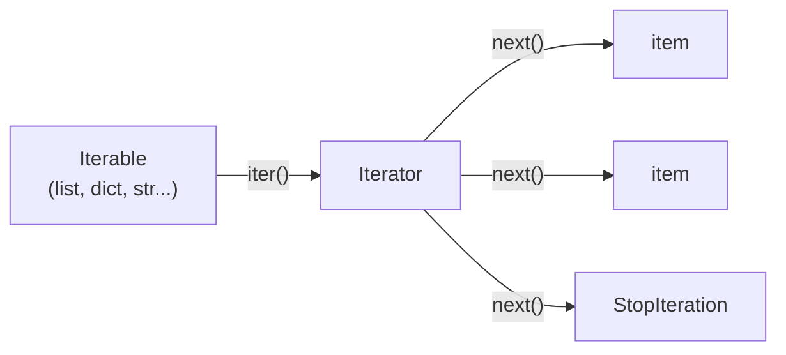
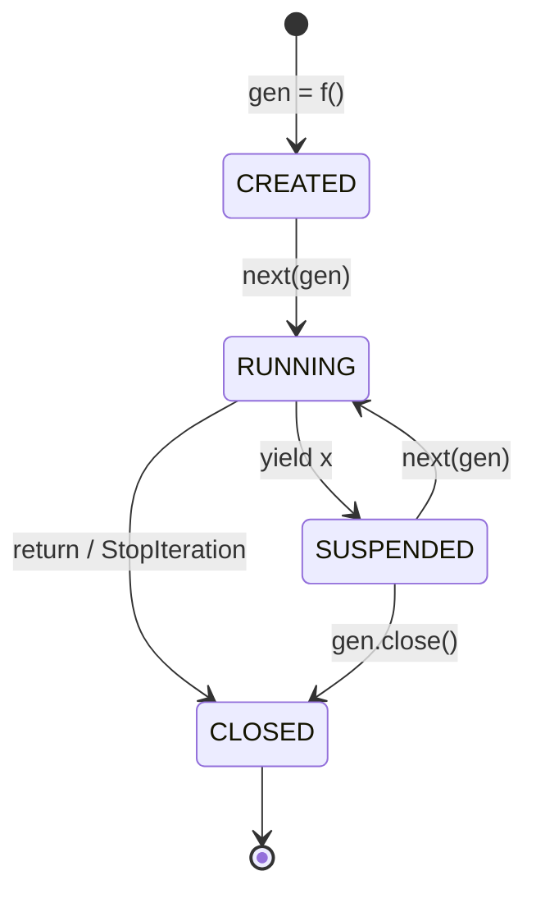
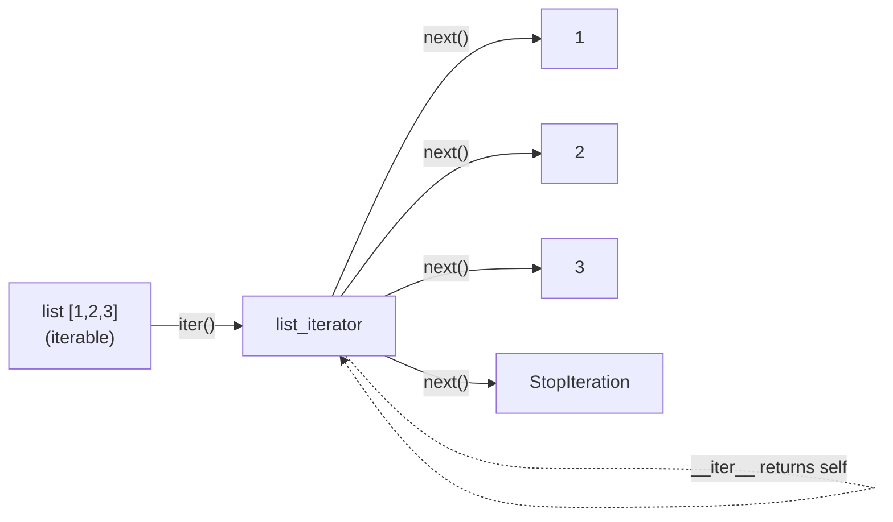
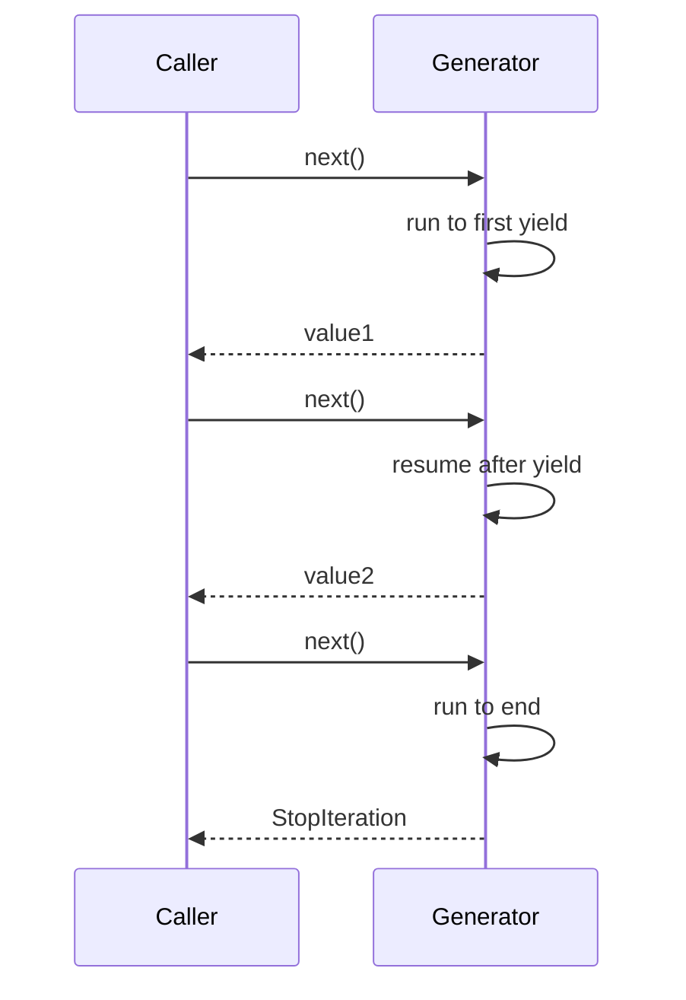
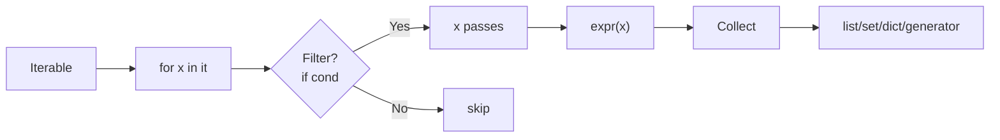
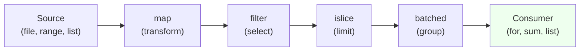
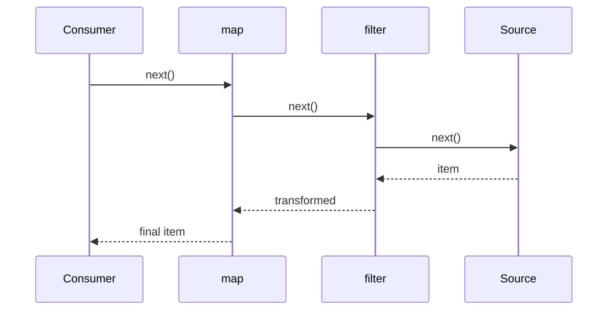

# Iterators, Generators & Comprehensions — Detailed Notes

---

## 1. What Is It? (Concept & Under the Hood)

Three intertwined concepts make Python's data processing **lazy**, **memory-efficient**, and **composable**:

1. **Iterable** — any object that can produce an iterator (`__iter__`).
2. **Iterator** — an object with `__next__` that yields items one at a time and raises `StopIteration` when exhausted.
3. **Generator** — a function or expression that produces an iterator, suspending execution between `yield`s.
4. **Comprehension** — concise syntax for building a list/set/dict/generator from an iterable.

The unifying idea: **produce items on demand** rather than all at once.

### Under the Hood — The Iterator Protocol

The protocol is small:

```python
class Iterator:
    def __iter__(self): return self          # iterators return themselves
    def __next__(self): ...                  # return next item or raise StopIteration
```

Any object with `__iter__` returning an iterator is **iterable**. Any object with `__next__` is an **iterator**.



Every `for` loop is sugar for:

```python
it = iter(iterable)
while True:
    try:
        item = next(it)
    except StopIteration:
        break
    body(item)
```

### Generators — Suspended Functions

A generator function is compiled to a **frame that can be paused**. When called, it returns a **generator object** without running the body. Each `next()` resumes execution from the last `yield` and runs until the next `yield`.

```python
def countdown(n):
    while n > 0:
        yield n
        n -= 1

g = countdown(3)          # nothing runs yet
next(g)                   # 3 — runs to first yield
next(g)                   # 2 — resumes
next(g)                   # 1
next(g)                   # StopIteration
```

The generator's frame stores:
- **Instruction pointer** (`f_lasti`) — where to resume.
- **Local variables** — preserved across yields.
- **Evaluation stack** — same as any frame.
- **State** — `GEN_CREATED`, `GEN_RUNNING`, `GEN_SUSPENDED`, `GEN_CLOSED`.

### The Generator State Machine



### Characteristics

| Feature | Iterator | Generator | Comprehension |
|---|---|---|---|
| Lazy | ✅ | ✅ | ✅ (generator expr) / ❌ (list comp) |
| Stateful | ✅ | ✅ | N/A |
| Reusable | ❌ (single pass) | ❌ | Depends |
| Memory | O(1) per item | O(1) per item | Varies |
| Speed | Fast | Fast | Fastest (list comp) |
| Syntax | Class | `yield` | `[...]`, `{...}`, `(...)` |

---

## 2. Iterables vs Iterators

### The Distinction

| | Iterable | Iterator |
|---|---|---|
| Protocol | `__iter__` | `__iter__` + `__next__` |
| Purpose | Can produce an iterator | Tracks position |
| Reusable | ✅ (usually) | ❌ (single pass) |
| Examples | list, dict, str, set, range | file, generator, `iter(list)` |

Every iterator **is also iterable** (`__iter__` returns `self`). Not every iterable is an iterator.

### Detecting

```python
from collections.abc import Iterable, Iterator

isinstance([1, 2, 3], Iterable)      # True
isinstance([1, 2, 3], Iterator)      # False

isinstance(iter([1, 2, 3]), Iterator)  # True
```

### Consuming an Iterator

```python
it = iter([1, 2, 3])

next(it)         # 1
next(it)         # 2
next(it)         # 3
next(it)         # ❌ StopIteration

list(it)         # [] — exhausted!
```

### Reusability

```python
# Iterable — reusable
data = [1, 2, 3]
list(data)       # [1, 2, 3]
list(data)       # [1, 2, 3]

# Iterator — single use
it = iter(data)
list(it)         # [1, 2, 3]
list(it)         # [] — exhausted
```

### Creating Iterators From Iterables

```python
iter([1, 2, 3])          # list_iterator
iter("abc")              # str_iterator
iter({"a": 1})           # dict_keyiterator — iterates keys
iter({1, 2, 3})          # set_iterator
iter(range(5))           # range_iterator
iter(open("file.txt"))   # text file object
```

### Custom Iterable

```python
class Countdown:
    def __init__(self, start):
        self.start = start

    def __iter__(self):
        # Return a NEW iterator each time
        n = self.start
        while n > 0:
            yield n
            n -= 1

c = Countdown(3)
list(c)          # [3, 2, 1]
list(c)          # [3, 2, 1] — fresh each time
```

### Custom Iterator

```python
class CountdownIterator:
    def __init__(self, start):
        self.n = start

    def __iter__(self):
        return self

    def __next__(self):
        if self.n <= 0:
            raise StopIteration
        self.n -= 1
        return self.n + 1

it = CountdownIterator(3)
next(it)         # 3
next(it)         # 2
```

### Comparison Table

| Aspect | Iterable | Iterator |
|---|---|---|
| `__iter__` | Returns iterator | Returns self |
| `__next__` | Absent | Present |
| `for` loop works | ✅ | ✅ |
| `next()` works | ❌ | ✅ |
| Reusable | ✅ | ❌ |
| Example | `[1, 2, 3]` | `iter([1, 2, 3])` |

### Mermaid — Iterable vs Iterator Relationship



---

## 3. `iter()` and `next()`

### `iter()` — Get an Iterator

```python
it = iter([1, 2, 3])
type(it)                 # <class 'list_iterator'>
```

Also works with an optional sentinel:

```python
# Read until sentinel value
def read_until(stream, sentinel):
    for chunk in iter(lambda: stream.read(1), b""):
        yield chunk
```

`iter(callable, sentinel)` calls the callable repeatedly until it returns the sentinel.

### `next()` — Advance an Iterator

```python
it = iter([1, 2, 3])
next(it)                 # 1
next(it)                 # 2
next(it)                 # 3
next(it)                 # ❌ StopIteration
```

### `next(it, default)` — With Default

```python
it = iter([1])
next(it)                 # 1
next(it, None)           # None (no exception)
next(it, "exhausted")    # "exhausted"
```

### Manual Iteration Loop

```python
it = iter([1, 2, 3])
while True:
    try:
        x = next(it)
    except StopIteration:
        break
    print(x)
```

### `StopIteration` — The Sentinel

Any custom iterator signals completion with `StopIteration`:

```python
class Squares:
    def __init__(self, n):
        self.n = n
        self.i = 0

    def __iter__(self):
        return self

    def __next__(self):
        if self.i >= self.n:
            raise StopIteration
        self.i += 1
        return self.i ** 2

list(Squares(5))         # [1, 4, 9, 16, 25]
```

### Multiple Iterators Over the Same Iterable

```python
data = [1, 2, 3, 4]

it1 = iter(data)
it2 = iter(data)          # independent

next(it1)                 # 1
next(it1)                 # 2
next(it2)                 # 1 — independent
```

### `iter()` Idempotency

```python
it = iter([1, 2, 3])
iter(it) is it            # True — iterators return themselves
```

This matters for `for` — iterating over an iterator doesn't reset it.

### `next` with Default — Idiom for "Safe Peek"

```python
it = iter(items)
first = next(it, None)
if first is None:
    print("empty")
else:
    process(first)
    for item in it:       # continue where `next` left off
        process(item)
```

### Key Facts Table

| Call | Behavior |
|---|---|
| `iter(x)` | Returns iterator for x |
| `iter(f, sentinel)` | Calls f() until sentinel |
| `next(it)` | Next item or raises StopIteration |
| `next(it, default)` | Next item or returns default |
| `iter(it) is it` | True for iterators |

---

## 4. Generators — `yield`

### Basic Generator

```python
def gen():
    yield 1
    yield 2
    yield 3

g = gen()
list(g)                  # [1, 2, 3]
```

### `yield` — Pause and Produce

The key insight: **`yield` suspends execution**. Local variables, instruction pointer, and evaluation stack are preserved until the next `next()`.

```python
def counter():
    n = 0
    while True:
        n += 1
        yield n

c = counter()
next(c)                  # 1
next(c)                  # 2
next(c)                  # 3
```

### Infinite Generators Are Cheap

```python
def naturals():
    n = 0
    while True:
        yield n
        n += 1

from itertools import islice
list(islice(naturals(), 5))    # [0, 1, 2, 3, 4]
```

The generator object is O(1) memory regardless of how many items it can produce.

### `return` in a Generator

```python
def gen():
    yield 1
    yield 2
    return "done"            # becomes StopIteration.value

g = gen()
next(g)                      # 1
next(g)                      # 2
try:
    next(g)
except StopIteration as e:
    print(e.value)           # 'done'
```

`return` terminates the generator — no more values, but captures the return value as the "StopIteration payload".

### `yield from` — Delegation

```python
def chain(*iterables):
    for it in iterables:
        yield from it

list(chain([1, 2], "ab", {3}))    # [1, 2, 'a', 'b', 3]
```

`yield from it` is roughly equivalent to `for x in it: yield x`, but also:
- **Propagates `send`/`throw`/`close`** to the subiterator.
- **Returns the subiterator's return value**.
- **Faster** — implemented natively.

```python
def outer():
    result = yield from inner()      # result = inner's return value
    print("inner returned:", result)

def inner():
    yield 1
    yield 2
    return "complete"

list(outer())            # [1, 2], prints "inner returned: complete"
```

### `send()` — Two-Way Communication

```python
def accumulate():
    total = 0
    while True:
        x = yield total
        if x is None:
            break
        total += x

acc = accumulate()
next(acc)                # 0 — prime the generator
acc.send(5)              # 5
acc.send(3)              # 8
acc.send(10)             # 18
```

`s.send(value)` resumes the generator, and the `yield` expression returns `value`.

**Priming**: you must call `next()` (or `send(None)`) once before the generator reaches the first `yield`.

### `close()` — Terminate a Generator

```python
def gen():
    try:
        while True:
            yield 1
    finally:
        print("cleanup")

g = gen()
next(g)                  # 1
g.close()                # prints "cleanup"
next(g)                  # ❌ StopIteration
```

`close()` raises `GeneratorExit` inside the generator — the `finally` block runs, and the generator is marked exhausted.

### `throw()` — Inject Exception

```python
def gen():
    try:
        while True:
            yield 1
    except ValueError as e:
        print("caught:", e)

g = gen()
next(g)                  # 1
g.throw(ValueError("boom"))    # prints "caught: boom"
```

### Generator State

```python
import inspect

g = gen()
inspect.getgeneratorstate(g)
# 'GEN_CREATED'
next(g)
inspect.getgeneratorstate(g)
# 'GEN_SUSPENDED'
g.close()
inspect.getgeneratorstate(g)
# 'GEN_CLOSED'
```

### Generators Are Not Reusable

```python
def gen():
    yield 1
    yield 2

g = gen()
list(g)         # [1, 2]
list(g)         # [] — exhausted
```

### Comparison — Function vs Generator

| | Regular function | Generator function |
|---|---|---|
| Keyword | `return` | `yield` |
| Result | Value | Generator object |
| Execution | Runs to completion | Pauses at each yield |
| Memory | Stack-frame during run | Frame retained between calls |
| Multiple values | One return | Many yields |

### Mermaid — Generator Execution



---

## 5. Generator Expressions

### Syntax

```python
(x * 2 for x in range(5))     # generator expression
```

Same as a list comprehension but with **parentheses** — and **lazy**.

```python
g = (x * 2 for x in range(5))
type(g)                       # <class 'generator'>
list(g)                       # [0, 2, 4, 6, 8]
```

### List vs Generator Expression

```python
# List — eager, O(n) memory
squares = [x * x for x in range(1_000_000)]

# Generator — lazy, O(1) memory
squares = (x * x for x in range(1_000_000))
```

Both can be iterated identically:

```python
for s in (x * x for x in range(5)):
    print(s)
```

### Chaining — The Killer Feature

```python
nums = range(1_000_000)

result = sum(
    x * x
    for x in nums
    if x % 2 == 0
)
# No intermediate list — one pass, O(1) memory
```

### Function Call Without Extra Parens

When the generator expression is the **only argument**, you can omit the inner parens:

```python
sum(x * x for x in range(5))       # ✅ — no double parens needed
sum((x * x for x in range(5)))     # ✅ — explicit
```

But if there are multiple arguments:

```python
sorted((x for x in data), key=abs)   # parens required
```

### `yield from` vs Generator Expression

```python
def flat(seqs):
    for s in seqs:
        yield from s

def flat2(seqs):
    return (x for s in seqs for x in s)     # generator expression
```

Both lazily flatten. `yield from` is slightly more explicit.

### Common Applications

```python
# Sum, any, all
sum(x for x in nums if x > 0)
any(x > 100 for x in nums)
all(x > 0 for x in nums)

# Join
",".join(str(x) for x in nums)

# Min/max with key
max(len(w) for w in words)

# Feeding into iterators
from itertools import islice
list(islice((x * x for x in itertools.count()), 5))  # [0, 1, 4, 9, 16]
```

### Memory Comparison

```python
import sys

list_comp = [x for x in range(1_000_000)]
gen_expr = (x for x in range(1_000_000))

sys.getsizeof(list_comp)     # ~8 MB
sys.getsizeof(gen_expr)      # ~200 bytes
```

### Speed Comparison

For simple cases, list comprehensions are **slightly faster** than generator expressions — no generator state machine. But the memory difference dominates for large data.

```python
import timeit

timeit.timeit("[x * x for x in range(1000)]", number=10_000)
# ~0.5 s

timeit.timeit("list(x * x for x in range(1000))", number=10_000)
# ~0.7 s
```

**Rule:** use a generator expression when you don't need the whole list at once; use a list comprehension when you do.

### Comparison Table

| Aspect | List comp | Generator expr |
|---|---|---|
| Syntax | `[...]` | `(...)` |
| Result | `list` | `generator` |
| Memory | O(n) | O(1) |
| Speed | Faster | Slightly slower |
| Reusable | ✅ | ❌ |
| Indexable | ✅ | ❌ |
| `len()` | ✅ | ❌ |

---

## 6. List, Dict, Set Comprehensions

### List Comprehension

```python
[x * 2 for x in range(5)]                 # [0, 2, 4, 6, 8]
[x for x in range(10) if x % 2 == 0]      # [0, 2, 4, 6, 8]
[(x, y) for x in "ab" for y in "12"]      # [('a','1'),('a','2'),('b','1'),('b','2')]
```

### Dict Comprehension

```python
{x: x * x for x in range(5)}              # {0: 0, 1: 1, 2: 4, 3: 9, 4: 16}
{k: v for k, v in [("a", 1), ("b", 2)]}   # {'a': 1, 'b': 2}
{k: v for k, v in d.items() if v > 0}     # filter by value
{v: k for k, v in d.items()}              # invert
```

### Set Comprehension

```python
{x * 2 for x in range(5)}                 # {0, 2, 4, 6, 8}
{c.lower() for c in "Hello World"}        # {'h', 'e', 'l', 'o', ' ', 'w', 'r', 'd'}
```

### Nested Loops in Comprehension

```python
# Flatten a matrix
matrix = [[1, 2], [3, 4], [5, 6]]
flat = [x for row in matrix for x in row]     # [1, 2, 3, 4, 5, 6]

# Cartesian product
[(x, y) for x in [1, 2] for y in ["a", "b"]]
# [(1,'a'), (1,'b'), (2,'a'), (2,'b')]
```

### Conditionals — Filter vs Transform

```python
# Filter — after the loop
[x for x in range(10) if x % 2 == 0]          # [0, 2, 4, 6, 8]

# Transform — before the loop
[x if x % 2 == 0 else "odd" for x in range(5)]  # [0, 'odd', 2, 'odd', 4]

# Both
[x ** 2 if x % 2 == 0 else -x for x in range(5) if x > 0]
```

- **Filter** (`if` after) — subset selection.
- **Conditional expression** (`if ... else ...` before) — transform every item.

### Multiple Conditions

```python
[x for x in range(100) if x % 2 == 0 if x % 3 == 0]
# [0, 6, 12, ..., 96]

# Equivalent to:
[x for x in range(100) if x % 2 == 0 and x % 3 == 0]
```

### Nested Comprehension (Matrix)

```python
matrix = [[i * j for j in range(3)] for i in range(3)]
# [[0, 0, 0], [0, 1, 2], [0, 2, 4]]

# Transpose
transposed = [[row[i] for row in matrix] for i in range(3)]
```

### Walrus in Comprehension

```python
# Compute once, use twice
results = [y for x in data if (y := compute(x)) is not None]

# Equivalent to:
results = []
for x in data:
    y = compute(x)
    if y is not None:
        results.append(y)
```

### Comprehension vs Loop vs `map`/`filter`

```python
nums = [1, 2, 3, 4, 5]

# Comprehension — idiomatic
result = [x * 2 for x in nums if x > 2]

# Loop — verbose
result = []
for x in nums:
    if x > 2:
        result.append(x * 2)

# map/filter — less Pythonic
result = list(map(lambda x: x * 2, filter(lambda x: x > 2, nums)))
```

Comprehensions are **faster** than `map`/`filter` with lambdas and more readable than loops for simple transformations.

### Comprehension Side Effects — Avoid

```python
# ❌ Anti-pattern — using comprehension for side effects
[print(x) for x in range(5)]

# ✅ Use a loop
for x in range(5):
    print(x)
```

Comprehensions are for building containers, not for side effects.

### Comprehension Variable Scope

```python
x = 10

result = [x for x in range(3)]
# [0, 1, 2]

print(x)                 # 10 — outer x unchanged

# But in Python 2, this would print 2 — one of the great 2→3 fixes.
```

Comprehensions have their **own scope** in Python 3 — the loop variable doesn't leak.

### Nested Comprehension Scope

```python
# Each comprehension has its own scope
result = [[y for y in range(x)] for x in range(3)]
# [[], [0], [0, 1]]
```

### Dictionary From Two Lists

```python
keys = ["a", "b", "c"]
values = [1, 2, 3]

{ k: v for k, v in zip(keys, values) }     # {'a': 1, 'b': 2, 'c': 3}
dict(zip(keys, values))                    # same, faster
```

### Inverting a Dict

```python
d = {"a": 1, "b": 2, "c": 3}

{v: k for k, v in d.items()}               # {1: 'a', 2: 'b', 3: 'c'}
```

Beware of duplicate values — later keys win.

### Grouping — `defaultdict` Beats Comprehension

```python
# ✅ Clear
from collections import defaultdict
groups = defaultdict(list)
for k, v in pairs:
    groups[k].append(v)

# ❌ Awkward with comprehensions
```

Not every aggregation fits a comprehension.

### Comprehension Summary Table

| Type | Syntax | Returns |
|---|---|---|
| List | `[expr for x in it]` | `list` |
| Set | `{expr for x in it}` | `set` |
| Dict | `{k: v for x in it}` | `dict` |
| Generator | `(expr for x in it)` | `generator` |

### Mermaid — Comprehension Transformation



---

## 7. `itertools` — The Standard Library Powerhouse

### Overview

`itertools` provides **iterator building blocks** — fast, memory-efficient, composable. All return iterators.

### Infinite Iterators

```python
from itertools import count, cycle, repeat

count(10)              # 10, 11, 12, ...
count(10, step=2)      # 10, 12, 14, ...
cycle("ABC")           # A, B, C, A, B, C, ...
repeat(5)              # 5, 5, 5, ...
repeat(5, times=3)     # 5, 5, 5
```

Always pair with a terminator:

```python
from itertools import islice
list(islice(count(), 5))       # [0, 1, 2, 3, 4]
```

### Terminating Iterators

```python
from itertools import (
    accumulate, chain, compress,
    dropwhile, filterfalse, groupby,
    islice, pairwise, starmap,
    takewhile, tee, zip_longest,
)
```

**`chain`** — concatenate iterables:

```python
list(chain([1, 2], "ab", {3}))         # [1, 2, 'a', 'b', 3]
list(chain.from_iterable([[1, 2], [3, 4]]))  # [1, 2, 3, 4]
```

**`islice`** — slice an iterator:

```python
list(islice(range(100), 5))            # [0, 1, 2, 3, 4]
list(islice(range(100), 10, 15))       # [10, 11, 12, 13, 14]
list(islice(range(100), 0, 100, 10))   # [0, 10, 20, ..., 90]
```

**`compress`** — filter by boolean mask:

```python
list(compress("ABCDEF", [1, 0, 1, 0, 1, 0]))  # ['A', 'C', 'E']
```

**`dropwhile`** / **`takewhile`**:

```python
list(dropwhile(lambda x: x < 5, [1, 4, 6, 4, 1]))  # [6, 4, 1]
list(takewhile(lambda x: x < 5, [1, 4, 6, 4, 1]))  # [1, 4]
```

**`filterfalse`** — the inverse of `filter`:

```python
list(filterfalse(lambda x: x % 2, range(10)))  # [0, 2, 4, 6, 8]
```

**`groupby`** — consecutive grouping (input must be sorted by key):

```python
from operator import itemgetter

data = [("a", 1), ("a", 2), ("b", 3), ("a", 4)]
for key, group in groupby(data, key=itemgetter(0)):
    print(key, list(group))
# a [('a', 1), ('a', 2)]
# b [('b', 3)]
# a [('a', 4)]      ← separate group because not consecutive
```

**`accumulate`** — running totals:

```python
list(accumulate([1, 2, 3, 4]))         # [1, 3, 6, 10]
list(accumulate([1, 2, 3, 4], max))    # [1, 2, 3, 4]
```

**`starmap`** — `map` with unpacked arguments:

```python
list(starmap(pow, [(2, 3), (3, 2)]))   # [8, 9]
```

**`tee`** — clone an iterator:

```python
it1, it2 = tee(range(5), 2)
list(it1)                              # [0, 1, 2, 3, 4]
list(it2)                              # [0, 1, 2, 3, 4]
```

**`zip_longest`** — zip until the longest:

```python
list(zip_longest([1, 2, 3], "ab", fillvalue=None))
# [(1, 'a'), (2, 'b'), (3, None)]
```

**`pairwise`** (3.10+) — overlapping pairs:

```python
list(pairwise([1, 2, 3, 4]))           # [(1,2), (2,3), (3,4)]
```

### Combinatoric Iterators

```python
from itertools import product, permutations, combinations, combinations_with_replacement

list(product("AB", "12"))
# [('A','1'), ('A','2'), ('B','1'), ('B','2')]

list(product([1, 2], repeat=2))
# [(1,1), (1,2), (2,1), (2,2)]

list(permutations("ABC", 2))
# [('A','B'), ('A','C'), ('B','A'), ('B','C'), ('C','A'), ('C','B')]

list(combinations("ABC", 2))
# [('A','B'), ('A','C'), ('B','C')]

list(combinations_with_replacement("AB", 2))
# [('A','A'), ('A','B'), ('B','B')]
```

### `itertools` Cheat Sheet

| Category | Functions |
|---|---|
| Infinite | `count`, `cycle`, `repeat` |
| Terminating | `accumulate`, `chain`, `compress`, `dropwhile`, `filterfalse`, `groupby`, `islice`, `pairwise`, `starmap`, `takewhile`, `tee`, `zip_longest` |
| Combinatoric | `product`, `permutations`, `combinations`, `combinations_with_replacement` |

### Real-World Example — Paginated API Loop

```python
from itertools import count

def fetch_all(url):
    for page in count(1):
        resp = get(url, params={"page": page}).json()
        if not resp["items"]:
            return
        yield from resp["items"]
```

### Real-World Example — Grouping Consecutive Runs

```python
from itertools import groupby

data = [1, 1, 2, 3, 3, 3, 1, 1]
for value, group in groupby(data):
    print(value, len(list(group)))
# 1 2
# 2 1
# 3 3
# 1 2
```

### Mermaid — itertools Pipeline


All steps are **lazy** — nothing runs until consumed.

---

## 8. Real-World Use Cases

### Use Case 1 — Streaming Large Files

```python
def process_log(path):
    with open(path) as f:
        for line in f:                          # line-by-line, O(1) memory
            if "ERROR" in line:
                yield line.rstrip()

for error in process_log("huge.log"):
    print(error)
```

### Use Case 2 — Paginated Data

```python
def paginate(fetch_page, per_page=100):
    page = 1
    while True:
        items = fetch_page(page, per_page)
        if not items:
            return
        yield from items
        page += 1
```

### Use Case 3 — Transducers via Generators

```python
def numbers():
    n = 0
    while True:
        yield n
        n += 1

def square(it):
    for x in it:
        yield x * x

def evens(it):
    for x in it:
        if x % 2 == 0:
            yield x

from itertools import islice
pipeline = square(evens(numbers()))
list(islice(pipeline, 5))         # [0, 4, 16, 36, 64]
```

### Use Case 4 — Batching

```python
from itertools import islice

def batched(iterable, size):
    it = iter(iterable)
    while batch := list(islice(it, size)):
        yield batch

for batch in batched(range(10), 3):
    print(batch)
# [0, 1, 2]
# [3, 4, 5]
# [6, 7, 8]
# [9]
```

Python 3.12 adds `itertools.batched`:

```python
from itertools import batched
list(batched(range(10), 3))
```

### Use Case 5 — Sliding Window

```python
from collections import deque

def sliding_window(iterable, size):
    it = iter(iterable)
    window = deque(maxlen=size)
    for _ in range(size):
        try:
            window.append(next(it))
        except StopIteration:
            return
    yield tuple(window)
    for x in it:
        window.append(x)
        yield tuple(window)

list(sliding_window(range(5), 3))
# [(0, 1, 2), (1, 2, 3), (2, 3, 4)]
```

Or with `itertools` (3.10+):

```python
from itertools import islice, tee

def sliding_window(it, n):
    its = tee(it, n)
    for i, it_ in enumerate(its):
        next(islice(it_, i, i), None)
    return zip(*its)
```

### Use Case 6 — Lazily Parsing CSV

```python
import csv

def csv_rows(path):
    with open(path, newline="", encoding="utf-8") as f:
        yield from csv.DictReader(f)

for row in csv_rows("data.csv"):
    process(row)
```

### Use Case 7 — Building a Query DSL

```python
def query(source):
    return (
        row
        for row in source
        if row["active"]
    )

def sort_by(rows, key):
    return iter(sorted(rows, key=lambda r: r[key]))

def limit(rows, n):
    from itertools import islice
    return islice(rows, n)

pipeline = limit(sort_by(query(records), "score"), 10)
for row in pipeline:
    print(row)
```

### Use Case 8 — Memory-Efficient Aggregation

```python
# ❌ Loads everything
with open("huge.txt") as f:
    total = sum(map(int, f.readlines()))

# ✅ Streams
with open("huge.txt") as f:
    total = sum(int(line) for line in f)
```

### Use Case 9 — Deduplicating a Stream

```python
def dedupe(iterable):
    seen = set()
    for item in iterable:
        if item not in seen:
            seen.add(item)
            yield item

list(dedupe([1, 2, 1, 3, 2, 4]))    # [1, 2, 3, 4]
```

### Use Case 10 — Tree Traversal (Lazy)

```python
def walk(node):
    yield node
    for child in node.children:
        yield from walk(child)

for n in walk(root):
    print(n.value)
```

---

## 9. Common Pitfalls

### Pitfall 1 — Reusing an Exhausted Iterator

```python
it = iter([1, 2, 3])
list(it)         # [1, 2, 3]
list(it)         # [] — exhausted
```

Fix: keep the iterable, or use `itertools.tee`.

### Pitfall 2 — `return` vs `yield` — Accidental Non-Generator

```python
def gen():
    return [1, 2, 3]        # ❌ not a generator — returns a list

def gen():
    yield from [1, 2, 3]    # ✅ generator
```

Any `yield` **anywhere** in the function body makes it a generator — even in a conditional.

```python
def f(x):
    if x:
        return [1, 2, 3]    # ❌ — this branch returns a list, not generator
    yield 1                 # presence of this makes f a generator
```

### Pitfall 3 — Mutating While Iterating

```python
for x in [1, 2, 3]:
    if x == 2:
        list_.remove(x)     # ❌ skips items

# ✅
for x in list(list_):
    ...
```

### Pitfall 4 — Forgetting to Prime a `send`-Based Generator

```python
def gen():
    total = 0
    while True:
        x = yield total
        total += x

g = gen()
g.send(5)                # ❌ TypeError: can't send non-None to a just-started generator

# ✅
next(g)                  # prime it first
g.send(5)
```

### Pitfall 5 — Generator Expressions Are One-Shot

```python
squares = (x * x for x in range(5))
total = sum(squares)
count = sum(squares)     # ❌ 0 — exhausted
```

Fix: make it a list comprehension if you need to iterate more than once.

### Pitfall 6 — Unbounded Memory in Comprehensions

```python
# ❌ Loads 100M rows into a list
rows = [parse(line) for line in open("huge.log")]

# ✅ Streams
rows = (parse(line) for line in open("huge.log"))
```

### Pitfall 7 — `groupby` on Unsorted Data

```python
data = [("a", 1), ("b", 2), ("a", 3)]
list(groupby(data, key=lambda x: x[0]))
# [('a', [('a', 1)]), ('b', [('b', 2)]), ('a', [('a', 3)])]  — 'a' split!

# ✅ Sort first
data.sort(key=lambda x: x[0])
list(groupby(data, key=lambda x: x[0]))
```

### Pitfall 8 — Nested Comprehensions Are Hard to Read

```python
# ❌ Very hard to parse
result = [a+b for a in [1, 2] for b in [3, 4] if a+b > 4 if b > 3]

# ✅ Use a loop
result = []
for a in [1, 2]:
    for b in [3, 4]:
        if a + b > 4 and b > 3:
            result.append(a + b)
```

### Pitfall 9 — Modifying a List Inside Its Own Comprehension

```python
# ❌ Subtle bug
lst = [1, 2, 3]
result = [lst.pop() for _ in lst]    # iterating while popping
```

### Pitfall 10 — Return Value of a Generator Function

```python
def gen():
    yield 1
    return 2

g = gen()
next(g)      # 1
next(g)      # ❌ StopIteration(2) — value captured in e.value
```

This is intentional — `return value` becomes `StopIteration.value`, useful with `yield from`.

### Pitfall 11 — Memory Leak via `tee`

```python
it1, it2 = tee(big_iterator, 2)
list(it1)                # consumes
list(it2)                # tee buffers all values from it1 → memory!
```

`tee` buffers consumed items — can grow unbounded if one branch lags.

### Pitfall 12 — Generator Exhaustion Is Silent

```python
def gen():
    yield 1

g = gen()
for x in g: pass
for x in g: pass        # silently does nothing
```

Always be aware of whether something is a fresh iterable or a consumed iterator.

### Pitfall 13 — Comprehension Variable Scope

```python
x = "outer"
result = [x for x in range(3)]
print(x)                # 'outer' — not overwritten in Python 3
```

Great — but note that in Python 2 it **was** overwritten.

### Pitfall Summary Table

| Pitfall | Symptom | Fix |
|---|---|---|
| Exhausted iterator | Empty second iteration | Recreate or `tee` |
| `return` in generator | Not lazy | Use `yield from` |
| Unprimed `send` | `TypeError` | `next(g)` first |
| One-shot gen expr | Second `sum` = 0 | List comp if reused |
| `groupby` unsorted | Split groups | Sort first |
| `tee` memory | Growth | Don't lag branches |
| Oversized list comp | OOM | Generator expr |
| Silent exhaustion | No output | Track state |

---

## 10. Comparison Tables

### Iterable vs Iterator vs Generator

| | Iterable | Iterator | Generator |
|---|---|---|---|
| Has `__iter__` | ✅ | ✅ | ✅ |
| Has `__next__` | ❌ | ✅ | ✅ |
| Reusable | ✅ | ❌ | ❌ |
| Created by | Class | Class / `iter()` | `def` with `yield` |
| Memory | Varies | O(1) | O(1) |
| `for x in obj` | ✅ | ✅ | ✅ |

### Comprehension Types

| Type | Syntax | Lazy | Returns |
|---|---|---|---|
| List | `[x for x in it]` | ❌ | `list` |
| Set | `{x for x in it}` | ❌ | `set` |
| Dict | `{k:v for x in it}` | ❌ | `dict` |
| Generator | `(x for x in it)` | ✅ | `generator` |

### Generators vs Regular Functions

| | Regular | Generator |
|---|---|---|
| Keyword | `return` | `yield` |
| Called → | Value | Generator object |
| Body runs | Immediately | On `next()` |
| Multiple values | One | Many |
| Paused state | ❌ | ✅ |
| `send`/`throw` | ❌ | ✅ |

### `map`/`filter` vs Comprehensions

| Task | Comprehension | `map`/`filter` |
|---|---|---|
| Transform | `[f(x) for x in it]` | `map(f, it)` |
| Filter | `[x for x in it if p(x)]` | `filter(p, it)` |
| Both | `[f(x) for x in it if p(x)]` | `map(f, filter(p, it))` |
| Multiple iterables | Nested for | `map(f, a, b, c)` |
| Lazy | Use gen expr | `map`/`filter` are lazy |
| Speed (small) | Fast | Fast |
| Readability | High | Medium |

### itertools Cheat Sheet

| Function | Purpose |
|---|---|
| `count` | Infinite counter |
| `cycle` | Repeat iterable forever |
| `repeat` | Repeat one value |
| `chain` | Concatenate iterables |
| `islice` | Slice an iterator |
| `tee` | Clone an iterator |
| `groupby` | Group consecutive items |
| `accumulate` | Running reduction |
| `product` | Cartesian product |
| `permutations` | All orderings |
| `combinations` | Subsets of size k |
| `zip_longest` | Zip padding shortest |

---

## 11. Mermaid — Generator Pipeline



Nothing runs until the consumer pulls. Each stage processes **one item at a time**.

### Lazy Evaluation Timeline



Backpressure — the consumer drives production, one item at a time.

---

## 12. Performance Notes

### Comprehensions Are Compiled Special

List comprehensions are compiled to a specialized bytecode path — faster than `append` in a loop:

```python
import timeit

timeit.timeit("[x * 2 for x in range(1000)]", number=10_000)
# ~0.25 s

timeit.timeit("""
out = []
for x in range(1000):
    out.append(x * 2)
""", number=10_000)
# ~0.45 s
```

### Generator Expressions — Memory Wins

```python
import sys

lst = [x for x in range(10_000_000)]
gen = (x for x in range(10_000_000))

sys.getsizeof(lst)      # ~80,000,000 bytes
sys.getsizeof(gen)      # ~200 bytes
```

**O(n) vs O(1) memory** — the entire reason to prefer generators.

### Streaming vs Buffering

```python
# ❌ 1 GB file loaded into RAM
data = open("huge.bin", "rb").read()

# ✅ Same data, constant memory
for chunk in iter(lambda: open("huge.bin", "rb").read(8192), b""):
    process(chunk)
```

### `sum` with Generator Expression

```python
# ✅ Streaming, O(1) memory
sum(int(line) for line in open("huge.log"))

# ❌ Full list in memory first
sum([int(line) for line in open("huge.log")])
```

### `itertools` Is C-Accelerated

```python
from itertools import chain, islice

# ✅ C-implemented, fast
list(islice(chain(a, b), 100))

# ❌ Python-level generator
def chain_(a, b):
    yield from a
    yield from b
```

`itertools` beats hand-written generators for large streams.

### Local Lookups in Generators

```python
# ✅ Local binding for hot loops
def process(items):
    append = out.append           # if out is a list
    for x in items:
        append(f(x))
```

### Generator Function Call Overhead

Each `next()` resumes the generator's frame — ~100 ns overhead. For tight numeric loops, a plain list comp is faster.

### `tee` Buffering Cost

```python
from itertools import tee

# Two consumers of the same stream
a, b = tee(source, 2)
```
- **Memory** grows if one consumer lags.
- **Latency** — the slower consumer forces buffering.

### Approximate Costs

| Operation | Memory | Speed |
|---|---|---|
| List comprehension | O(n) | Fastest |
| Generator expression | O(1) | Slightly slower |
| Generator function | O(1) | Slightly slower |
| `itertools` pipeline | O(1) | Fastest for streams |
| `map`/`filter` with lambda | O(1) | Slower than gen expr |

### Rule of Thumb

- **Need the whole list?** — list comprehension.
- **Only iterating once?** — generator expression.
- **Complex pipeline?** — generator function or `itertools`.
- **Simple transform?** — `map` without lambda, or comprehension.

---

## 13. Quick Reference Card

```python
# ─── ITERABLES / ITERATORS ─────────────────────
it = iter([1, 2, 3])          # get iterator
next(it)                       # 1
next(it, "default")            # safe next
list(it)                       # consume rest

from collections.abc import Iterable, Iterator
isinstance([], Iterable)       # True
isinstance([], Iterator)       # False

# ─── CUSTOM ITERATOR ───────────────────────────
class Counter:
    def __init__(self, start): self.n = start
    def __iter__(self): return self
    def __next__(self):
        if self.n <= 0:
            raise StopIteration
        self.n -= 1
        return self.n + 1

# ─── CUSTOM ITERABLE ───────────────────────────
class Counter:
    def __init__(self, start): self.start = start
    def __iter__(self):
        n = self.start
        while n > 0:
            yield n
            n -= 1

# ─── GENERATORS ────────────────────────────────
def gen():
    yield 1
    yield 2
    return "done"

g = gen()
next(g)                        # 1
next(g)                        # 2
try: next(g)
except StopIteration as e: print(e.value)   # 'done'

# yield from
def chain(*its):
    for it in its:
        yield from it

# send — two-way
def acc():
    total = 0
    while True:
        x = yield total
        total += x

a = acc()
next(a)                        # prime
a.send(5)                      # 5

# close
g.close()

# ─── GENERATOR EXPRESSIONS ─────────────────────
g = (x * x for x in range(10))
sum(x * x for x in range(10))
any(x > 5 for x in range(10))

# ─── COMPREHENSIONS ────────────────────────────
[x * 2 for x in range(5)]                     # list
{x * 2 for x in range(5)}                     # set
{x: x * x for x in range(5)}                  # dict
(x for x in range(5))                          # generator

# with filter
[x for x in range(10) if x % 2 == 0]

# with transform
[x if x % 2 == 0 else "odd" for x in range(5)]

# nested
[(x, y) for x in [1, 2] for y in "ab"]
[[x * y for y in range(3)] for x in range(3)]

# walrus
[y for x in data if (y := f(x)) is not None]

# ─── ITERTOOLS ─────────────────────────────────
from itertools import (
    count, cycle, repeat,
    chain, islice, tee, groupby, accumulate,
    product, permutations, combinations,
    zip_longest, filterfalse, dropwhile, takewhile,
    starmap, compress, pairwise,
)

count(10)                      # 10, 11, 12, ...
cycle("AB")                    # A, B, A, B, ...
chain([1], [2, 3])             # 1, 2, 3
islice(range(100), 5)          # 0..4
list(pairwise([1, 2, 3]))      # [(1,2), (2,3)]
list(accumulate([1, 2, 3]))    # [1, 3, 6]
list(product("AB", "12"))      # 4 tuples
list(combinations("ABC", 2))   # 3 tuples

# ─── COMMON PATTERNS ───────────────────────────
# Stream a file
with open(path) as f:
    for line in f: ...

# Read in chunks
def chunks(f, size=8192):
    while chunk := f.read(size):
        yield chunk

# Batch
from itertools import islice
def batched(it, n):
    it = iter(it)
    while batch := list(islice(it, n)):
        yield batch

# Sliding window
def window(it, n):
    from collections import deque
    w = deque(maxlen=n)
    for x in it:
        w.append(x)
        if len(w) == n:
            yield tuple(w)

# Dedupe a stream
def dedupe(it):
    seen = set()
    for x in it:
        if x not in seen:
            seen.add(x)
            yield x

# ─── DETECT ────────────────────────────────────
import inspect
inspect.isgenerator(g)         # True
inspect.isgeneratorfunction(f) # True
inspect.getgeneratorstate(g)   # 'GEN_CREATED' | 'GEN_RUNNING' | ...
```

---

## Summary

- **Iterables** produce iterators via `__iter__`; **iterators** implement `__next__` and signal completion with `StopIteration`.
- Every `for` loop desugars to `iter()` + `next()` + `StopIteration` — that's the entire protocol.
- **Iterators are one-shot** — consuming one exhausts it. Iterables can produce fresh iterators.
- **Generators** are functions with `yield` — they pause execution, preserve state, and produce values lazily; a generator object is O(1) in memory regardless of stream length.
- **`yield from`** delegates to a subiterator and captures its return value; **`send`**, **`throw`**, **`close`** enable two-way communication and cleanup.
- **Generator expressions** (`(x for x in ...)`) are lazy, memory-efficient; **list/set/dict comprehensions** are eager and slightly faster.
- **Comprehension scoping** is isolated (Python 3) — the loop variable doesn't leak.
- **`itertools`** provides C-accelerated building blocks: `chain`, `islice`, `groupby`, `accumulate`, `product`, `combinations`, `pairwise`, and more.
- **Idioms**: stream files line by line, use `sum(gen_expr)` for streaming sums, `yield from` for flattening, `itertools` for composition.
- **Pitfalls** cluster around reusing exhausted iterators, forgetting to prime `send`-based generators, `groupby` on unsorted data, unbounded list comprehensions, `tee` buffering, and mutating while iterating.