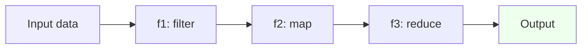
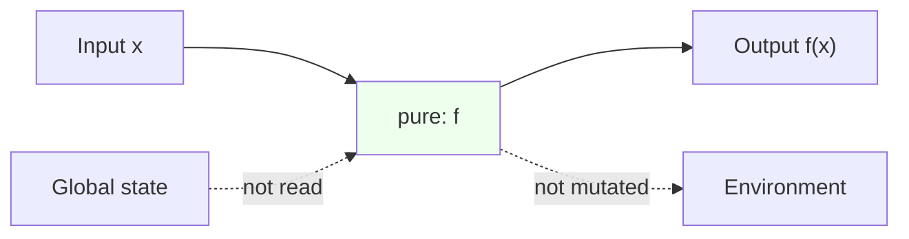
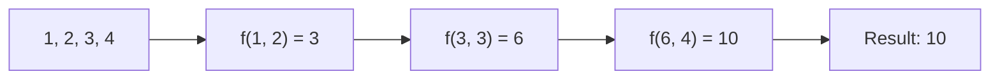
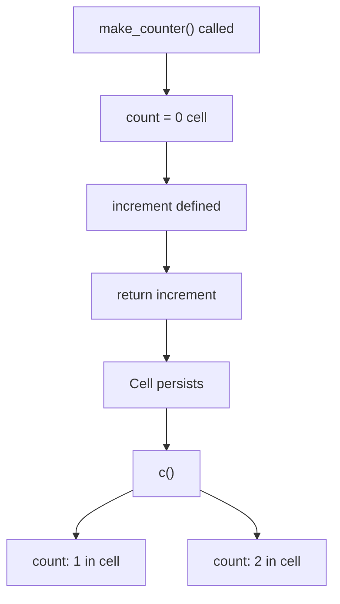
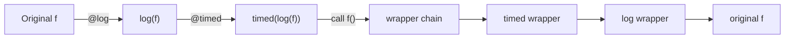
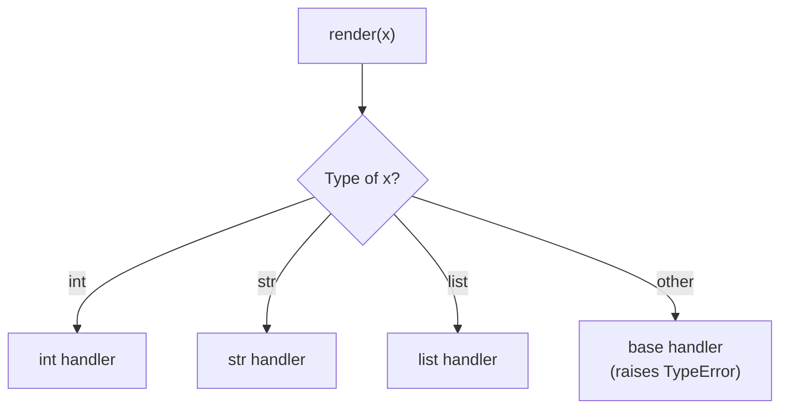
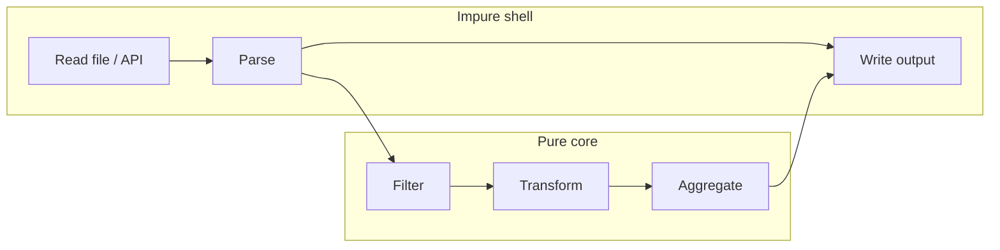
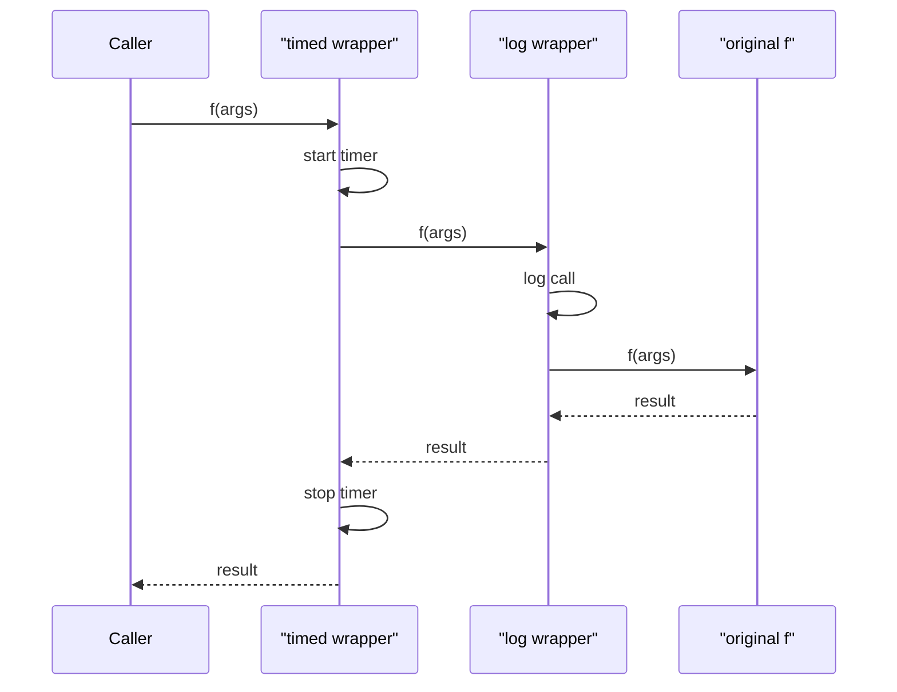
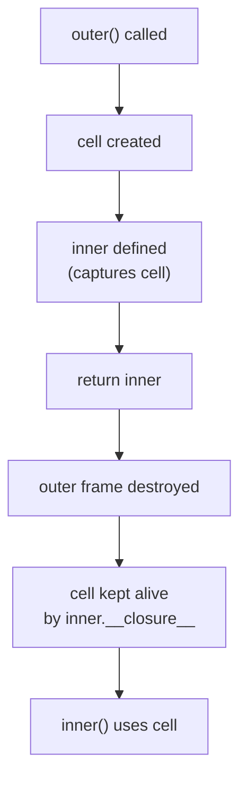

# Functional Programming — Detailed Notes

---

## 1. What Is It? (Concept & Under the Hood)

**Functional Programming (FP)** treats computation as the **evaluation of mathematical functions** — avoiding mutable state, side effects, and imperative control flow in favor of **composition**, **immutability**, and **higher-order functions**.

Python is **not** a pure functional language — it's multi-paradigm — but it provides strong FP tools that mesh with its object-oriented core.

Key pillars:
- **Pure functions** — same input → same output, no side effects.
- **First-class functions** — functions are values, passable and returnable.
- **Higher-order functions** — functions that take or return functions.
- **Immutability preference** — return new values instead of mutating.
- **Composition** — build complex behavior from simple functions.
- **Declarative style** — describe *what*, not *how*.

### Under the Hood — Functions as Objects

Every Python function is a `PyFunctionObject` with:
- A **code object** (bytecode + metadata).
- A **globals dict** — the module namespace.
- A **closure tuple** — captured free variables.
- **Defaults**, **annotations**, **name**, and a mutable `__dict__`.

Higher-order functions operate on these objects — calling, composing, or wrapping them. Nothing special is needed; functions are just values.

### The FP "Pipeline" Model



Data flows through a chain of pure transformations — each stage independent, testable, and composable.

### Characteristics

| Aspect | Value |
|---|---|
| Functions | First-class values |
| State | Preferred immutable |
| Side effects | Isolated, explicit |
| Composition | `f(g(x))` or pipelines |
| Evaluation | Eager (Python), lazy via generators |
| Purity | Optional — not enforced |

### FP vs OOP in Python

| | Functional | Object-oriented |
|---|---|---|
| Primary unit | Function | Object |
| State | Immutable data | Mutable attributes |
| Behavior | Function composition | Method dispatch |
| Extensibility | New functions | New classes |
| Polymorphism | Duck typing / dispatch | Inheritance / MRO |
| Typical tools | `map`, `filter`, `reduce`, decorators | Classes, inheritance, dunders |

Both coexist — the `functools` module and decorators are FP-flavored, while `dataclasses` is OOP.

---

## 2. Pure Functions

### Definition

A function is **pure** if it:

1. **Always returns the same output for the same input** (deterministic).
2. **Has no side effects** — no I/O, no mutation of external state, no globals changed.

```python
# ✅ Pure
def add(a, b):
    return a + b

# ❌ Impure — depends on external state
counter = 0
def increment():
    global counter
    counter += 1
    return counter

# ❌ Impure — mutates its argument
def append_to(lst, x):
    lst.append(x)
    return lst

# ✅ Pure alternative
def append_new(lst, x):
    return [*lst, x]
```

### Why Purity Matters

| Benefit | Explanation |
|---|---|
| **Testable** | No mocking needed — just inputs and outputs |
| **Predictable** | Same input → same output, always |
| **Cacheable** | Memoization is safe (`lru_cache`) |
| **Parallelizable** | No shared state — safe to run concurrently |
| **Composable** | Pure functions combine cleanly |
| **Reasonable about** | You can substitute the call with its result |

### Referential Transparency

In pure code, `f(x)` can be **replaced by its value** anywhere — a mathematical property called **referential transparency**:

```python
# These are equivalent
y = add(2, 3) + add(2, 3)
y = 5 + 5
```

Not true for impure functions:

```python
# Not equivalent — each call advances the counter
next(counter)
next(counter)

# vs.
0        # can't substitute!
1
```

### Side Effects — Classifying

| Effect | Example | Impure? |
|---|---|---|
| Return value | `return a + b` | Pure ✅ |
| Read global | `x = GLOBAL` | Impure (dependency) |
| Write global | `GLOBAL = 5` | Impure |
| Mutate arg | `lst.append(x)` | Impure |
| Print / log | `print(x)` | Impure |
| File I/O | `open(...)` | Impure |
| Random | `random.random()` | Impure |
| Time | `time.time()` | Impure |
| Raise exception | `raise ValueError` | Can be pure (logical) |

### Managing Impurity — Boundaries

Real programs can't be fully pure — they must read input and write output. The FP discipline is to **push impurity to the boundaries**:

```python
# ✅ Impure shell, pure core
def load_scores(path):                       # impure — reads file
    with open(path) as f:
        return [int(line) for line in f]

def average(nums):                           # pure
    return sum(nums) / len(nums)

def save_result(path, value):                # impure — writes file
    with open(path, "w") as f:
        f.write(str(value))

def main():
    scores = load_scores("scores.txt")
    avg = average(scores)
    save_result("avg.txt", avg)
```

The **core logic** (`average`) is testable in isolation; impurity lives at the edges.

### Pure Function Checklist

- ✅ Same input → same output, always.
- ✅ No mutation of arguments (unless documented).
- ✅ No I/O (`print`, `open`, `requests`).
- ✅ No reliance on globals, time, or randomness.
- ✅ No side effects on the environment.

### Mermaid — Pure Function Contract



A pure function is a sealed box: inputs in, outputs out.

---

## 3. `map()`, `filter()`, `reduce()`

### `map(f, iterable, ...)` — Apply to Each Item

```python
nums = [1, 2, 3, 4]

list(map(lambda x: x * 2, nums))       # [2, 4, 6, 8]
list(map(str, nums))                    # ['1', '2', '3', '4']
```

With multiple iterables:

```python
list(map(lambda a, b: a + b, [1, 2, 3], [10, 20, 30]))
# [11, 22, 33]
```

`map` stops at the shortest iterable.

**Lazy** — returns an iterator, not a list:

```python
m = map(str, range(1_000_000))          # no work done yet
next(m)                                  # '0' — one item at a time
```

### `filter(predicate, iterable)` — Keep Items Where True

```python
nums = [1, 2, 3, 4, 5, 6]

list(filter(lambda x: x % 2 == 0, nums))   # [2, 4, 6]
list(filter(None, [0, 1, "", "a", None]))  # [1, 'a'] — truthiness filter
```

`filter(None, ...)` keeps **truthy** items — handy for cleaning lists.

**Lazy** — also an iterator.

### `reduce(f, iterable[, initial])` — Fold to a Single Value

```python
from functools import reduce

reduce(lambda a, b: a + b, [1, 2, 3, 4])          # 10
reduce(lambda a, b: a * b, [1, 2, 3, 4])          # 24
reduce(lambda a, b: a + b, [1, 2, 3, 4], 100)     # 110 — with initial
```

**Not lazy** — reduce consumes the entire iterable.

Reduce logic:



### `reduce` Without `initial` — Empty Sequence Raises

```python
reduce(lambda a, b: a + b, [])           # ❌ TypeError: reduce() of empty iterable
reduce(lambda a, b: a + b, [], 0)        # ✅ 0
```

Always provide `initial` unless you know the sequence is non-empty.

### When to Use Which

| Task | FP tool | Pythonic alternative |
|---|---|---|
| Transform each item | `map(f, it)` | `[f(x) for x in it]` |
| Keep some items | `filter(p, it)` | `[x for x in it if p(x)]` |
| Fold to one value | `reduce(f, it)` | `sum`, `min`, `max`, `any`, `all` |
| Both transform + filter | `map(f, filter(p, it))` | `[f(x) for x in it if p(x)]` |

### The Comprehensions Alternative

```python
nums = [1, 2, 3, 4]

# FP style
list(map(lambda x: x * 2, filter(lambda x: x % 2 == 0, nums)))   # [4, 8]

# Pythonic — clearer and often faster
[x * 2 for x in nums if x % 2 == 0]
```

**Modern guidance:** use comprehensions unless you have a **named function** or a **pipeline** that flows better with `map`/`filter`.

```python
# ✅ map shines with a named function and no lambda
list(map(str.strip, lines))

# ✅ filter with a named predicate
list(filter(str.isdigit, tokens))
```

### Common Built-in Reductions

```python
nums = [1, 2, 3, 4]

sum(nums)                   # 10
min(nums)                   # 1
max(nums)                   # 4
any(x > 3 for x in nums)    # True
all(x > 0 for x in nums)    # True
len(nums)                   # 4
```

Use these instead of `reduce` where they exist — faster and clearer.

### Example — Building a Pipeline

```python
from functools import reduce

def pipe(*funcs):
    def apply(value):
        return reduce(lambda v, f: f(v), funcs, value)
    return apply

process = pipe(
    str.strip,
    str.lower,
    lambda s: s.split(),
    lambda words: [w for w in words if w not in {"the", "a", "an"}],
)

process("  The Quick Brown Fox  ")
# ['quick', 'brown', 'fox']
```

### Comparison Table

| Function | Lazy? | Returns | Common replace |
|---|---|---|---|
| `map` | ✅ | Iterator | Comprehension |
| `filter` | ✅ | Iterator | Comprehension |
| `reduce` | ❌ | Single value | `sum`, `min`, `max`, `any`, `all` |

---

## 4. Lambda Expressions

### Review — Quick Recap

A `lambda` is an **anonymous, single-expression function**:

```python
square = lambda x: x * x
square(5)               # 25
```

Fully covered in the Functions section — this subsection focuses on **functional-programming-specific use**.

### Lambdas as Higher-Order Arguments

```python
# Sort keys
sorted(people, key=lambda p: (p.age, p.name))

# Transform
list(map(lambda x: x * 2, nums))

# Reduce
reduce(lambda acc, x: acc + x, nums)

# Callbacks
button.on_click(lambda: print("clicked"))
```

### Closures via Lambda

```python
def make_adder(n):
    return lambda x: x + n

add5 = make_adder(5)
add5(10)                # 15
```

Lambdas capture their enclosing scope like any function.

### Late-Binding Trap — Redux

```python
# ❌ All lambdas capture the same `i`
funcs = [lambda: i for i in range(3)]
[f() for f in funcs]                # [2, 2, 2]

# ✅ Bind via default arg
funcs = [lambda i=i: i for i in range(3)]
[f() for f in funcs]                # [0, 1, 2]

# ✅ Or use functools.partial
from functools import partial
funcs = [partial(lambda i: i, i) for i in range(3)]
```

### Lambda vs `def` — When to Choose

| Situation | Choice |
|---|---|
| Inline `key=` for sort | Lambda |
| Simple `map`/`filter` transform | Lambda |
| Any function used more than once | `def` |
| Any function with a name in the domain | `def` |
| Multi-line body | `def` |
| Docstring needed | `def` |
| Debugging visibility (tracebacks) | `def` |

### When Lambdas Become Anti-Patterns

```python
# ❌ Assigned to a name — use def
f = lambda x: x + 1

# ✅
def f(x):
    return x + 1
```

```python
# ❌ Complicated logic
f = lambda x: x * 2 if x > 0 else x ** 2 if x < -10 else 0

# ✅
def f(x):
    if x > 0:
        return x * 2
    if x < -10:
        return x ** 2
    return 0
```

```python
# ❌ Lambda that shadows a built-in name
sum = lambda a, b: a + b
```

### Currying with Lambdas

Currying = transforming `f(a, b)` into `f(a)(b)`:

```python
add = lambda a: lambda b: a + b
add(2)(3)                # 5

add2 = add(2)
add2(10)                 # 12
```

Useful in FP pipelines where you want pre-configured functions.

### Combinators — `compose` and `pipe`

```python
def compose(*funcs):
    """compose(f, g)(x) == f(g(x))"""
    return lambda x: reduce(lambda v, f: f(v), reversed(funcs), x)

def pipe(*funcs):
    """pipe(f, g)(x) == g(f(x))"""
    return lambda x: reduce(lambda v, f: f(v), funcs, x)

strip_lower = compose(str.strip, str.lower)
strip_lower("  HELLO  ")      # 'hello'
```

### Lambda Summary Table

| Aspect | Detail |
|---|---|
| Syntax | `lambda params: expression` |
| Body | Single expression |
| Return | Implicit |
| Name | `<lambda>` in tracebacks |
| Docstring | ❌ |
| Annotations | ❌ |
| Use for | Inline keys, simple transforms |
| Avoid when | Named, multi-step, or debugged |

---

## 5. Closures

### What Is a Closure?

A **closure** is a function that **captures variables from its enclosing scope** — those variables persist even after the outer function returns.

```python
def make_counter():
    count = 0
    def increment():
        nonlocal count
        count += 1
        return count
    return increment

c = make_counter()
c()                      # 1
c()                      # 2
c()                      # 3
```

`increment` closes over `count` — the variable survives the return of `make_counter`.

### How It Works — Cell Objects

CPython stores captured variables in **cell objects**:

```python
def outer():
    x = 10
    def inner():
        return x
    return inner

f = outer()
f.__closure__                # (<cell at 0x...: int object at 0x...>,)
f.__closure__[0].cell_contents   # 10
```

`inner.__code__.co_freevars` lists the names it captures:

```python
f.__code__.co_freevars       # ('x',)
```

### Closure vs Regular Function

```python
def regular(x):
    return x + 1

def outer():
    n = 10
    def closed(x):
        return x + n            # captures `n`
    return closed

f = outer()
f(5)                             # 15
```

### The Classic Counter

```python
def make_counter(start=0):
    count = start
    def increment(step=1):
        nonlocal count
        count += step
        return count
    return increment

c = make_counter(10)
c()          # 11
c(5)         # 16
c()          # 17
```

### Closures Capture by Reference, Not Value

```python
def make_funcs():
    funcs = []
    for i in range(3):
        funcs.append(lambda: i)      # captures the SAME `i`
    return funcs

[f() for f in make_funcs()]          # [2, 2, 2] — surprise!
```

Fix by binding at definition time:

```python
def make_funcs():
    return [lambda i=i: i for i in range(3)]

[f() for f in make_funcs()]          # [0, 1, 2]
```

### Closures vs Objects

A closure is essentially an object with a single method and hidden state. You can implement the same thing as a class:

```python
# Closure
def make_counter():
    count = 0
    def inc():
        nonlocal count
        count += 1
        return count
    return inc

# Class equivalent
class Counter:
    def __init__(self):
        self.count = 0
    def inc(self):
        self.count += 1
        return self.count
```

| | Closure | Class |
|---|---|---|
| Boilerplate | Low | Higher |
| Introspection | Limited | Rich |
| Multiple methods | Awkward | Natural |
| Picklable | ❌ (usually) | ✅ |
| Inheritance | N/A | ✅ |
| Performance | Fast | Slightly slower |

Use closures for **small, single-purpose** state; use classes for richer behavior.

### Closures in Decorators

Closures are the mechanism behind decorators — see the next section.

### Memoization with Closure

```python
def memoize(f):
    cache = {}
    def wrapper(*args):
        if args not in cache:
            cache[args] = f(*args)
        return cache[args]
    return wrapper

@memoize
def fib(n):
    return n if n < 2 else fib(n - 1) + fib(n - 2)

fib(100)                 # instant
```

### Inspecting Closures

```python
def outer():
    x = 1
    y = 2
    def inner():
        return x + y
    return inner

f = outer()
f.__code__.co_freevars        # ('x', 'y')
[c.cell_contents for c in f.__closure__]    # [1, 2]
```

### Closures and `nonlocal`

You can **read** a captured variable without `nonlocal`, but **assigning** requires it:

```python
def outer():
    count = 0
    def inner():
        # count += 1              # ❌ UnboundLocalError without nonlocal
        nonlocal count
        count += 1
        return count
    return inner
```

### Mermaid — Closure Capture



The cell lives on independently of `make_counter`'s frame.

### Pitfalls

| Pitfall | Fix |
|---|---|
| Late binding in loops | `lambda i=i:` or `partial` |
| `UnboundLocalError` | `nonlocal` |
| Mutating a shared list | Use per-closure state |
| Unpicklable closures | Use classes |
| Debugging invisibility | Name functions or log |

---

## 6. Decorators

### What Is a Decorator?

A **decorator** is a function that takes a function and returns a (usually wrapped) function. It's **syntactic sugar**:

```python
@decorator
def f(): ...

# is equivalent to:
def f(): ...
f = decorator(f)
```

### Basic Decorator

```python
def logging_decorator(f):
    def wrapper(*args, **kwargs):
        print(f"calling {f.__name__}")
        return f(*args, **kwargs)
    return wrapper

@logging_decorator
def add(a, b):
    return a + b

add(2, 3)
# prints: calling add
# returns: 5
```

### Preserving Metadata — `functools.wraps`

Without `wraps`, the wrapper replaces `__name__`, `__doc__`, etc.:

```python
from functools import wraps

def decorator(f):
    @wraps(f)
    def wrapper(*args, **kwargs):
        return f(*args, **kwargs)
    return wrapper
```

**Always use `@wraps`** — it copies `__name__`, `__doc__`, `__module__`, `__qualname__`, `__dict__`, and `__wrapped__`.

### Decorator with Arguments

To pass arguments to the decorator, add another layer:

```python
def retry(attempts=3, delay=1):
    def decorator(f):
        @wraps(f)
        def wrapper(*args, **kwargs):
            import time
            for i in range(attempts):
                try:
                    return f(*args, **kwargs)
                except Exception:
                    if i == attempts - 1:
                        raise
                    time.sleep(delay)
        return wrapper
    return decorator

@retry(attempts=5, delay=0.5)
def fetch(url): ...
```

Layer structure:

```
retry(attempts, delay) → decorator
decorator(f)           → wrapper
wrapper(*args)         → calls f
```

### Common Decorator Patterns

**Timing:**

```python
import time
from functools import wraps

def timed(f):
    @wraps(f)
    def wrapper(*args, **kwargs):
        start = time.perf_counter()
        result = f(*args, **kwargs)
        print(f"{f.__name__}: {time.perf_counter() - start:.4f}s")
        return result
    return wrapper
```

**Memoization:**

```python
from functools import lru_cache

@lru_cache(maxsize=128)
def fib(n):
    return n if n < 2 else fib(n - 1) + fib(n - 2)
```

**Logging:**

```python
import logging
from functools import wraps

def log_calls(f):
    logger = logging.getLogger(f.__module__)
    @wraps(f)
    def wrapper(*args, **kwargs):
        logger.debug("calling %s", f.__name__)
        return f(*args, **kwargs)
    return wrapper
```

**Validation:**

```python
def validate_positive(f):
    @wraps(f)
    def wrapper(x, *args, **kwargs):
        if x <= 0:
            raise ValueError("must be positive")
        return f(x, *args, **kwargs)
    return wrapper

@validate_positive
def sqrt(x):
    return x ** 0.5
```

**Access control:**

```python
from functools import wraps

def requires_permission(perm):
    def decorator(f):
        @wraps(f)
        def wrapper(user, *args, **kwargs):
            if perm not in user.permissions:
                raise PermissionError(perm)
            return f(user, *args, **kwargs)
        return wrapper
    return decorator

@requires_permission("admin")
def delete_user(user, target): ...
```

### Stacked Decorators

```python
@timed
@log_calls
@validate_positive
def compute(x): ...

# Equivalent to:
compute = timed(log_calls(validate_positive(compute)))
```

Order matters — the **bottom-most decorator runs first** and its output is passed up.

### Class-Based Decorators

```python
from functools import wraps

class CountCalls:
    def __init__(self, f):
        wraps(f)(self)                    # copy metadata
        self.f = f
        self.count = 0

    def __call__(self, *args, **kwargs):
        self.count += 1
        return self.f(*args, **kwargs)

@CountCalls
def hello():
    return "hi"

hello()
hello()
hello.count                # 2
```

Useful when the decorator needs its own state (counts, caches, connections).

### Decorators for Classes

```python
def add_repr(cls):
    def __repr__(self):
        return f"{cls.__name__}({vars(self)})"
    cls.__repr__ = __repr__
    return cls

@add_repr
class Point:
    def __init__(self, x, y):
        self.x, self.y = x, y

repr(Point(1, 2))          # "Point({'x': 1, 'y': 2})"
```

### `@functools.wraps` in Detail

```python
def my_decorator(f):
    @wraps(f)
    def wrapper(*args, **kwargs):
        return f(*args, **kwargs)
    return wrapper
```

`wraps` sets:

- `wrapper.__name__ = f.__name__`
- `wrapper.__doc__ = f.__doc__`
- `wrapper.__module__ = f.__module__`
- `wrapper.__qualname__ = f.__qualname__`
- `wrapper.__dict__.update(f.__dict__)`
- `wrapper.__wrapped__ = f`

### Accessing the Wrapped Function

```python
@my_decorator
def f(): ...

f.__wrapped__              # original f
inspect.unwrap(f)          # same
```

### Mermaid — Decorator Composition



Each call walks down the wrapper chain to the original, then unwinds.

### Decorator Summary Table

| Type | Signature |
|---|---|
| Plain | `def deco(f): def wrapper(...): ...; return wrapper` |
| With args | `def deco(*args): def inner(f): def wrapper(...): ...; return wrapper; return inner` |
| Class-based | Class with `__call__` |
| Stacked | `@a` `@b` `def f()` — b runs first |
| Metadata preservation | `@wraps(f)` |

### Common Built-in Decorators

| Decorator | Purpose |
|---|---|
| `@property` | Getter accessor |
| `@classmethod` | Class method |
| `@staticmethod` | Static method |
| `@functools.lru_cache` | Memoize with LRU |
| `@functools.cached_property` | Lazy one-time property |
| `@functools.singledispatch` | Type-based dispatch |
| `@contextlib.contextmanager` | Context manager from generator |
| `@dataclasses.dataclass` | Generate boilerplate |
| `@abc.abstractmethod` | Abstract method |

---

## 7. `functools` — The FP Toolkit

### `functools.partial` — Freeze Some Arguments

```python
from functools import partial

def power(base, exp):
    return base ** exp

square = partial(power, exp=2)
cube = partial(power, exp=3)

square(5)              # 25
cube(3)                # 27

# Positional freeze
add5 = partial(lambda a, b: a + b, 5)
add5(3)                # 8
```

`partial` is faster than a closure and introspectable:

```python
square.func            # <function power>
square.args            # ()
square.keywords        # {'exp': 2}
```

### `functools.lru_cache` — Memoization

```python
from functools import lru_cache

@lru_cache(maxsize=128)
def fib(n):
    return n if n < 2 else fib(n - 1) + fib(n - 2)

fib(100)               # instant
fib.cache_info()       # CacheInfo(hits=98, misses=101, ...)
fib.cache_clear()      # reset
```

- **`maxsize=None`** — unbounded cache (use with care).
- **`maxsize=0`** — no cache.
- Arguments must be **hashable**.
- Thread-safe.

### `functools.cache` (3.9+)

```python
from functools import cache

@cache
def expensive(n):
    ...
```

Equivalent to `lru_cache(maxsize=None)` — simpler and unbounded.

### `functools.cached_property`

```python
from functools import cached_property

class Data:
    def __init__(self, raw):
        self.raw = raw

    @cached_property
    def parsed(self):
        return expensive_parse(self.raw)

d = Data(data)
d.parsed                # computed once
d.parsed                # cached
```

Requires `__dict__` — won't work with `__slots__` unless `__dict__` is included.

### `functools.reduce`

Already covered — fold a sequence.

### `functools.wraps`

Already covered — preserve metadata in decorators.

### `functools.singledispatch` — Type-Based Dispatch

```python
from functools import singledispatch

@singledispatch
def render(x):
    raise TypeError(x)

@render.register
def _(x: int):
    return f"int: {x}"

@render.register
def _(x: str):
    return f"str: {x!r}"

@render.register
def _(x: list):
    return "\n".join(map(str, x))

render(42)              # 'int: 42'
render("hi")            # "str: 'hi'"
render([1, 2, 3])       # '1\n2\n3'
```

Dispatch is based on the **type of the first argument** — a Pythonic alternative to method overloading.

`singledispatchmethod` works for methods:

```python
from functools import singledispatchmethod

class Handler:
    @singledispatchmethod
    def handle(self, x):
        raise TypeError

    @handle.register
    def _(self, x: int):
        return x * 2
```

### `functools.total_ordering` — Fill Comparison Methods

```python
from functools import total_ordering

@total_ordering
class Version:
    def __init__(self, *parts):
        self.parts = parts

    def __eq__(self, other):
        return self.parts == other.parts

    def __lt__(self, other):
        return self.parts < other.parts

# Now __le__, __gt__, __ge__ work too
```

Define `__eq__` and one of `__lt__`/`__le__`/`__gt__`/`__ge__` — `total_ordering` supplies the rest.

### `functools.cmp_to_key` — Old-Style Comparators

```python
from functools import cmp_to_key

def compare(a, b):
    if a < b: return -1
    if a > b: return 1
    return 0

sorted(data, key=cmp_to_key(compare))
```

Rarely needed — prefer `key=` functions.

### `functools.reduce` vs Built-ins

```python
# ✅ Use built-ins when available
sum(nums)
max(nums)
min(nums)
any(pred(x) for x in nums)
all(pred(x) for x in nums)

# Use reduce for general folds
reduce(operator.mul, nums, 1)     # product
```

### `functools` Cheat Sheet

| Function | Purpose |
|---|---|
| `partial` | Freeze some args |
| `lru_cache` / `cache` | Memoize |
| `cached_property` | One-time computed property |
| `reduce` | Fold sequence |
| `wraps` | Preserve metadata |
| `singledispatch` | Type dispatch |
| `singledispatchmethod` | Type dispatch for methods |
| `total_ordering` | Fill comparison methods |
| `cmp_to_key` | Adapter for `sorted` |
| `update_wrapper` | Low-level `wraps` |

### Mermaid — `functools.singledispatch` Dispatch



---

## 8. Real-World Use Cases

### Use Case 1 — Data Processing Pipeline

```python
from functools import reduce
from itertools import islice

def pipe(*funcs):
    return lambda x: reduce(lambda v, f: f(v), funcs, x)

clean = pipe(
    str.strip,
    str.lower,
    lambda s: s.replace(",", ""),
    lambda s: s.split(),
    lambda words: [w for w in words if w not in {"the", "a", "an"}],
)

clean("  The Quick, Brown Fox  ")
# ['quick', 'brown', 'fox']
```

### Use Case 2 — Memoized API Client

```python
from functools import lru_cache
import requests

@lru_cache(maxsize=256)
def fetch_user(user_id):
    resp = requests.get(f"https://api.example.com/users/{user_id}")
    return resp.json()

fetch_user(1)             # hits API
fetch_user(1)             # cached
fetch_user.cache_info()   # hits=1, misses=1
```

### Use Case 3 — Retry with Backoff

```python
import time
from functools import wraps

def retry(attempts=3, backoff=0.5, exceptions=(Exception,)):
    def decorator(f):
        @wraps(f)
        def wrapper(*args, **kwargs):
            for i in range(attempts):
                try:
                    return f(*args, **kwargs)
                except exceptions as e:
                    if i == attempts - 1:
                        raise
                    time.sleep(backoff * 2 ** i)
        return wrapper
    return decorator

@retry(attempts=5, backoff=1)
def flaky_call(): ...
```

### Use Case 4 — Closure-Based Config

```python
def make_client(base_url, timeout=10):
    def get(path):
        return requests.get(base_url + path, timeout=timeout)
    return get

api = make_client("https://api.example.com", timeout=5)
api("/users")
```

### Use Case 5 — Pure Validation Functions

```python
def is_positive(x): return x > 0
def is_even(x): return x % 2 == 0
def is_under_100(x): return x < 100

def validator(*rules):
    return lambda x: all(rule(x) for rule in rules)

is_valid = validator(is_positive, is_even, is_under_100)
is_valid(42)          # True
is_valid(-2)          # False
is_valid(101)         # False
```

### Use Case 6 — Timing Decorator

```python
import time
from functools import wraps

def timed(f):
    @wraps(f)
    def wrapper(*args, **kwargs):
        t0 = time.perf_counter()
        result = f(*args, **kwargs)
        dt = time.perf_counter() - t0
        wrapper.total_time += dt
        return result
    wrapper.total_time = 0.0
    return wrapper

@timed
def process(data): ...

process(data)
process(data)
process.total_time     # accumulated
```

### Use Case 7 — `singledispatch` for Serialization

```python
from functools import singledispatch
import json

@singledispatch
def to_json(obj):
    raise TypeError(f"cannot serialize {type(obj)}")

@to_json.register
def _(obj: int): return str(obj)

@to_json.register
def _(obj: str): return json.dumps(obj)

@to_json.register
def _(obj: list):
    return "[" + ",".join(to_json(x) for x in obj) + "]"
```

### Use Case 8 — `partial` for Method Callbacks

```python
from functools import partial

# GUI callbacks with pre-bound arguments
for i, button in enumerate(buttons):
    button.on_click(partial(handle_click, index=i))
```

### Use Case 9 — Composed Filters

```python
def compose(*predicates):
    return lambda x: all(p(x) for p in predicates)

is_valid_user = compose(
    lambda u: u["age"] >= 18,
    lambda u: "@" in u["email"],
    lambda u: u["name"],
)

valid = [u for u in users if is_valid_user(u)]
```

### Use Case 10 — Curry Utility

```python
from functools import partial

def add(a, b, c):
    return a + b + c

add5 = partial(add, 5)
add5_10 = partial(add5, 10)
add5_10(20)               # 35

# Cleaner with lambda currying
add = lambda a: lambda b: lambda c: a + b + c
add(1)(2)(3)              # 6
```

---

## 9. Common Pitfalls

### Pitfall 1 — Impure Functions in Comprehensions

```python
# ❌ Side effects inside comprehension
[print(x) for x in range(5)]

# ✅ Use a loop
for x in range(5):
    print(x)
```

### Pitfall 2 — Mutable Default in FP Utility

```python
# ❌ Shared across calls
def add_item(item, target=[]):
    target.append(item)
    return target

# ✅
def add_item(item, target=None):
    if target is None:
        target = []
    return [*target, item]
```

### Pitfall 3 — Late Binding in Loops

```python
# ❌
funcs = [lambda: i for i in range(3)]
[f() for f in funcs]      # [2, 2, 2]

# ✅
funcs = [lambda i=i: i for i in range(3)]
```

### Pitfall 4 — `map`/`filter` Return Iterators

```python
m = map(str, nums)
list(m)                   # consumes
list(m)                   # [] — exhausted
```

Materialize once if reused:

```python
m = list(map(str, nums))
```

### Pitfall 5 — `reduce` on Empty Sequence

```python
reduce(lambda a, b: a + b, [])     # ❌ TypeError
reduce(lambda a, b: a + b, [], 0)  # ✅
```

### Pitfall 6 — Forgetting `@wraps`

```python
def deco(f):
    def wrapper(*args, **kwargs):
        return f(*args, **kwargs)
    return wrapper

@deco
def my_func(): """docs"""

my_func.__name__         # 'wrapper' — lost!
my_func.__doc__          # None — lost!
```

Fix: `@wraps(f)`.

### Pitfall 7 — Lambda Capturing Mutable State

```python
# ❌ All lambdas share `state`
state = []
for i in range(3):
    state.append(lambda: i)
```

Capture by value with default args.

### Pitfall 8 — `lru_cache` with Unhashable Arguments

```python
@lru_cache
def process(data):        # ❌ if data is a list
    ...

process([1, 2, 3])        # TypeError: unhashable type: 'list'
```

Fix: accept hashable inputs or convert:

```python
@lru_cache
def process(data_tuple): ...

process(tuple([1, 2, 3]))
```

### Pitfall 9 — `lru_cache` Leaking Memory

```python
@lru_cache(maxsize=None)          # ❌ unbounded
def fetch(x): ...

# ✅ Bound it
@lru_cache(maxsize=1000)
def fetch(x): ...
```

### Pitfall 10 — Decorator Loses Async Nature

```python
# ❌ Regular wrapper breaks async
def deco(f):
    def wrapper(*args, **kwargs):
        return f(*args, **kwargs)     # returns a coroutine, not awaited
    return wrapper

# ✅ Async-aware
def deco(f):
    @wraps(f)
    async def wrapper(*args, **kwargs):
        return await f(*args, **kwargs)
    return wrapper
```

### Pitfall 11 — Closure Over Loop Variable

Already covered — bind via default args or `partial`.

### Pitfall 12 — Impure Memoization

```python
# ❌ Cached result depends on time — staleness
@lru_cache
def get_time():
    return time.time()
```

Only memoize functions that are **pure** (or deterministic).

### Pitfall 13 — `singledispatch` and Inheritance

`singledispatch` uses `type(x)` — the **exact** class, then falls back up the MRO:

```python
@singledispatch
def render(x): ...

class Animal: pass
class Dog(Animal): pass

@render.register
def _(x: Animal): ...

render(Dog())     # dispatches to Animal — MRO walk works
```

But multiple inheritance is rarely the intent — prefer `ABC` + overrides.

### Pitfall 14 — Overusing Lambdas

```python
# ❌ Lambda soup
f = lambda x: (lambda y: (lambda z: x + y + z))

# ✅ Named functions
def f(x):
    def g(y):
        def h(z):
            return x + y + z
        return h
    return g
```

### Pitfall Summary Table

| Pitfall | Symptom | Fix |
|---|---|---|
| Side effects in comp | Confusing state | Use loops |
| Mutable default | Shared state | `None` sentinel |
| Late binding | Wrong capture | Default arg trick |
| Consumed iterator | Empty second pass | Materialize |
| `reduce` on empty | `TypeError` | Provide initial |
| No `@wraps` | Lost metadata | Use it |
| `lru_cache` unbounded | Memory growth | Set `maxsize` |
| Async wrapper | Not awaited | `async def wrapper` |
| Impure memoized | Stale results | Only memoize pure |

---

## 10. Comparison Tables

### FP vs Imperative Style

| Task | FP | Imperative |
|---|---|---|
| Transform | `[f(x) for x in it]` | `for` + `append` |
| Filter | `[x for x in it if p(x)]` | `if` in loop |
| Fold | `reduce(f, it)` | Accumulator loop |
| Compose | `pipe(f, g)` | Sequential calls |
| State | Return new | Mutate in place |

### `map`/`filter` vs Comprehensions vs Loops

| Aspect | `map`/`filter` | Comprehension | Loop |
|---|---|---|---|
| Length | Short | Short | Long |
| Readability | Medium | High | High |
| Speed | Fast (no lambda) | Fast | Slower |
| Lazy | ✅ | ❌ (list comp) | ❌ |
| Debuggable | Hard | Medium | Easy |
| Multi-step | Chains | Nested | Explicit |

### Closures vs Classes vs `partial`

| Aspect | Closure | Class | `partial` |
|---|---|---|---|
| Boilerplate | Low | High | Lowest |
| State | Captured cells | Attributes | Frozen args |
| Multiple methods | Awkward | Natural | N/A |
| Introspection | Limited | Rich | Medium |
| Picklable | ❌ | ✅ | ✅ (if wrapped) |
| Speed | Fast | Slower | Fast |

### Decorator Patterns

| Pattern | Signature |
|---|---|
| Simple | `def d(f): return wrapper` |
| With args | `def d(*a): def inner(f): ...; return inner` |
| Class | `class D: __init__(self, f); __call__` |
| Async | `async def wrapper(...)` |
| Method | `def d(method)` or `@singledispatchmethod` |

### `functools` — When to Use

| Need | Tool |
|---|---|
| Freeze args | `partial` |
| Cache results | `lru_cache` / `cache` |
| One-time property | `cached_property` |
| Preserve metadata | `wraps` |
| Fold | `reduce` |
| Dispatch by type | `singledispatch` |
| Fill comparisons | `total_ordering` |
| Old comparator | `cmp_to_key` |

### Pure vs Impure

| | Pure | Impure |
|---|---|---|
| Same input → | Same output | May differ |
| Side effects | None | Yes |
| Testable | Trivially | With mocks |
| Cacheable | ✅ | ❌ |
| Parallelizable | ✅ | Need locks |
| Referentially transparent | ✅ | ❌ |

---

## 11. Mermaid — FP Pipeline Architecture



Impurity lives at the edges; the core is pure and composable.

### Decorator Call Flow



Each wrapper adds cross-cutting behavior without touching `f`.

### Closure Cell Lifetime



The cell outlives the outer frame — that's what makes closures work.

---

## 12. Performance Notes

### Lambda vs `def` Overhead

Lambdas have the same runtime cost as `def` — both create function objects. Choice is about readability, not speed.

### `partial` vs Closure

```python
from functools import partial

def f(a, b): return a + b

# ✅ partial — C-implemented, faster
g = partial(f, 5)

# ❌ closure — Python frame overhead
def g(b): return f(5, b)
```

`partial` wins in hot paths.

### `lru_cache` — Exponential → Linear

```python
# Without cache: O(2^n)
def fib(n):
    return n if n < 2 else fib(n - 1) + fib(n - 2)

fib(35)                  # ~5 s

# With cache: O(n)
@lru_cache(maxsize=None)
def fib(n):
    return n if n < 2 else fib(n - 1) + fib(n - 2)

fib(500)                 # instant
```

### `map` vs Comprehension

```python
import timeit

timeit.timeit("[str(x) for x in range(1000)]", number=10_000)
# ~0.35 s

timeit.timeit("list(map(str, range(1000)))", number=10_000)
# ~0.30 s — named function, no lambda
```

**Rule:** `map` with a **named function** is competitive; with a **lambda**, comprehensions win.

### `filter` vs Comprehension

```python
# Similar performance
[x for x in range(1000) if x % 2]              # comprehension
list(filter(lambda x: x % 2, range(1000)))     # filter + lambda
```

Comprehension usually wins because it avoids the lambda call.

### `reduce` — General but Not Always Fast

```python
from functools import reduce

# Slower
reduce(lambda a, b: a + b, range(1000))

# Faster — sum is C-implemented
sum(range(1000))
```

Prefer specialized built-ins when they exist.

### Closure Cell Access

Reading from a cell (`LOAD_DEREF`) is **slightly slower** than a local (`LOAD_FAST`). In hot loops, hoist closure variables:

```python
def process(items):
    factor = 2
    def helper(x):
        return x * factor       # LOAD_DEREF per call
    return [helper(x) for x in items]
```

For very hot loops, pass the value as an argument or capture it locally.

### Decorator Overhead

Each wrapper adds a frame — ~50–200 ns per call. Stacking decorators multiplies. For hot paths, consider inlining or caching the wrapped function.

### Memoization — Watch the Cache Size

```python
@lru_cache(maxsize=100)
def process(key): ...
```

`maxsize=None` grows unbounded — use a fixed bound in production.

### Pure Functions Enable Parallelism

Pure functions have no shared state — safe to run in threads or processes without locks (see Concurrency section). This is a **correctness** win as much as a performance one.

### Cost Summary

| Operation | Approximate cost |
|---|---|
| Function call | ~50–100 ns |
| `partial` call | ~100 ns |
| Closure call | ~100 ns |
| Decorator frame | +50–200 ns per layer |
| `lru_cache` hit | ~200 ns |
| Comprehension iteration | ~30 ns/item |
| Generator `next` | ~100 ns |

---

## 13. Quick Reference Card

```python
# ─── PURE FUNCTIONS ────────────────────────────
def add(a, b): return a + b              # ✅ pure
def append_to(lst, x):                    # ❌ mutates
    lst.append(x)
def append_new(lst, x): return [*lst, x]  # ✅ pure alternative

# ─── MAP / FILTER / REDUCE ─────────────────────
list(map(str, nums))                      # iterator → list
list(map(lambda x: x * 2, nums))
list(filter(None, items))                 # remove falsy
list(filter(str.isdigit, tokens))         # named predicate

from functools import reduce
reduce(lambda a, b: a + b, nums, 0)       # fold with initial
reduce(lambda a, b: a * b, nums, 1)       # product

# Built-in reductions
sum(nums); min(nums); max(nums)
any(p(x) for x in nums); all(p(x) for x in nums)

# ─── LAMBDAS ───────────────────────────────────
square = lambda x: x * x
sorted(people, key=lambda p: (p.age, p.name))
add = lambda a: lambda b: a + b           # currying

# ─── CLOSURES ──────────────────────────────────
def make_counter(start=0):
    count = start
    def inc(step=1):
        nonlocal count
        count += step
        return count
    return inc

# Inspect closure
f.__closure__
f.__code__.co_freevars

# ─── DECORATORS ────────────────────────────────
from functools import wraps

def my_decorator(f):
    @wraps(f)
    def wrapper(*args, **kwargs):
        return f(*args, **kwargs)
    return wrapper

@my_decorator
def f(): ...

# With arguments
def retry(attempts=3):
    def decorator(f):
        @wraps(f)
        def wrapper(*args, **kwargs):
            for i in range(attempts):
                try: return f(*args, **kwargs)
                except Exception:
                    if i == attempts - 1: raise
        return wrapper
    return decorator

@retry(attempts=5)
def flaky(): ...

# ─── FUNCTOOLS ─────────────────────────────────
from functools import (
    partial, lru_cache, cache, cached_property,
    reduce, wraps, singledispatch, singledispatchmethod,
    total_ordering, cmp_to_key,
)

# Partial
square = partial(pow, exp=2)
square(5)                                 # 25

# Memoization
@lru_cache(maxsize=128)
def fib(n): return n if n < 2 else fib(n - 1) + fib(n - 2)
fib.cache_info()
fib.cache_clear()

@cache                                    # unbounded 3.9+
def fib(n): ...

# Cached property
class Data:
    @cached_property
    def parsed(self): return parse(self.raw)

# Type dispatch
@singledispatch
def render(x): raise TypeError

@render.register
def _(x: int): return f"int: {x}"

@render.register
def _(x: str): return f"str: {x!r}"

# Total ordering
@total_ordering
class V:
    def __init__(self, x): self.x = x
    def __eq__(self, o): return self.x == o.x
    def __lt__(self, o): return self.x < o.x

# ─── COMPOSITION ───────────────────────────────
from functools import reduce

def compose(*funcs):
    return lambda x: reduce(lambda v, f: f(v), reversed(funcs), x)

def pipe(*funcs):
    return lambda x: reduce(lambda v, f: f(v), funcs, x)

process = pipe(str.strip, str.lower, str.split)
process("  Hello World  ")                # ['hello', 'world']

# ─── IDIOMS ────────────────────────────────────
# Guard clause purity boundary
def load(path):    # impure
    with open(path) as f: return f.read()

def parse(text):   # pure
    return text.splitlines()

# Config via closure
def make_client(base, timeout=10):
    def get(path):
        return requests.get(base + path, timeout=timeout)
    return get
```

---

## Summary

- **Functional programming** in Python is pragmatic — pure functions, first-class functions, and composable pipelines layered onto an OO language.
- **Pure functions** (same input → same output, no side effects) are the foundation — testable, cacheable, parallelizable, and referentially transparent.
- **Push impurity to the edges**: keep I/O and mutation at the boundary; write a pure core that's easy to reason about.
- **`map`, `filter`, `reduce`** are the classic FP triad — lazy iterators for the first two, an eager fold for the third. In modern Python, comprehensions usually replace `map`/`filter` for readability; `reduce` is best replaced by `sum`/`min`/`max`/`any`/`all` when possible.
- **Lambdas** are anonymous single-expression functions — perfect for inline `key=`, less so for anything named or complex.
- **Closures** capture enclosing state in **cell objects** — the foundation of factories, decorators, and lightweight stateful objects.
- **Decorators** wrap functions to add cross-cutting behavior (timing, logging, caching, retries, permission checks) — always use `@functools.wraps` to preserve metadata, and handle `async` explicitly.
- **`functools`** provides the FP toolkit: `partial`, `lru_cache`/`cache`, `cached_property`, `reduce`, `wraps`, `singledispatch`, `total_ordering`.
- **Watch for pitfalls**: late binding in loops, mutable defaults, `map`/`filter` returning one-shot iterators, `reduce` on empty sequences, missing `@wraps`, unbounded caches, and memoizing impure functions.
- **Performance**: named `map` beats lambdas; comprehensions beat both; `partial` beats closures; memoization turns exponential into linear; decorators add small per-call overhead.