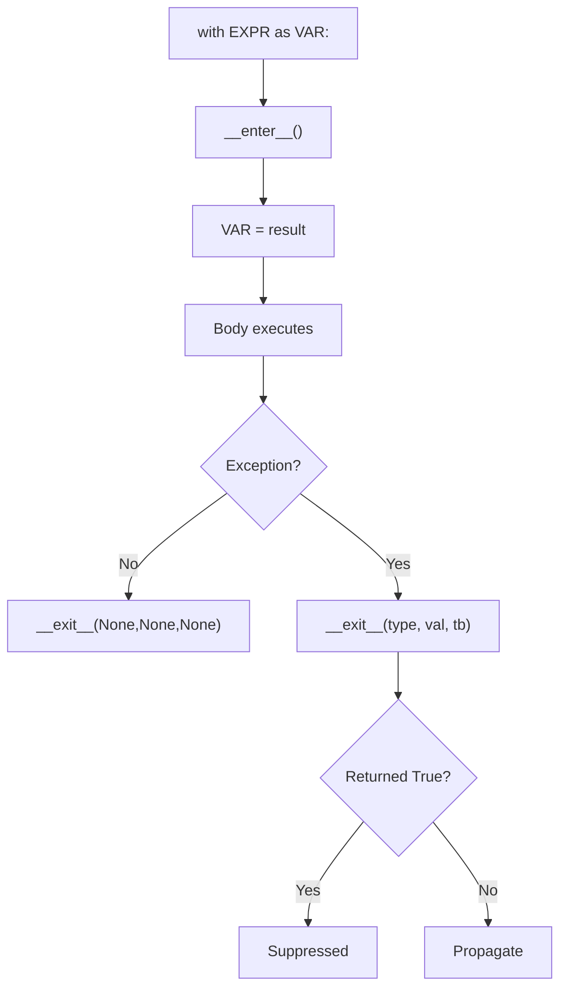
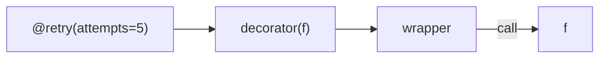
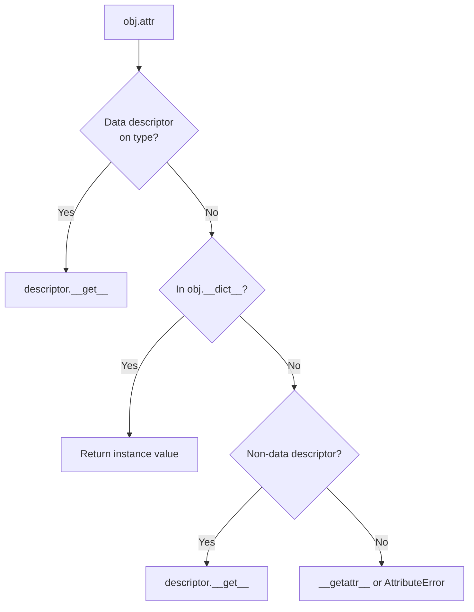
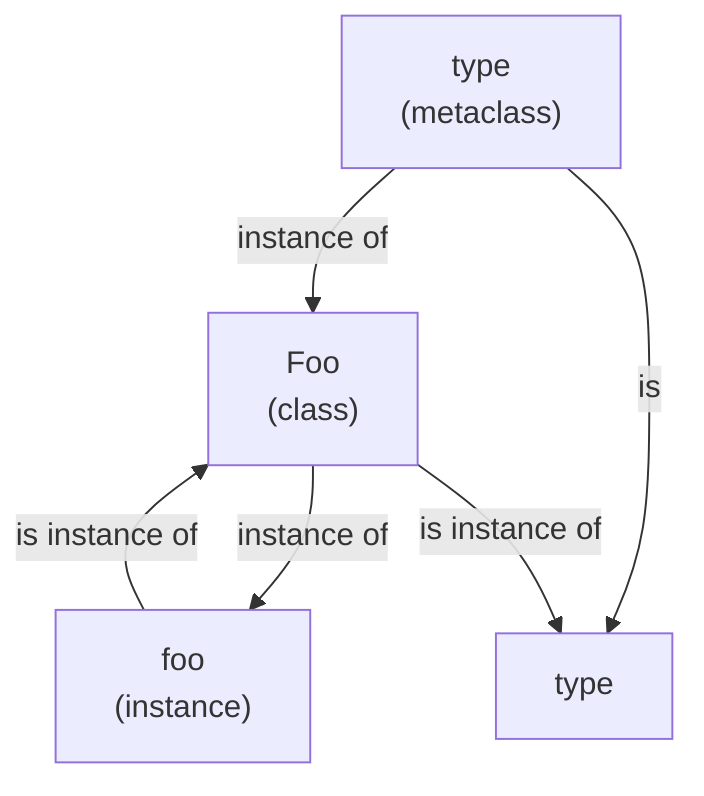
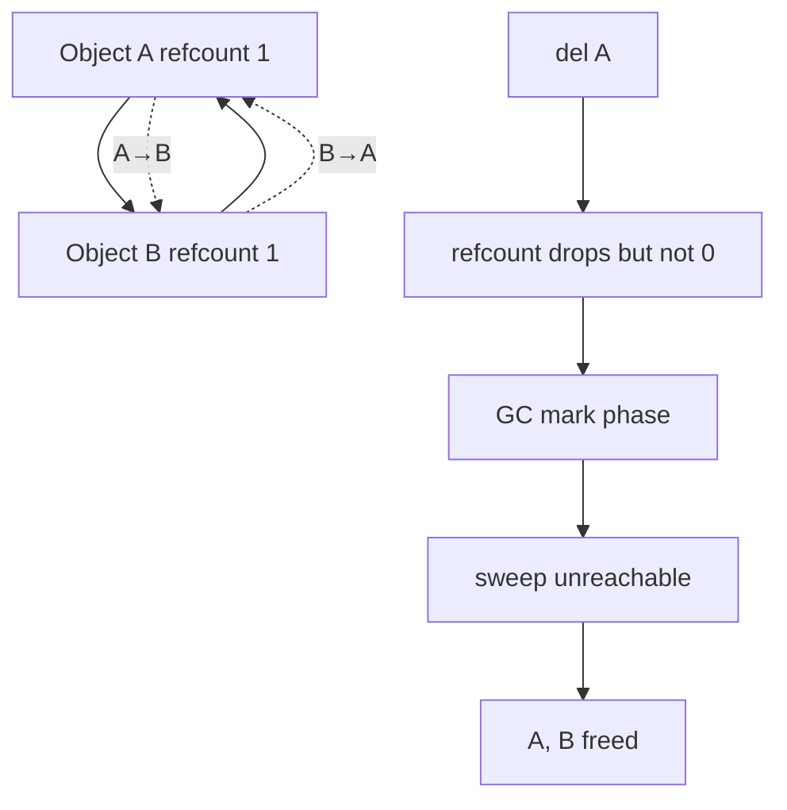
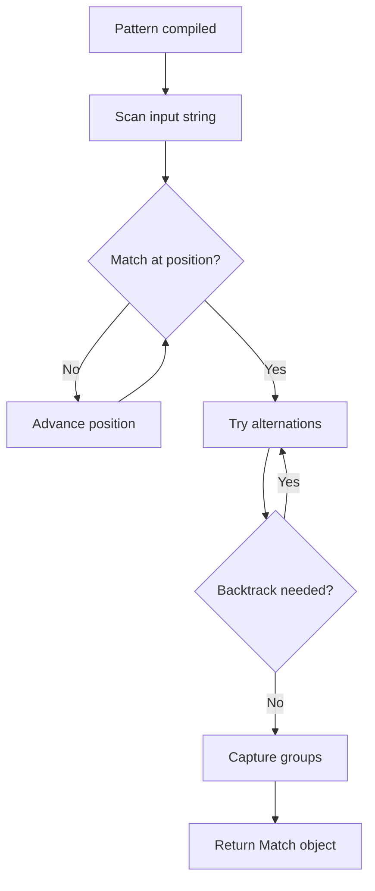
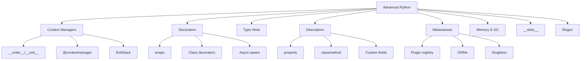
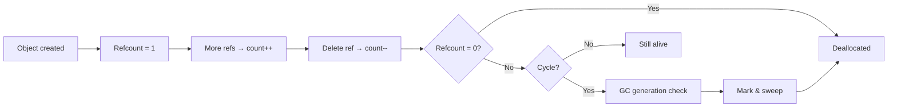
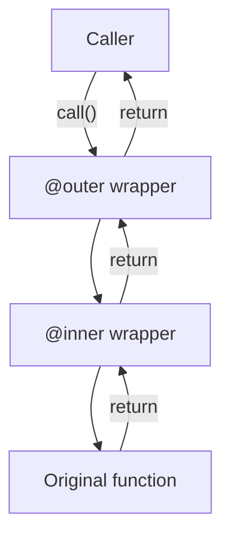

# Advanced Python — Detailed Notes

---

## 1. Context Managers

### What Is It?

A **context manager** is an object that defines setup and teardown logic around a block of code. The `with` statement guarantees the teardown runs — even on exceptions, `return`, or `break`.

The protocol:
- **`__enter__`** — runs on entry; return value is bound to the `as` target.
- **`__exit__(exc_type, exc_val, exc_tb)`** — runs on exit; return `True` to suppress the exception.

### Under the Hood

```python
with EXPR as VAR:
    BODY

# is equivalent to:
mgr = EXPR
VAR = type(mgr).__enter__(mgr)
try:
    BODY
except BaseException as e:
    if not type(mgr).__exit__(mgr, type(e), e, e.__traceback__):
        raise
else:
    type(mgr).__exit__(mgr, None, None, None)
```

`__exit__` receives the exception triplet (or three `None`s). Return `True` to swallow, `False` (or `None`) to propagate.



### Class-Based Context Manager

```python
class File:
    def __init__(self, path, mode="r"):
        self.path = path
        self.mode = mode
        self.file = None

    def __enter__(self):
        self.file = open(self.path, self.mode)
        return self.file

    def __exit__(self, exc_type, exc, tb):
        if self.file:
            self.file.close()
        return False    # don't suppress

with File("data.txt") as f:
    data = f.read()
```

### Generator-Based Context Manager — `contextlib.contextmanager`

```python
from contextlib import contextmanager

@contextmanager
def timer(label):
    import time
    start = time.perf_counter()
    try:
        yield                            # execution pauses here
    finally:
        elapsed = time.perf_counter() - start
        print(f"{label}: {elapsed:.3f}s")

with timer("process"):
    do_work()
```

Code before `yield` = `__enter__`; code after = `__exit__` (in the `finally`). The `yield` value is what `as` binds.

### `contextlib` Toolkit

| Tool | Purpose |
|---|---|
| `contextmanager` | Turn a generator into a CM |
| `suppress(*exceptions)` | Ignore specific exceptions |
| `closing(thing)` | Call `.close()` on exit |
| `nullcontext()` | No-op context (placeholder) |
| `ExitStack` | Manage dynamic sets of CMs |
| `AsyncExitStack` | Async variant |
| `asynccontextmanager` | Async generator CM |

**`suppress`:**

```python
from contextlib import suppress

with suppress(FileNotFoundError):
    os.remove("temp.txt")
```

**`closing`:**

```python
from contextlib import closing
from urllib.request import urlopen

with closing(urlopen("https://example.com")) as page:
    content = page.read()
```

**`nullcontext`:**

```python
from contextlib import nullcontext

def process(lock=None):
    with lock or nullcontext():
        do_work()
```

### `ExitStack` — Dynamic Contexts

```python
from contextlib import ExitStack

with ExitStack() as stack:
    files = [stack.enter_context(open(f"f{i}.txt")) for i in range(10)]
    # all closed when the block exits, in reverse order
    for f in files:
        print(f.read())
```

`ExitStack` also handles callbacks:

```python
with ExitStack() as stack:
    stack.callback(cleanup_a)
    stack.callback(cleanup_b, arg1, arg2)
    # cleanups run LIFO on exit
```

### Suppressing Exceptions from `__exit__`

```python
class Suppress:
    def __init__(self, *exceptions):
        self.exceptions = exceptions

    def __enter__(self):
        return self

    def __exit__(self, exc_type, exc, tb):
        return exc_type is not None and issubclass(exc_type, self.exceptions)
```

### Reentrant vs Reusable

Most context managers are **single-use** — they set up state on `__enter__` and clean it on `__exit__`. Reusing the same instance usually fails.

```python
# ❌ Reusing
cm = File("data.txt")
with cm: pass
with cm: pass    # may work or fail — usually undefined

# ✅ Fresh instance
with File("data.txt"): pass
with File("data.txt"): pass
```

`contextlib.contextmanager` yields a **new generator** per call, so each `with` gets a fresh one.

### Real-World Examples

**Database transaction:**

```python
@contextmanager
def transaction(conn):
    try:
        yield conn
        conn.commit()
    except Exception:
        conn.rollback()
        raise
```

**Locking:**

```python
import threading

lock = threading.Lock()
with lock:
    critical_section()
```

**Temporary directory:**

```python
from contextlib import contextmanager
import tempfile, shutil

@contextmanager
def temp_dir():
    d = tempfile.mkdtemp()
    try:
        yield d
    finally:
        shutil.rmtree(d)
```

**Redirect stdout:**

```python
from contextlib import redirect_stdout
import io

buffer = io.StringIO()
with redirect_stdout(buffer):
    print("captured")
buffer.getvalue()        # 'captured\n'
```

### Comparison Table

| Approach | Boilerplate | Async-aware | Reusable |
|---|---|---|---|
| Class with `__enter__`/`__exit__` | Higher | Yes (`__aenter__`) | Depends |
| `@contextmanager` | Lower | No | Yes (fresh gen) |
| `@asynccontextmanager` | Lower | Yes | Yes |

---

## 2. Decorators — Deep Dive

### Review — Decorator Basics

```python
def deco(f):
    @wraps(f)
    def wrapper(*args, **kwargs):
        return f(*args, **kwargs)
    return wrapper

@deco
def g(): ...
```

`@deco` is syntactic sugar for `g = deco(g)`.

### Layer Taxonomy

| Form | Signature | Example |
|---|---|---|
| No args | `def d(f): ...` | `@timed` |
| With args | `def d(*a, **kw): def inner(f): ...; return inner` | `@retry(3)` |
| Class-based | `class D: def __init__(self, f); def __call__` | Stateful |
| Partial (via `functools.wraps`) | `@partial(deco, arg)` | Rare |
| Async | `async def wrapper(...)` | Async funcs |

### Decorator with Arguments — Full Layering

```python
def retry(attempts=3, delay=1):
    def decorator(f):
        @wraps(f)
        def wrapper(*args, **kwargs):
            last_exc = None
            for i in range(attempts):
                try:
                    return f(*args, **kwargs)
                except Exception as e:
                    last_exc = e
                    if i < attempts - 1:
                        time.sleep(delay * 2 ** i)
            raise last_exc
        return wrapper
    return decorator

@retry(attempts=5, delay=0.5)
def flaky(): ...
```

Composition chain:



### Class-Based Decorator with State

```python
class CountCalls:
    def __init__(self, f):
        wraps(f)(self)
        self.f = f
        self.count = 0

    def __call__(self, *args, **kwargs):
        self.count += 1
        return self.f(*args, **kwargs)

@CountCalls
def hello():
    return "hi"

hello(); hello()
hello.count              # 2
```

Or with arguments:

```python
class Retry:
    def __init__(self, attempts=3):
        self.attempts = attempts

    def __call__(self, f):
        @wraps(f)
        def wrapper(*args, **kwargs):
            for i in range(self.attempts):
                try:
                    return f(*args, **kwargs)
                except Exception:
                    if i == self.attempts - 1:
                        raise
        return wrapper

@Retry(attempts=5)
def flaky(): ...
```

### `functools.wraps` — Restoring Metadata

Without it, `wrapper.__name__ == "wrapper"` — breaking introspection, `help()`, and doc generation.

```python
from functools import wraps

def deco(f):
    @wraps(f)
    def wrapper(*args, **kwargs):
        return f(*args, **kwargs)
    return wrapper
```

`wraps` copies: `__module__`, `__name__`, `__qualname__`, `__doc__`, `__dict__`, `__wrapped__`.

Access the original via `wrapper.__wrapped__` or `inspect.unwrap(wrapper)`.

### Decorator for Async Functions

A **regular** decorator breaking async:

```python
def bad_deco(f):
    def wrapper(*args, **kwargs):
        return f(*args, **kwargs)    # returns a coroutine, not awaited
    return wrapper

@bad_deco
async def fetch(): ...

asyncio.run(fetch())    # ❌ — wrapper returns a coroutine, but not awaitable properly
```

Async-aware decorator:

```python
def good_deco(f):
    @wraps(f)
    async def wrapper(*args, **kwargs):
        return await f(*args, **kwargs)
    return wrapper
```

Universal (sync + async) decorator:

```python
import inspect

def universal_deco(f):
    if inspect.iscoroutinefunction(f):
        @wraps(f)
        async def wrapper(*args, **kwargs):
            return await f(*args, **kwargs)
    else:
        @wraps(f)
        def wrapper(*args, **kwargs):
            return f(*args, **kwargs)
    return wrapper
```

### Decorating Methods

```python
class Service:
    @timed
    def process(self, x):
        return x * 2
```

`timed` sees the method as a regular function; `self` arrives through `*args`. Works transparently.

Decorating **classmethods** requires order:

```python
class C:
    @classmethod
    @my_decorator          # runs first (bottom-up)
    def method(cls): ...

    @my_decorator
    @classmethod           # classmethod applied first, then decorator
    def other(cls): ...
```

### Stacking — Order Matters

```python
@A
@B
@C
def f(): ...

# equivalent to:
f = A(B(C(f)))
```

- **Bottom-most runs first** — `C` wraps `f`, then `B` wraps that, then `A`.
- **Call order**: `A`'s wrapper runs first, then `B`'s, then `C`'s, then `f`.

### Parameterized Decorator — Alternate Form

```python
def my_deco(func=None, *, option=False):
    def inner(f):
        @wraps(f)
        def wrapper(*args, **kwargs):
            return f(*args, **kwargs)
        return wrapper

    if func is None:
        return inner
    return inner(func)

@my_deco                          # no parens
def f(): ...

@my_deco(option=True)             # with args
def g(): ...
```

### Decorator Registry Pattern

```python
REGISTRY = {}

def register(name):
    def deco(cls):
        REGISTRY[name] = cls
        return cls
    return deco

@register("email")
class EmailHandler:
    ...

REGISTRY["email"]                 # EmailHandler
```

Common in plugin architectures and web frameworks.

### `contextlib.ContextDecorator` — Decorator from CM

```python
from contextlib import ContextDecorator

class timed(ContextDecorator):
    def __enter__(self):
        import time
        self.start = time.perf_counter()
        return self

    def __exit__(self, *exc):
        print(f"{time.perf_counter() - self.start:.3f}s")
        return False

@timed                            # works as decorator
def f(): ...

with timed():                     # works as context manager
    ...
```

### Quick Comparison

| Feature | Function decorator | Class decorator | `ContextDecorator` |
|---|---|---|---|
| No args | `def d(f)` | `class D: __call__` | Inherit + `__enter__/__exit__` |
| With args | Nested functions | `__init__` + `__call__` | Same |
| State | Closure cell | Instance attrs | Instance attrs |
| Async | `async def wrapper` | Wrap separately | Manual |
| Usable as CM | ❌ | ❌ | ✅ |

---

## 3. Type Hints / Typing — Deep Dive

### The `typing` Module

Since 3.9+, most types are **built-in generics**:

```python
# Old (pre-3.9)
from typing import List, Dict, Tuple, Set

def f(x: List[int]) -> Dict[str, int]: ...

# New (3.9+)
def f(x: list[int]) -> dict[str, int]: ...
```

Since 3.10, unions use `|`:

```python
def f(x: int | str | None) -> None: ...
```

### Type Aliases

```python
Vector = list[float]
Matrix = list[list[float]]
JSON = dict[str, "JSON"] | list["JSON"] | str | int | float | bool | None
```

### `TypeVar` — Generics

```python
from typing import TypeVar

T = TypeVar("T")                     # any type
N = TypeVar("N", int, float)         # numeric bound

def first(items: list[T]) -> T:
    return items[0]

def add(a: N, b: N) -> N:
    return a + b
```

**Constraints** vs **bound**:

```python
T = TypeVar("T", int, str)           # constraint — must be int OR str
T = TypeVar("T", bound="Comparable") # bound — must be subclass of Comparable
```

### `Generic` — Custom Generic Classes

```python
from typing import Generic, TypeVar

T = TypeVar("T")

class Stack(Generic[T]):
    def __init__(self) -> None:
        self._items: list[T] = []

    def push(self, item: T) -> None:
        self._items.append(item)

    def pop(self) -> T:
        return self._items.pop()

stack: Stack[int] = Stack()
stack.push(1)
stack.push("no")                     # type checker error
```

Python 3.12 adds the new syntax:

```python
class Stack[T]:
    def push(self, item: T) -> None: ...
```

### `Protocol` — Structural Typing

```python
from typing import Protocol

class Drawable(Protocol):
    def draw(self) -> None: ...

def render(x: Drawable) -> None:
    x.draw()

class Circle:
    def draw(self) -> None: ...

render(Circle())                     # ✅ — no inheritance needed
```

Protocols define **shape**, not identity. Runtime-checkable:

```python
from typing import Protocol, runtime_checkable

@runtime_checkable
class Drawable(Protocol):
    def draw(self) -> None: ...

isinstance(Circle(), Drawable)       # True
```

Runtime `isinstance` with Protocols only checks **method presence**, not signatures.

### `TypedDict` — Typed Dictionaries

```python
from typing import TypedDict

class User(TypedDict):
    name: str
    age: int

u: User = {"name": "Ada", "age": 36}
u["email"]                           # ❌ mypy: key not defined
```

Optional keys via inheritance:

```python
class UserBase(TypedDict):
    name: str

class UserFull(UserBase, total=False):
    email: str
    phone: str
```

### `Literal` — Specific Values

```python
from typing import Literal

def set_mode(mode: Literal["r", "w", "a"]) -> None: ...

set_mode("r")                        # ✅
set_mode("x")                        # ❌ type checker error
```

### `Annotated` — Metadata on Types

```python
from typing import Annotated

def send(host: Annotated[str, "must be a hostname"]) -> None: ...

# Runtime metadata access
from typing import get_type_hints
get_type_hints(send, include_extras=True)
```

Used by `pydantic`, `FastAPI`, and validation frameworks.

### `Callable`

```python
from typing import Callable

def apply(f: Callable[[int, str], bool], x: int, s: str) -> bool:
    return f(x, s)
```

For any callable with flexible args:

```python
Callable[..., int]                   # any args → int
```

### `overload` — Multiple Signatures

```python
from typing import overload

@overload
def parse(x: str) -> str: ...
@overload
def parse(x: bytes) -> str: ...
def parse(x):                        # actual implementation
    if isinstance(x, bytes):
        return x.decode()
    return str(x)
```

Type checkers use the `@overload` signatures; the runtime uses the last definition.

### `Self` (3.11+)

```python
from typing import Self

class Builder:
    def add(self, x: int) -> Self:
        ...
        return self

Builder().add(1).add(2)
```

Preserves subclass types in fluent APIs.

### `Final` — Prevent Overriding

```python
from typing import Final

MAX: Final[int] = 100

class C:
    def method(self) -> Final[int]: ...    # not overridable
```

### `ClassVar` — Class Attributes

```python
from typing import ClassVar

class Counter:
    instances: ClassVar[int] = 0           # class-level, not per-instance

    def __init__(self):
        Counter.instances += 1
```

### `TYPE_CHECKING` — Deferred Imports

```python
from typing import TYPE_CHECKING

if TYPE_CHECKING:
    from expensive_module import HeavyType    # only imported by type checkers

def f(x: "HeavyType") -> None: ...
```

Avoids runtime cost of importing for type-only use.

### Forward References

```python
class Node:
    def __init__(self, next: "Node | None" = None):
        self.next = next
```

Or with PEP 563:

```python
from __future__ import annotations

class Node:
    def __init__(self, next: Node | None = None):    # no quotes needed
        self.next = next
```

### Runtime Type Inspection

```python
import typing

typing.get_type_hints(f)             # resolved hints
f.__annotations__                    # raw annotations
typing.get_origin(list[int])         # list
typing.get_args(list[int])           # (int,)
```

### Type Checkers

| Tool | Speed | Popularity | Notes |
|---|---|---|---|
| `mypy` | Medium | High | Reference implementation |
| `pyright` | Fast | High | VS Code, TypeScript-adjacent |
| `pyre` | Fast | Medium | Facebook |
| `pytype` | Medium | Low | Google |
| `pyanalyze` | Medium | Low | Quora |

### Runtime Validation

```python
from pydantic import BaseModel

class User(BaseModel):
    name: str
    age: int
    email: str | None = None

u = User(name="Ada", age=36)
u.age = "old"                        # ✅ validates at runtime — raises
```

Or `beartype`:

```python
from beartype import beartype

@beartype
def add(a: int, b: int) -> int:
    return a + b

add(1, 2)                            # ✅
add("a", "b")                        # ❌ raises at runtime
```

### Best Practices

- **Annotate public API** — always.
- **Annotate tricky internals** — especially with generics.
- **Skip trivial locals** — `x: int = 1` is redundant.
- **Use `TYPE_CHECKING`** for circular imports.
- **Run a type checker in CI.**
- **Use `Literal`, `Annotated`, and `TypedDict`** for structure.
- **Avoid `Any`** unless truly unknowable.
- **Consider `Protocol`** over inheritance for flexibility.

### Common Type Hint Patterns

```python
from typing import Any, Iterator, Iterable, Sequence, Mapping, Optional, Union

def read(it: Iterable[int]) -> Iterator[str]: ...
def find(key: str, d: Mapping[str, int]) -> Optional[int]: ...
def merge(a: Sequence[int], b: Sequence[int]) -> list[int]: ...
def log(data: Any) -> None: ...
```

### Summary Table

| Feature | Python version | Syntax |
|---|---|---|
| Basic hints | 3.0 | `x: int` |
| Built-in generics | 3.9 | `list[int]` |
| Union `\|` | 3.10 | `int \| str` |
| Type parameter syntax | 3.12 | `class Stack[T]` |
| `Self` | 3.11 | `-> Self` |
| `Literal` | 3.8 | `Literal["a", "b"]` |
| `Protocol` | 3.8 | `class P(Protocol): ...` |
| `TypedDict` | 3.8 | `class T(TypedDict): ...` |
| `Annotated` | 3.9 | `Annotated[int, "meta"]` |

---

## 4. Descriptors

### What Is a Descriptor?

A **descriptor** is an object that defines `__get__`, `__set__`, or `__delete__`. When a class attribute is a descriptor, attribute access on **instances** of that class routes through the descriptor methods.

Descriptors are how `@property`, `@classmethod`, `@staticmethod`, and `functools.cached_property` all work.

### The Descriptor Protocol

```python
class Descriptor:
    def __get__(self, obj, objtype=None):
        """Called when accessed as obj.attr — obj is None for class access."""
        ...

    def __set__(self, obj, value):
        """Called on obj.attr = value."""
        ...

    def __delete__(self, obj):
        """Called on del obj.attr."""
        ...
```

### Minimal Example

```python
class Positive:
    def __set_name__(self, owner, name):
        self.name = f"_{name}"

    def __get__(self, obj, objtype=None):
        if obj is None:
            return self
        return getattr(obj, self.name)

    def __set__(self, obj, value):
        if value < 0:
            raise ValueError("must be positive")
        setattr(obj, self.name, value)


class Product:
    price = Positive()

    def __init__(self, price):
        self.price = price


p = Product(10)
p.price          # 10
p.price = 20     # ✅
p.price = -5     # ❌ ValueError
```

### Data vs Non-Data Descriptors

| | Data descriptor | Non-data descriptor |
|---|---|---|
| Defines | `__get__` + `__set__` (or `__delete__`) | `__get__` only |
| Precedence | **Beats** instance `__dict__` | **Loses** to instance `__dict__` |
| Example | `property` | function, `staticmethod` |

Attribute lookup order:

1. **Data descriptor** on type.
2. Instance `__dict__`.
3. **Non-data descriptor** on type.
4. `__getattr__` fallback.



### `__set_name__` (3.6+)

Called when the descriptor is assigned as a class attribute — lets the descriptor know its own name:

```python
class Field:
    def __set_name__(self, owner, name):
        self.name = name

    def __get__(self, obj, objtype=None):
        if obj is None:
            return self
        return obj.__dict__.get(self.name)

    def __set__(self, obj, value):
        obj.__dict__[self.name] = value
```

### Descriptors vs `property`

`property` **is** a data descriptor implemented in C:

```python
class C:
    @property
    def x(self): return self._x

# equivalent to:
class C:
    def _get_x(self): return self._x
    x = property(_get_x)
```

For simple getter/setter/validation, use `property`. For **reusable** descriptors (applied to many classes), write a descriptor class.

### Descriptor vs `__getattr__`/`__setattr__`

| | Descriptor | `__getattr__`/`__setattr__` |
|---|---|---|
| Scope | One attribute per descriptor | All attributes on class |
| Reusable | ✅ across classes | ❌ per class |
| Precedence | Follows protocol order | Falls to these when others miss |
| Performance | Fast | Slower |

### Common Descriptor Patterns

**Type-checking field:**

```python
class Typed:
    def __init__(self, expected_type):
        self.expected_type = expected_type

    def __set_name__(self, owner, name):
        self.name = f"_{name}"

    def __get__(self, obj, objtype=None):
        if obj is None:
            return self
        return getattr(obj, self.name, None)

    def __set__(self, obj, value):
        if not isinstance(value, self.expected_type):
            raise TypeError(f"{self.name} must be {self.expected_type}")
        setattr(obj, self.name, value)


class User:
    name = Typed(str)
    age = Typed(int)
```

**Lazy initialization:**

```python
class Lazy:
    def __init__(self, func):
        self.func = func

    def __set_name__(self, owner, name):
        self.name = f"_{name}"

    def __get__(self, obj, objtype=None):
        if obj is None:
            return self
        if not hasattr(obj, self.name):
            setattr(obj, self.name, self.func(obj))
        return getattr(obj, self.name)
```

**Cached property (simplified):**

```python
class cached_property:
    def __init__(self, func):
        self.func = func
        self.__doc__ = func.__doc__

    def __set_name__(self, owner, name):
        self.name = name

    def __get__(self, obj, objtype=None):
        if obj is None:
            return self
        value = self.func(obj)
        obj.__dict__[self.name] = value    # cache on the instance
        return value
```

Note: this is a **non-data** descriptor (no `__set__`) — so subsequent lookups hit `obj.__dict__` directly, bypassing the descriptor. This is why `cached_property` is fast after the first access.

### Descriptors in the Standard Library

| Class | Type | Purpose |
|---|---|---|
| `property` | Data descriptor | Computed attributes |
| `classmethod` | Non-data descriptor | Bind to class |
| `staticmethod` | Non-data descriptor | No binding |
| `functools.cached_property` | Non-data descriptor | Cached computation |
| `__slots__` slots | Data descriptor | Fixed attribute layout |

### Performance

Descriptors add a small overhead per access — a Python function call for each `__get__`. For hot loops, caching in `__init__` or using `__slots__` avoids this.

```python
import timeit

class WithDescriptor:
    x = property(lambda self: self._x)
    def __init__(self): self._x = 1

class Plain:
    def __init__(self): self.x = 1

timeit.timeit("obj.x", setup="obj = WithDescriptor()", number=1_000_000)
# ~0.15 s
timeit.timeit("obj.x", setup="obj = Plain()", number=1_000_000)
# ~0.05 s — 3× faster
```

### When to Use Descriptors

- **Reusable validation** across many classes.
- **Computed/cached** attributes with fine control.
- **Framework internals** (ORM fields, form fields).
- **Lazy initialization** patterns.

For one-off validation on a class — use `property`.

---

## 5. Metaclasses

### What Is a Metaclass?

A **metaclass** is the class of a class. Just as objects are instances of classes, classes are instances of metaclasses.

```python
class Foo: pass

type(Foo)         # <class 'type'> — the metaclass
type(3)           # <class 'int'> — an instance's class
type(int)         # <class 'type'> — the class of int
isinstance(Foo, type)     # True
```

Default metaclass: **`type`**. `type(name, bases, namespace)` creates a class dynamically.

### The Three-Argument `type()`

```python
Foo = type("Foo", (object,), {"x": 1, "greet": lambda self: "hi"})

f = Foo()
f.x               # 1
f.greet()         # 'hi'
```

`class Foo: ...` is syntactic sugar for `type("Foo", ..., ...)`.

### Creating a Custom Metaclass

```python
class Meta(type):
    def __new__(mcs, name, bases, namespace):
        print(f"creating class {name}")
        cls = super().__new__(mcs, name, bases, namespace)
        return cls

class Foo(metaclass=Meta):
    pass

# prints: creating class Foo
```

### Metaclass Methods

| Method | Called when |
|---|---|
| `__new__(mcs, name, bases, ns)` | Before class creation |
| `__init__(cls, name, bases, ns)` | After class creation |
| `__call__(cls, *args)` | When an instance is created |
| `__prepare__(name, bases)` | Returns namespace dict for class body |

### `__prepare__` — Custom Namespace

```python
class OrderedMeta(type):
    @classmethod
    def __prepare__(mcs, name, bases):
        from collections import OrderedDict
        return OrderedDict()

    def __new__(mcs, name, bases, namespace):
        print(list(namespace.keys()))    # preserves order
        return super().__new__(mcs, name, bases, dict(namespace))

class Foo(metaclass=OrderedMeta):
    x = 1
    y = 2
    z = 3
```

### Enforcing Class Rules — Registry Pattern

```python
class RegistryMeta(type):
    registry = {}

    def __new__(mcs, name, bases, namespace):
        cls = super().__new__(mcs, name, bases, namespace)
        if name != "Base":
            mcs.registry[name] = cls
        return cls


class Base(metaclass=RegistryMeta):
    pass


class PluginA(Base):
    pass


class PluginB(Base):
    pass


RegistryMeta.registry
# {'PluginA': <class 'PluginA'>, 'PluginB': <class 'PluginB'>}
```

### Singleton Metaclass

```python
class SingletonMeta(type):
    _instances = {}

    def __call__(cls, *args, **kwargs):
        if cls not in cls._instances:
            cls._instances[cls] = super().__call__(*args, **kwargs)
        return cls._instances[cls]


class Config(metaclass=SingletonMeta):
    pass


Config() is Config()     # True
```

### `__init_subclass__` — The Modern Alternative

Before reaching for a metaclass, consider `__init_subclass__` (PEP 487) — it handles most registration and validation needs without metaclass complexity:

```python
class Plugin:
    registry = {}

    def __init_subclass__(cls, **kwargs):
        super().__init_subclass__(**kwargs)
        Plugin.registry[cls.__name__] = cls


class MyPlugin(Plugin):
    pass

Plugin.registry          # {'MyPlugin': <class 'MyPlugin'>}
```

### `__set_name__` — Descriptor Hook

Also from PEP 487 — lets descriptors know their own name:

```python
class Field:
    def __set_name__(self, owner, name):
        self.name = name


class Model:
    x = Field()
    y = Field()

Model.x.name             # 'x'
```

### Metaclass vs `__init_subclass__` vs Class Decorators

| Approach | Complexity | Use for |
|---|---|---|
| `__init_subclass__` | Low | Registration, validation of subclasses |
| Class decorators | Low | Post-process a single class |
| Metaclass | High | Alter class creation for **all** classes |
| `__set_name__` | Low | Descriptors self-aware |

**Recommendation:** try `__init_subclass__`, then class decorators, then metaclasses last.

### Metaclass Conflict

A class can only have one metaclass; when inheriting, the metaclasses must be **compatible** (one is a subclass of the other).

```python
class MetaA(type): pass
class MetaB(type): pass

class A(metaclass=MetaA): pass
class B(metaclass=MetaB): pass

class C(A, B):                # ❌ metaclass conflict
    pass
```

Fix: create a combined metaclass:

```python
class CombinedMeta(MetaA, MetaB): pass

class C(A, B, metaclass=CombinedMeta): pass
```

### Real Metaclass Uses

- **ORMs** (Django, SQLAlchemy): collect fields from class body.
- **ABCs**: `ABCMeta` enforces abstract methods.
- **Enums**: `EnumMeta` builds enum members.
- **Singletons** and **service locators**.
- **API serializers** (Pydantic, marshmallow).

### Example — Enforcing a Class Attribute

```python
class RequireTableName(type):
    def __new__(mcs, name, bases, namespace):
        if name != "Model" and "table_name" not in namespace:
            raise TypeError(f"{name} must define table_name")
        return super().__new__(mcs, name, bases, namespace)


class Model(metaclass=RequireTableName):
    pass


class User(Model):               # ❌ TypeError
    pass


class Post(Model):               # ✅
    table_name = "posts"
```

### Mermaid — Metaclass Chain



- Instance's type is its class.
- Class's type is its metaclass.
- Metaclass's type is `type` (self-referential).

---

## 6. Memory Model & Garbage Collection

### Python's Object Model

Everything is an object with:
- **`id`** — memory address (unique while alive).
- **`type`** — pointer to a class.
- **`refcount`** — number of references.
- **Payload** — value or slots.

```python
import sys

x = [1, 2, 3]
sys.getrefcount(x)        # 2 (x + the argument to getrefcount)

y = x
sys.getrefcount(x)        # 3
del y
sys.getrefcount(x)        # 2
```

`getrefcount` returns one more than expected — the argument itself adds a reference.

### Reference Counting

Each assignment, function call, or container addition increments the count; each deletion decrements it. When it reaches zero, the object is deallocated immediately.

```python
a = [1, 2, 3]             # refcount = 1
b = a                     # refcount = 2
c = [a, a]                # refcount = 4
del b                     # refcount = 3
del c                     # refcount = 1
del a                     # refcount = 0 → deallocated
```

### Cycles — When Refcounting Fails

```python
class Node:
    def __init__(self):
        self.ref = None

a = Node()
a.ref = a                # self-cycle → refcount never hits zero
del a                    # leaked (until GC runs)
```

The **cyclic garbage collector** detects these via mark-and-sweep.

### Generational GC

CPython's GC uses **three generations**:

| Generation | Threshold | Scanned |
|---|---|---|
| 0 | 700 allocations | Most frequent |
| 1 | 10 gen-0 collections | Less frequent |
| 2 | 10 gen-1 collections | Rare |

Objects start in gen-0; survivors are promoted. Older generations are scanned less often — the "weak generational hypothesis" (most objects die young).

```python
import gc

gc.get_threshold()        # (700, 10, 10)
gc.collect()              # force a full collection
gc.get_count()            # current counts per generation
gc.get_stats()            # cumulative stats
gc.disable() / gc.enable()
```

### `gc` Module — Reference Cycles

```python
import gc

gc.collect()              # trigger collection
gc.get_objects()          # list all tracked objects
gc.is_tracked(obj)        # is this object GC-tracked?
gc.garbage               # uncollectable objects (rare)
gc.freeze()              # exclude current objects from future collections
gc.unfreeze()
```

### `__del__` — Finalizer

```python
class Resource:
    def __init__(self, name):
        self.name = name

    def __del__(self):
        print(f"cleanup {self.name}")

r = Resource("db")
del r                    # prints "cleanup db"
```

Caveats:
- **Order not guaranteed** — especially during interpreter shutdown.
- **Exceptions in `__del__` are ignored** (just printed to stderr).
- **Not called for cyclic garbage** in some cases.
- **Blocks GC** — objects with `__del__` in cycles may not be collected until 3.4+ (`PEP 442` fixes this).

Prefer explicit `close()` or context managers over `__del__`.

### `weakref` — Non-Owning References

A **weak reference** doesn't increment refcount — the object can be collected when only weak refs remain.

```python
import weakref

class Cache:
    pass

obj = Cache()
ref = weakref.ref(obj)

ref()                    # <Cache object> — alive
del obj
ref()                    # None — collected
```

Common uses:
- **Caches** that shouldn't prevent GC.
- **Observer patterns** (subscribers don't own publishers).
- **Back-references** in tree structures.

`WeakValueDictionary` and `WeakKeyDictionary`:

```python
from weakref import WeakValueDictionary

cache = WeakValueDictionary()
cache["key"] = BigObject()      # collected when no other refs remain
```

### `sys.getsizeof` vs Actual Memory

`sys.getsizeof` returns the size of the object **header + direct payload** — not nested objects.

```python
import sys

lst = [1, 2, 3]
sys.getsizeof(lst)               # 88 bytes — list object only
# ints are separate: 28 bytes each
```

For a **deep** size estimate, use `pympler`:

```python
from pympler import asizeof

asizeof.asizeof([1, 2, 3])       # total including elements
```

### Memory Layout of Common Types

| Type | Fixed size | Notes |
|---|---|---|
| `int` (small) | 28 bytes | Varies for bignums |
| `float` | 24 bytes | |
| `bool` | 28 bytes | Same as int |
| `str` (empty) | 49 bytes | + data |
| `list` (empty) | 56 bytes | + 8 bytes/slot |
| `tuple` (empty) | 40 bytes | + 8 bytes/slot |
| `dict` (empty) | 64 bytes | + entries |
| `set` (empty) | 216 bytes | + entries |

### `__slots__` (See §7)

Avoids per-instance `__dict__` — saves ~50% memory per instance.

### Deallocation Order

When refcount hits zero, CPython:
1. Calls finalizers (`__del__`).
2. Clears references held by the object (this decrements refcounts of contained objects).
3. Frees the memory.

This cascades — deleting a list deletes all its items (if no other refs).

### Memory Profiling Tools

| Tool | Purpose |
|---|---|
| `sys.getsizeof` | Size of one object |
| `tracemalloc` | Python allocation traces |
| `objgraph` | Object graph visualization |
| `pympler` | Deep size, class tracking |
| `memory_profiler` | Line-by-line memory |

**`tracemalloc`:**

```python
import tracemalloc

tracemalloc.start()
# ... run code ...
snapshot = tracemalloc.take_snapshot()
for stat in snapshot.statistics("lineno")[:10]:
    print(stat)
```

### Common Memory Leaks

1. **Uncleared caches** — dicts that grow unbounded.
2. **Event handlers** — registered callbacks never removed.
3. **Cycles with `__del__`** (pre-3.4).
4. **Closures capturing large data**.
5. **Global registries** — long-lived references.
6. **Thread-local storage** — per-thread references kept alive.

### Mermaid — GC Cycle Detection



The cycle survives refcounting but is caught by the generational collector.

---

## 7. `__slots__`

### The Problem

By default, every instance has a `__dict__` — a hash table storing instance attributes:

```python
class Point:
    def __init__(self, x, y):
        self.x = x
        self.y = y

p = Point(1, 2)
p.__dict__            # {'x': 1, 'y': 2}
sys.getsizeof(p)      # 48
sys.getsizeof(p.__dict__)    # 104
```

That dict overhead (~104 bytes) is significant for many small instances.

### `__slots__` — Fixed Attribute Layout

```python
class Point:
    __slots__ = ("x", "y")

    def __init__(self, x, y):
        self.x = x
        self.y = y

p = Point(1, 2)
p.__dict__            # ❌ AttributeError — no __dict__
p.x                   # 1
p.z = 3               # ❌ AttributeError
```

Slots are implemented as **data descriptors** — one slot per attribute, laid out inline in the object.

### Memory Savings

```python
import sys

class WithoutSlots:
    def __init__(self, x, y):
        self.x, self.y = x, y

class WithSlots:
    __slots__ = ("x", "y")
    def __init__(self, x, y):
        self.x, self.y = x, y

sys.getsizeof(WithoutSlots(1, 2))     # 48
sys.getsizeof(WithSlots(1, 2))        # 48
# But the __dict__ overhead is eliminated:
sys.getsizeof(WithoutSlots(1, 2).__dict__)   # 104
```

**Total** for 1M instances:

| | Without slots | With slots | Savings |
|---|---|---|---|
| Per instance | ~152 bytes | ~48 bytes | **~68%** |
| 1M instances | ~150 MB | ~50 MB | ~100 MB |

### Speed Improvement

Attribute lookup via slot descriptors is slightly faster than dict lookup:

```python
import timeit

timeit.timeit("obj.x", setup="obj = WithSlots(1, 2)", number=10_000_000)
# ~0.4 s

timeit.timeit("obj.x", setup="obj = WithoutSlots(1, 2)", number=10_000_000)
# ~0.5 s — slower
```

### Slot Inheritance

Subclasses inherit slots from parents — but must redeclare if adding more:

```python
class A:
    __slots__ = ("x",)

class B(A):
    __slots__ = ("y",)      # adds y — A's x is inherited

class C(A):
    pass                    # ❌ no __slots__ → gets a __dict__ → loses benefits
```

**Rule:** every class in the hierarchy must declare `__slots__` — otherwise instances regain a `__dict__`.

### `__slots__` and Dataclasses

```python
from dataclasses import dataclass

@dataclass(slots=True)     # Python 3.10+
class Point:
    x: int
    y: int
```

### Missing Features with `__slots__`

- **No `__dict__`** — no dynamic attributes.
- **No `weakref`** — unless you add `"__weakref__"` to slots.
- **Multiple inheritance issues** — only the first non-`object` base can have slots.
- **Pickling** — needs `__getstate__`/`__setstate__` or `__reduce__`.
- **`@property`** — still works (properties don't use `__dict__`).

### `__slots__` + Weakref

```python
class C:
    __slots__ = ("x", "__weakref__")

import weakref
c = C()
r = weakref.ref(c)     # ✅ works
```

Add `"__dict__"` to slots if you want both fixed slots **and** dynamic attributes:

```python
class C:
    __slots__ = ("x", "__dict__")     # x is fast, others go in dict
```

### Pickling with `__slots__`

```python
class Point:
    __slots__ = ("x", "y")

    def __init__(self, x, y):
        self.x, self.y = x, y

    def __getstate__(self):
        return (self.x, self.y)

    def __setstate__(self, state):
        self.x, self.y = state

import pickle
p = pickle.loads(pickle.dumps(Point(1, 2)))
```

### When to Use `__slots__`

✅ **Use when:**
- Creating **millions** of small instances.
- Schema is **fixed** and known.
- You need **memory** and **speed**.
- Data classes / simple records.

❌ **Don't use when:**
- Attributes are dynamic or unknown.
- You rely on `__dict__` (monkey-patching, `vars()`, `setattr`).
- Mixed multiple inheritance.
- Interoperability with libraries expecting `__dict__`.

### Summary Table

| Aspect | With `__dict__` | With `__slots__` |
|---|---|---|
| Per-instance memory | Higher | Lower |
| Attribute lookup | Dict lookup | Descriptor |
| Dynamic attributes | ✅ | ❌ |
| Inheritance | Flexible | Constrained |
| Weakref | ✅ (auto) | Requires `"__weakref__"` |
| Pickle | ✅ | Custom methods |
| `vars(obj)` | ✅ | ❌ |
| Speed | Baseline | Slightly faster |

---

## 8. Regular Expressions (`re`)

### What Are They?

**Regular expressions** are patterns for matching and manipulating text. Python's `re` module compiles patterns to a bytecode machine, using either backtracking or a hybrid engine.

### Basic Usage

```python
import re

re.match(r"hello", "hello world")     # match at start
re.search(r"world", "hello world")    # search anywhere
re.findall(r"\d+", "a1b22c333")       # ['1', '22', '333']
re.finditer(r"\d+", "a1b22c333")      # iterator of Match objects
re.sub(r"\d+", "#", "a1b22c333")      # 'a#b#c#'
re.split(r"\s+", "a b  c")            # ['a', 'b', 'c']
```

### Compile Once, Use Many Times

```python
PATTERN = re.compile(r"\d{4}-\d{2}-\d{2}")

PATTERN.search("date: 2024-01-15")    # fast — pattern is pre-compiled
PATTERN.findall(text)
```

`re` caches compiled patterns automatically (~512), but explicit `compile` is clearer and slightly faster.

### Pattern Syntax Cheat Sheet

| Syntax | Meaning |
|---|---|
| `.` | Any char except newline |
| `^` | Start of string (or line with `MULTILINE`) |
| `$` | End of string (or line with `MULTILINE`) |
| `\d` | Digit `[0-9]` |
| `\D` | Non-digit |
| `\w` | Word char `[a-zA-Z0-9_]` |
| `\W` | Non-word |
| `\s` | Whitespace |
| `\S` | Non-whitespace |
| `\b` | Word boundary |
| `\B` | Non-boundary |
| `[...]` | Character class |
| `[^...]` | Negated class |
| `*` | 0 or more (greedy) |
| `+` | 1 or more |
| `?` | 0 or 1 (greedy) |
| `{n}` | Exactly n |
| `{n,m}` | n to m |
| `*?`, `+?`, `??`, `{n,m}?` | Lazy versions |
| `\|` | Alternation |
| `(...)` | Capture group |
| `(?:...)` | Non-capturing group |
| `(?P<name>...)` | Named group |
| `(?=...)` | Lookahead |
| `(?!...)` | Negative lookahead |
| `(?<=...)` | Lookbehind |
| `(?<!...)` | Negative lookbehind |
| `\1`, `\2` | Backreference |

### Match Objects

```python
m = re.search(r"(\w+)@(\w+)", "email: ada@example")

m.group()          # 'ada@example'
m.group(0)         # 'ada@example'
m.group(1)         # 'ada'
m.group(2)         # 'example'
m.groups()         # ('ada', 'example')
m.start()          # 7
m.end()            # 18
m.span()           # (7, 18)
```

Named groups:

```python
m = re.search(r"(?P<user>\w+)@(?P<host>\w+)", "ada@example")
m.group("user")    # 'ada'
m.groupdict()      # {'user': 'ada', 'host': 'example'}
```

### Compilation Flags

| Flag | Meaning |
|---|---|
| `re.IGNORECASE` (`I`) | Case-insensitive |
| `re.MULTILINE` (`M`) | `^`/`$` match at line breaks |
| `re.DOTALL` (`S`) | `.` matches newline too |
| `re.VERBOSE` (`X`) | Ignore whitespace + allow `#` comments |
| `re.ASCII` (`A`) | `\w`, `\d`, `\s` match ASCII only |
| `re.UNICODE` (`U`) | Default in Python 3 — Unicode-aware |

Verbose mode for readable patterns:

```python
pattern = re.compile(r"""
    (?P<year>\d{4}) -
    (?P<month>\d{2}) -
    (?P<day>\d{2})
""", re.VERBOSE)
```

### Greedy vs Lazy

Greedy quantifiers match as much as possible; lazy (with `?`) match as little:

```python
text = "<a><b><c>"

re.findall(r"<.+>", text)      # ['<a><b><c>'] — greedy
re.findall(r"<.+?>", text)     # ['<a>', '<b>', '<c>'] — lazy
```

### Groups — Capturing and Non-Capturing

```python
re.findall(r"(\d+)-(\d+)", "1-2 3-4")
# [('1', '2'), ('3', '4')]

re.findall(r"(?:\d+)-(\d+)", "1-2 3-4")
# ['2', '4'] — non-capturing skips the first group
```

### Substitution — `sub` and `subn`

```python
re.sub(r"\d+", "#", "a1b22c333")             # 'a#b#c#'
re.sub(r"(\w+)@(\w+)", r"\2:\1", "ada@example")
# 'example:ada'  — group backreference

re.subn(r"\d+", "#", "a1b22c333")            # ('a#b#c#', 3)
```

Replacement can be a function:

```python
def repl(m):
    return str(int(m.group()) * 2)

re.sub(r"\d+", repl, "a1b2c3")               # 'a2b4c6'
```

### `split` with Regex

```python
re.split(r"[,;\s]+", "a, b;c  d")            # ['a', 'b', 'c', 'd']

# With capture groups, separators are included
re.split(r"([,;])", "a,b;c")                 # ['a', ',', 'b', ';', 'c']
```

### `fullmatch` — Entire String

```python
re.fullmatch(r"\d+", "12345")                # Match
re.fullmatch(r"\d+", "12345abc")             # None
```

### Lookahead and Lookbehind

**Lookahead** — what follows without consuming:

```python
re.findall(r"\d+(?= dollars)", "10 dollars 20 euros")
# ['10']
```

**Negative lookahead:**

```python
re.findall(r"\d+(?! dollars)", "10 dollars 20 euros")
# ['20']
```

**Lookbehind:**

```python
re.findall(r"(?<=\$)\d+", "$10 and $20")
# ['10', '20']
```

Lookbehind must be **fixed width** in Python (no `*` or `+` inside).

### Named Groups — Structured Matching

```python
LOG_RE = re.compile(
    r"(?P<ip>\S+) \S+ \S+ \[(?P<time>[^\]]+)\] "
    r'"(?P<method>\S+) (?P<path>\S+) [^"]+" '
    r"(?P<status>\d+)"
)

line = '1.2.3.4 - - [10/Oct/2024:10:00:00] "GET /index HTTP/1.1" 200'
m = LOG_RE.match(line)
m.group("ip")        # '1.2.3.4'
m.group("status")    # '200'
m.groupdict()        # {...}
```

### Compiling Flags — Putting It Together

```python
EMAIL = re.compile(
    r"""
    ^
    (?P<user>[a-zA-Z0-9._%+-]+)
    @
    (?P<host>[a-zA-Z0-9.-]+)
    \.
    (?P<tld>[a-zA-Z]{2,})
    $
    """,
    re.VERBOSE,
)

EMAIL.match("ada@example.com").groupdict()
```

### Performance — Compiled vs Uncompiled

```python
import re, timeit

text = "phone: 555-1234" * 1000

timeit.timeit(
    lambda: re.findall(r"\d{3}-\d{4}", text),
    number=100,
)
# ~0.05 s

pat = re.compile(r"\d{3}-\d{4}")
timeit.timeit(lambda: pat.findall(text), number=100)
# ~0.04 s
```

Compile patterns used in hot paths; `re` caches ~512 patterns but explicit compile is faster and clearer.

### Catastrophic Backtracking

Greedy quantifiers over ambiguous alternations can blow up exponentially:

```python
# ❌ Backtracking bomb
pattern = re.compile(r"(a+)+$")
pattern.match("a" * 30 + "b")     # may hang
```

**Mitigation:**
- Use **atomic groups** (Python 3.11+: `(?>...)`).
- Rewrite patterns to avoid nested quantifiers.
- Prefer `re.fullmatch` over `re.match` when applicable.
- Limit input length.

Python 3.11 introduced **atomic groups** and **possessive quantifiers**:

```python
re.match(r"(?>a+)b", "aaab")       # atomic group — no backtracking
re.match(r"a++b", "aaab")          # possessive quantifier
```

### `re` vs `regex` (Third-Party)

The third-party `regex` module supports:
- Variable-width lookbehind.
- Recursive patterns.
- Unicode properties (`\p{L}`).
- Set operations in character classes.

```python
import regex

regex.findall(r"\p{L}+", "héllo wörld")
```

Use `regex` when you need these; `re` otherwise.

### Summary — Which Function to Use

| Task | Function |
|---|---|
| Match at start | `re.match` |
| Match anywhere | `re.search` |
| Match entire string | `re.fullmatch` |
| All matches | `re.findall` |
| Iterator of matches | `re.finditer` |
| Replace | `re.sub` |
| Replace + count | `re.subn` |
| Split | `re.split` |

### Mermaid — Regex Match Flow



---

## 9. Real-World Use Cases

### Use Case 1 — Retry with Backoff + Context Manager

```python
from contextlib import contextmanager
import time, random

@contextmanager
def retry(attempts=3, backoff=0.5):
    for i in range(attempts):
        try:
            yield
            return
        except Exception:
            if i == attempts - 1:
                raise
            time.sleep(backoff * 2 ** i + random.random() * 0.1)

with retry(attempts=5):
    fetch_data()
```

### Use Case 2 — Timing Decorator with Stats

```python
import time
from functools import wraps

class Timer:
    def __init__(self, f):
        wraps(f)(self)
        self.f = f
        self.calls = 0
        self.total = 0.0

    def __call__(self, *args, **kwargs):
        t0 = time.perf_counter()
        try:
            return self.f(*args, **kwargs)
        finally:
            self.calls += 1
            self.total += time.perf_counter() - t0

    @property
    def average(self):
        return self.total / self.calls if self.calls else 0.0

@Timer
def process(data): ...

process(data)
print(process.average)
```

### Use Case 3 — ORM Field via Descriptor

```python
class Field:
    def __init__(self, type_):
        self.type = type_

    def __set_name__(self, owner, name):
        self.name = f"_{name}"

    def __get__(self, obj, objtype=None):
        if obj is None:
            return self
        return getattr(obj, self.name, None)

    def __set__(self, obj, value):
        if value is not None and not isinstance(value, self.type):
            raise TypeError(f"{self.name} must be {self.type.__name__}")
        setattr(obj, self.name, value)


class Model:
    id = Field(int)
    name = Field(str)
```

### Use Case 4 — Plugin Registry via Metaclass

```python
class PluginMeta(type):
    registry = {}

    def __new__(mcs, name, bases, ns):
        cls = super().__new__(mcs, name, bases, ns)
        if name != "Plugin":
            mcs.registry[name] = cls
        return cls


class Plugin(metaclass=PluginMeta):
    @classmethod
    def get(cls, name):
        return cls.registry[name]


class EmailPlugin(Plugin):
    pass


Plugin.get("EmailPlugin")     # EmailPlugin
```

### Use Case 5 — Memory-Efficient Records

```python
from dataclasses import dataclass

@dataclass(slots=True, frozen=True)
class Record:
    id: int
    ts: int
    value: float
    tag: str

# Millions of instances — ~72 bytes each instead of ~200
```

### Use Case 6 — Weakref Cache

```python
import weakref

class ResourcePool:
    def __init__(self):
        self._cache = weakref.WeakValueDictionary()

    def get(self, key):
        obj = self._cache.get(key)
        if obj is None:
            obj = self._load(key)
            self._cache[key] = obj
        return obj

    def _load(self, key):
        return ExpensiveObject(key)
```

### Use Case 7 — Log Parsing with Named Regex

```python
import re
from datetime import datetime

LOG_RE = re.compile(
    r"(?P<ip>\S+) \S+ \S+ \[(?P<ts>[^\]]+)\] "
    r'"(?P<method>\w+) (?P<path>\S+) [^"]+" '
    r"(?P<status>\d+) (?P<bytes>\d+)"
)

def parse(line):
    m = LOG_RE.match(line)
    if not m:
        return None
    return {
        "ip": m["ip"],
        "time": datetime.strptime(m["ts"], "%d/%b/%Y:%H:%M:%S %z"),
        "method": m["method"],
        "path": m["path"],
        "status": int(m["status"]),
        "bytes": int(m["bytes"]),
    }
```

### Use Case 8 — Type-Safe Config with Pydantic

```python
from pydantic import BaseModel, Field, field_validator

class Config(BaseModel):
    host: str = "localhost"
    port: int = Field(ge=1, le=65535)
    debug: bool = False

    @field_validator("host")
    @classmethod
    def non_empty(cls, v):
        if not v:
            raise ValueError("host required")
        return v

Config(port=0)        # ❌ validation error
Config(port=8080)     # ✅
```

### Use Case 9 — Python Object Graph Inspection

```python
import gc
from collections import Counter

def object_types():
    return Counter(type(o).__name__ for o in gc.get_objects())

object_types().most_common(10)
```

### Use Case 10 — Safe File Replacement

```python
import os, tempfile
from contextlib import contextmanager

@contextmanager
def atomic_write(path, encoding="utf-8"):
    dir_, base = os.path.split(path)
    fd, tmp = tempfile.mkstemp(dir=dir_, prefix=f".{base}.")
    try:
        with os.fdopen(fd, "w", encoding=encoding) as f:
            yield f
            f.flush()
            os.fsync(f.fileno())
        os.replace(tmp, path)
    except Exception:
        try:
            os.unlink(tmp)
        except FileNotFoundError:
            pass
        raise

with atomic_write("config.json") as f:
    f.write('{"key": "value"}')
```

---

## 10. Common Pitfalls

### Pitfall 1 — Context Manager Not Suppressing When It Should

```python
class CM:
    def __exit__(self, *exc):
        return None       # ❌ propagates
        # To suppress: return True
```

Return `True` explicitly to suppress.

### Pitfall 2 — Decorator Without `@wraps`

```python
def deco(f):
    def wrapper(*args, **kwargs):
        return f(*args, **kwargs)
    return wrapper

@deco
def documented(): """docstring"""

documented.__doc__      # None — lost!
```

Always use `@wraps`.

### Pitfall 3 — Decorator Breaking Async

Already covered — must handle `async def`.

### Pitfall 4 — Using Mutable Defaults in Decorators

```python
def deco(f, cache={}):       # ❌ shared across all uses
    ...
```

Use closures or class-based decorators for per-decoration state.

### Pitfall 5 — Type Hints Not Enforced

```python
def f(x: int) -> int:
    return x

f("hello")    # runs fine — hints aren't checks
```

Use `pydantic`/`beartype` for runtime enforcement.

### Pitfall 6 — Mutable Default in Type Aliases

```python
from typing import List

def f(x: List[int] = []):    # ❌ still a runtime trap
    ...
```

Types don't change the mutable default problem.

### Pitfall 7 — Descriptor Precedence Confusion

```python
class D:
    def __get__(self, obj, objtype=None):
        return "descriptor"

class C:
    x = D()

c = C()
c.x = 5            # creates instance attribute (D has no __set__)
c.x                # 5 — instance dict wins
```

Non-data descriptors lose to instance `__dict__` — add `__set__` to make it a data descriptor.

### Pitfall 8 — Descriptor Not Called for Class Access

```python
class D:
    def __get__(self, obj, objtype=None):
        return obj is None and "class access" or "instance access"

class C:
    x = D()

C.x                # 'class access' — obj is None
C().x              # 'instance access'
```

Handle `obj is None` when the descriptor is accessed via the class.

### Pitfall 9 — Metaclass Conflicts

```python
class A(metaclass=MetaA): ...
class B(metaclass=MetaB): ...
class C(A, B): ...    # ❌ metaclass conflict
```

Fix: create a combined metaclass.

### Pitfall 10 — Reference Cycles With `__del__`

```python
class Node:
    def __init__(self):
        self.next = None
    def __del__(self):
        print("cleanup")

a = Node()
b = Node()
a.next = b
b.next = a
# a and b form a cycle
```

Pre-3.4 (PEP 442) this leaked; modern CPython handles it but order of cleanup isn't guaranteed.

### Pitfall 11 — `__slots__` Breaks `__dict__`-Dependent Code

```python
class C:
    __slots__ = ("x",)

c = C()
vars(c)              # ❌ TypeError
c.y = 5              # ❌ AttributeError
```

Don't use slots on classes you'll dynamically extend.

### Pitfall 12 — `__slots__` Inheritance

```python
class Base:
    __slots__ = ("x",)

class Sub(Base):
    pass              # ❌ no __slots__ → subclasses get __dict__
```

Every class in the hierarchy must declare `__slots__`.

### Pitfall 13 — Regex Greedy Backtracking

```python
re.match(r"(a+)+b", "a" * 30 + "c")    # catastrophic backtracking
```

Use atomic groups (`(?>...)` in 3.11+), possessive quantifiers, or restructure.

### Pitfall 14 — Forgetting `raw` Strings for Regex

```python
re.match("\d+", "123")     # ⚠️ works, but \d is an unrecognized escape
re.match(r"\d+", "123")    # ✅ explicit — always use r""
```

Python keeps unknown escapes as-is for now, but it's a warning and future-unsafe.

### Pitfall 15 — Not Anchoring Patterns

```python
re.match(r"\d+", "123abc")   # ✅ match at start
re.match(r"\d+", "abc123")   # None — no match at start

# For full validation:
re.fullmatch(r"\d+", "123")    # ✅
re.fullmatch(r"\d+", "123abc") # None
```

Use `fullmatch` for validation, `search` for scanning.

### Pitfall 16 — Group Numbering Surprises

```python
re.match(r"(\d)(\d)(\d)", "123").groups()   # ('1', '2', '3')
# But if you add groups, numbering shifts!
```

Named groups (`(?P<name>...)`) avoid this problem.

### Pitfall Summary Table

| Pitfall | Symptom | Fix |
|---|---|---|
| `__exit__` return None | Exception propagates | Return `True` to suppress |
| Missing `@wraps` | Lost `__name__`, `__doc__` | Use it |
| Decorator breaks async | Coroutine not awaited | Handle `async` |
| Non-enforced hints | Runtime OK | Use `pydantic`/`beartype` |
| Non-data descriptor | Shadowed by instance attr | Add `__set__` |
| Metaclass conflict | `TypeError` at class def | Combined metaclass |
| `__slots__` inheritance | Adds `__dict__` | Every class declares slots |
| Regex backtracking | Hang | Atomic groups |
| No raw string | Escape warnings | `r"..."` |
| No anchoring | Partial matches | `fullmatch` |

---

## 11. Comparison Tables

### Context Managers — Class vs Generator vs `ExitStack`

| Approach | Complexity | Reusable | Dynamic count |
|---|---|---|---|
| Class | Medium | Depends | ❌ |
| `@contextmanager` | Low | ✅ (fresh gen) | ❌ |
| `ExitStack` | Low | ✅ | ✅ |

### Decorators — Forms

| Form | Boilerplate | State | Args |
|---|---|---|---|
| Function | Low | Closure | Default |
| Function + args | Medium | Closure | Explicit |
| Class | Medium | Instance | Any |
| `ContextDecorator` | Medium | Instance | Any |

### Type System

| Feature | Static | Runtime |
|---|---|---|
| Type hints | ✅ | ❌ |
| `pydantic` | Partial | ✅ |
| `beartype` | Partial | ✅ |
| `Protocol` | ✅ | With decorator |
| `TypedDict` | ✅ | With runtime check |

### Descriptor Types

| Type | `__get__` | `__set__` | Data? |
|---|---|---|---|
| Function | ✅ | ❌ | Non-data |
| `classmethod` | ✅ | ❌ | Non-data |
| `staticmethod` | ✅ | ❌ | Non-data |
| `property` | ✅ | ✅ | Data |
| `cached_property` | ✅ | ❌ | Non-data |
| Custom validators | ✅ | ✅ | Data |

### Memory: `__dict__` vs `__slots__`

| Aspect | `__dict__` | `__slots__` |
|---|---|---|
| Memory per instance | ~152 B | ~48 B |
| Dynamic attrs | ✅ | ❌ |
| Lookup | Dict | Descriptor |
| Pickle | Built-in | Manual |
| Inheritance | Flexible | Constrained |
| Weakref | Auto | `"__weakref__"` |

### Regex Function Comparison

| Task | Function |
|---|---|
| Match prefix | `match` |
| Search anywhere | `search` |
| Full-string match | `fullmatch` |
| All matches | `findall` |
| Iterate matches | `finditer` |
| Replace | `sub` / `subn` |
| Split | `split` |

### GC Comparison

| | CPython | PyPy | Jython |
|---|---|---|---|
| Primary GC | Refcount + gen GC | Tracing | JVM GC |
| Cycle detection | Gen generational | Yes | JVM |
| `gc.collect()` | Yes | Different API | JVM |
| `__del__` timing | Refcount | Delayed | JVM finalization |

---

## 12. Mermaid — Advanced Python Ecosystem



### Memory Lifecycle



### Decorator Layers Visualized



Each layer can inspect, modify, or short-circuit the call.

---

## 13. Performance Notes

### Context Managers — Cost

`with` is essentially free (setup cost = `__enter__`, `__exit__`). Overhead is one Python call each. For hot loops, keep bodies simple.

### Decorators — Frame Overhead

Each decorator adds ~50–200 ns per call. Stacked decorators multiply. For hot functions, prefer non-decorated inner implementations with decorated public wrappers.

```python
def public(x):
    return _fast_inner(x)      # decorated entry point

def _fast_inner(x):
    # hot path, no decorators
    ...
```

### Type Hints — Zero Runtime Cost

Hints are **not evaluated** at runtime (except in `get_type_hints`, `pydantic`, etc.). Adding hints doesn't slow code.

### Descriptors — 2–3× Slower than Plain Attributes

```python
import timeit

class P:
    x = property(lambda s: 1)

class Q:
    def __init__(self): self.x = 1

timeit.timeit("obj.x", setup="obj = P()", number=10_000_000)  # ~1.4 s
timeit.timeit("obj.x", setup="obj = Q()", number=10_000_000)  # ~0.5 s
```

Use properties where their power matters; avoid in tight numeric loops.

### `__slots__` — Memory and Speed

- **Memory**: ~68% savings per instance.
- **Speed**: ~20% faster attribute access.
- **Creation**: slightly faster.

### GC Tuning

```python
import gc

gc.set_threshold(2000, 15, 15)    # larger thresholds — fewer collections, more memory
gc.disable()                       # off — manual only (careful with cycles)
gc.freeze()                        # exclude long-lived objects (e.g., after imports)
```

`gc.freeze()` after startup can cut collection times dramatically for long-running services.

### Regex Compilation

Patterns are cached (~512), but explicit `re.compile` avoids lookup overhead and clarifies intent:

```python
PATTERN = re.compile(r"\d+")     # compile once
PATTERN.findall(text)             # reuse
```

Prefer `finditer` over `findall` when you only need to iterate.

### Regex vs `str` Methods

```python
# ❌ Slower
if re.match(r"^\d+$", s): ...

# ✅ Faster
if s.isdigit(): ...
```

Built-in `str` methods are C-implemented and often faster than regex for simple checks: `startswith`, `endswith`, `isdigit`, `split`, `replace`.

### Cost Summary Table

| Feature | Cost |
|---|---|
| `with` block | ~2 function calls |
| Decorator (each layer) | ~50–200 ns |
| Type hint | 0 (ignored at runtime) |
| Property access | ~100 ns vs ~30 ns |
| Slot attribute | ~30 ns |
| Dict attribute | ~40 ns |
| `gc.collect()` | Depends on object count |
| `re.compile` | ~10 µs |

---

## 14. Quick Reference Card

```python
# ─── CONTEXT MANAGERS ──────────────────────────
from contextlib import contextmanager, suppress, closing, ExitStack

@contextmanager
def my_cm():
    # setup
    try:
        yield value      # value is bound to `as`
    finally:
        # cleanup

with my_cm() as v: ...

with suppress(FileNotFoundError):
    os.remove("missing.txt")

with ExitStack() as stack:
    files = [stack.enter_context(open(f)) for f in paths]

# Class-based
class CM:
    def __enter__(self): return self
    def __exit__(self, *exc): return False    # True to suppress

# ─── DECORATORS ────────────────────────────────
from functools import wraps

def deco(f):
    @wraps(f)
    def wrapper(*args, **kwargs):
        return f(*args, **kwargs)
    return wrapper

def deco_args(**opts):
    def inner(f):
        @wraps(f)
        def wrapper(*args, **kwargs):
            return f(*args, **kwargs)
        return wrapper
    return inner

# Async
def async_deco(f):
    @wraps(f)
    async def wrapper(*args, **kwargs):
        return await f(*args, **kwargs)
    return wrapper

# Class-based
class Deco:
    def __init__(self, f):
        wraps(f)(self)
        self.f = f
    def __call__(self, *args, **kwargs):
        return self.f(*args, **kwargs)

# ─── TYPE HINTS ────────────────────────────────
from typing import (
    Any, Callable, Iterable, Iterator, Sequence, Mapping,
    TypeVar, Generic, Protocol, TypedDict, Literal,
    Annotated, Self, Final, ClassVar, Optional, Union,
    overload, get_type_hints, TYPE_CHECKING,
)

T = TypeVar("T")

def f(x: int, y: str | None = None) -> list[str]: ...

class Box(Generic[T]):
    def get(self) -> T: ...

class Drawable(Protocol):
    def draw(self) -> None: ...

class User(TypedDict):
    name: str
    age: int

Mode = Literal["r", "w", "a"]

# ─── DESCRIPTORS ───────────────────────────────
class Field:
    def __set_name__(self, owner, name):
        self.name = f"_{name}"
    def __get__(self, obj, objtype=None):
        if obj is None: return self
        return getattr(obj, self.name, None)
    def __set__(self, obj, value):
        setattr(obj, self.name, value)

# ─── METACLASSES ───────────────────────────────
class Meta(type):
    registry = {}
    def __new__(mcs, name, bases, ns):
        cls = super().__new__(mcs, name, bases, ns)
        if name != "Base":
            mcs.registry[name] = cls
        return cls

# Modern alternative — prefer this
class Base:
    registry = {}
    def __init_subclass__(cls, **kwargs):
        super().__init_subclass__(**kwargs)
        Base.registry[cls.__name__] = cls

# ─── MEMORY / GC ───────────────────────────────
import gc, sys, weakref

sys.getrefcount(obj)
gc.collect()
gc.get_threshold()
gc.set_threshold(700, 10, 10)
gc.freeze()

ref = weakref.ref(obj)
weakref.WeakValueDictionary()

# ─── __slots__ ─────────────────────────────────
class Point:
    __slots__ = ("x", "y", "__weakref__")
    def __init__(self, x, y):
        self.x, self.y = x, y

from dataclasses import dataclass
@dataclass(slots=True, frozen=True)
class P:
    x: int
    y: int

# ─── REGEX ─────────────────────────────────────
import re

re.match(r"pat", s)
re.search(r"pat", s)
re.fullmatch(r"pat", s)
re.findall(r"pat", s)
re.finditer(r"pat", s)
re.sub(r"pat", "repl", s)
re.split(r"\s+", s)

PATTERN = re.compile(r"(?P<name>\w+)", re.IGNORECASE | re.VERBOSE)
m = PATTERN.search(s)
m.group("name")
m.groupdict()

# Common flags
re.I    # ignore case
re.M    # multiline
re.S    # dotall
re.X    # verbose

# 3.11+ atomic
re.match(r"(?>a+)b", s)
re.match(r"a++b", s)
```

---

## Summary

- **Context managers** wrap setup/teardown via `__enter__`/`__exit__`; `@contextmanager` and `ExitStack` cover most needs — `__exit__` returns `True` to suppress exceptions.
- **Decorators** wrap functions with cross-cutting logic. Layer them for args, handle `async` explicitly, and **always use `@wraps`** to preserve metadata.
- **Type hints** are runtime-free documentation that static checkers enforce — modern syntax (`list[int]`, `int | None`) plus `Protocol`, `TypedDict`, `Literal`, and `Annotated` cover most typing needs. Runtime validators like `pydantic`/`beartype` bridge to enforcement.
- **Descriptors** power `property`, `classmethod`, `staticmethod`, and `cached_property` — data descriptors beat instance `__dict__`; non-data descriptors lose to it. Use them for reusable validation and computation.
- **Metaclasses** control class creation — but reach for `__init_subclass__` and class decorators first; metaclasses are rarely the right tool.
- **Memory**: refcounting frees most objects instantly, generational GC collects cycles; `weakref` avoids ownership; `tracemalloc` and `gc` help diagnose leaks; `__del__` is unreliable for cleanup.
- **`__slots__`** eliminates per-instance `__dict__`, saving ~68% memory and slightly speeding attribute access — at the cost of dynamic attributes and inheritance constraints. Every class in the hierarchy must declare it.
- **Regex** is powerful but slow when misused — compile patterns once, prefer `str` methods for simple checks, use `fullmatch` for validation, avoid catastrophic backtracking, and use named groups for clarity.
- **Pitfalls** cluster around missing `@wraps`, async decorators, non-enforced type hints, descriptor precedence, metaclass conflicts, `__slots__` inheritance, GC cycles with `__del__`, and regex backtracking.