# Concurrency & Async — Detailed Notes

---

## 1. What Is It? (Concept & Under the Hood)

**Concurrency** is about *dealing with* many tasks at once — overlapping their execution so the program stays responsive. **Parallelism** is about *doing* many tasks at once — using multiple CPU cores simultaneously.

Three concurrency models in Python:

- **Threading** — multiple threads within one process, sharing memory. Best for **I/O-bound** work.
- **Multiprocessing** — multiple processes, each with its own interpreter and memory. Best for **CPU-bound** work.
- **Asyncio** — cooperative single-threaded concurrency using an event loop and `async`/`await`. Best for **massive I/O-bound** concurrency (thousands of connections).

### The GIL — Global Interpreter Lock

CPython has a **Global Interpreter Lock**: only one thread executes Python bytecode at a time. This means:

- **Threads don't parallelize CPU-bound Python code.**
- **Threads do parallelize I/O** — the GIL is released during blocking I/O syscalls.
- **C extensions** can release the GIL (NumPy, Pillow) — real parallelism there.

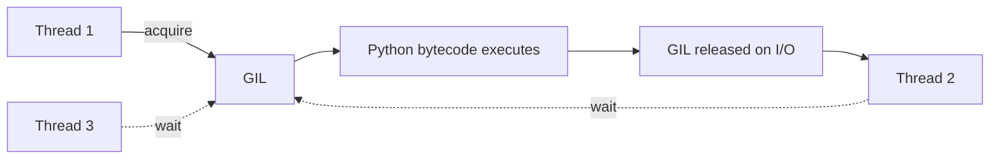

Since Python 3.13, an **experimental free-threaded build** (PEP 703, "no-GIL") is available — opt-in, not default.

### When Each Model Wins

| Workload | Best model | Why |
|---|---|---|
| I/O-bound (file, network, DB) | **Threads** or **Async** | Overlap waiting |
| CPU-bound (math, parsing) | **Multiprocessing** | Bypass GIL |
| Massive I/O concurrency | **Async** | Thousands of sockets, single thread |
| Mixed | **Process pool** + threads/async inside | Combine |
| C extensions releasing GIL | **Threads** | Real parallelism |

### Under the Hood — Threads

Threads are OS-level (in CPython) — each thread gets a native stack. Python's `threading` module wraps pthreads/Win32 threads.

```c
// Simplified
PyThread_start_new_thread(func, arg)   // OS thread created
// Each thread runs a loop that:
//   1. acquires the GIL
//   2. executes bytecode
//   3. releases the GIL (every N instructions or on I/O)
```

The GIL is switched every 5 ms by default (`sys.setswitchinterval`).

### Under the Hood — Multiprocessing

Each process runs a **separate Python interpreter** with its own GIL and memory space. Communication uses **pipes, sockets, or shared memory** — data is **pickled** across boundaries.

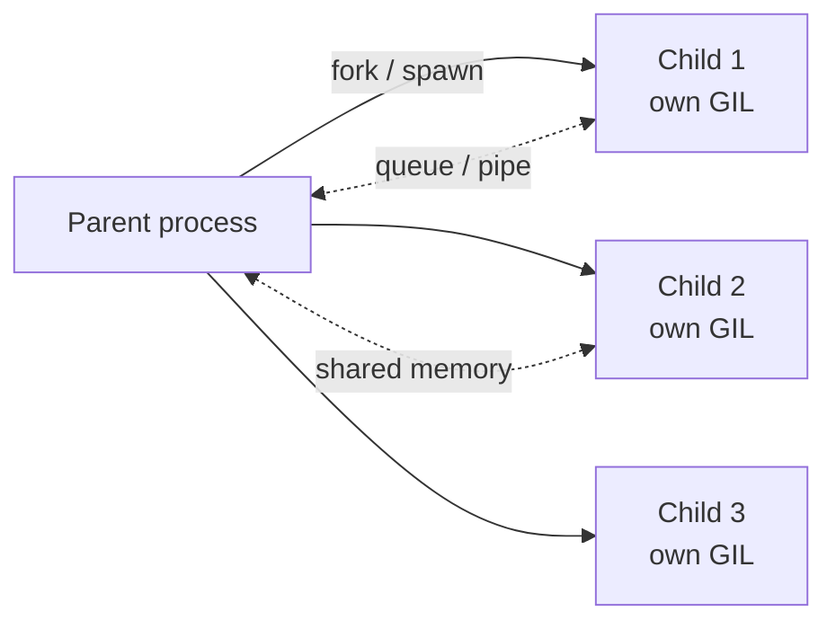

### Under the Hood — Asyncio

An **event loop** runs in a single thread, multiplexing thousands of coroutines. Coroutines **suspend** at `await` points, letting the loop run other work.

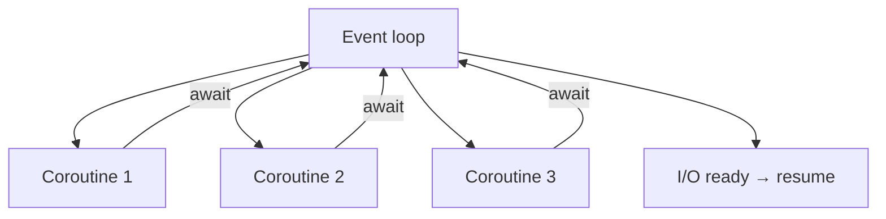

The OS-level mechanism is **`select`/`poll`/`epoll`/`kqueue`** — one syscall monitors many file descriptors.

### Characteristics

| Model | Parallel? | Memory | Communication | Best for |
|---|---|---|---|---|
| Threading | No (GIL) | Shared | Shared memory + locks | I/O-bound |
| Multiprocessing | Yes | Isolated | Pickle / shared memory | CPU-bound |
| Asyncio | No | Shared | Callback / await | Massive I/O |

---

## 2. Threading

### Creating Threads

```python
import threading
import time

def worker(name, delay):
    for i in range(3):
        print(f"{name}: {i}")
        time.sleep(delay)

t1 = threading.Thread(target=worker, args=("A", 0.5))
t2 = threading.Thread(target=worker, args=("B", 0.7))

t1.start()
t2.start()
t1.join()          # wait for t1
t2.join()          # wait for t2
```

### Thread Subclass

```python
class Worker(threading.Thread):
    def __init__(self, name, delay):
        super().__init__(name=name)
        self.delay = delay

    def run(self):
        for i in range(3):
            print(f"{self.name}: {i}")
            time.sleep(self.delay)

w = Worker("A", 0.5)
w.start()
w.join()
```

### Daemon Threads

Daemon threads are killed when the main program exits — they don't block shutdown:

```python
t = threading.Thread(target=background_task, daemon=True)
t.start()
# Program exits without waiting for t
```

Non-daemon threads (default) keep the process alive until they finish.

### `ThreadPoolExecutor` — Higher Level

```python
from concurrent.futures import ThreadPoolExecutor

def fetch(url):
    return requests.get(url).text

urls = ["https://a.com", "https://b.com", "https://c.com"]

with ThreadPoolExecutor(max_workers=10) as executor:
    results = list(executor.map(fetch, urls))
```

- `max_workers` defaults to `min(32, os.cpu_count() + 4)`.
- `executor.map` preserves input order.
- `executor.submit` returns a `Future` — fetch results with `.result()`.

```python
with ThreadPoolExecutor() as ex:
    futures = [ex.submit(fetch, url) for url in urls]
    for fut in futures:
        try:
            print(fut.result(timeout=5))
        except Exception as e:
            print(f"failed: {e}")
```

### `as_completed` — Finish Order

```python
from concurrent.futures import as_completed

with ThreadPoolExecutor() as ex:
    futures = {ex.submit(fetch, url): url for url in urls}
    for fut in as_completed(futures):
        url = futures[fut]
        print(url, fut.result())
```

### Locks — Mutual Exclusion

```python
lock = threading.Lock()

counter = 0

def increment():
    global counter
    for _ in range(100_000):
        with lock:                 # acquire/release
            counter += 1

threads = [threading.Thread(target=increment) for _ in range(10)]
for t in threads: t.start()
for t in threads: t.join()

print(counter)                     # 1_000_000 — correct with lock
```

Without the lock, `counter += 1` is not atomic — you get lost updates.

### `RLock` — Reentrant Lock

A thread can re-acquire `RLock` without deadlock — needed for recursive functions:

```python
rlock = threading.RLock()

def recursive(n):
    with rlock:
        if n <= 0:
            return
        recursive(n - 1)
```

`Lock` would deadlock here.

### `Semaphore` — Limit Concurrency

```python
sem = threading.Semaphore(5)       # at most 5 concurrent

def limited():
    with sem:
        do_work()
```

### `Event` — Signaling

```python
event = threading.Event()

def waiter():
    print("waiting...")
    event.wait()                   # blocks until set
    print("done")

def setter():
    time.sleep(2)
    event.set()

threading.Thread(target=waiter).start()
threading.Thread(target=setter).start()
```

### `Condition` — Wait/Notify

```python
cond = threading.Condition()
queue = []

def consumer():
    with cond:
        while not queue:
            cond.wait()            # releases lock, waits
        item = queue.pop(0)
        print(f"got {item}")

def producer():
    with cond:
        queue.append(42)
        cond.notify()              # wake one waiter
```

### `Barrier` — Synchronize N Threads

```python
barrier = threading.Barrier(3)

def task():
    print("before")
    barrier.wait()                 # blocks until all 3 arrive
    print("after")

for _ in range(3):
    threading.Thread(target=task).start()
```

### `queue.Queue` — Thread-Safe Queue

```python
import queue

q = queue.Queue()

def producer():
    for i in range(10):
        q.put(i)
    q.put(None)                    # sentinel

def consumer():
    while (item := q.get()) is not None:
        process(item)
        q.task_done()

threading.Thread(target=producer).start()
threading.Thread(target=consumer).start()
```

`queue.Queue` is **thread-safe** — no external lock needed. Use it instead of a list + lock.

### Thread-Local Storage

```python
local = threading.local()

def process():
    if not hasattr(local, "counter"):
        local.counter = 0
    local.counter += 1
    print(local.counter)

# Each thread has its own `local.counter`
```

### Threading Comparison Table

| Primitive | Purpose |
|---|---|
| `Thread` | Basic thread |
| `Lock` / `RLock` | Mutual exclusion |
| `Semaphore` | Bounded concurrency |
| `Event` | One-shot signaling |
| `Condition` | Wait for predicate |
| `Barrier` | Sync N threads |
| `queue.Queue` | Thread-safe queue |
| `threading.local` | Thread-specific data |

### Mermaid — Thread Lifecycle

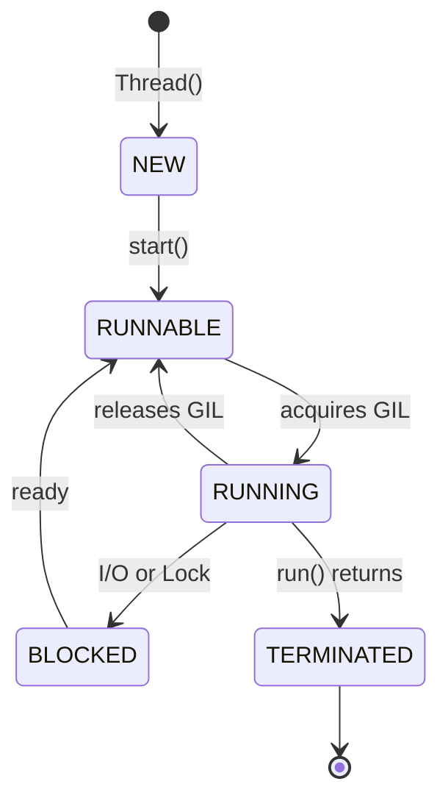

---

## 3. Multiprocessing

### Creating Processes

```python
import multiprocessing as mp
import time

def worker(name):
    print(f"process {name}: pid={mp.current_process().pid}")
    time.sleep(1)

if __name__ == "__main__":        # ← required on Windows/macOS
    p1 = mp.Process(target=worker, args=("A",))
    p2 = mp.Process(target=worker, args=("B",))
    p1.start(); p2.start()
    p1.join(); p2.join()
```

**Important:** the `if __name__ == "__main__":` guard is required on Windows and macOS (spawn start method) to avoid re-importing the module in child processes.

### `ProcessPoolExecutor` — Higher Level

```python
from concurrent.futures import ProcessPoolExecutor

def cpu_intensive(n):
    return sum(i * i for i in range(n))

with ProcessPoolExecutor(max_workers=4) as ex:
    results = list(ex.map(cpu_intensive, [1_000_000] * 8))
```

Pickling requirements: the target function and its arguments must be **picklable** (importable top-level, no lambdas or closures).

### IPC — Inter-Process Communication

**`Queue`:**

```python
def producer(q):
    for i in range(5):
        q.put(i)
    q.put(None)

def consumer(q):
    while (item := q.get()) is not None:
        print(f"got {item}")

if __name__ == "__main__":
    q = mp.Queue()
    p1 = mp.Process(target=producer, args=(q,))
    p2 = mp.Process(target=consumer, args=(q,))
    p1.start(); p2.start()
    p1.join(); p2.join()
```

**`Pipe` — bidirectional:**

```python
parent, child = mp.Pipe()

def child_fn(conn):
    conn.send("hello")
    print(conn.recv())

if __name__ == "__main__":
    p = mp.Process(target=child_fn, args=(child,))
    p.start()
    print(parent.recv())
    parent.send("hi")
    p.join()
```

**`Manager` — shared Python objects:**

```python
with mp.Manager() as manager:
    shared_dict = manager.dict()
    shared_list = manager.list()

    def add(d):
        d["key"] = "value"

    p = mp.Process(target=add, args=(shared_dict,))
    p.start(); p.join()
    print(shared_dict)          # {'key': 'value'}
```

Manager objects are slower than `Queue`/`Pipe` — each access is a proxy call.

### Shared Memory

**`multiprocessing.Value` and `Array`:**

```python
counter = mp.Value("i", 0)         # 'i' = int
arr = mp.Array("d", [0.0] * 10)    # 'd' = double

def increment(c):
    with c.get_lock():
        c.value += 1
```

**`shared_memory` (3.8+):**

```python
from multiprocessing import shared_memory
import numpy as np

shm = shared_memory.SharedMemory(create=True, size=1024)
arr = np.ndarray((128,), dtype=np.int64, buffer=shm.buf)
arr[:] = range(128)
# Other processes can attach:
existing = shared_memory.SharedMemory(name=shm.name)
arr2 = np.ndarray((128,), dtype=np.int64, buffer=existing.buf)
```

Fastest IPC — no pickling, no copies.

### `Pool` — Legacy API

```python
with mp.Pool(processes=4) as pool:
    results = pool.map(cpu_intensive, inputs)
    results = pool.starmap(power, [(2, 3), (3, 2)])
    async_result = pool.apply_async(cpu_intensive, (1_000_000,))
    print(async_result.get())
```

`Pool` is older; `ProcessPoolExecutor` is preferred in new code but `Pool` is still common.

### Start Methods

| Method | Platform | Notes |
|---|---|---|
| `fork` | Linux (default <3.14) | Fast; inherits memory |
| `spawn` | Windows, macOS | Fresh interpreter; slower; required guard |
| `forkserver` | Unix | Fresh, forks from a clean server |
| `forkserver` (3.14) | Linux default | Safer than `fork` |

Set explicitly:

```python
mp.set_start_method("spawn")
```

### Pickling — Data Crossing Boundaries

Everything sent between processes must be picklable:

```python
# ✅ Top-level functions
def f(x): return x * 2

# ❌ Lambdas
mp.Process(target=lambda: print("hi"))    # fails on Windows/macOS

# ❌ Local functions
def outer():
    def inner(): ...
    mp.Process(target=inner)              # fails

# ✅ Use functools.partial or top-level
from functools import partial
mp.Process(target=partial(f, 5))
```

### Comparison — Threads vs Processes

| Aspect | Threads | Processes |
|---|---|---|
| Memory | Shared | Isolated |
| Start cost | Low | High (~50 ms) |
| Communication | Direct | Pickle |
| Parallel CPUs | ❌ (GIL) | ✅ |
| Crash isolation | ❌ (one crash kills all) | ✅ |
| State sharing | Easy but racy | Explicit |
| Best for | I/O-bound | CPU-bound |

### Mermaid — Process Communication

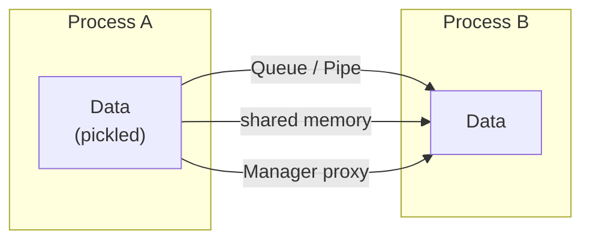

---

## 4. The GIL — Deep Dive

### What the GIL Actually Does

The GIL is a **mutex** protecting CPython's internal state — refcounts, object headers, and the interpreter's allocator. It's held while executing Python bytecode; released during I/O and at switch intervals.

### What It Prevents

- **True CPU parallelism** across threads.
- Simultaneous modification of Python objects by multiple threads.

### What It Doesn't Prevent

- **I/O parallelism** — GIL is released during `read`, `write`, `recv`, `send`, `sleep`, and most syscalls.
- **C extension parallelism** — NumPy, Pillow, lxml release the GIL for heavy compute.

### Demonstrating the GIL

```python
import threading, time

def count(n):
    while n > 0:
        n -= 1

N = 50_000_000

# Single thread
t0 = time.perf_counter()
count(N)
print(f"single: {time.perf_counter() - t0:.2f}s")

# Two threads
t0 = time.perf_counter()
t1 = threading.Thread(target=count, args=(N // 2,))
t2 = threading.Thread(target=count, args=(N // 2,))
t1.start(); t2.start()
t1.join(); t2.join()
print(f"two threads: {time.perf_counter() - t0:.2f}s")
```

On a multicore machine, **two threads take the same or longer** than one — no speedup for CPU-bound work.

### `sys.setswitchinterval`

```python
import sys
sys.getswitchinterval()          # 0.005 s — default
sys.setswitchinterval(0.001)     # switch more often
```

Lower intervals reduce latency but add overhead. Default 5 ms is a compromise.

### Workarounds for CPU-Bound Work

| Strategy | Notes |
|---|---|
| **Multiprocessing** | True parallelism |
| **C extensions** | NumPy, Cython, Cython, C |
| **Async I/O** | Doesn't help CPU-bound |
| **Free-threaded Python 3.13+** | Experimental, opt-in |

### The Free-Threaded Build (PEP 703)

Python 3.13 introduced an **experimental** build without the GIL:

```bash
./configure --disable-gil
# or download python3.13t (t = threading)
```

Trade-offs:
- ~10–20% slower single-threaded (early measurements).
- Memory overhead for per-object locks.
- Not yet production-ready; C extensions may not be compatible.

### GIL and Async

`asyncio` is **not affected by the GIL** because it's single-threaded — no contention. But **CPU-bound coroutines block the event loop**.

### GIL Summary

| Claim | True? |
|---|---|
| GIL means no parallelism in Python | Only for **Python bytecode** |
| I/O releases the GIL | ✅ |
| C extensions release the GIL | Some do |
| GIL is per-interpreter | ✅ |
| GIL will disappear soon | Experimental only |

### Mermaid — GIL Contention

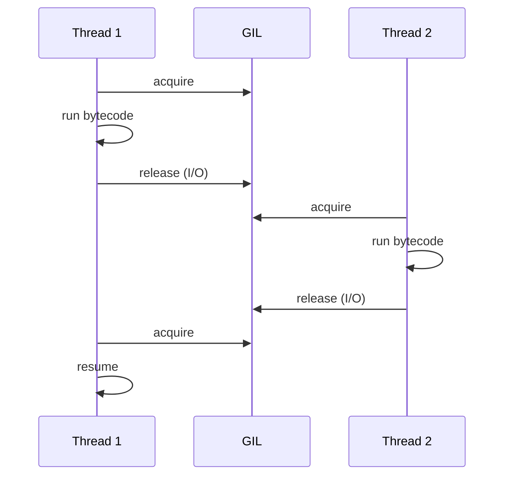

Only one thread runs Python bytecode at a time.

---

## 5. `concurrent.futures`

### The Unified API

`concurrent.futures` provides **`ThreadPoolExecutor`** and **`ProcessPoolExecutor`** with identical interfaces — switch by changing one word.

```python
from concurrent.futures import ThreadPoolExecutor, ProcessPoolExecutor

# Threads — for I/O
with ThreadPoolExecutor(max_workers=10) as ex:
    results = list(ex.map(fetch, urls))

# Processes — for CPU
with ProcessPoolExecutor(max_workers=4) as ex:
    results = list(ex.map(compute, inputs))
```

### `map` — Ordered Results

```python
with ThreadPoolExecutor() as ex:
    results = list(ex.map(fetch, urls))     # results in input order
```

`map` blocks until all complete. Internally, submits all tasks and collects results in order.

### `submit` — Individual Futures

```python
with ThreadPoolExecutor() as ex:
    futures = [ex.submit(fetch, url) for url in urls]

    # Wait for all to complete (or timeout)
    from concurrent.futures import wait, FIRST_COMPLETED
    done, not_done = wait(futures, return_when=FIRST_COMPLETED)

    for fut in futures:
        try:
            result = fut.result(timeout=5)
        except Exception as e:
            result = f"error: {e}"
```

### `as_completed` — Finish Order

```python
from concurrent.futures import as_completed

with ThreadPoolExecutor() as ex:
    futures = {ex.submit(fetch, url): url for url in urls}
    for fut in as_completed(futures, timeout=10):
        url = futures[fut]
        print(url, fut.result())
```

### `wait` — Blocking with Control

```python
from concurrent.futures import wait, ALL_COMPLETED, FIRST_COMPLETED, FIRST_EXCEPTION

done, pending = wait(futures, timeout=5, return_when=ALL_COMPLETED)
```

### The `Future` Object

| Method | Purpose |
|---|---|
| `result(timeout=None)` | Wait and get result (raises) |
| `exception(timeout=None)` | Get exception (if any) |
| `done()` | Is it finished? |
| `running()` | Is it running? |
| `cancelled()` | Was it cancelled? |
| `cancel()` | Try to cancel |
| `add_done_callback(fn)` | Call fn on completion |

### Cancellation

```python
fut = ex.submit(slow_task)
if fut.cancel():
    print("cancelled before start")
```

Cancellation only works if the task hasn't started. For running tasks, use cooperative cancellation (a flag/event).

### Callbacks — Composition

```python
def on_done(fut):
    print(f"result: {fut.result()}")

fut = ex.submit(fetch, url)
fut.add_done_callback(on_done)
```

Callbacks run in the worker thread — keep them fast.

### Comparison — `ThreadPoolExecutor` vs Manual Threads

| Aspect | `ThreadPoolExecutor` | Manual `Thread` |
|---|---|---|
| Reuse | Pool of workers | Manual lifecycle |
| Result collection | Futures | Manual queue |
| Exception handling | `.result()` | Manual |
| Cancellation | `.cancel()` | Manual |
| Composition | `map`, `as_completed` | Manual |
| Code size | Small | Larger |

### Comparison — Which Executor?

| Workload | Executor | Why |
|---|---|---|
| HTTP requests | `ThreadPoolExecutor` | I/O |
| File reads | `ThreadPoolExecutor` | I/O |
| DB queries | `ThreadPoolExecutor` | I/O |
| Image resize | `ProcessPoolExecutor` | CPU |
| Numerical compute | `ProcessPoolExecutor` | CPU |
| Mixed | Both — nested or separate pools | — |

### Mermaid — Executor Flow


Futures are lazy handles — the caller decides when to wait.

---

## 6. `asyncio` — Async I/O

### The Event Loop

`asyncio` runs coroutines on a **single-threaded event loop**. The loop uses OS-level multiplexing (`select`, `epoll`, `kqueue`) to handle many I/O operations concurrently.

```python
import asyncio

async def main():
    print("hello")
    await asyncio.sleep(1)
    print("world")

asyncio.run(main())
```

`asyncio.run()` creates a loop, runs the coroutine, and closes the loop.

### `async def` — Coroutine Functions

```python
async def fetch():
    await asyncio.sleep(1)          # suspend here
    return "data"

# Calling fetch() returns a coroutine — no work done yet
coro = fetch()                       # <coroutine object>
result = asyncio.run(coro)           # runs it
```

Coroutines must be **awaited** — either via `await` or `asyncio.run`.

### `await` — Suspend Point

```python
async def main():
    data = await fetch()             # suspend until fetch returns
    print(data)
```

`await` can only be used inside `async def` (or via `asyncio.run`).

### `asyncio.gather` — Concurrent Coroutines

```python
async def fetch(url):
    async with aiohttp.ClientSession() as session:
        async with session.get(url) as resp:
            return await resp.text()

async def main():
    urls = ["https://a.com", "https://b.com", "https://c.com"]
    results = await asyncio.gather(*(fetch(u) for u in urls))
    print(results)
```

`gather` runs them **concurrently** — total time ≈ slowest, not sum.

### `asyncio.create_task` — Fire and Forget (With Handle)

```python
async def main():
    tasks = [asyncio.create_task(fetch(u)) for u in urls]
    results = await asyncio.gather(*tasks)
```

`create_task` schedules immediately — the coroutine starts running on the next loop iteration.

### `asyncio.wait_for` — Timeouts

```python
async def main():
    try:
        result = await asyncio.wait_for(fetch(url), timeout=5)
    except asyncio.TimeoutError:
        print("timed out")
```

### `asyncio.sleep` vs `time.sleep`

```python
await asyncio.sleep(1)     # ✅ non-blocking
time.sleep(1)              # ❌ blocks the entire event loop
```

**Never** call blocking functions in async code — use async versions or `loop.run_in_executor`.

### Blocking I/O in Async

```python
import asyncio
from concurrent.futures import ThreadPoolExecutor

executor = ThreadPoolExecutor()

async def read_file(path):
    loop = asyncio.get_running_loop()
    return await loop.run_in_executor(executor, open, path)
```

Wrap blocking calls in `run_in_executor` to keep the loop responsive.

### Semaphores — Bounded Concurrency

```python
sem = asyncio.Semaphore(10)

async def fetch(url):
    async with sem:
        async with aiohttp.ClientSession() as session:
            async with session.get(url) as resp:
                return await resp.text()
```

Limits concurrent requests — crucial for rate limiting.

### Async Context Managers

```python
class AsyncResource:
    async def __aenter__(self):
        await self.connect()
        return self

    async def __aexit__(self, exc_type, exc, tb):
        await self.disconnect()
        return False

async with AsyncResource() as r:
    await r.use()
```

Or with `@asynccontextmanager`:

```python
from contextlib import asynccontextmanager

@asynccontextmanager
async def connection(url):
    conn = await connect(url)
    try:
        yield conn
    finally:
        await conn.close()
```

### Async Iterators

```python
class AsyncCounter:
    def __init__(self, n):
        self.n = n
        self.i = 0

    def __aiter__(self):
        return self

    async def __anext__(self):
        if self.i >= self.n:
            raise StopAsyncIteration
        self.i += 1
        await asyncio.sleep(0.1)
        return self.i

async for x in AsyncCounter(3):
    print(x)
```

Or async generators:

```python
async def counter(n):
    for i in range(n):
        await asyncio.sleep(0.1)
        yield i

async for x in counter(3):
    print(x)
```

### `asyncio.Queue` — Producer/Consumer

```python
async def producer(q):
    for i in range(5):
        await q.put(i)
    await q.put(None)

async def consumer(q):
    while (item := await q.get()) is not None:
        print(f"got {item}")
        q.task_done()

async def main():
    q = asyncio.Queue()
    await asyncio.gather(producer(q), consumer(q))

asyncio.run(main())
```

### `asyncio.Lock`, `Event`, `Condition`

Same primitives as threading, but async-aware:

```python
lock = asyncio.Lock()

async def update():
    async with lock:
        await do_work()
```

### `asyncio.TaskGroup` (3.11+) — Structured Concurrency

```python
async def main():
    async with asyncio.TaskGroup() as tg:
        t1 = tg.create_task(fetch(url1))
        t2 = tg.create_task(fetch(url2))
    # Both completed (or one raised and cancelled the other)
    print(t1.result(), t2.result())
```

Cleaner than `gather` for error handling — if one task fails, the group cancels the others.

### `asyncio.timeout` (3.11+)

```python
async with asyncio.timeout(5):
    await slow_operation()
# raises TimeoutError if > 5s
```

Cleaner than `wait_for`.

### `asyncio.to_thread` (3.9+) — Offload Blocking

```python
data = await asyncio.to_thread(blocking_read, "file.txt")
```

Wraps `run_in_executor` — easier API.

### Error Handling

```python
try:
    result = await fetch(url)
except aiohttp.ClientError as e:
    print(f"failed: {e}")
```

Exceptions propagate from awaited coroutines like normal functions.

### Async Summary Table

| Concept | Sync | Async |
|---|---|---|
| Function | `def` | `async def` |
| Call | `f()` | `await f()` |
| Blocking | `time.sleep` | `await asyncio.sleep` |
| Iteration | `for x in it` | `async for x in ait` |
| Context | `with` | `async with` |
| Queue | `queue.Queue` | `asyncio.Queue` |
| Lock | `threading.Lock` | `asyncio.Lock` |

### Mermaid — Event Loop

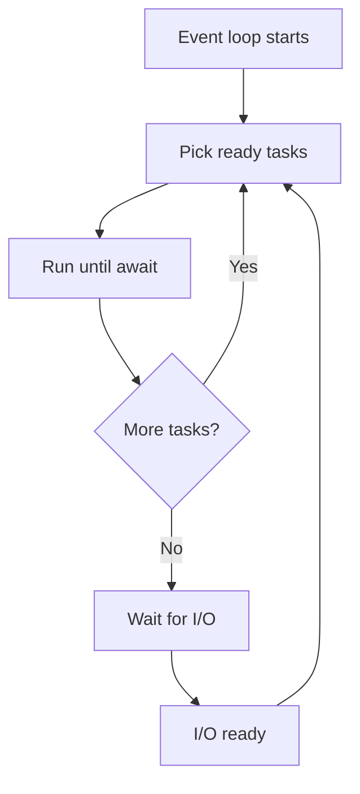

One thread, many coroutines, cooperative scheduling at `await`.

---

## 7. Async / Await — The Mechanics

### Coroutine vs Function

```python
def regular():
    return 1

async def coro():
    return 1

regular()                    # 1
coro()                       # <coroutine object>
```

Calling an `async def` function creates a coroutine object — it doesn't run until awaited.

### `await` — Only in Async Context

```python
async def f():
    await g()                # ✅

def h():
    await g()                # ❌ SyntaxError
```

Use `asyncio.run(g())` at the top level.

### Awaiting Multiple Things — Sequential vs Concurrent

```python
# ❌ Sequential — ~2s
async def main():
    a = await fetch_a()
    b = await fetch_b()

# ✅ Concurrent — ~1s
async def main():
    a, b = await asyncio.gather(fetch_a(), fetch_b())
```

`await` pauses for **one thing**. `gather` runs many concurrently.

### Tasks — Scheduling Coroutines

```python
async def main():
    task = asyncio.create_task(fetch(url))
    # Task is now scheduled — runs concurrently
    await asyncio.sleep(0.1)
    result = await task
```

Without `create_task`, `await coro()` runs it inline — no concurrency.

### `asyncio.shield` — Protect from Cancellation

```python
try:
    result = await asyncio.shield(important_op())
except asyncio.CancelledError:
    # important_op is still running
    ...
```

### Cancellation

```python
async def main():
    task = asyncio.create_task(long_op())
    await asyncio.sleep(1)
    task.cancel()

    try:
        await task
    except asyncio.CancelledError:
        print("cancelled")
```

Coroutines must be **cooperative** — cancellation is delivered at `await` points.

### `contextvars` — Async-Safe Globals

Thread-locals don't work across tasks. Use `contextvars`:

```python
from contextvars import ContextVar

request_id: ContextVar[str] = ContextVar("request_id")

async def handle():
    request_id.set("abc123")
    await process()
    print(request_id.get())    # 'abc123' — per-task

async def process():
    print(request_id.get())    # 'abc123' — same task
```

Each task sees its own copy — ideal for request-scoped data.

### Async Pitfalls

```python
# ❌ Blocking call in async
async def bad():
    time.sleep(1)              # blocks the loop

# ✅
async def good():
    await asyncio.sleep(1)

# ❌ Forgetting to await
async def bad():
    fetch()                    # coroutine created, never awaited

# ✅
async def good():
    await fetch()

# ❌ Mixing sync and async incorrectly
async def bad():
    with open("file") as f:    # OK for local files (fast), but blocks
        data = f.read()

# ✅ Use aiofiles for large files
import aiofiles
async with aiofiles.open("file") as f:
    data = await f.read()
```

### Async Summary

| Concept | Purpose |
|---|---|
| `async def` | Declare coroutine |
| `await` | Suspend until done |
| `asyncio.run` | Start the loop |
| `create_task` | Schedule concurrently |
| `gather` | Await many at once |
| `TaskGroup` | Structured concurrency |
| `wait_for` / `timeout` | Time limits |
| `shield` | Protect from cancellation |
| `to_thread` | Offload blocking |
| `contextvars` | Task-local state |

---

## 8. Locks, Queues, Synchronization

### Locks — When and Why

Any **shared mutable state** accessed from multiple threads needs protection:

```python
class Counter:
    def __init__(self):
        self._value = 0
        self._lock = threading.Lock()

    def increment(self):
        with self._lock:
            self._value += 1

    @property
    def value(self):
        with self._lock:
            return self._value
```

### Races Without Locks

```python
counter = 0

def bad():
    global counter
    for _ in range(1_000_000):
        counter += 1

# Two threads — counter ends up < 2_000_000
```

`counter += 1` compiles to `LOAD`, `ADD`, `STORE` — the GIL can switch between them.

### Deadlock

Two threads holding locks the other needs:

```python
lock_a = threading.Lock()
lock_b = threading.Lock()

def t1():
    with lock_a:
        with lock_b:       # waits for lock_b
            pass

def t2():
    with lock_b:
        with lock_a:       # waits for lock_a — DEADLOCK
            pass
```

**Fix:** acquire locks in a consistent global order.

### Lock Timeouts

```python
if lock.acquire(timeout=5):
    try:
        ...
    finally:
        lock.release()
else:
    print("could not acquire lock")
```

Always release in `finally` (or use `with`).

### `queue.Queue` — The Right Way to Coordinate

```python
import queue

q = queue.Queue(maxsize=100)     # bounded

def producer():
    for item in items:
        q.put(item)              # blocks if full

def consumer():
    while True:
        item = q.get()
        if item is None:
            break
        process(item)
        q.task_done()            # signal done

threads = [
    threading.Thread(target=consumer, daemon=True)
    for _ in range(4)
]
for t in threads: t.start()

producer()
q.join()                          # wait for all items processed
```

`Queue` handles locking, blocking, and task tracking internally.

### `queue.LifoQueue` and `PriorityQueue`

```python
from queue import LifoQueue, PriorityQueue

lifo = LifoQueue()               # stack semantics
prio = PriorityQueue()
prio.put((3, "low"))
prio.put((1, "high"))
prio.get()                       # (1, 'high')
```

### RLock vs Lock

| | `Lock` | `RLock` |
|---|---|---|
| Re-acquire same thread | ❌ deadlock | ✅ |
| Release count | 1 | must match acquires |
| Use case | Simple mutual exclusion | Recursive functions |
| Overhead | Lower | Higher |

### Semaphore Patterns

```python
# Rate limiting
rate = threading.Semaphore(10)

with rate:
    make_request()

# Resource pool
pool = threading.BoundedSemaphore(3)   # raises if over-released
```

### `Barrier` — Start Line

```python
barrier = threading.Barrier(parties=4)

def worker():
    prepare()
    barrier.wait()               # all wait here
    run()

# All 4 threads start `run` together
```

### `Event` — One-Shot Signal

```python
stop = threading.Event()

def worker():
    while not stop.is_set():
        do_work()

# Elsewhere:
stop.set()                        # signal workers to stop
```

### Comparing Synchronization Primitives

| Primitive | Purpose | Blocks when |
|---|---|---|
| `Lock` | Mutual exclusion | Already held |
| `RLock` | Reentrant lock | Held by other thread |
| `Semaphore` | Limit concurrency | Count is 0 |
| `Event` | One-shot signal | Not set (on `wait`) |
| `Condition` | Wait for predicate | Predicate false |
| `Barrier` | Sync N threads | Fewer than N present |
| `Queue` | Message passing | Empty (get) / full (put) |

### Mermaid — Producer-Consumer

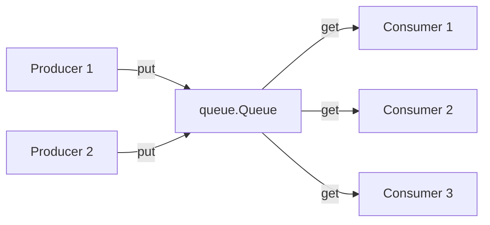

The queue decouples producers from consumers — the standard concurrency pattern.

---

## 9. When to Use Threads vs Processes vs Async

### Decision Tree

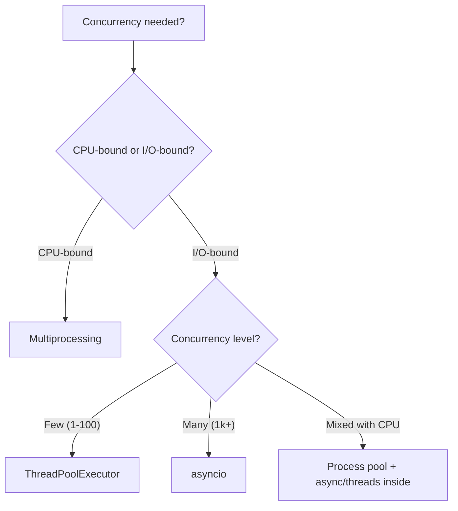

### Comparison Table

| Factor | Threads | Processes | Async |
|---|---|---|---|
| Parallel CPUs | ❌ (GIL) | ✅ | ❌ |
| Memory per unit | Low | High | Lowest |
| Start cost | ~50 µs | ~50 ms | ~2 µs |
| Concurrency limit | ~100s | ~cores | ~10,000s |
| Communication | Shared | Pickle | Await |
| Debug | Hard (races) | Hard (IPC) | Medium |
| Best for | I/O-bound | CPU-bound | Network I/O |
| Libraries | `threading`, `concurrent.futures` | `multiprocessing` | `asyncio`, `aiohttp` |

### Concrete Rules

| Situation | Choose |
|---|---|
| Download 100 URLs | **Threads** (or async) |
| Download 10,000 URLs | **Async** |
| Resize 1,000 images | **Processes** (Pillow releases GIL — threads also work) |
| Parse 100 large JSON files | **Processes** (CPU-bound parsing) |
| Serve 5,000 websocket clients | **Async** |
| Query database in a loop | **Threads** (or async driver) |
| Numerical simulation | **Processes** or NumPy |
| Long-lived background task | **Threads** |
| Scheduled jobs | **Threads** or `sched` |

### Hybrid Patterns

**Async with CPU offload:**

```python
async def process(data):
    result = await asyncio.to_thread(cpu_heavy, data)
    # or: await loop.run_in_executor(ProcessPoolExecutor(), cpu_heavy, data)
    return result
```

**Threads inside processes:**

```python
def process_batch(batch):
    with ThreadPoolExecutor() as ex:
        return list(ex.map(fetch, batch))

with ProcessPoolExecutor() as ex:
    results = ex.map(process_batch, batches)
```

**Async + threads for blocking libraries:**

```python
async def fetch(url):
    return await asyncio.to_thread(requests.get, url)
```

### Signal Handling — Main Thread Only

Signals (SIGINT, SIGTERM) are only delivered to the **main thread**. In async programs, `asyncio.run` handles SIGINT gracefully. In threaded programs, install handlers in the main thread.

### Mermaid — Choose Your Concurrency

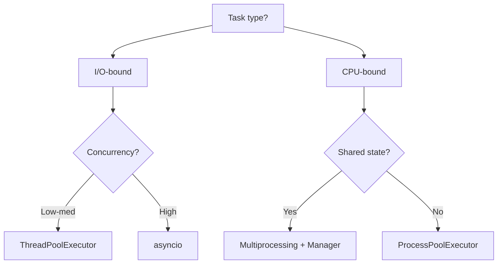

---

## 10. Real-World Use Cases

### Use Case 1 — Concurrent HTTP Requests (Async)

```python
import asyncio
import aiohttp

async def fetch(session, url):
    async with session.get(url) as resp:
        return await resp.text()

async def fetch_all(urls, concurrency=50):
    sem = asyncio.Semaphore(concurrency)
    async with aiohttp.ClientSession() as session:
        async def bounded(url):
            async with sem:
                return await fetch(session, url)
        return await asyncio.gather(*(bounded(u) for u in urls))

urls = [f"https://api.example.com/items/{i}" for i in range(1000)]
results = asyncio.run(fetch_all(urls))
```

### Use Case 2 — Parallel CPU Work (Processes)

```python
from concurrent.futures import ProcessPoolExecutor

def is_prime(n):
    if n < 2: return False
    for d in range(2, int(n ** 0.5) + 1):
        if n % d == 0:
            return False
    return True

numbers = list(range(10_000_000, 10_000_100))

with ProcessPoolExecutor() as ex:
    results = list(ex.map(is_prime, numbers))
```

### Use Case 3 — Producer/Consumer with Queue

```python
import threading, queue, time

def producer(q, items):
    for item in items:
        q.put(item)
    q.put(None)                    # sentinel per consumer

def consumer(q, results):
    while (item := q.get()) is not None:
        results.append(process(item))
        q.task_done()

q = queue.Queue()
results = []
consumers = [threading.Thread(target=consumer, args=(q, results)) for _ in range(4)]
for c in consumers: c.start()

producer(q, items)
q.join()

for _ in consumers: q.put(None)
for c in consumers: c.join()
```

### Use Case 4 — Rate-Limited Async Fetcher

```python
async def rate_limited(urls, per_second=10):
    async def fetch_one(session, url):
        async with aiohttp.ClientSession() as session:
            async with session.get(url) as resp:
                return await resp.text()

    results = []
    for i in range(0, len(urls), per_second):
        batch = urls[i:i + per_second]
        results.extend(await asyncio.gather(*(fetch_one(None, u) for u in batch)))
        await asyncio.sleep(1)
    return results
```

### Use Case 5 — Graceful Shutdown

```python
import asyncio, signal

async def main():
    stop = asyncio.Event()

    def handler():
        print("shutdown requested")
        stop.set()

    loop = asyncio.get_running_loop()
    for sig in (signal.SIGINT, signal.SIGTERM):
        loop.add_signal_handler(sig, handler)

    task = asyncio.create_task(worker(stop))
    await task

async def worker(stop):
    while not stop.is_set():
        await asyncio.sleep(1)
        print("working...")
```

### Use Case 6 — Parallel Data Pipeline

```python
async def pipeline(inputs):
    async def process(x):
        # simulate I/O
        await asyncio.sleep(0.1)
        return x * 2

    async with asyncio.TaskGroup() as tg:
        tasks = [tg.create_task(process(x)) for x in inputs]

    return [t.result() for t in tasks]

results = asyncio.run(pipeline(range(100)))
```

### Use Case 7 — Background Thread for Monitoring

```python
import threading, time

class Monitor(threading.Thread):
    def __init__(self):
        super().__init__(daemon=True)
        self._stop = threading.Event()

    def run(self):
        while not self._stop.is_set():
            check_health()
            time.sleep(5)

    def stop(self):
        self._stop.set()

monitor = Monitor()
monitor.start()
# ...
monitor.stop()
monitor.join(timeout=2)
```

### Use Case 8 — Map-Reduce with Processes

```python
from concurrent.futures import ProcessPoolExecutor

def map_reduce(items, mapper, reducer, initial):
    with ProcessPoolExecutor() as ex:
        mapped = list(ex.map(mapper, items))
    return reduce(reducer, mapped, initial)
```

### Use Case 9 — Async DB Pool

```python
import asyncpg, asyncio

async def main():
    pool = await asyncpg.create_pool(dsn="postgres://...", min_size=5, max_size=20)
    async with pool.acquire() as conn:
        rows = await conn.fetch("SELECT * FROM users")
    await pool.close()

asyncio.run(main())
```

### Use Case 10 — Retry with Exponential Backoff (Async)

```python
import asyncio, random

async def retry(coro_fn, attempts=5, base=0.5):
    for i in range(attempts):
        try:
            return await coro_fn()
        except Exception:
            if i == attempts - 1:
                raise
            await asyncio.sleep(base * 2 ** i + random.random() * 0.1)
```

---

## 11. Common Pitfalls

### Pitfall 1 — CPU-Bound Work in Threads

```python
# ❌ No speedup due to GIL
with ThreadPoolExecutor() as ex:
    results = list(ex.map(compute_heavy, data))

# ✅ Use processes
with ProcessPoolExecutor() as ex:
    results = list(ex.map(compute_heavy, data))
```

### Pitfall 2 — Blocking the Event Loop

```python
# ❌ Blocks everything
async def bad():
    time.sleep(1)
    requests.get(url)

# ✅
async def good():
    await asyncio.sleep(1)
    await asyncio.to_thread(requests.get, url)
```

### Pitfall 3 — Forgetting to `await`

```python
# ❌ Coroutine created, never run
async def bad():
    fetch(url)

# ✅
async def good():
    await fetch(url)
```

Python may warn `RuntimeWarning: coroutine was never awaited`.

### Pitfall 4 — Data Races Without Locks

```python
# ❌ Lost updates
counter = 0
def inc():
    global counter
    for _ in range(1_000_000):
        counter += 1
```

Use `Lock` or avoid shared mutable state.

### Pitfall 5 — Deadlock via Lock Ordering

```python
# ❌ Thread 1: A → B; Thread 2: B → A
def t1():
    with lock_a:
        with lock_b: ...
def t2():
    with lock_b:
        with lock_a: ...
```

Always acquire in the same global order.

### Pitfall 6 — Global `Queue` Between Processes

```python
# ❌ Regular queue doesn't share across processes
q = queue.Queue()

# ✅ Use multiprocessing.Queue
q = mp.Queue()
```

### Pitfall 7 — Pickling Local Functions

```python
# ❌ Fails on Windows/macOS
def outer():
    def inner(): ...
    with ProcessPoolExecutor() as ex:
        ex.submit(inner)

# ✅ Top-level function
def inner(): ...
```

### Pitfall 8 — Forgetting `if __name__ == "__main__"`

```python
# ❌ On Windows: infinite process spawning
def main(): ...

with ProcessPoolExecutor() as ex:
    ex.map(work, data)
```

Wrap in the main guard:

```python
if __name__ == "__main__":
    with ProcessPoolExecutor() as ex:
        ex.map(work, data)
```

### Pitfall 9 — Too Many Threads

```python
# ❌ 10,000 threads — memory explodes
with ThreadPoolExecutor(max_workers=10_000) as ex:
    ...

# ✅ Cap at ~100 for I/O or use async
with ThreadPoolExecutor(max_workers=20) as ex:
    ...
```

### Pitfall 10 — Tasks Holding References

```python
# ❌ Tasks may be garbage-collected before completing
asyncio.create_task(fetch(url))

# ✅ Keep a reference
tasks = set()
task = asyncio.create_task(fetch(url))
tasks.add(task)
task.add_done_callback(tasks.discard)
```

### Pitfall 11 — `asyncio.run` in Async Context

```python
# ❌ Cannot nest event loops
async def outer():
    asyncio.run(inner())    # RuntimeError

# ✅ Just await
async def outer():
    await inner()
```

### Pitfall 12 — Blocking on `future.result()` in Async

```python
# ❌ Blocks the loop
async def bad():
    fut = ex.submit(work)
    return fut.result()

# ✅
async def good():
    return await asyncio.to_thread(work)
```

### Pitfall 13 — Signals in Threads

```python
# ❌ Signals only work in main thread
threading.Thread(target=lambda: signal.signal(signal.SIGINT, handler)).start()
```

Install signal handlers in the main thread only.

### Pitfall 14 — Thread-Local Leakage Across Async Tasks

```python
# ❌ threading.local doesn't isolate asyncio tasks
local = threading.local()

# ✅ Use contextvars
from contextvars import ContextVar
request_id = ContextVar("request_id")
```

### Pitfall Summary Table

| Pitfall | Symptom | Fix |
|---|---|---|
| CPU work in threads | No speedup | Processes |
| Blocking event loop | Freezes async | `to_thread` / async libs |
| Missing `await` | Warning, no work | Always await |
| Races | Wrong counts | Locks |
| Deadlock | Hangs | Consistent lock order |
| Pickling local func | ProcessPoolError | Top-level functions |
| Missing main guard | Infinite spawning | `if __name__` |
| Too many threads | Memory/context switch | Cap workers |
| Lost task references | Silent GC | Keep refs |
| `run` inside `run` | RuntimeError | Just `await` |

---

## 12. Comparison Tables

### Thread vs Process vs Async — Full

| Aspect | Thread | Process | Async |
|---|---|---|---|
| Concurrency | Preemptive | Preemptive | Cooperative |
| Parallel CPU | ❌ | ✅ | ❌ |
| Memory | Shared | Isolated | Shared |
| Start cost | Low | High | Very low |
| Max practical count | ~100s | ~cores | ~10,000s |
| Communication | Direct | Pickle | Await |
| Race conditions | Yes | No | No (single thread) |
| Debugging | Hard | Hard | Medium |
| Libraries | `threading`, `futures` | `multiprocessing` | `asyncio`, `aiohttp` |
| Best for | I/O-bound | CPU-bound | High-concurrency I/O |

### Synchronization Primitives

| Primitive | Threads | Async | Processes |
|---|---|---|---|
| Lock | `threading.Lock` | `asyncio.Lock` | `multiprocessing.Lock` |
| Semaphore | `threading.Semaphore` | `asyncio.Semaphore` | `multiprocessing.Semaphore` |
| Event | `threading.Event` | `asyncio.Event` | `multiprocessing.Event` |
| Condition | `threading.Condition` | `asyncio.Condition` | `multiprocessing.Condition` |
| Queue | `queue.Queue` | `asyncio.Queue` | `multiprocessing.Queue` |

### IPC Mechanisms

| Mechanism | Speed | Serialization | Shared? |
|---|---|---|---|
| `Queue` | Medium | Pickle | No |
| `Pipe` | Fast | Pickle | No |
| `Manager` | Slow | Proxy calls | Yes |
| `Value` / `Array` | Fast | C types | Yes |
| `shared_memory` | Fastest | Raw bytes | Yes |

### Async Libraries

| Task | Sync lib | Async lib |
|---|---|---|
| HTTP client | `requests` | `aiohttp`, `httpx` |
| HTTP server | `flask`, `django` | `fastapi`, `aiohttp` |
| Database | `psycopg2` | `asyncpg`, `aiomysql` |
| File I/O | `open` | `aiofiles` |
| Redis | `redis-py` | `aioredis` |
| MongoDB | `pymongo` | `motor` |

### Executor Comparison

| Feature | `ThreadPoolExecutor` | `ProcessPoolExecutor` |
|---|---|---|
| Speed start | Fast | Slow |
| Parallel CPU | ❌ | ✅ |
| Shared state | ✅ | Explicit |
| Pickle required | ❌ | ✅ |
| Max workers | 32+ | cores |
| Use for | I/O | CPU |

---

## 13. Mermaid — Complete Concurrency Landscape

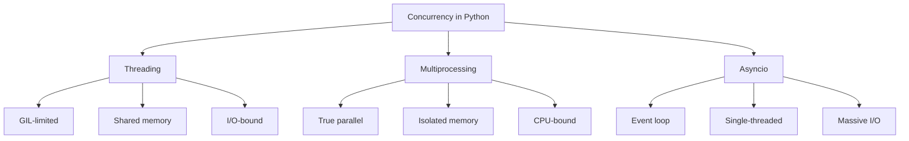

### The Decision Flow

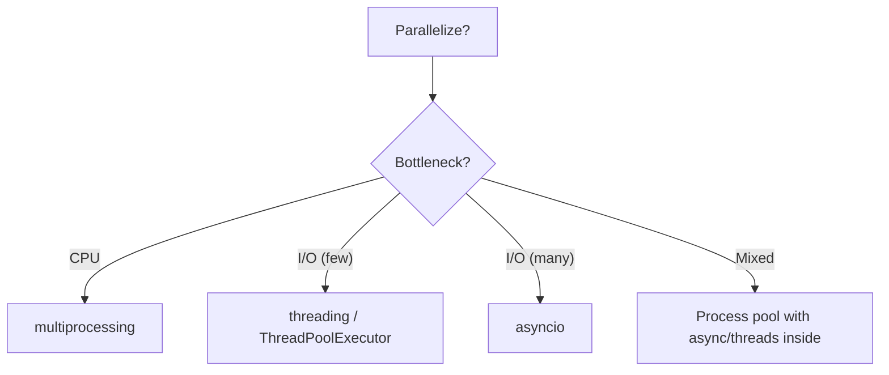

### Async vs Threads Concurrency

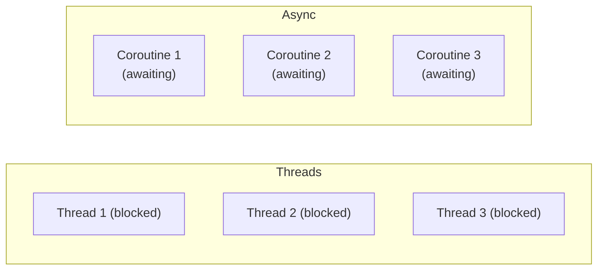

Both handle I/O concurrently — async is cheaper per unit but requires all-async stack.

---

## 14. Performance Notes

### Threading vs Sequential (I/O-Bound)

```python
import time, requests
from concurrent.futures import ThreadPoolExecutor

urls = [f"https://httpbin.org/delay/1" for _ in range(10)]

# Sequential: ~10s
t0 = time.perf_counter()
for u in urls:
    requests.get(u)
print(f"sequential: {time.perf_counter() - t0:.1f}s")

# Threaded: ~1s (10 workers)
t0 = time.perf_counter()
with ThreadPoolExecutor(max_workers=10) as ex:
    list(ex.map(lambda u: requests.get(u), urls))
print(f"threaded: {time.perf_counter() - t0:.1f}s")
```

### Threading vs ProcessPool (CPU-Bound)

```python
def cpu_heavy(n):
    return sum(i * i for i in range(n))

# Single-process threaded — same as sequential (GIL)
with ThreadPoolExecutor(max_workers=4) as ex:
    ex.map(cpu_heavy, [1_000_000] * 4)

# Multi-process — near-linear speedup
with ProcessPoolExecutor(max_workers=4) as ex:
    ex.map(cpu_heavy, [1_000_000] * 4)
```

### Async Concurrency vs Threads

```python
# Threads — 1000 concurrent connections
with ThreadPoolExecutor(max_workers=100) as ex:
    ex.map(fetch, urls_1000)    # ~10 batches × latency

# Async — 1000 connections in one thread
await asyncio.gather(*(fetch(u) for u in urls_1000))
# All concurrent — one latency total
```

Async handles thousands of sockets with one thread; threads cap at ~100–1000 due to memory.

### Thread Startup Cost

| Operation | Time |
|---|---|
| Create thread | ~50–100 µs |
| Create process (fork) | ~1–5 ms |
| Create process (spawn) | ~50–100 ms |
| Create task (async) | ~1–2 µs |
| Context switch (thread) | ~5–10 µs |
| Context switch (process) | ~50 µs |

Async wins big on startup — a `TaskGroup` creating 10,000 tasks runs in ~20 ms.

### `ThreadPoolExecutor` — Optimal Workers

For I/O: `max_workers = min(32, os.cpu_count() * 5)` often works; sometimes up to 100 for latency-bound work. Measure.

For CPU: `max_workers = os.cpu_count()` — more just adds context switches.

### `ProcessPoolExecutor` Startup

Each process start re-imports your module (spawn) — startup ~50 ms. Amortize by using long-lived pools.

```python
# ✅ Pool reused across many tasks
with ProcessPoolExecutor() as ex:
    for batch in batches:
        results = ex.map(work, batch)

# ❌ Pool per batch — startup dominates
for batch in batches:
    with ProcessPoolExecutor() as ex:
        results = ex.map(work, batch)
```

### Async Overhead

| Operation | Time |
|---|---|
| `create_task` | ~1–2 µs |
| `await asyncio.sleep(0)` | ~1 µs |
| `await I/O` | I/O latency |
| Event loop iteration | ~1–2 µs |

Async excels when I/O latency dominates — overhead is negligible.

### GIL Contention

Even I/O threads contend briefly on the GIL. With 100+ threads, GIL contention can become measurable. Async avoids this entirely.

### Shared Memory vs Pickle

```python
# Queue with pickling — ~100 MB/s
q.put(large_array)

# shared_memory — ~10 GB/s
shm.buf[:] = large_array.tobytes()
```

For large arrays between processes, `shared_memory` is 100× faster.

### Cost Summary

| Primitive | Startup | Per-item |
|---|---|---|
| Sequential loop | 0 | Baseline |
| Thread creation | ~50 µs | — |
| Thread task | ~10 µs | Fast |
| Async task | ~2 µs | Fastest |
| Process creation | ~50 ms | — |
| Process task | ~1 ms | Pickle cost |

---

## 15. Quick Reference Card

```python
# ─── THREADING ─────────────────────────────────
import threading
from concurrent.futures import ThreadPoolExecutor, as_completed

# Basic
t = threading.Thread(target=fn, args=(1, 2), daemon=True)
t.start()
t.join()

# Pool
with ThreadPoolExecutor(max_workers=10) as ex:
    results = list(ex.map(fn, items))
    futures = [ex.submit(fn, x) for x in items]
    for fut in as_completed(futures):
        print(fut.result())

# Primitives
lock = threading.Lock()
rlock = threading.RLock()
sem = threading.Semaphore(5)
event = threading.Event()
cond = threading.Condition()
barrier = threading.Barrier(4)
local = threading.local()

with lock:
    shared += 1

# Queue
import queue
q = queue.Queue(maxsize=100)
q.put(item)
item = q.get()
q.task_done()
q.join()

# ─── MULTIPROCESSING ───────────────────────────
import multiprocessing as mp
from concurrent.futures import ProcessPoolExecutor

if __name__ == "__main__":
    with ProcessPoolExecutor(max_workers=4) as ex:
        results = list(ex.map(cpu_fn, items))

    # Manual processes
    p = mp.Process(target=fn, args=(1,))
    p.start(); p.join()

    # IPC
    q = mp.Queue()
    pipe_a, pipe_b = mp.Pipe()
    with mp.Manager() as m:
        shared = m.dict()
    val = mp.Value("i", 0)
    arr = mp.Array("d", [0.0] * 10)

    # Shared memory (3.8+)
    from multiprocessing import shared_memory
    shm = shared_memory.SharedMemory(create=True, size=1024)

# ─── GIL ───────────────────────────────────────
import sys
sys.getswitchinterval()
sys.setswitchinterval(0.005)      # switch every 5ms

# Python 3.13+: free-threaded build (python3.13t)

# ─── ASYNCIO ───────────────────────────────────
import asyncio

async def main():
    # Basic await
    result = await fetch()

    # Concurrent
    results = await asyncio.gather(fetch(1), fetch(2))

    # Tasks
    task = asyncio.create_task(fetch())
    result = await task

    # TaskGroup (3.11+)
    async with asyncio.TaskGroup() as tg:
        t1 = tg.create_task(fetch(1))
        t2 = tg.create_task(fetch(2))

    # Timeout
    async with asyncio.timeout(5):
        await slow()

    # Offload blocking
    data = await asyncio.to_thread(blocking_fn, arg)

    # Async queue
    q = asyncio.Queue()
    await q.put(x)
    x = await q.get()

    # Semaphore
    sem = asyncio.Semaphore(10)
    async with sem:
        await fetch()

asyncio.run(main())

# Async context manager
from contextlib import asynccontextmanager

@asynccontextmanager
async def resource():
    r = await acquire()
    try:
        yield r
    finally:
        await release(r)

# Async iterator
async def counter():
    for i in range(10):
        yield i

async for x in counter():
    print(x)

# Async comprehensions
results = [x async for x in aiter()]
results = [await fetch(x) for x in items]    # not concurrent

# ─── CONTEXTVARS ───────────────────────────────
from contextvars import ContextVar
request_id: ContextVar[str] = ContextVar("request_id")
request_id.set("abc")
request_id.get()

# ─── SIGNALS ───────────────────────────────────
import signal
loop = asyncio.get_running_loop()
loop.add_signal_handler(signal.SIGINT, handler)
```

---

## Summary

- **Concurrency** (overlap) and **parallelism** (simultaneous) are different — Python's GIL blocks parallel CPU execution in threads, but I/O still parallelizes.
- **Threading** is best for **I/O-bound** work — the GIL is released during blocking syscalls, allowing concurrent waits.
- **Multiprocessing** is best for **CPU-bound** work — separate interpreters with separate GILs, at the cost of pickling and process startup.
- **Asyncio** is best for **massive I/O concurrency** — a single-threaded event loop multiplexes thousands of coroutines with tiny per-task overhead.
- **`concurrent.futures`** provides a unified `Executor` API for both threads and processes — `map`, `submit`, `as_completed`, and `Future`.
- **Thread safety** requires locks, queues, or immutable data — races on `+=` are real even with the GIL.
- **Synchronization primitives**: `Lock`, `RLock`, `Semaphore`, `Event`, `Condition`, `Barrier`, `Queue` — plus async equivalents.
- **Async requires discipline**: never block the event loop, always `await`, use `to_thread` for blocking calls, `contextvars` for per-task state, and `TaskGroup` for structured concurrency.
- **Choose by workload**: CPU → processes; I/O with low concurrency → threads; I/O with high concurrency → async; mixed → process pool with async/threads inside.
- **Pitfalls** cluster around CPU in threads, blocking the event loop, missing `await`, races without locks, deadlocks from lock ordering, pickling local functions, missing `if __name__` guards, and forgetting to keep references to scheduled tasks.