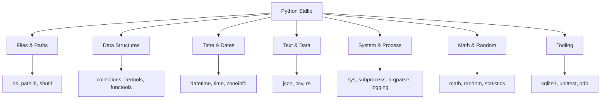
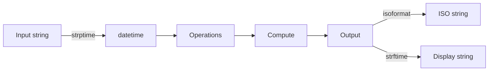
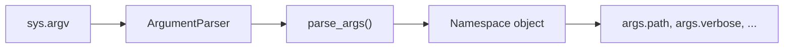
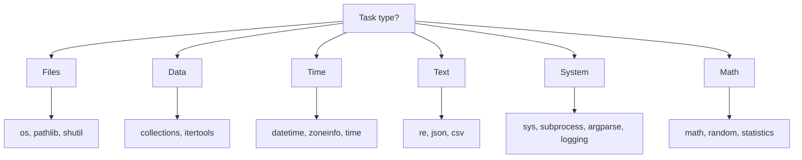
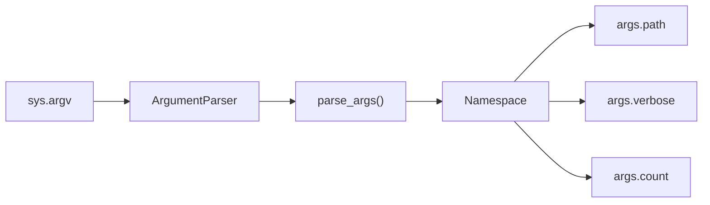
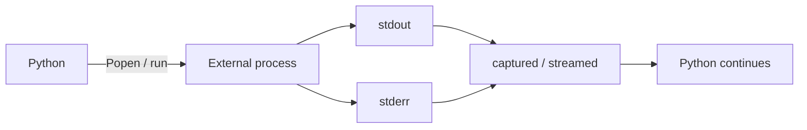
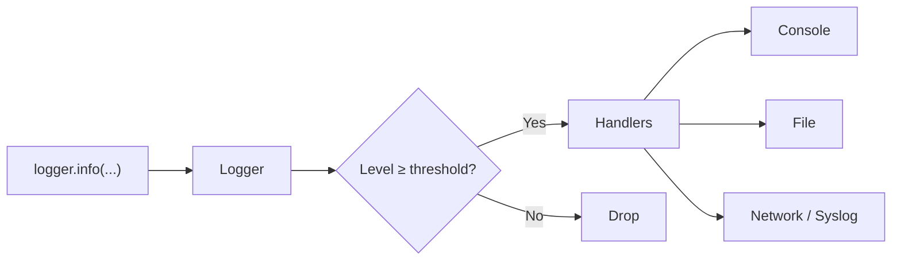

# Standard Library Essentials — Detailed Notes

---

## 1. What Is It? (Concept & Under the Hood)

The **Python Standard Library** ships with every Python installation — hundreds of modules covering files, dates, data structures, networking, text, math, serialization, and more. It's often described as **"batteries included"**: most programs never need third-party libraries for common tasks.

Key facts:
- **~200+ modules** in the default install.
- Written in a mix of **C** (performance-critical) and **Python**.
- Stable API — backwards compatible across minor versions.
- Importable without installation.
- Organized by domain: text, numbers, files, dates, networking, concurrency, etc.

### The Most-Used Modules — A Mental Map



### What's Covered Here

This section covers the **high-frequency** modules — the ones you'll use week after week. Some (pathlib, itertools, functools, json, csv, re) were covered in depth elsewhere; here they get a quick refresher plus practical examples.

### Characteristics of Stdlib Code

| Aspect | Value |
|---|---|
| Stability | Backwards-compatible (rare deprecations) |
| Performance | C-accelerated where it matters |
| Dependencies | None — self-contained |
| Documentation | `help()`, `pydoc`, docs.python.org |
| Discoverability | `dir(module)`, `help(module)` |

---

## 2. `os` and `sys` — System Interface

### `os` — Operating System Bridge

Cross-platform access to filesystem, environment, and OS operations.

```python
import os

# Environment
os.environ["HOME"]                       # read
os.environ.get("DEBUG", "0")             # safe read
os.environ["MY_VAR"] = "value"            # set (child processes see it)

# Working directory
os.getcwd()                              # current directory
os.chdir("/tmp")                         # change

# Files & directories
os.listdir(".")                          # names only
os.mkdir("dir")                          # single level
os.makedirs("a/b/c", exist_ok=True)      # recursive
os.remove("file.txt")                    # delete file
os.rmdir("dir")                          # delete empty dir
os.rename("old", "new")                  # rename/move
os.replace("src", "dst")                 # atomic (POSIX)

# File metadata
os.stat("file.txt")                      # stat_result
os.stat("file.txt").st_size              # bytes
os.path.exists("file.txt")
os.path.isfile("file.txt")
os.path.isdir("dir")

# Walking directories (fast, iterator-based)
with os.scandir(".") as it:
    for entry in it:
        if entry.is_file():
            print(entry.name, entry.stat().st_size)

# Recursive walk (classic)
for root, dirs, files in os.walk("project"):
    for f in files:
        print(os.path.join(root, f))

# Path manipulation (prefer pathlib for new code)
os.path.join("a", "b", "c.txt")          # 'a/b/c.txt'
os.path.basename("/a/b/c.txt")           # 'c.txt'
os.path.dirname("/a/b/c.txt")            # '/a/b'
os.path.splitext("f.tar.gz")             # ('f.tar', '.gz')
os.path.abspath("./x")                   # absolute path
```

**When to use `os` vs `pathlib`:**
- `os` — low-level, POSIX-style operations, environment variables, process info.
- `pathlib` — object-oriented paths, modern code.

### `sys` — Interpreter Interface

```python
import sys

sys.argv                     # command-line arguments
sys.version                  # Python version string
sys.version_info             # named tuple: (3, 11, 7, 'final', 0)
sys.executable               # path to interpreter
sys.path                     # import search path
sys.modules                  # imported module cache
sys.platform                 # 'linux', 'darwin', 'win32'
sys.maxsize                  # largest int (2^63 - 1 on 64-bit)
sys.getrecursionlimit()      # default 1000
sys.getsizeof(obj)           # memory size in bytes
sys.prefix, sys.base_prefix  # venv detection
sys.stdin, sys.stdout, sys.stderr   # standard streams

# Exit with a status code
sys.exit(0)                  # success
sys.exit(1)                  # error
sys.exit("error message")    # prints and exits with code 1

# Recursion limit (careful — can crash C stack)
sys.setrecursionlimit(5000)
```

### Detecting Environment

```python
import os, sys

def is_venv() -> bool:
    return sys.prefix != sys.base_prefix

def is_ci() -> bool:
    return os.environ.get("CI", "").lower() in {"true", "1"}

def is_docker() -> bool:
    return os.path.exists("/.dockerenv")
```

### Version Checking

```python
if sys.version_info < (3, 10):
    raise RuntimeError("Python 3.10+ required")
```

### `os` vs `sys` — Division of Labor

| Module | Domain |
|---|---|
| `os` | Files, directories, environment, processes |
| `sys` | Interpreter state, argv, streams, version |
| `os.path` | Path string operations |
| `sys.path` | Module search path |

---

## 3. `pathlib` — Modern Path Handling (Refresher)

**Full treatment in §File Handling & I/O.** Key API:

```python
from pathlib import Path

p = Path("data") / "users" / "ada.txt"

p.exists()                                  # bool
p.is_file() / p.is_dir()
p.read_text(encoding="utf-8")               # read
p.write_text("data", encoding="utf-8")      # write
p.read_bytes() / p.write_bytes(b"\x00")
p.parent, p.name, p.stem, p.suffix
p.mkdir(parents=True, exist_ok=True)
p.unlink()                                  # delete file
p.glob("*.py")                              # non-recursive
p.rglob("*.py")                             # recursive
p.resolve()                                 # absolute path
p.touch()                                   # create empty file
```

Conveniences:
```python
Path.home()                                 # user home
Path.cwd()                                  # current directory
Path(__file__).parent                       # script's directory
```

`pathlib` beats `os.path` for readability and cross-platform correctness — use it in new code.

---

## 4. `datetime` — Dates, Times, Timezones

### The Core Types

| Type | Meaning | Example |
|---|---|---|
| `date` | Calendar date | `2024-01-15` |
| `time` | Wall-clock time | `14:30:00` |
| `datetime` | Date + time | `2024-01-15 14:30:00` |
| `timedelta` | Duration | `2 days, 3:00:00` |
| `timezone` | Fixed offset | UTC+5:30 |
| `tzinfo` | Abstract timezone |

### Current Time

```python
from datetime import datetime, date, time, timedelta, timezone

now = datetime.now()                        # naive local
utc = datetime.now(timezone.utc)            # aware UTC
today = date.today()                        # just the date
```

**Naive** = no timezone. **Aware** = has `tzinfo`. Never compare the two — it raises `TypeError`.

### Creating Specific Dates

```python
d = datetime(2024, 1, 15, 14, 30, 0)
d = datetime(2024, 1, 15, 14, 30, tzinfo=timezone.utc)

# Parse strings
datetime.fromisoformat("2024-01-15T14:30:00+00:00")
datetime.strptime("2024-01-15", "%Y-%m-%d")
datetime.strptime("15/01/2024 14:30", "%d/%m/%Y %H:%M")
```

### Formatting

```python
now = datetime(2024, 1, 15, 14, 30, 45)

now.isoformat()                             # '2024-01-15T14:30:45'
now.strftime("%Y-%m-%d %H:%M:%S")           # '2024-01-15 14:30:45'
f"{now:%Y-%m-%d}"                           # f-strings also work
now.strftime("%B %d, %Y")                   # 'January 15, 2024'
```

**Common format codes:**

| Code | Meaning | Example |
|---|---|---|
| `%Y` | 4-digit year | 2024 |
| `%m` | Month | 01–12 |
| `%d` | Day | 01–31 |
| `%H` | Hour (24h) | 00–23 |
| `%M` | Minute | 00–59 |
| `%S` | Second | 00–59 |
| `%f` | Microsecond | 000000–999999 |
| `%A` | Weekday name | Monday |
| `%B` | Month name | January |
| `%z` | UTC offset | +0000 |
| `%Z` | Timezone name | UTC |

### Arithmetic with `timedelta`

```python
today = date(2024, 1, 15)

tomorrow = today + timedelta(days=1)
next_week = today + timedelta(weeks=1)
yesterday = today - timedelta(days=1)

delta = datetime(2024, 1, 20) - datetime(2024, 1, 15)
delta.days                                  # 5
delta.total_seconds()                       # 432000.0

# Careful: months/years aren't fixed-length
# Use dateutil.relativedelta for calendar arithmetic
```

### Timezones — Use `zoneinfo` (3.9+)

```python
from datetime import datetime
from zoneinfo import ZoneInfo

now_ny = datetime.now(ZoneInfo("America/New_York"))
now_utc = datetime.now(ZoneInfo("UTC"))

# Convert between zones
now_utc.astimezone(ZoneInfo("Asia/Tokyo"))
```

**Prefer `zoneinfo` over `pytz`** — it's built in and uses the system's tzdata (or the `tzdata` PyPI package).

### Timestamps

```python
import time
from datetime import datetime, timezone

# datetime → unix timestamp
ts = datetime.now(timezone.utc).timestamp()    # float seconds

# unix timestamp → datetime
dt = datetime.fromtimestamp(ts, tz=timezone.utc)

# time module — simpler
time.time()                                    # current unix timestamp
time.perf_counter()                            # monotonic, for timing
time.sleep(1.5)                                # sleep
time.monotonic()                               # monotonic clock
```

### Comparing Dates

```python
d1 = date(2024, 1, 15)
d2 = date(2024, 1, 20)

d1 < d2                # True
d2 - d1                # timedelta(days=5)
d1 == d1               # True
```

**Never compare naive and aware** — raises `TypeError`.

### Real-World Example — Age Calculator

```python
from datetime import date

def age(birthdate: date) -> int:
    today = date.today()
    years = today.year - birthdate.year
    if (today.month, today.day) < (birthdate.month, birthdate.day):
        years -= 1
    return years
```

### Common Pitfalls

| Pitfall | Fix |
|---|---|
| Naive vs aware comparison | Always use aware datetimes |
| Storing local time | Store UTC; convert at edges |
| Assuming month = 30 days | Use `dateutil.relativedelta` |
| Using `time.time()` for elapsed | Use `time.perf_counter()` |
| `strptime` wrong format | Match format strings exactly |
| Timezone as string | Use `ZoneInfo(...)` |

### Mermaid — Date/Time Pipeline



---

## 5. `collections` — Specialized Containers

The `collections` module provides **high-performance alternatives** to the built-in containers.

### `Counter` — Tallying

```python
from collections import Counter

Counter("hello")                         # Counter({'l': 2, 'h': 1, 'e': 1, 'o': 1})
Counter([1, 2, 2, 3, 3, 3])              # Counter({3: 3, 2: 2, 1: 1})

c = Counter("abracadabra")
c.most_common(3)                         # [('a', 5), ('b', 2), ('r', 2)]
c["a"]                                    # 5
c["z"]                                    # 0 (missing keys default to 0)
c.total()                                 # sum of counts (3.10+)

# Arithmetic
c1 = Counter("aabbb")
c2 = Counter("ab")
c1 + c2                                   # counts add
c1 - c2                                   # counts subtract (keep positive)
c1 & c2                                   # min counts
c1 | c2                                   # max counts

# Update
c.update("hello")
c.subtract("hel")
```

**Common uses:** word frequency, histogram, majority elements.

### `defaultdict` — Auto-Initializing

```python
from collections import defaultdict

groups = defaultdict(list)
for name, dept in records:
    groups[dept].append(name)
# No need to check if dept exists

counts = defaultdict(int)
for word in words:
    counts[word] += 1

# Custom factory
tree = defaultdict(lambda: defaultdict(list))
tree["a"]["b"].append(1)
```

Contrast with `dict.setdefault`:

```python
# defaultdict — simpler
groups = defaultdict(list)
groups[key].append(value)

# dict — more verbose
groups = {}
groups.setdefault(key, []).append(value)
```

`defaultdict` is faster and cleaner for repeated grouping/counting.

### `deque` — Double-Ended Queue

```python
from collections import deque

dq = deque([1, 2, 3])

dq.append(4)                             # right
dq.appendleft(0)                         # left — O(1)
dq.pop()                                 # right — O(1)
dq.popleft()                             # left — O(1)

dq.extend([5, 6])
dq.extendleft([-1, -2])                  # prepends in reverse

dq.rotate(1)                             # right by 1
dq.rotate(-1)                            # left by 1

# Bounded — discards from opposite end
recent = deque(maxlen=3)
for x in range(10):
    recent.append(x)
# deque([7, 8, 9], maxlen=3)
```

`deque` beats `list` for **FIFO queues** — `list.pop(0)` is O(n); `deque.popleft()` is O(1).

### `namedtuple` — Tuples with Field Names

```python
from collections import namedtuple

Point = namedtuple("Point", ["x", "y"])
p = Point(1, 2)

p.x                                      # 1
p[0]                                     # 1
p._asdict()                              # {'x': 1, 'y': 2}
p._replace(x=10)                         # Point(x=10, y=2)

# Defaults
Point = namedtuple("Point", "x y", defaults=[0, 0])
Point()                                  # Point(x=0, y=0)
```

Or use `typing.NamedTuple` for type hints:

```python
from typing import NamedTuple

class Point(NamedTuple):
    x: int
    y: int = 0
```

### `OrderedDict` — Rarely Needed

Regular dicts preserve insertion order since 3.7. `OrderedDict` remains useful for:

- **Explicit ordering equality** — `OrderedDict([('a',1),('b',2)]) == OrderedDict([('b',2),('a',1)])` is `False`.
- **`move_to_end()`** — for LRU caches.

```python
from collections import OrderedDict

od = OrderedDict([("a", 1), ("b", 2)])
od.move_to_end("a")                      # move to end
od.popitem(last=False)                   # FIFO pop
```

### `ChainMap` — Layered Dictionaries

```python
from collections import ChainMap

defaults = {"color": "red", "size": "M"}
overrides = {"color": "blue"}

config = ChainMap(overrides, defaults)
config["color"]                          # 'blue'
config["size"]                           # 'M' (falls through)
```

Useful for config layering: user → project → defaults.

### Comparison Table

| Container | Ordered | Unique | Fast end | Best for |
|---|---|---|---|---|
| `list` | ✅ | ❌ | Right | Sequences |
| `deque` | ✅ | ❌ | Both | Queues |
| `Counter` | ✅ | Keys | — | Counting |
| `defaultdict` | ✅ | Keys | — | Grouping |
| `namedtuple` | ✅ | ❌ | — | Records |
| `OrderedDict` | ✅ | Keys | — | LRU caches |
| `ChainMap` | ✅ | Keys | — | Layered config |

---

## 6. `itertools` and `functools` (Refresher)

**Full treatment in §Iterators/Generators and §Functional Programming.**

### `itertools` — Iterator Building Blocks

```python
from itertools import (
    count, cycle, repeat,                    # infinite
    chain, islice, tee, groupby, accumulate, # terminating
    product, permutations, combinations,     # combinatoric
    zip_longest, filterfalse, takewhile, dropwhile,
    starmap, compress, pairwise,
)

count(10)                                    # 10, 11, 12, ...
cycle("ABC")                                 # A, B, C, A, B, C, ...
chain([1, 2], [3, 4])                        # 1, 2, 3, 4
islice(range(100), 5)                        # first 5
groupby(sorted(data, key=k), key=k)          # requires sorting
accumulate([1, 2, 3, 4])                     # [1, 3, 6, 10]
product("AB", "12")                          # 4 tuples
combinations("ABC", 2)                       # 3 tuples
pairwise([1, 2, 3])                          # [(1,2), (2,3)]
```

### `functools` — Higher-Order Utilities

```python
from functools import (
    partial, lru_cache, cache, cached_property,
    reduce, wraps, singledispatch, total_ordering,
)

@lru_cache(maxsize=128)
def fib(n): return n if n < 2 else fib(n - 1) + fib(n - 2)

double = partial(pow, exp=2)                 # freeze args
double(5)                                    # 25

@singledispatch
def render(x): raise TypeError

@render.register
def _(x: int): return f"int: {x}"

@total_ordering
class V:
    def __eq__(self, o): return self.x == o.x
    def __lt__(self, o): return self.x < o.x
```

### When to Use Which

| Task | Tool |
|---|---|
| Stream of numbers | `count`, `cycle`, `repeat` |
| Flatten iterables | `chain`, `chain.from_iterable` |
| Slice iterator | `islice` |
| Clone iterator | `tee` |
| Group runs | `groupby` |
| Running reduction | `accumulate` |
| Combinatorics | `product`, `permutations`, `combinations` |
| Freeze args | `partial` |
| Cache | `lru_cache`, `cache` |
| Type dispatch | `singledispatch` |
| Fill comparisons | `total_ordering` |

---

## 7. `json`, `csv`, `re` (Refresher)

**Full treatments in §File Handling and §Advanced Python.**

### `json` — Structured Data

```python
import json

# File
with open("data.json", encoding="utf-8") as f:
    data = json.load(f)

with open("out.json", "w", encoding="utf-8") as f:
    json.dump(data, f, indent=2, ensure_ascii=False)

# String
data = json.loads('{"name": "Ada"}')
text = json.dumps(data, indent=2, sort_keys=True)
```

**Key options:** `indent`, `ensure_ascii`, `sort_keys`, `default`, `separators`.

### `csv` — Tabular Text

```python
import csv

with open("data.csv", newline="", encoding="utf-8") as f:
    reader = csv.DictReader(f)
    for row in reader:
        print(row["name"])

with open("out.csv", "w", newline="", encoding="utf-8") as f:
    writer = csv.DictWriter(f, fieldnames=["name", "age"])
    writer.writeheader()
    writer.writerows([{"name": "Ada", "age": 36}])
```

**Always use `newline=""`** for CSV — avoids blank lines on Windows.

### `re` — Regular Expressions

```python
import re

PATTERN = re.compile(r"(?P<name>\w+)@(?P<host>\w+)", re.IGNORECASE)

m = PATTERN.search("Contact: ada@example")
m.group("name")                              # 'ada'
m.groupdict()                                # {'name': 'ada', 'host': 'example'}

re.findall(r"\d+", "a1b22c333")              # ['1', '22', '333']
re.sub(r"\d+", "#", "a1b22c333")             # 'a#b#c#'
re.split(r"\s+", "a b  c")                   # ['a', 'b', 'c']
```

**Always compile patterns used in hot paths.**

---

## 8. `math`, `random`, `statistics`

### `math` — Floating-Point Math

```python
import math

math.pi, math.e, math.tau                    # 3.14..., 2.72..., 6.28...
math.inf, math.nan                           # inf, nan

math.sqrt(16)                                # 4.0
math.pow(2, 10)                              # 1024.0
math.exp(1)                                  # 2.718...
math.log(100, 10)                            # 2.0
math.log2(1024)                              # 10.0

math.floor(3.7)                              # 3
math.ceil(3.2)                               # 4
math.trunc(3.7)                              # 3

math.fabs(-5)                                # 5.0
math.gcd(12, 18)                             # 6
math.lcm(4, 6)                               # 12 (3.9+)
math.factorial(5)                            # 120

math.isclose(0.1 + 0.2, 0.3)                 # True
math.isnan(x)
math.isinf(x)

# Trig
math.sin(math.pi / 2)                        # 1.0
math.cos(0)                                  # 1.0
math.degrees(math.pi)                        # 180.0
math.radians(180)                            # 3.14159...
```

### `random` — Random Numbers

```python
import random

random.random()                              # [0.0, 1.0)
random.uniform(1, 10)                        # float in range
random.randint(1, 6)                         # inclusive int
random.randrange(0, 100, 5)                  # like range

random.choice(["a", "b", "c"])               # one item
random.choices(population, k=5)              # with replacement
random.sample(range(100), k=10)              # without replacement
random.shuffle(lst)                          # in place

# Reproducibility
random.seed(42)
random.random()                              # deterministic

# Cryptographic randomness
import secrets
secrets.token_hex(16)                        # cryptographically secure
secrets.token_urlsafe(32)
secrets.randbelow(100)
```

**Never use `random` for security** — use `secrets`.

### `statistics` — Descriptive Statistics

```python
import statistics

data = [1, 2, 3, 4, 5, 6, 7, 8, 9, 100]

statistics.mean(data)                        # 14.5
statistics.median(data)                      # 5.5
statistics.mode([1, 2, 2, 3])                # 2
statistics.multimode([1, 2, 2, 3, 3])        # [2, 3] (3.8+)

statistics.stdev(data)                       # sample stdev
statistics.pstdev(data)                      # population stdev
statistics.variance(data)
statistics.pvariance(data)

statistics.quantiles(data, n=4)              # quartiles
statistics.fmean(data)                       # faster float mean
statistics.geometric_mean([1, 2, 4])         # 2.0
statistics.harmonic_mean([1, 2, 4])          # 1.71...
```

### When to Use Which

| Task | Module |
|---|---|
| Trig, log, sqrt | `math` |
| Random choice/shuffle | `random` |
| Cryptographic tokens | `secrets` |
| Descriptive stats | `statistics` |
| Large numeric arrays | `numpy` (3rd party) |

---

## 9. `logging` — Structured, Level-Based Output

### Why Not `print`?

`print` writes to stdout always. `logging` gives:
- **Levels** — debug/info/warning/error/critical.
- **Destinations** — console, file, syslog, network.
- **Formatting** — timestamps, module, line number.
- **Filtering** — log level per logger.
- **Hierarchy** — `myapp.db` inherits from `myapp`.

### Basic Setup

```python
import logging

logging.basicConfig(
    level=logging.INFO,
    format="%(asctime)s [%(levelname)s] %(name)s: %(message)s",
    datefmt="%Y-%m-%d %H:%M:%S",
)

logging.debug("hidden unless level=DEBUG")
logging.info("info message")
logging.warning("warning")
logging.error("error")
logging.critical("critical")
```

### Logger per Module — The Standard Pattern

```python
# mymodule.py
import logging

logger = logging.getLogger(__name__)         # e.g. "mypackage.mymodule"

def process(data):
    logger.info("processing %d items", len(data))
    try:
        ...
    except Exception:
        logger.exception("failed")           # includes traceback
        raise
```

**Never use `logging.info(...)` directly** — always `logger.info(...)` via a module-level logger.

### Log Levels

| Level | Numeric | Use for |
|---|---|---|
| `DEBUG` | 10 | Detailed diagnostics |
| `INFO` | 20 | Normal events |
| `WARNING` | 30 | Something unexpected (default) |
| `ERROR` | 40 | Failure, but program continues |
| `CRITICAL` | 50 | Program may not continue |

### Lazy Formatting

```python
# ✅ Arguments formatted only if log emitted
logger.info("user %s logged in from %s", user_id, ip)

# ❌ Always formats the string
logger.info(f"user {user_id} logged in from {ip}")
```

### Handlers and Formatters

```python
import logging
from logging.handlers import RotatingFileHandler

logger = logging.getLogger("myapp")
logger.setLevel(logging.DEBUG)

# Console
console = logging.StreamHandler()
console.setLevel(logging.INFO)
console.setFormatter(logging.Formatter("%(levelname)s: %(message)s"))

# File with rotation
file_handler = RotatingFileHandler(
    "app.log", maxBytes=10_000_000, backupCount=5
)
file_handler.setLevel(logging.DEBUG)
file_handler.setFormatter(logging.Formatter(
    "%(asctime)s %(name)s %(levelname)s %(message)s"
))

logger.addHandler(console)
logger.addHandler(file_handler)
```

### Structured Logging (JSON)

```python
import logging, json

class JSONFormatter(logging.Formatter):
    def format(self, record):
        log = {
            "time": self.formatTime(record),
            "level": record.levelname,
            "logger": record.name,
            "message": record.getMessage(),
        }
        if record.exc_info:
            log["exception"] = self.formatException(record.exc_info)
        return json.dumps(log)

handler = logging.StreamHandler()
handler.setFormatter(JSONFormatter())
logging.basicConfig(handlers=[handler], level=logging.INFO)
```

Structured logs are parseable by log aggregators (ELK, Datadog, Splunk).

### Exception Logging

```python
try:
    risky()
except Exception:
    logger.exception("operation failed")     # includes traceback
    # or:
    logger.error("failed: %s", e, exc_info=True)
```

`logger.exception(...)` is `logger.error(..., exc_info=True)`.

### Best Practices

| Do | Don't |
|---|---|
| One logger per module | `logging.info(...)` globally |
| Lazy `%s` formatting | f-strings in log calls |
| Use `logger.exception` for errors | `logging.error(traceback)` |
| Configure at `if __name__ == "__main__"` | Configure at module import |
| Log exceptions, not just messages | Log secrets/passwords |
| Structured (JSON) in production | Print to stdout |

---

## 10. `argparse` — Command-Line Interfaces

### Basic Parser

```python
import argparse

def main():
    parser = argparse.ArgumentParser(
        prog="myapp",
        description="Process some files.",
    )
    parser.add_argument("path", help="input file path")
    parser.add_argument("-v", "--verbose", action="store_true",
                        help="verbose output")
    parser.add_argument("-n", "--count", type=int, default=10,
                        help="number of items")
    parser.add_argument("--format", choices=["json", "csv"],
                        default="json")
    args = parser.parse_args()

    if args.verbose:
        print(f"processing {args.path}")
    print(f"count={args.count}, format={args.format}")

if __name__ == "__main__":
    main()
```

### Common Argument Types

| Declaration | Meaning |
|---|---|
| `add_argument("path")` | Required positional |
| `add_argument("-v", "--verbose", action="store_true")` | Boolean flag |
| `add_argument("-n", type=int, default=10)` | Typed option with default |
| `add_argument("--items", nargs="+")` | One or more values |
| `add_argument("--items", nargs="*")` | Zero or more values |
| `add_argument("--key=value", action="append")` | Repeatable |
| `add_argument("--format", choices=[...])` | Restricted set |
| `add_argument("--config", type=argparse.FileType("r"))` | File handle |

### Subcommands

```python
parser = argparse.ArgumentParser()
sub = parser.add_subparsers(dest="command", required=True)

add = sub.add_parser("add", help="add item")
add.add_argument("name")

remove = sub.add_parser("remove", help="remove item")
remove.add_argument("name")

args = parser.parse_args()

if args.command == "add":
    do_add(args.name)
elif args.command == "remove":
    do_remove(args.name)
```

### Custom Types

```python
def positive_int(value):
    n = int(value)
    if n <= 0:
        raise argparse.ArgumentTypeError(f"must be positive: {value}")
    return n

parser.add_argument("--count", type=positive_int, default=10)
```

### Argument Groups — Nicer Help

```python
parser = argparse.ArgumentParser()
group = parser.add_argument_group("network options")
group.add_argument("--host", default="localhost")
group.add_argument("--port", type=int, default=8080)
```

### Auto-Generated Help

```bash
$ python app.py --help
usage: myapp [-h] [-v] [-n COUNT] [--format {json,csv}] path

Process some files.

positional arguments:
  path                  input file path

options:
  -h, --help            show this help message and exit
  -v, --verbose         verbose output
  -n COUNT, --count COUNT
                        number of items
  --format {json,csv}
```

### Comparison — Parsing Libraries

| Library | Built-in? | Subcommands | Style |
|---|---|---|---|
| `argparse` | ✅ | ✅ | Standard |
| `optparse` | ✅ (deprecated) | ❌ | Legacy |
| `getopt` | ✅ | ❌ | C-style |
| `click` | ❌ | ✅ | Decorator-based |
| `typer` | ❌ | ✅ | Type-hint-based |

Use `argparse` for stdlib-only projects; `click`/`typer` for richer CLIs.

### Argument Flow



---

## 11. `subprocess` — Running External Commands

### Basic Run

```python
import subprocess

result = subprocess.run(
    ["ls", "-la"],
    capture_output=True,
    text=True,
    check=True,
)
print(result.stdout)
print(result.returncode)                     # 0
```

**Never use `shell=True` with user input** — command injection.

### Key Parameters

| Parameter | Purpose |
|---|---|
| `args` | List of arguments (preferred) or string |
| `capture_output=True` | Capture stdout + stderr |
| `text=True` | Decode bytes to str |
| `check=True` | Raise on non-zero exit |
| `timeout=N` | Kill after N seconds |
| `cwd=path` | Working directory |
| `env=dict` | Environment variables |
| `input=str` | Send to stdin |

### Capturing Output

```python
result = subprocess.run(
    ["git", "rev-parse", "HEAD"],
    capture_output=True, text=True, check=True,
)
commit = result.stdout.strip()
```

### Handling Errors

```python
try:
    result = subprocess.run(
        ["git", "status"],
        capture_output=True, text=True, check=True,
        timeout=10,
    )
except subprocess.CalledProcessError as e:
    print(f"command failed: {e.returncode}")
    print(e.stderr)
except subprocess.TimeoutExpired:
    print("timed out")
except FileNotFoundError:
    print("command not found")
```

### Piping

```python
# ls | grep py
p1 = subprocess.Popen(["ls"], stdout=subprocess.PIPE)
p2 = subprocess.Popen(["grep", "py"], stdin=p1.stdout, stdout=subprocess.PIPE)
p1.stdout.close()
output = p2.communicate()[0]
```

Or with `shell=True` (careful — only with trusted input):

```python
result = subprocess.run(
    "ls | grep .py",
    shell=True, capture_output=True, text=True,
)
```

### `Popen` — Low-Level Control

```python
proc = subprocess.Popen(
    ["python", "-u", "long_running.py"],
    stdout=subprocess.PIPE,
    text=True,
)

for line in proc.stdout:
    print(f"got: {line.rstrip()}")

proc.wait()
```

Useful for streaming output line by line.

### Common Patterns

**Check if a command exists:**

```python
import shutil

if shutil.which("ffmpeg") is None:
    raise SystemExit("ffmpeg is required")
```

**Run and stream output live:**

```python
subprocess.run(["ffmpeg", "-i", "in.mp4", "out.mp4"], check=True)
```

**Capture with real-time output:**

```python
with subprocess.Popen(
    cmd, stdout=subprocess.PIPE, stderr=subprocess.STDOUT, text=True, bufsize=1
) as proc:
    for line in proc.stdout:
        print(line, end="")
```

### Security — Command Injection

```python
# ❌ DANGEROUS
subprocess.run(f"ls {user_input}", shell=True)

# ✅ Safe — no shell
subprocess.run(["ls", user_input], check=True)
```

With `shell=True`, the input is interpreted by `/bin/sh` — a user could inject `; rm -rf /`.

### `subprocess` vs `os.system`

| | `subprocess.run` | `os.system` |
|---|---|---|
| Return | `CompletedProcess` | Exit code only |
| Capture output | ✅ | ❌ |
| Env / cwd control | ✅ | Limited |
| Safety | Good with list args | Shell injection |
| Recommended | ✅ | ❌ |

Use `subprocess` — `os.system` is legacy.

---

## 12. `sqlite3` — Embedded Database

### What Is It?

`sqlite3` wraps **SQLite** — a self-contained, file-based SQL database. It requires no server, no configuration, and ships with Python.

### Connect and Query

```python
import sqlite3

conn = sqlite3.connect("app.db")
cursor = conn.cursor()

# Create table
cursor.execute("""
    CREATE TABLE IF NOT EXISTS users (
        id INTEGER PRIMARY KEY,
        name TEXT NOT NULL,
        email TEXT UNIQUE,
        created_at TIMESTAMP DEFAULT CURRENT_TIMESTAMP
    )
""")

# Insert
cursor.execute(
    "INSERT INTO users (name, email) VALUES (?, ?)",
    ("Ada", "ada@example.com"),
)
conn.commit()

# Query
cursor.execute("SELECT id, name FROM users WHERE name = ?", ("Ada",))
for row in cursor:
    print(row)                                # (1, 'Ada')

conn.close()
```

**Always use `?` placeholders** — never string formatting.

### Row Factory — Dict-Like Rows

```python
conn = sqlite3.connect("app.db")
conn.row_factory = sqlite3.Row

cursor = conn.execute("SELECT * FROM users")
for row in cursor:
    print(row["name"], row["email"])          # dict-like access
```

### Context Manager — Auto-Commit/Rollback

```python
with sqlite3.connect("app.db") as conn:
    conn.execute("INSERT INTO users (name) VALUES (?)", ("Alan",))
    # commits on success, rolls back on exception
```

### `executemany` — Bulk Insert

```python
data = [("Ada", "ada@x.com"), ("Alan", "alan@x.com")]
conn.executemany("INSERT INTO users (name, email) VALUES (?, ?)", data)
conn.commit()
```

### Parameter Styles

| Style | Example |
|---|---|
| `?` (qmark) | `WHERE name = ?` |
| `:name` (named) | `WHERE name = :name` |

```python
cursor.execute("SELECT * FROM users WHERE name = :name", {"name": "Ada"})
```

### Transactions

```python
try:
    conn.execute("BEGIN")
    conn.execute("UPDATE accounts SET balance = balance - 100 WHERE id = 1")
    conn.execute("UPDATE accounts SET balance = balance + 100 WHERE id = 2")
    conn.commit()
except Exception:
    conn.rollback()
    raise
```

### Common Patterns

**Reusable connection:**

```python
from contextlib import contextmanager

@contextmanager
def db_connection(path):
    conn = sqlite3.connect(path)
    conn.row_factory = sqlite3.Row
    try:
        yield conn
        conn.commit()
    except Exception:
        conn.rollback()
        raise
    finally:
        conn.close()
```

**In-memory database (for tests):**

```python
conn = sqlite3.connect(":memory:")
```

**Migration / schema check:**

```python
cursor.execute("SELECT name FROM sqlite_master WHERE type='table'")
tables = [row[0] for row in cursor]
```

### When to Use SQLite

✅ **Use for:**
- Local app data (mobile, desktop).
- Prototypes and tests.
- Small analytics (up to ~1 TB, single writer).
- Config / state storage.

❌ **Don't use for:**
- High-concurrency writes (single writer).
- Network-accessed databases.
- Very large analytics (use Postgres).

### Comparison — SQLite vs Client-Server DBs

| | SQLite | Postgres / MySQL |
|---|---|---|
| Setup | None | Server required |
| Concurrency | Single writer | Many writers |
| Network | Local only | Network |
| Size limit | ~281 TB | Effectively unlimited |
| Use case | Local, embedded | Server apps |

---

## 13. Real-World Use Cases

### Use Case 1 — CLI File Processing

```python
import argparse
from pathlib import Path
from collections import Counter

def main():
    parser = argparse.ArgumentParser()
    parser.add_argument("path", type=Path)
    parser.add_argument("--top", type=int, default=10)
    args = parser.parse_args()

    counter = Counter()
    for line in args.path.read_text(encoding="utf-8").splitlines():
        counter.update(line.lower().split())

    for word, count in counter.most_common(args.top):
        print(f"{count:6d}  {word}")

if __name__ == "__main__":
    main()
```

### Use Case 2 — Config Layer with `ChainMap`

```python
from collections import ChainMap
import os, json
from pathlib import Path

def load_config():
    defaults = {"host": "localhost", "port": 8080, "debug": False}
    project = json.loads(Path("config.json").read_text()) if Path("config.json").exists() else {}
    env = {k[6:].lower(): v for k, v in os.environ.items() if k.startswith("APP_")}
    return ChainMap(env, project, defaults)

cfg = load_config()
cfg["host"]                                     # environment > project > defaults
```

### Use Case 3 — Structured Logging to File

```python
import logging
from logging.handlers import RotatingFileHandler

def setup_logging():
    handler = RotatingFileHandler(
        "app.log", maxBytes=10_000_000, backupCount=5
    )
    handler.setFormatter(logging.Formatter(
        "%(asctime)s %(name)s %(levelname)s %(message)s"
    ))

    root = logging.getLogger()
    root.setLevel(logging.INFO)
    root.addHandler(handler)

setup_logging()
logging.getLogger(__name__).info("app started")
```

### Use Case 4 — Running External Tools

```python
import subprocess
from pathlib import Path

def convert_video(src, dst):
    subprocess.run(
        ["ffmpeg", "-i", str(src), "-c:v", "libx264", str(dst)],
        check=True, capture_output=True,
    )
```

### Use Case 5 — SQLite as Local Store

```python
import sqlite3
from contextlib import contextmanager

@contextmanager
def db(path):
    conn = sqlite3.connect(path)
    conn.row_factory = sqlite3.Row
    try:
        yield conn
        conn.commit()
    finally:
        conn.close()

with db("app.db") as conn:
    conn.execute("""
        CREATE TABLE IF NOT EXISTS events (
            id INTEGER PRIMARY KEY,
            name TEXT, ts REAL
        )
    """)
    conn.execute("INSERT INTO events (name, ts) VALUES (?, ?)", ("login", 0))
```

### Use Case 6 — Stats Report

```python
import statistics
from pathlib import Path
import json

def report(path):
    data = json.loads(Path(path).read_text())
    times = [row["duration"] for row in data]

    return {
        "count": len(times),
        "mean": statistics.mean(times),
        "median": statistics.median(times),
        "p95": statistics.quantiles(times, n=20)[18],
        "stdev": statistics.stdev(times) if len(times) > 1 else 0,
    }
```

### Use Case 7 — Reproducible Sampling

```python
import random

def sample_reproducible(items, k, seed=42):
    rng = random.Random(seed)
    return rng.sample(items, k)
```

Using a local `Random` instance avoids polluting the global RNG state — critical for tests.

### Use Case 8 — Safe Temp Files

```python
import tempfile
from pathlib import Path

with tempfile.TemporaryDirectory() as tmp:
    p = Path(tmp) / "work.txt"
    p.write_text("data")
    process(p)
# tmp cleaned up automatically
```

### Use Case 9 — Debounced Timer

```python
import time
from contextlib import contextmanager

@contextmanager
def timer(label):
    start = time.perf_counter()
    try:
        yield
    finally:
        print(f"{label}: {time.perf_counter() - start:.3f}s")

with timer("load"):
    load_data()
```

### Use Case 10 — Log + CSV Pipeline

```python
import csv, logging
from pathlib import Path

logger = logging.getLogger(__name__)

def process_csv(path):
    with open(path, newline="", encoding="utf-8") as f:
        reader = csv.DictReader(f)
        rows = list(reader)

    logger.info("loaded %d rows from %s", len(rows), path)
    return rows
```

---

## 14. Common Pitfalls

### Pitfall 1 — Naive vs Aware `datetime`

```python
from datetime import datetime, timezone

a = datetime.now()                            # naive
b = datetime.now(timezone.utc)                # aware

a - b                                         # ❌ TypeError
```

Always work with aware datetimes for cross-timezone logic.

### Pitfall 2 — `random` for Security

```python
# ❌ Predictable
import random
token = "".join(random.choices("abcdef", k=16))

# ✅
import secrets
token = secrets.token_urlsafe(32)
```

### Pitfall 3 — `os.environ` Not Shared With Running Shell

```python
import os
os.environ["FOO"] = "bar"
# Only child processes see FOO — not the parent shell
```

### Pitfall 4 — Reading `sys.argv` Directly

```python
# ❌ No help, no validation
cmd = sys.argv[1]

# ✅ Use argparse
parser.add_argument("cmd")
```

### Pitfall 5 — `logging.info` Before Config

```python
import logging
logging.info("hello")                         # silently dropped — no handlers
```

Call `logging.basicConfig(...)` early, or configure loggers explicitly.

### Pitfall 6 — `shell=True` Command Injection

```python
# ❌ Dangerous
subprocess.run(f"rm {path}", shell=True)

# ✅
subprocess.run(["rm", path], check=True)
```

### Pitfall 7 — Forgetting `newline=""` With `csv`

Produces blank lines on Windows.

### Pitfall 8 — SQL Injection via f-strings

```python
# ❌
cursor.execute(f"SELECT * FROM users WHERE name = '{name}'")

# ✅
cursor.execute("SELECT * FROM users WHERE name = ?", (name,))
```

### Pitfall 9 — `defaultdict` Side Effects

```python
d = defaultdict(int)
d["missing"]                                  # inserts 0 silently!

# ✅ Use `in` if you don't want insertion
if "key" in d:
    ...
```

### Pitfall 10 — Deque Without `maxlen` Grows

```python
# ❌ Unbounded — grows forever
buffer = deque()

# ✅ Bounded
buffer = deque(maxlen=1000)
```

### Pitfall 11 — Modifying a `Counter` While Iterating

```python
c = Counter("hello")
for k in c:                                   # ❌ may raise if you mutate
    del c[k]
```

Iterate over `list(c)` to snapshot.

### Pitfall 12 — `statistics.quantiles` Requires n ≥ 2 Points

```python
statistics.quantiles([1], n=4)                # ❌ StatisticsError
```

### Pitfall 13 — `subprocess.run` Without `check=True`

```python
result = subprocess.run(["false"])            # silent failure
result.returncode                             # 1 — you must check
```

Use `check=True` unless you want to inspect the return code.

### Pitfall Summary Table

| Pitfall | Symptom | Fix |
|---|---|---|
| Naive + aware | `TypeError` | Always aware |
| `random` for tokens | Insecure | `secrets` |
| `shell=True` | Injection | List args |
| SQL via f-string | Injection | Parameterized queries |
| `logging.info` unconfigured | No output | `basicConfig` first |
| Missing `newline=""` | Blank CSV lines | Add it |
| `defaultdict` inserts | Unexpected keys | `in` check |
| Unbounded `deque` | Memory growth | `maxlen` |
| `subprocess` no check | Silent failure | `check=True` |

---

## 15. Comparison Tables

### Text Processing — `str` vs `re` vs `csv` vs `json`

| Task | Best tool |
|---|---|
| Simple split | `str.split` |
| Trim | `str.strip` |
| Complex pattern match | `re` |
| Structured tabular | `csv` |
| Hierarchical | `json` |
| Binary format | `pickle` (unsafe), `msgpack` |

### Data Structures — Built-in vs `collections`

| Need | Built-in | `collections` |
|---|---|---|
| Ordered list | `list` | — |
| FIFO queue | ❌ O(n) | `deque` |
| Counting | Manual dict | `Counter` |
| Grouping | Manual dict | `defaultdict` |
| Named record | `tuple` | `namedtuple` |
| Strict ordering | `dict` | `OrderedDict` |
| Layered dicts | Manual | `ChainMap` |

### Files — Path APIs

| Task | `os.path` | `pathlib` |
|---|---|---|
| Join | `os.path.join(a, b)` | `Path(a) / b` |
| Basename | `os.path.basename(p)` | `Path(p).name` |
| Ext | `os.path.splitext(p)` | `Path(p).suffix` |
| Read | `open(p).read()` | `Path(p).read_text()` |
| Glob | `glob.glob(p)` | `Path(".").glob(p)` |
| Exists | `os.path.exists(p)` | `Path(p).exists()` |

### Date Libraries

| Need | Tool |
|---|---|
| Current time | `datetime.now` |
| Parse ISO | `datetime.fromisoformat` |
| Parse custom | `datetime.strptime` |
| Timezones | `zoneinfo` |
| Calendar arithmetic | `dateutil.relativedelta` |
| High-resolution timing | `time.perf_counter` |
| Unix timestamps | `time.time`, `datetime.timestamp` |

### Logging — When to Use What

| Output | Tool |
|---|---|
| User-facing text | `print` |
| Diagnostic messages | `logging` |
| Structured JSON logs | Custom formatter |
| Error with traceback | `logger.exception` |
| Fast numeric output | `sys.stdout.write` |

### HTTP Clients

| Library | Sync/Async | Notes |
|---|---|---|
| `urllib.request` | Sync | Stdlib, low-level |
| `http.client` | Sync | Lower level |
| `requests` | Sync | 3rd party, ergonomic |
| `httpx` | Both | 3rd party, modern |
| `aiohttp` | Async | 3rd party |

### Comparing Arg Parsers

| Feature | `argparse` | `click` | `typer` |
|---|---|---|---|
| Built-in | ✅ | ❌ | ❌ |
| Subcommands | ✅ | ✅ | ✅ |
| Type hints | Manual | Manual | Auto |
| Boilerplate | Medium | Low | Lowest |
| Help output | Good | Excellent | Excellent |

### Time Complexity — Stdlib Containers

| Operation | `deque` | `Counter` | `defaultdict` |
|---|---|---|---|
| Lookup | O(n) index | O(1) | O(1) |
| Append (right) | O(1) | — | — |
| Append (left) | O(1) | — | — |
| Insert | — | O(1) | O(1) |
| Most common | — | O(n log n) | — |

---

## 16. Mermaid — Stdlib Task Map



### Argument Parsing Flow



### Subprocess Pipeline



### Logging Architecture



---

## 17. Performance Notes

### `collections` Beats Manual Implementations

```python
from collections import Counter
import timeit

data = "the quick brown fox " * 100_000

# Counter — C-accelerated
timeit.timeit(lambda: Counter(data.split()), number=10)
# ~0.5 s

# Manual dict
def manual_count(words):
    counts = {}
    for w in words:
        counts[w] = counts.get(w, 0) + 1
    return counts

timeit.timeit(lambda: manual_count(data.split()), number=10)
# ~0.8 s — slower
```

### `deque` vs `list.pop(0)`

```python
from collections import deque
import timeit

# list — O(n) per pop from front
timeit.timeit(
    "while lst: lst.pop(0)",
    setup="lst = list(range(10_000))",
    number=100,
)

# deque — O(1) per popleft
timeit.timeit(
    "while dq: dq.popleft()",
    setup="from collections import deque; dq = deque(range(10_000))",
    number=100,
)
```

`deque.popleft` is dramatically faster for queues.

### `lru_cache` — Exponential → Linear

```python
from functools import lru_cache
import timeit

def fib_naive(n):
    return n if n < 2 else fib_naive(n - 1) + fib_naive(n - 2)

@lru_cache(maxsize=None)
def fib_cached(n):
    return n if n < 2 else fib_cached(n - 1) + fib_cached(n - 2)

fib_naive(30)                                 # ~0.5 s
fib_cached(500)                               # instant
```

### `json` vs `pickle` Speed

```python
import json, pickle, timeit

data = {"a": list(range(1000))}

timeit.timeit(lambda: json.dumps(data), number=1000)      # ~0.5 s
timeit.timeit(lambda: pickle.dumps(data), number=1000)    # ~0.15 s
```

Pickle is 3× faster but Python-only and unsafe on untrusted data.

### `str` vs `re`

```python
import re, timeit

s = "abc123def"

# ✅ Faster
timeit.timeit("s.startswith('abc')", globals=globals(), number=1_000_000)
# ~0.05 s

# ❌ Slower
timeit.timeit("re.match(r'abc', s)", globals=globals(), number=1_000_000)
# ~0.5 s
```

Use `str` methods when they cover the need.

### CSV — Always Use the Module

The `csv` module is C-accelerated. Hand-rolled parsing is slower and incorrect.

### `logging` — Lazy Formatting

```python
# ✅ Fast — argument formatting only if log emitted
logger.debug("x=%s y=%s", x, y)

# ❌ Slower — always builds the f-string
logger.debug(f"x={x} y={y}")
```

### `subprocess` Startup Cost

| Operation | Time |
|---|---|
| `subprocess.run(["echo"])` | ~5 ms |
| `subprocess.run(["python", "-c", ""])` | ~30 ms |
| Spawn + import heavy module | ~200 ms |

Batch commands; avoid spawning per-iteration.

### `sqlite3` — Bulk Insert

```python
# ❌ Slow — one transaction per insert
for row in rows:
    conn.execute("INSERT ... VALUES (...)", row)
    conn.commit()

# ✅ Fast — single transaction
conn.executemany("INSERT ... VALUES (...)", rows)
conn.commit()
```

Bulk inserts within one transaction are 100× faster.

### Time Complexity Summary

| Operation | Cost |
|---|---|
| `Counter.most_common(k)` | O(n log k) |
| `deque.appendleft` | O(1) |
| `deque.popleft` | O(1) |
| `defaultdict[k]` | O(1) |
| `json.loads` | O(n) |
| `csv.reader` iteration | O(n) |
| `re.compile` | O(pattern) |
| `re.findall` | O(n × matches) |
| `lru_cache` hit | O(1) |
| `sqlite3` insert (bulk) | O(n) |

---

## 18. Quick Reference Card

```python
# ─── OS / SYS ──────────────────────────────────
import os, sys

os.environ["KEY"]                            # read env
os.environ.get("KEY", "default")
os.getcwd(), os.chdir("/tmp")
os.listdir("."), os.makedirs("a/b", exist_ok=True)
os.remove("f"), os.rename("a", "b")

sys.argv                                     # CLI args
sys.exit(0)                                  # exit code
sys.version_info                             # (3, 11, 7)
sys.platform                                 # 'linux'
sys.prefix != sys.base_prefix                # venv detection

# ─── PATHLIB ───────────────────────────────────
from pathlib import Path

p = Path("data") / "file.txt"
p.exists(), p.is_file(), p.is_dir()
p.read_text(encoding="utf-8")
p.write_text("data", encoding="utf-8")
p.mkdir(parents=True, exist_ok=True)
p.unlink(), p.rename("new")
p.parent, p.name, p.stem, p.suffix
p.glob("*.py"), p.rglob("**/*.py")

# ─── DATETIME ──────────────────────────────────
from datetime import datetime, date, timedelta, timezone
from zoneinfo import ZoneInfo

datetime.now(timezone.utc)
date.today()
datetime.fromisoformat("2024-01-15T14:30:00+00:00")
datetime.strptime(s, "%Y-%m-%d")
dt.isoformat()
dt.strftime("%Y-%m-%d %H:%M:%S")
dt + timedelta(days=7)
dt.astimezone(ZoneInfo("Asia/Tokyo"))
dt.timestamp()                               # unix seconds

# ─── COLLECTIONS ───────────────────────────────
from collections import Counter, defaultdict, deque, namedtuple, OrderedDict, ChainMap

Counter("hello").most_common(3)
defaultdict(list)
deque(maxlen=100)
Point = namedtuple("Point", "x y")
ChainMap(overrides, defaults)

# ─── ITERTOOLS / FUNCTOOLS ─────────────────────
from itertools import count, cycle, chain, islice, groupby, accumulate, product
from functools import lru_cache, partial, reduce, wraps, singledispatch

@lru_cache(maxsize=128)
def cached(n): ...

# ─── JSON / CSV / RE ───────────────────────────
import json, csv, re

json.load(f); json.dump(data, f, indent=2)
csv.DictReader(f); csv.DictWriter(f, fieldnames=...)
re.compile(r"\d+").findall(text)

# ─── MATH / RANDOM / STATISTICS ────────────────
import math, random, statistics, secrets

math.sqrt(16), math.log(100, 10), math.floor(3.7)
random.choice(items), random.shuffle(lst), random.seed(42)
secrets.token_urlsafe(32)
statistics.mean(data), statistics.median(data)

# ─── LOGGING ───────────────────────────────────
import logging

logger = logging.getLogger(__name__)
logging.basicConfig(level=logging.INFO, format="%(asctime)s %(levelname)s %(message)s")
logger.info("message %s", value)
logger.exception("failed")

# ─── ARGPARSE ──────────────────────────────────
import argparse

parser = argparse.ArgumentParser(prog="app")
parser.add_argument("path", type=Path)
parser.add_argument("-v", "--verbose", action="store_true")
parser.add_argument("-n", "--count", type=int, default=10)
args = parser.parse_args()

# ─── SUBPROCESS ────────────────────────────────
import subprocess

result = subprocess.run(
    ["ls", "-la"], capture_output=True, text=True, check=True, timeout=10,
)
print(result.stdout)

# ─── SQLITE3 ───────────────────────────────────
import sqlite3

conn = sqlite3.connect("app.db")
conn.row_factory = sqlite3.Row

conn.execute("CREATE TABLE IF NOT EXISTS t (id INTEGER PRIMARY KEY, name TEXT)")
conn.execute("INSERT INTO t (name) VALUES (?)", ("Ada",))
conn.executemany("INSERT INTO t (name) VALUES (?)", [("a",), ("b",)])
conn.commit()

for row in conn.execute("SELECT * FROM t"):
    print(row["name"])

conn.close()
```

---

## Summary

- The **standard library is huge and self-contained** — files, dates, data structures, text, math, networking, subprocess, database — all without third-party dependencies.
- **`os`** provides filesystem and environment access; **`sys`** exposes interpreter state (`argv`, streams, version, path).
- **`pathlib.Path`** replaces `os.path` for modern, object-oriented path handling — use it in new code.
- **`datetime`** covers dates, times, and durations; use **aware** datetimes and **`zoneinfo`** for timezones — never compare naive and aware.
- **`collections`** offers specialized containers: **`Counter`** (tally), **`defaultdict`** (auto-init), **`deque`** (fast both ends), **`namedtuple`** (named records), **`ChainMap`** (layered config).
- **`itertools`** and **`functools`** provide composable iterator and function utilities — `islice`, `chain`, `groupby`, `partial`, `lru_cache`, `singledispatch`.
- **`json`, `csv`, `re`** cover serialization and text parsing — always use the module, never hand-roll.
- **`math`, `random`, `statistics`** handle numeric work; use **`secrets`** for cryptographic randomness.
- **`logging`** replaces `print` for diagnostics — one logger per module, lazy `%s` formatting, `logger.exception` for tracebacks.
- **`argparse`** builds CLIs with parsing, validation, and auto-generated help; subcommands model multiple modes.
- **`subprocess`** runs external commands safely — prefer list args over `shell=True`.
- **`sqlite3`** is an embedded database — no server, no setup — perfect for local storage and tests.
- **Pitfalls** cluster around naive/aware datetime mixes, `random` for security, `shell=True` injection, SQL string interpolation, missing CSV `newline=""`, unbounded deques, and unconfigured logging.