# Testing, Debugging & Tooling — Detailed Notes

---

## 1. What Is It? (Concept & Under the Hood)

**Testing** verifies that code behaves as intended. **Debugging** locates and fixes defects. **Tooling** automates quality — linters, formatters, and type checkers catch problems before they ship.

Together, they form the **feedback loop** that makes code trustworthy:

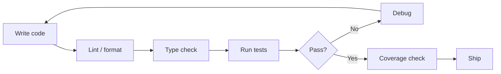

Each layer is cheaper than the one after it:

| Layer | Catches | Cost to fix |
|---|---|---|
| Formatter | Style drift | Zero (automated) |
| Linter | Bugs, smells | Seconds |
| Type checker | Type errors | Minutes |
| Unit tests | Logic bugs | Minutes |
| Integration tests | Interface bugs | Hours |
| Production | Everything | Days–weeks |

### The Testing Pyramid

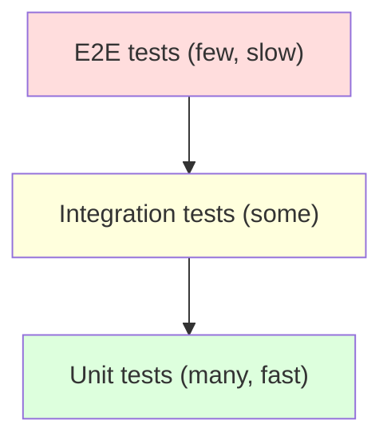

- **Unit tests** — one function/class in isolation; fast, numerous.
- **Integration tests** — multiple components together (DB, HTTP, filesystem).
- **End-to-end** — the whole system; slow, brittle, few.

### Test Frameworks in Python

| Framework | Built-in | Style | Popularity |
|---|---|---|---|
| `unittest` | ✅ | Class-based, xUnit-style | Legacy, common |
| `pytest` | ❌ | Function-based, fixtures | **Dominant** |
| `nose2` | ❌ | `unittest` successor | Niche |
| `doctest` | ✅ | Docstring examples | Small utilities |
| `hypothesis` | ❌ | Property-based | Advanced |

**Modern default: `pytest`.** It handles `unittest` tests too, so mixing is fine.

### Tooling Landscape

| Category | Tool | Purpose |
|---|---|---|
| Linter | `ruff` | Fast, all-in-one |
| Linter | `flake8` | Classic, plugin-rich |
| Linter | `pylint` | Deep, opinionated |
| Formatter | `black` | Opinionated, deterministic |
| Formatter | `ruff format` | Fast, Black-compatible |
| Formatter | `isort` | Import sorting |
| Type checker | `mypy` | Reference implementation |
| Type checker | `pyright` | Fast, VS Code |
| Coverage | `coverage.py`, `pytest-cov` | Line/branch coverage |
| Test runner | `pytest`, `tox`, `nox` | Multi-env runs |
| Debugger | `pdb`, `ipdb`, `pudb` | Interactive debugging |
| Profiler | `cProfile`, `py-spy` | Performance |

---

## 2. `unittest` — The Standard Library

### Basic Test

```python
import unittest


class TestMath(unittest.TestCase):
    def test_add(self):
        self.assertEqual(1 + 1, 2)

    def test_divide(self):
        self.assertEqual(10 / 2, 5.0)

    def test_zero_division(self):
        with self.assertRaises(ZeroDivisionError):
            1 / 0


if __name__ == "__main__":
    unittest.main()
```

Run:

```bash
python -m unittest test_math.py
python -m unittest discover          # find all test_*.py
python -m unittest -v                # verbose
python -m unittest tests.test_math.TestMath.test_add
```

### Key Assertions

| Assertion | Checks |
|---|---|
| `assertEqual(a, b)` | `a == b` |
| `assertNotEqual(a, b)` | `a != b` |
| `assertTrue(x)` / `assertFalse(x)` | Truthiness |
| `assertIs(a, b)` / `assertIsNot(a, b)` | Identity |
| `assertIsNone(x)` / `assertIsNotNone(x)` | `None` check |
| `assertIn(a, b)` / `assertNotIn(a, b)` | Membership |
| `assertIsInstance(a, T)` | `isinstance(a, T)` |
| `assertRaises(Exc)` | Raises `Exc` |
| `assertRaisesRegex(Exc, pattern)` | Raises with message match |
| `assertAlmostEqual(a, b)` | Floats within 7 places |
| `assertGreater(a, b)` | `a > b` |
| `assertListEqual(a, b)` | Lists, order matters |
| `assertDictEqual(a, b)` | Dicts |
| `assertSetEqual(a, b)` | Sets, order-agnostic |
| `assertCountEqual(a, b)` | Same items, any order |
| `assertWarns(Warning)` | Warning raised |

### Setup and Teardown

```python
class TestDatabase(unittest.TestCase):
    def setUp(self):
        """Runs before EACH test."""
        self.conn = sqlite3.connect(":memory:")
        self.conn.execute("CREATE TABLE users (id INTEGER)")

    def tearDown(self):
        """Runs after EACH test."""
        self.conn.close()

    @classmethod
    def setUpClass(cls):
        """Runs once before all tests."""
        cls.template = load_template()

    @classmethod
    def tearDownClass(cls):
        """Runs once after all tests."""
        cls.template = None

    def test_insert(self):
        self.conn.execute("INSERT INTO users VALUES (1)")
        result = self.conn.execute("SELECT COUNT(*) FROM users").fetchone()
        self.assertEqual(result[0], 1)
```

### Test Discovery

`unittest` finds tests matching:

- Files: `test_*.py` or `*_test.py`.
- Classes: subclass `unittest.TestCase`.
- Methods: start with `test_`.

### Skipping and Marking

```python
@unittest.skip("not ready")
def test_feature(self): ...

@unittest.skipIf(sys.version_info < (3, 10), "needs 3.10+")
def test_new_syntax(self): ...

@unittest.skipUnless(shutil.which("ffmpeg"), "ffmpeg required")
def test_conversion(self): ...

@unittest.expectedFailure
def test_known_bug(self): ...

def test_conditional(self):
    if not hasattr(sys, "gettotalrefcount"):
        self.skipTest("requires debug build")
```

### `unittest.mock` — Replacing Dependencies

```python
from unittest.mock import Mock, MagicMock, patch

# Mock object — any attribute returns a Mock
m = Mock()
m.foo(1, 2)                                  # returns a Mock
m.foo.assert_called_once_with(1, 2)

m.foo.return_value = 42
assert m.foo() == 42

m.foo.side_effect = [1, 2, 3]                # successive returns
m.foo.side_effect = ValueError("boom")       # raises
```

**Patch** — temporarily replace attributes:

```python
from unittest.mock import patch

class WeatherService:
    def get_temp(self, city):
        return requests.get(f"https://api.example.com/{city}").json()["temp"]

class TestWeather(unittest.TestCase):
    @patch("module.requests.get")
    def test_get_temp(self, mock_get):
        mock_get.return_value.json.return_value = {"temp": 72}
        service = WeatherService()
        self.assertEqual(service.get_temp("NYC"), 72)
        mock_get.assert_called_once_with("https://api.example.com/NYC")
```

**Context manager:**

```python
with patch("module.function") as mock_fn:
    mock_fn.return_value = 42
    result = call_under_test()
```

**Decorator:**

```python
@patch("module.dependency")
def test_something(self, mock_dep):
    ...
```

### `patch` — Best Practices

| Do | Don't |
|---|---|
| Patch where used, not where defined | Patch stdlib broadly |
| Patch at the module boundary | Patch internal helpers |
| Use `spec=` to enforce interface | Use `MagicMock` for everything |
| Restore state (auto with context/decorator) | Modify globals manually |

**`spec`** prevents typos:

```python
@patch("module.Service", spec=Service)
def test_x(self, MockService):
    MockService.invalid_method()             # ❌ AttributeError
```

### `unittest` — Pros and Cons

| Pros | Cons |
|---|---|
| Built-in | Verbose boilerplate |
| xUnit-familiar | No fixtures (only setUp/tearDown) |
| Rich assertion library | No parametrization |
| Mocking built-in | Weaker test discovery |

**Use it** when you can't install `pytest` or need xUnit compatibility. **Otherwise use `pytest`**.

---

## 3. `pytest` — The Modern Standard

### Installation

```bash
pip install pytest pytest-cov pytest-mock
```

### Basic Test — No Boilerplate

```python
# test_math.py

def test_add():
    assert 1 + 1 == 2

def test_divide():
    assert 10 / 2 == 5.0

def test_zero_division():
    import pytest
    with pytest.raises(ZeroDivisionError):
        1 / 0
```

Run:

```bash
pytest                          # discover and run all
pytest -v                       # verbose
pytest test_math.py             # one file
pytest test_math.py::test_add   # one test
pytest -k "add or divide"       # match name
pytest -x                       # stop on first failure
pytest --lf                     # last failed
pytest --ff                     # failed first
```

Plain `assert` is enriched by `pytest` — failures show the actual values.

### Assertion Introspection

```python
def test_introspection():
    result = [1, 2, 3]
    assert result == [1, 2, 4]

# Failure output:
# E   assert [1, 2, 3] == [1, 2, 4]
# E     At index 2 diff: 3 != 4
```

No need for `assertEqual` — plain `assert` is enough.

### Fixtures — Reusable Setup

```python
import pytest

@pytest.fixture
def db():
    conn = sqlite3.connect(":memory:")
    conn.execute("CREATE TABLE users (id INTEGER, name TEXT)")
    yield conn                                   # teardown after yield
    conn.close()


def test_insert(db):
    db.execute("INSERT INTO users VALUES (1, 'Ada')")
    assert db.execute("SELECT COUNT(*) FROM users").fetchone()[0] == 1


def test_empty(db):
    assert db.execute("SELECT COUNT(*) FROM users").fetchone()[0] == 0
```

Fixtures are **function parameters** — pytest injects them.

### Fixture Scopes

| Scope | Runs |
|---|---|
| `function` (default) | Once per test |
| `class` | Once per test class |
| `module` | Once per module |
| `package` | Once per package |
| `session` | Once per pytest run |

```python
@pytest.fixture(scope="session")
def db_engine():
    engine = create_engine("postgresql://...")
    yield engine
    engine.dispose()
```

### `conftest.py` — Shared Fixtures

Place fixtures in `conftest.py` and they're available to all tests **below** in the tree:

```
tests/
├── conftest.py            # shared fixtures
├── test_api.py
└── integration/
    ├── conftest.py        # fixtures only for this subdir
    └── test_db.py
```

```python
# tests/conftest.py
import pytest

@pytest.fixture
def client():
    return TestClient(app)
```

### Parametrization — One Test, Many Cases

```python
import pytest

@pytest.mark.parametrize("a, b, expected", [
    (1, 1, 2),
    (2, 3, 5),
    (-1, 1, 0),
    (0, 0, 0),
])
def test_add(a, b, expected):
    assert a + b == expected
```

Each tuple is a separate test case with its own result.

Multiple parametrize decorators combine:

```python
@pytest.mark.parametrize("x", [0, 1])
@pytest.mark.parametrize("y", [10, 20])
def test_grid(x, y):
    ...
# Runs: (0,10), (0,20), (1,10), (1,20)
```

### `pytest.raises` — Exception Testing

```python
import pytest

def test_raises():
    with pytest.raises(ValueError) as exc_info:
        int("abc")
    assert "invalid literal" in str(exc_info.value)


def test_raises_match():
    with pytest.raises(ValueError, match=r"invalid literal"):
        int("abc")
```

### `pytest.mark` — Marking and Filtering

```python
import pytest

@pytest.mark.slow
def test_slow_operation():
    ...

@pytest.mark.integration
def test_database():
    ...

@pytest.mark.skip(reason="not implemented")
def test_future(): ...

@pytest.mark.skipif(sys.version_info < (3, 10), reason="3.10+")
def test_new(): ...

@pytest.mark.xfail(reason="known bug")
def test_bug(): ...
```

Configure markers in `pyproject.toml`:

```toml
[tool.pytest.ini_options]
markers = [
    "slow: marks tests as slow",
    "integration: needs external services",
]
addopts = "-ra --strict-markers"
```

Run by marker:

```bash
pytest -m slow
pytest -m "not slow"
```

### `pytest-mock` — Mocking Fixture

```python
def test_api_call(mocker):
    mocker.patch("mymodule.requests.get")
    mocker.patch("mymodule.requests.get").return_value.json.return_value = {"ok": True}

    result = fetch_data()
    assert result == {"ok": True}
```

`mocker` is a `pytest`-friendly wrapper around `unittest.mock`.

### `monkeypatch` — Modify Environment

```python
def test_with_env(monkeypatch):
    monkeypatch.setenv("DEBUG", "1")
    monkeypatch.setattr("module.CONSTANT", 42)
    monkeypatch.chdir(tmp_path)

    assert load_config()["debug"] is True
```

Changes are **automatically undone** after the test.

### `tmp_path` — Temp Files

```python
def test_write_file(tmp_path):
    p = tmp_path / "test.txt"
    p.write_text("data")
    assert p.read_text() == "data"
```

`tmp_path` is a `pathlib.Path` — pytest handles cleanup.

### `capsys` — Capture Output

```python
def test_print(capsys):
    print("hello")
    captured = capsys.readouterr()
    assert captured.out == "hello\n"
    assert captured.err == ""
```

### Comparison Table — Common Fixtures

| Fixture | Purpose |
|---|---|
| `tmp_path` | Temp directory (Path) |
| `tmp_path_factory` | Session-scoped temp dirs |
| `capsys` | Capture stdout/stderr |
| `capfd` | Capture file descriptors |
| `monkeypatch` | Env vars, attributes, cwd |
| `mocker` | From `pytest-mock` |
| `caplog` | Capture log records |
| `request` | Test metadata |
| `pytestconfig` | Config object |

### `pytest` — Pros and Cons

| Pros | Cons |
|---|---|
| Concise | Not built-in |
| Rich fixtures | Magic (fixtures auto-injected) |
| Parametrization | Learning curve |
| Plugins | — |
| Reads `unittest` | — |
| Plain `assert` | — |
| Excellent failure output | — |

### Mermaid — pytest Fixture Lifecycle

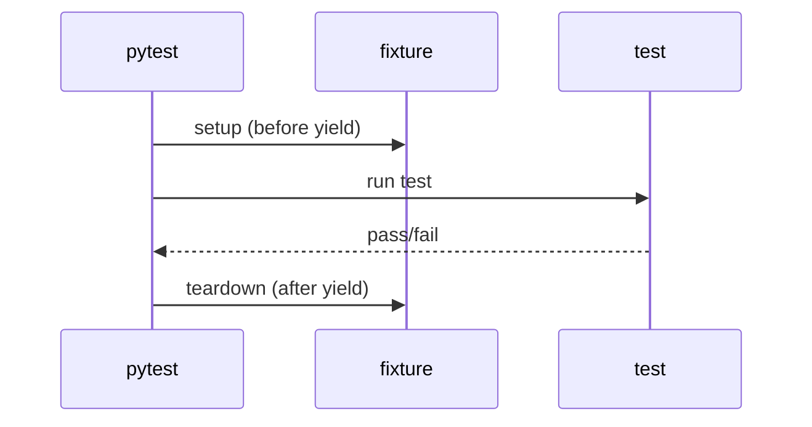

Each test gets its own fixture instance (by default).

---

## 4. `pdb` — The Interactive Debugger

### Built-in Debugger

```python
import pdb

def buggy_function(x):
    y = x + 1
    pdb.set_trace()                        # drop into debugger here
    return y * 2
```

Running the code drops into an interactive prompt:

```
(Pdb) 
```

### Breakpoint — Python 3.7+

```python
def process(data):
    breakpoint()                           # equivalent to pdb.set_trace()
    return transform(data)
```

Override the debugger:

```bash
PYTHONBREAKPOINT=ipdb.set_trace python app.py
PYTHONBREAKPOINT=0 python app.py           # disable breakpoints
```

### Essential `pdb` Commands

| Command | Short | Action |
|---|---|---|
| `help` | `h` | Show help |
| `list` | `l` | Show source around current line |
| `longlist` | `ll` | Show entire function |
| `next` | `n` | Execute next line (step over) |
| `step` | `s` | Step into function call |
| `return` | `r` | Continue until function returns |
| `continue` | `c` | Continue execution |
| `until` | `unt` | Continue until line > current |
| `jump` | `j` | Jump to a line |
| `where` | `w` | Show stack trace |
| `up` / `down` | `u` / `d` | Move up/down stack |
| `print` | `p` | Print expression |
| `pp` | — | Pretty-print |
| `display` | — | Auto-print on stop |
| `undisplay` | — | Stop auto-printing |
| `break` | `b` | Set breakpoint |
| `clear` | — | Remove breakpoint |
| `condition` | — | Set conditional breakpoint |
| `quit` | `q` | Exit debugger |
| `!stmt` | — | Execute Python statement |

### Setting Breakpoints

```python
# From code
import pdb; pdb.set_trace()

# From CLI
python -m pdb script.py

# In pdb session
(Pdb) b 42                                 # line 42 in current file
(Pdb) b module.py:100
(Pdb) b my_function                        # function entry
(Pdb) b module.py:50, x > 10              # conditional
```

### Post-Mortem Debugging

Debug a crashed program at the point of failure:

```python
import pdb

try:
    risky()
except Exception:
    pdb.post_mortem()                      # inspect the traceback
```

Or from CLI:

```bash
python -m pdb -c continue script.py        # drop into pdb on crash
```

### `pdb` in pytest

```bash
pytest --pdb                                 # drop into pdb on failure
pytest --pdb --pdbcls=IPython.terminal.debugger:TerminalPdb
pytest --trace                               # break at start of each test
```

### Alternatives

| Debugger | Description |
|---|---|
| `pdb` | Standard library |
| `ipdb` | `pdb` + IPython features |
| `pudb` | Full-screen terminal UI |
| `pdbpp` | Enhanced `pdb` |
| `pycharm debugger` | IDE-integrated |
| `debugpy` | VS Code backend |

### Debugging Without `pdb`

```python
# Print debugging (still valuable)
print(f"{x=}, {y=}, {z=}")

# Logging with context
logger.debug("state: %r", state)

# Post-mortem assertion
assert x > 0, f"expected positive, got {x}"
```

### Debug Print — But Structured

```python
# ❌ Ad-hoc
print("x:", x, "y:", y)

# ✅ Self-documenting f-string debug (3.8+)
print(f"{x=} {y=}")

# ✅ With context
print(f"[{func_name}] x={x} y={y}")
```

### Mermaid — Debugging Flow

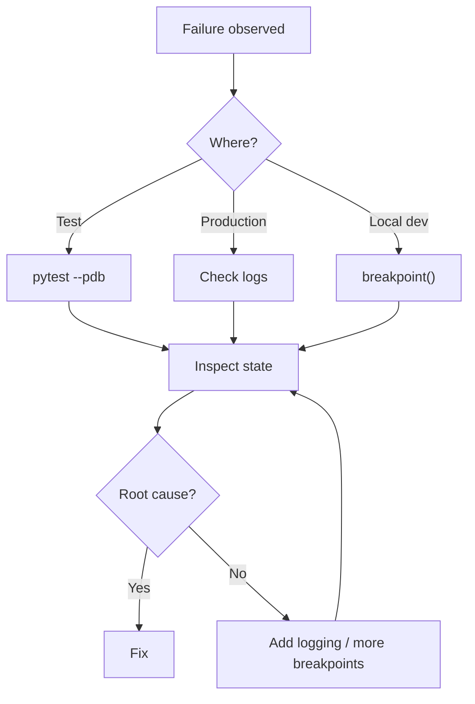

---

## 5. Logging for Debugging

### Debug vs Info

```python
import logging

logger = logging.getLogger(__name__)

def process(item):
    logger.debug("processing item %s", item.id)
    try:
        result = transform(item)
    except Exception:
        logger.exception("failed to process %s", item.id)
        raise
    logger.debug("result: %r", result)
    return result
```

Rules:
- **DEBUG** — internal state useful when troubleshooting.
- **INFO** — important events (startup, shutdown, requests).
- **WARNING** — recoverable issues.
- **ERROR** — operation failed, program continues.
- **CRITICAL** — program may not continue.

### `caplog` — Capture Logs in Tests

```python
import logging

def test_logging(caplog):
    with caplog.at_level(logging.DEBUG):
        do_something()

    assert "processing" in caplog.text
    assert caplog.records[0].levelname == "DEBUG"
```

### Structured Logging

```python
import json, logging

class JSONFormatter(logging.Formatter):
    def format(self, record):
        return json.dumps({
            "time": self.formatTime(record),
            "level": record.levelname,
            "logger": record.name,
            "message": record.getMessage(),
            "exception": self.formatException(record.exc_info) if record.exc_info else None,
        })
```

Parseable by log aggregators — Datadog, ELK, Loki.

### Logging Best Practices

| Do | Don't |
|---|---|
| One logger per module | `logging.info` globally |
| Lazy `%s` formatting | f-strings in hot paths |
| `logger.exception` for errors | Bare `traceback` printing |
| Structured (JSON) in prod | Multi-line ad-hoc output |
| Correlation IDs | Ambiguous context-free messages |

---

## 6. Linters — `ruff` and `flake8`

### What's a Linter?

A **linter** analyzes code without running it — flagging style issues, likely bugs, unused imports, complexity, and more.

### `ruff` — The Modern Choice

**Ruff** is a Rust-based linter + formatter — 10–100× faster than alternatives.

```bash
pip install ruff
ruff check .
ruff check --fix .
ruff format .
```

Configuration in `pyproject.toml`:

```toml
[tool.ruff]
line-length = 100
target-version = "py311"

[tool.ruff.lint]
select = [
    "E",    # pycodestyle errors
    "W",    # pycodestyle warnings
    "F",    # Pyflakes
    "I",    # isort
    "B",    # flake8-bugbear
    "C4",   # comprehensions
    "UP",   # pyupgrade
    "N",    # pep8-naming
    "SIM",  # simplify
    "RUF",  # ruff-specific
]
ignore = ["E501"]                # line length handled by formatter

[tool.ruff.lint.per-file-ignores]
"tests/*" = ["S101"]             # allow assert in tests
```

Common categories:

| Code | Source | Meaning |
|---|---|---|
| `E` | pycodestyle | PEP 8 errors |
| `W` | pycodestyle | PEP 8 warnings |
| `F` | Pyflakes | Unused imports, undefined names |
| `I` | isort | Import ordering |
| `B` | bugbear | Likely bugs |
| `C4` | comprehensions | Simplify comprehensions |
| `UP` | pyupgrade | Modernize syntax |
| `S` | bandit | Security |
| `N` | pep8-naming | Naming conventions |
| `SIM` | flake8-simplify | Simplification |
| `ARG` | flake8-unused-arguments | Unused args |
| `T20` | flake8-print | Leftover `print` calls |

### `flake8` — Classic Linter

```bash
pip install flake8
flake8 .
```

Configuration in `.flake8`, `setup.cfg`, or `tox.ini`:

```ini
[flake8]
max-line-length = 100
extend-ignore = E203, W503
exclude = .git,__pycache__,build,dist
per-file-ignores =
    tests/*: S101
```

`flake8` composes plugins:

- `flake8-bugbear` — bug patterns
- `flake8-comprehensions` — comprehension style
- `flake8-import-order` — import order
- `flake8-print` — catch `print`
- `flake8-bandit` — security

### `pylint` — Deep, Opinionated

```bash
pip install pylint
pylint mymodule.py
```

More thorough, slower, opinionated. Good for legacy audits; commonly replaced by `ruff` in modern setups.

### Common Lint Findings

| Finding | Meaning |
|---|---|
| `F401` | Unused import |
| `F841` | Unused variable |
| `E711` | Comparison to `None` — use `is None` |
| `E712` | Comparison to `True`/`False` |
| `B006` | Mutable default argument |
| `B008` | Function call in default argument |
| `C401` | Unnecessary generator — use set comprehension |
| `UP032` | Use f-string instead of `.format()` |
| `N802` | Function name should be lowercase |
| `T201` | `print` found |

### Inline Suppression

```python
x = compute()  # noqa: F841

# Ignore all rules on a line
y = 1  # noqa
```

Use sparingly — suppression hides problems.

### Linters vs Formatters

| | Linter | Formatter |
|---|---|---|
| Purpose | Detect issues | Fix style |
| Modifies code | Sometimes (`--fix`) | Always |
| Examples | `ruff`, `flake8`, `pylint` | `black`, `ruff format` |
| Runs on | Semantics + style | Whitespace + line breaks |

### Mermaid — Lint Pipeline

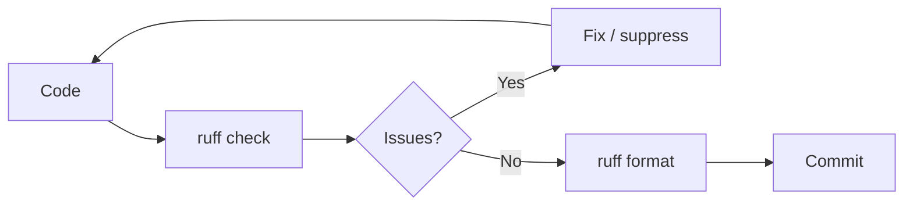

---

## 7. Formatters — `black`

### What's a Formatter?

A formatter **rewrites code** to a canonical style. It's not a linter — it doesn't find bugs, it just enforces consistent layout.

### `black` — The De Facto Standard

```bash
pip install black
black .                         # format all files
black --check .                 # check without modifying
black --diff file.py            # show what would change
```

Configuration in `pyproject.toml`:

```toml
[tool.black]
line-length = 100
target-version = ["py311"]
skip-string-normalization = false
```

### What `black` Does

**Before:**

```python
def foo( a,b,c ):
    d = { 'x':1,'y':2 }
    return [x for x in range(10) if x%2==0]
```

**After:**

```python
def foo(a, b, c):
    d = {"x": 1, "y": 2}
    return [x for x in range(10) if x % 2 == 0]
```

- Normalizes whitespace, string quotes, trailing commas.
- Wraps long lines deterministically.
- Splits long calls and collections.
- Adds/removes blank lines consistently.

### `ruff format` — Faster Drop-In

```bash
ruff format .                   # Black-compatible output
ruff format --check .
```

Same output, ~10× faster. Many projects use `ruff format` alone.

### `isort` — Import Sorting

```bash
pip install isort
isort .
```

Sorts and groups imports:

```python
# Before
import sys
import os
from mypackage import foo
import requests

# After (black profile compatible)
import os
import sys

import requests

from mypackage import foo
```

`ruff` includes `isort` rules (`I`) — often no separate install needed.

### Formatter — Best Practices

| Do | Don't |
|---|---|
| Run on save | Argue style in PRs |
| Commit formatted code | Mix formatting and logic |
| Add pre-commit hook | Fix formatting manually |
| Configure once | Change config constantly |
| Use one formatter per project | Mix `black` + `autopep8` |

### Pre-Commit Hook

```yaml
# .pre-commit-config.yaml
repos:
  - repo: https://github.com/astral-sh/ruff-pre-commit
    rev: v0.4.0
    hooks:
      - id: ruff
        args: [--fix]
      - id: ruff-format
```

```bash
pip install pre-commit
pre-commit install
```

Now every commit runs `ruff check --fix` and `ruff format`.

### Format Flow


---

## 8. Type Checkers — `mypy` and `pyright`

### Static Type Checking

Type hints are optional — but a **type checker** verifies them without running code, catching bugs like passing `str` where `int` is expected.

### `mypy` — Reference Implementation

```bash
pip install mypy
mypy script.py
mypy --strict src/
```

Configuration in `pyproject.toml`:

```toml
[tool.mypy]
python_version = "3.11"
strict = true
warn_unused_ignores = true
warn_redundant_casts = true
disallow_untyped_defs = true
```

### `pyright` — Fast, VS Code-Integrated

```bash
pip install pyright
pyright
```

Config in `pyproject.toml`:

```toml
[tool.pyright]
include = ["src"]
pythonVersion = "3.11"
typeCheckingMode = "strict"        # or "basic", "standard"
```

`pyright` is faster, `mypy` catches some things `pyright` doesn't (and vice versa). Pick one — running both is overkill.

### Common Type Errors Caught

```python
def add(a: int, b: int) -> int:
    return a + b

add("1", "2")                        # ❌ Argument 1 has incompatible type "str"

def find(key: str) -> str | None:
    return None

result = find("k")
print(result.upper())                # ❌ Item "None" has no attribute "upper"
```

### `# type: ignore` — Suppress

```python
x = some_dynamic_fn()  # type: ignore[no-any-return]
```

Add specific codes when possible — bare `# type: ignore` hides everything.

### `cast` — Tell the Checker

```python
from typing import cast

value = cast(int, dynamic_value)
```

Use sparingly — `cast` doesn't validate at runtime.

### Type Checking Strategy

| Level | `mypy` setting | `pyright` setting |
|---|---|---|
| Off | — | `off` |
| Lenient | default | `basic` |
| Standard | `strict` subset | `standard` |
| Strict | `strict = true` | `strict` |

**Pragmatic approach**: start with lenient, gradually tighten; annotate public API first.

### Running in CI

```yaml
- name: Type check
  run: |
    pip install mypy
    mypy --strict src/
```

Type errors block merges — enforced quality.

### Type Flow

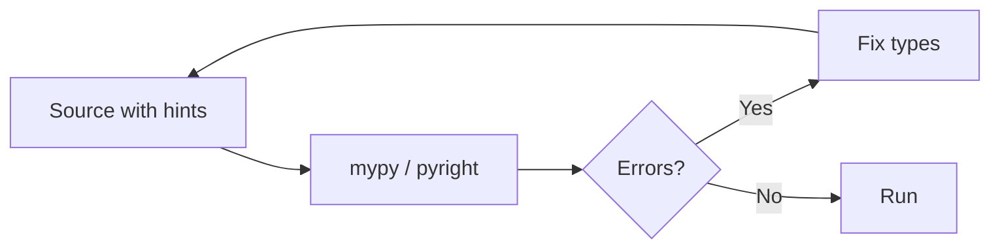

### Type Checkers — Comparison

| | `mypy` | `pyright` |
|---|---|---|
| Language | Python | TypeScript (Node) |
| Speed | Medium | Fast |
| Strictness | Configurable | Configurable |
| Adoption | Very high | High |
| VS Code | Plugin | Built-in |
| Best for | Backend, libraries | Editors, CI |

---

## 9. Fixtures, Mocks, and Coverage

### Fixtures — Reusable Test Setup

Already covered in the `pytest` section. Key points:

- **Function scope** (default) — fresh per test.
- **Session scope** — reused; fast but risky (state leakage).
- **Fixtures compose** — a fixture can depend on other fixtures.
- **`yield` for teardown** — code after `yield` runs after the test.

```python
@pytest.fixture
def api_client(db, monkeypatch):
    monkeypatch.setenv("API_KEY", "test")
    client = Client(base_url="http://test")
    yield client
    client.close()
```

### Mocks — Replacing Dependencies

Two flavors:

| Tool | Style |
|---|---|
| `unittest.mock` | `Mock`, `MagicMock`, `patch` |
| `pytest-mock` | `mocker` fixture — thin wrapper |

**Test double taxonomy:**

| Type | Description |
|---|---|
| Dummy | Placeholder, never used |
| Stub | Returns canned answers |
| Spy | Records calls |
| Mock | Stub + expectations |
| Fake | Working simplified impl |

### `Mock` vs `MagicMock`

- **`Mock`** — any attribute access returns a `Mock`.
- **`MagicMock`** — also supports magic methods (`__len__`, `__iter__`, etc.).

```python
m = MagicMock()
len(m)                                  # works
list(m)                                 # works
```

### `patch` — Where to Patch

**Patch where the object is looked up, not where it's defined.**

```python
# mymodule.py
import requests

def fetch():
    return requests.get("...")
```

```python
# test_mymodule.py
@patch("mymodule.requests.get")        # ✅ patch in mymodule's namespace
def test_fetch(mock_get):
    ...
```

Patching `requests.get` would not affect `mymodule.requests.get` — it's the same object, but the reference in `mymodule` is captured first.

### Coverage — `coverage.py` + `pytest-cov`

```bash
pip install pytest-cov
pytest --cov=mypackage --cov-report=term-missing
pytest --cov=mypackage --cov-report=html
```

`coverage.py` config in `pyproject.toml`:

```toml
[tool.coverage.run]
source = ["src/mypackage"]
branch = true                            # branch coverage, not just lines
omit = ["*/tests/*", "*/__main__.py"]

[tool.coverage.report]
exclude_lines = [
    "pragma: no cover",
    "raise NotImplementedError",
    "if TYPE_CHECKING:",
]
```

### Reading Coverage Reports

```
Name                     Stmts   Miss Branch BrPart  Cover   Missing
----------------------------------------------------------------------
mypackage/core.py          120      8     34      3    92%   45-52, 78
mypackage/utils.py          45      0     12      0   100%
----------------------------------------------------------------------
TOTAL                      165      8     46      3    94%
```

- **Stmts** — statements.
- **Miss** — unexecuted lines.
- **Branch** — branch points.
- **Cover** — percentage.

Missing lines (`45-52, 78`) show what wasn't tested.

### Coverage Goals

| Type | Target |
|---|---|
| Line | 80–90% |
| Branch | 70–85% |
| Critical paths | 100% |

**100% coverage ≠ no bugs** — it means every line ran, not that every behavior was verified.

### Coverage Anti-Patterns

| Anti-pattern | Problem |
|---|---|
| Chasing 100% | Tests that exist only to cover |
| Ignoring branch | Misses conditionals |
| No `omit` | Tests counted |
| Coverage on generated code | Noise |

### Test Doubles Table

| Task | Tool |
|---|---|
| Replace a function | `mocker.patch` |
| Return canned value | `Mock(return_value=...)` |
| Record calls | `Mock` + `assert_called_*` |
| Stand-in for complex class | `MagicMock(spec=RealClass)` |
| Fake the filesystem | `tmp_path`, `pyfakefs` |
| Fake time | `freezegun`, `time-machine` |
| Fake network | `responses`, `respx`, `vcrpy` |
| Fake DB | `sqlite3.connect(":memory:")`, `pytest-postgresql` |

### Mermaid — Test Composition

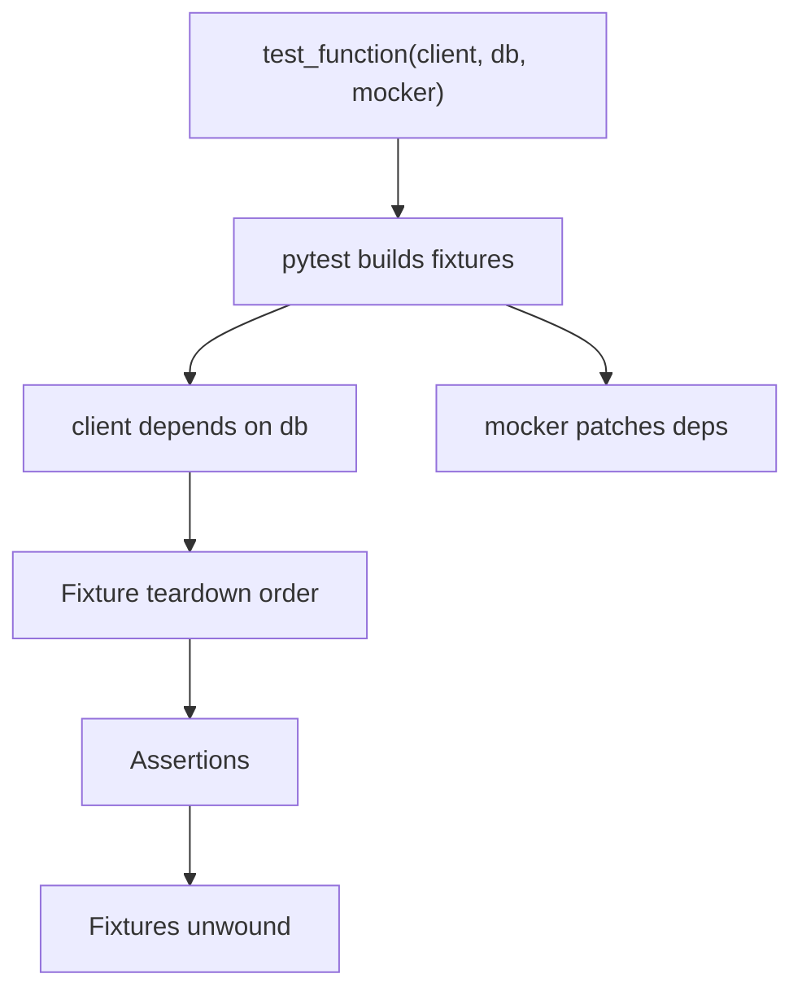

Fixtures compose and unwind in dependency order.

---

## 10. Real-World Use Cases

### Use Case 1 — Full Test Suite with Fixtures

```python
# tests/conftest.py
import pytest
from myapp import create_app, db

@pytest.fixture(scope="session")
def app():
    app = create_app(config="testing")
    with app.app_context():
        db.create_all()
        yield app
        db.drop_all()

@pytest.fixture
def client(app):
    return app.test_client()

@pytest.fixture
def user(app):
    u = User(name="Ada", email="ada@x.com")
    db.session.add(u)
    db.session.commit()
    return u


# tests/test_api.py
def test_get_user(client, user):
    resp = client.get(f"/users/{user.id}")
    assert resp.status_code == 200
    assert resp.json["name"] == "Ada"
```

### Use Case 2 — Parametrized Edge Cases

```python
import pytest

@pytest.mark.parametrize("input, expected", [
    ("2024-01-15", True),
    ("2024-13-01", False),
    ("", False),
    (None, False),
    ("2024-02-30", False),
])
def test_is_valid_date(input, expected):
    assert is_valid_date(input) == expected
```

### Use Case 3 — Mocking External HTTP

```python
# Using respx for httpx
import respx
import httpx

@respx.mock
def test_fetch_user():
    respx.get("https://api.example.com/users/1").mock(
        return_value=httpx.Response(200, json={"id": 1, "name": "Ada"})
    )

    result = fetch_user(1)
    assert result["name"] == "Ada"
```

### Use Case 4 — Coverage Gate in CI

```yaml
# .github/workflows/test.yml
- name: Test with coverage
  run: |
    pip install -e ".[test]"
    pytest --cov=mypackage --cov-fail-under=85

- name: Type check
  run: mypy --strict src/

- name: Lint
  run: ruff check .

- name: Format check
  run: ruff format --check .
```

### Use Case 5 — Property-Based Testing

```python
from hypothesis import given, strategies as st

@given(st.lists(st.integers()))
def test_sort_is_idempotent(xs):
    assert sorted(sorted(xs)) == sorted(xs)

@given(st.text())
def test_encode_decode_roundtrip(s):
    assert s.encode("utf-8").decode("utf-8") == s
```

`hypothesis` generates thousands of inputs — finds edge cases you'd miss.

### Use Case 6 — Debugging a Stack Trace

```python
# app.py
def main():
    data = load()
    parse(data)

def load():
    return open("data.txt").read()

main()
```

Crash:

```
Traceback (most recent call last):
  File "app.py", line 10, in <module>
    main()
  File "app.py", line 4, in main
    parse(data)
  File "app.py", line 7, in parse
    return json.loads(data)
FileNotFoundError: [Errno 2] No such file or directory: 'data.txt'
```

Steps:
1. Bottom line — `FileNotFoundError`.
2. Last frame — `load()` in `app.py:7`.
3. Add context or start debugger:

```bash
pytest --pdb
python -m pdb app.py
```

### Use Case 7 — Debugging with Logging

```python
import logging

logging.basicConfig(level=logging.DEBUG, format="%(levelname)s %(message)s")
logger = logging.getLogger(__name__)

def process(items):
    logger.debug("processing %d items", len(items))
    for i, item in enumerate(items):
        logger.debug("item %d: %r", i, item)
        transform(item)
```

Run with `-v` or set level — logs reveal state.

### Use Case 8 — Benchmark Tests

```python
import pytest

@pytest.mark.benchmark
def test_sort_performance(benchmark):
    data = list(range(10_000, 0, -1))
    result = benchmark(sorted, data)
    assert result[0] == 1
```

Requires `pytest-benchmark` — tracks performance regressions.

### Use Case 9 — Fixture for Temporary DB

```python
@pytest.fixture
def db():
    import sqlite3
    conn = sqlite3.connect(":memory:")
    conn.row_factory = sqlite3.Row
    conn.executescript("""
        CREATE TABLE users (id INTEGER PRIMARY KEY, name TEXT);
        INSERT INTO users (name) VALUES ('Ada'), ('Alan');
    """)
    yield conn
    conn.close()

def test_query(db):
    rows = db.execute("SELECT name FROM users ORDER BY name").fetchall()
    assert [r["name"] for r in rows] == ["Ada", "Alan"]
```

### Use Case 10 — Pre-Commit Pipeline

```yaml
# .pre-commit-config.yaml
repos:
  - repo: https://github.com/astral-sh/ruff-pre-commit
    rev: v0.4.0
    hooks:
      - id: ruff
        args: [--fix]
      - id: ruff-format
  - repo: https://github.com/pre-commit/mirrors-mypy
    rev: v1.10.0
    hooks:
      - id: mypy
        args: [--strict]
        additional_dependencies: [types-requests]
```

Install: `pre-commit install`. Now every commit runs the checks.

---

## 11. Common Pitfalls

### Pitfall 1 — Tests That Depend on Order

```python
# ❌ Order-dependent
def test_create():
    global user
    user = User("Ada")

def test_read():
    assert user.name == "Ada"      # fails if run alone
```

Fix: use fixtures — each test sets up its own state.

### Pitfall 2 — Shared Mutable Fixtures

```python
@pytest.fixture
def items():
    return []                       # ✅ fresh per test

@pytest.fixture
def items():
    return SHARED_LIST              # ❌ mutated across tests
```

### Pitfall 3 — Over-Mocking

```python
# ❌ Mocks the whole implementation
@patch("module.calculate")
@patch("module.transform")
@patch("module.validate")
def test_process(m1, m2, m3):
    ...
    # You're testing that you called the mocks
```

Fix: test the logic, mock only at the boundary (network, DB, time).

### Pitfall 4 — Forgetting `spec=`

```python
@patch("module.Service")
def test_x(MockService):
    MockService.mispelled_method()      # ✅ silently passes
```

Add `spec=Service` — catches typos.

### Pitfall 5 — Mocking `datetime.now` Incorrectly

```python
# ❌ Doesn't work — datetime.now is a C method
@patch("datetime.datetime.now")
def test_time(mock_now):
    ...

# ✅ Use freezegun
from freezegun import freeze_time

@freeze_time("2024-01-15 14:30:00")
def test_time():
    assert datetime.now().year == 2024
```

### Pitfall 6 — Coverage Chasing

```python
def test_useless():
    fn()                                     # runs but asserts nothing
```

Coverage can mislead — always assert behavior, not just execution.

### Pitfall 7 — Slow Tests in the Default Suite

```python
# ❌ 30-second test runs on every save
def test_full_integration():
    ...

# ✅ Mark slow tests
@pytest.mark.slow
def test_full_integration():
    ...

# Run only fast by default
pytest -m "not slow"
```

### Pitfall 8 — Ignoring Warnings

```bash
pytest -W error                          # treat warnings as errors
pytest -W default                        # show all warnings
```

Catching `DeprecationWarning` early prevents future breakage.

### Pitfall 9 — Lint Config Conflicts

Mixing `black` and `autopep8` causes churn. Choose one formatter — `black` or `ruff format`.

### Pitfall 10 — Type Hints That Lie

```python
def get_user(id) -> User:                # says User, may return None
    return db.query(id)
```

Type checkers trust the hints — incorrect hints hide bugs. Annotate accurately: `-> User | None`.

### Pitfall 11 — Assert in Production Code

```python
def withdraw(account, amount):
    assert amount > 0                    # ❌ disabled under -O
    ...
```

Fix: `if amount <= 0: raise ValueError(...)`.

### Pitfall 12 — `pytest` Collecting Test Utilities

```python
def test_helper():                        # ❌ collected as a test
    return True

def helper():                             # ✅ not collected
    return True
```

Name helpers without the `test_` prefix.

### Pitfall 13 — Debugging in Tests Without `--pdb`

```python
def test_fails():
    do_work()                              # just shows an assertion error
```

Use `pytest --pdb` to drop into the debugger at failure.

### Pitfall 14 — Left-In `print()` Statements

```python
def process(data):
    print("DEBUG:", data)                  # ❌ ship to prod
    return transform(data)
```

Use `logging.debug`. `ruff` with `T20` catches leftovers.

### Pitfall Summary Table

| Pitfall | Symptom | Fix |
|---|---|---|
| Order-dependent tests | Fail in isolation | Fixtures |
| Shared fixtures | Cross-test pollution | Function scope |
| Over-mocking | Tests only call mocks | Mock boundaries |
| Missing `spec` | Typo passes | `spec=Class` |
| Patch `datetime.now` | Fails silently | `freezegun` |
| Coverage chasing | Useless tests | Assert behavior |
| Slow default tests | Long CI | Marker + filter |
| Ignored warnings | Future breakage | `-W error` in CI |
| Mixed formatters | Churn | One formatter |
| Lying hints | Hidden bugs | Accurate types |
| `assert` in prod | Disabled under `-O` | Explicit raises |
| `test_` helper | Wrongly collected | Rename |
| No `--pdb` | Manual debug | Use it |
| Leftover `print` | Noise in prod | `ruff` T20 |

---

## 12. Comparison Tables

### Test Frameworks

| Feature | `unittest` | `pytest` | `nose2` |
|---|---|---|---|
| Built-in | ✅ | ❌ | ❌ |
| Style | Class | Function | Class |
| Fixtures | setUp/tearDown | Rich fixtures | Layers |
| Parametrize | ❌ | ✅ | ✅ |
| Assertions | Rich methods | Plain `assert` | `assert` |
| Plugins | Some | **Many** | Some |
| Discovery | Configurable | `test_*.py` | Flexible |
| Popularity | Moderate | Dominant | Low |

### Linters

| Feature | `ruff` | `flake8` | `pylint` |
|---|---|---|---|
| Speed | ⚡⚡⚡ | ⚡ | ⚡ |
| Language | Rust | Python | Python |
| Config | `pyproject.toml` | `.flake8` | `.pylintrc` |
| Rules | Hundreds | Plugin-based | Very deep |
| Auto-fix | ✅ | Some | Some |
| Recommended | ✅ | Legacy | Audits |

### Formatters

| | `black` | `ruff format` | `autopep8` |
|---|---|---|---|
| Speed | Medium | Fast | Fast |
| Opinionated | ✅ | ✅ | ❌ |
| Line length | Configurable | Configurable | Configurable |
| Compatible | Reference | Black-compatible | PEP 8 only |
| Recommended | ✅ | ✅ | Legacy |

### Type Checkers

| | `mypy` | `pyright` |
|---|---|---|
| Speed | Medium | Fast |
| Language | Python | TypeScript |
| Strictness | Configurable | Configurable |
| Adoption | Highest | High |
| VS Code | Plugin | Built-in |
| CI | Common | Common |

### Assertion Cheat Sheet

| Task | `unittest` | `pytest` |
|---|---|---|
| Equality | `self.assertEqual(a, b)` | `assert a == b` |
| Identity | `self.assertIs(a, b)` | `assert a is b` |
| Truthiness | `self.assertTrue(x)` | `assert x` |
| Membership | `self.assertIn(a, b)` | `assert a in b` |
| Raises | `with self.assertRaises(E):` | `with pytest.raises(E):` |
| Approx | `self.assertAlmostEqual(a, b)` | `assert a == pytest.approx(b)` |
| Warns | `self.assertWarns(W)` | `with pytest.warns(W):` |

### Fixture vs `setUp`

| | `pytest` fixture | `unittest` setUp |
|---|---|---|
| Reusable | ✅ | ❌ |
| Scoped | ✅ | Class/function only |
| Composable | ✅ | Limited |
| Parametrized | ✅ | ❌ |
| Explicit deps | ✅ | ❌ |
| Auto-injected | ✅ | ❌ |

---

## 13. Mermaid — Complete CI Flow

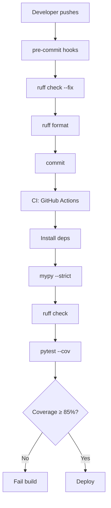

### Test Pyramid in Detail

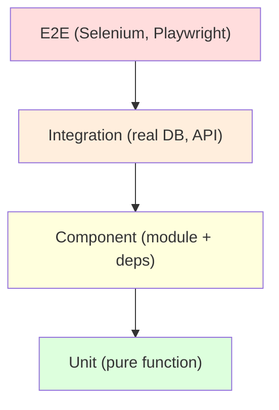

### Debugging Decision Tree

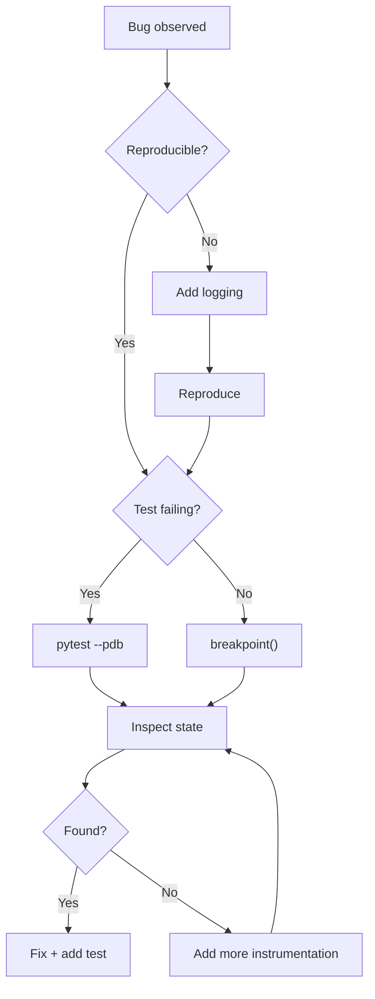

### Mocking Boundary

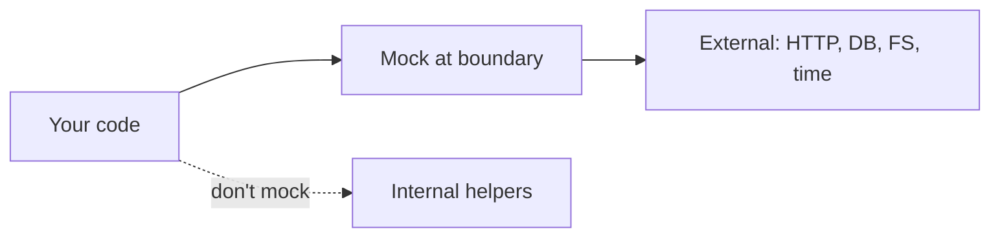

Mock at the edges — never mock your own logic.

---

## 14. Performance Notes

### Test Speed — Fast Feedback

| Technique | Impact |
|---|---|
| Unit tests over integration | 10× faster |
| Session fixtures for expensive setup | Amortized |
| Parametrize bulk cases | Fewer test functions |
| Mock I/O | Eliminates network/disk |
| `pytest-xdist` for parallelism | Linear with cores |

```bash
pip install pytest-xdist
pytest -n auto                          # run on all cores
```

### `pytest` with Coverage — Overhead

Coverage adds ~20–50% overhead. For fast local iteration:

```bash
pytest                                  # no coverage
pytest --cov=myapp --cov-report=html    # full report
```

### `ruff` vs `flake8` Speed

```bash
# 100k lines of code
time flake8 src/                        # ~30 s
time ruff check src/                    # ~0.3 s — 100× faster
```

### `mypy` vs `pyright` Speed

```bash
time mypy src/                          # ~15 s for medium project
time pyright src/                       # ~5 s
```

`pyright` wins on speed; `mypy` has more configurable strictness.

### Mock Cost

`Mock` is fast — but `MagicMock` with `spec` invokes attribute lookups on every access. For 1M+ mock accesses in a benchmark, this adds up.

### `pytest` Startup

| Operation | Time |
|---|---|
| `pytest` cold start | ~200 ms |
| `pytest` in large suite | Varies |
| `pytest -x` (fail fast) | Much faster |
| `pytest --lf` | Skips passing |

For very large suites, `pytest-xdist`, `--lf`, and parallel collection help.

### `pre-commit` Overhead

Each hook re-runs on changed files — but only changed. If you have many hooks, cap with `files:` patterns to limit scope.

### Comparing Test Approaches

| Approach | Time per test |
|---|---|
| Pure unit (no I/O) | ~1 ms |
| With mocks | ~2 ms |
| With in-memory DB | ~5 ms |
| With file I/O | ~20 ms |
| With real DB | ~100 ms |
| With real HTTP | ~200 ms |
| With real browser | ~2 s |

Aim for **< 1 s per test on average**.

### Coverage Report Time

| File Count | Time (line) | Time (branch) |
|---|---|---|
| 10 | ~1 s | ~1.5 s |
| 100 | ~5 s | ~10 s |
| 1000 | ~30 s | ~60 s |

Branch coverage is ~2× slower — run it in CI, not on every edit.

---

## 15. Quick Reference Card

```bash
# ─── PYTEST ────────────────────────────────────
pytest                                  # all tests
pytest -v                               # verbose
pytest -x                               # stop on first fail
pytest -k "add or divide"               # match name
pytest -m "not slow"                    # skip marker
pytest --lf                             # last failed
pytest --ff                             # failed first
pytest -n auto                          # parallel
pytest --cov=mypkg --cov-report=html
pytest --pdb                            # debug on failure
pytest --trace                          # break at test start
pytest -W error                         # warnings as errors

# ─── RUFF ──────────────────────────────────────
ruff check .                            # lint
ruff check --fix .                      # fix
ruff format .                           # format
ruff check --select F,E,W               # specific rules
ruff check --statistics                 # rule counts

# ─── BLACK ─────────────────────────────────────
black .                                 # format
black --check .                         # check without writing
black --diff file.py                    # show changes

# ─── MYPY / PYRIGHT ────────────────────────────
mypy --strict src/
mypy --install-types
pyright

# ─── COVERAGE ──────────────────────────────────
coverage run -m pytest
coverage report -m                      # missing lines
coverage html                           # HTML report
coverage combine                        # merge parallel runs

# ─── PRE-COMMIT ────────────────────────────────
pre-commit install
pre-commit run --all-files
pre-commit autoupdate
```

```python
# ─── PYTEST FIXTURES ───────────────────────────
import pytest

@pytest.fixture
def db():
    conn = sqlite3.connect(":memory:")
    yield conn
    conn.close()

@pytest.fixture(scope="session")
def engine():
    e = create_engine(...)
    yield e
    e.dispose()

@pytest.fixture
def user(db):
    u = User(name="Ada")
    db.add(u)
    db.commit()
    return u

# ─── PARAMETRIZE ───────────────────────────────
@pytest.mark.parametrize("a, b, expected", [
    (1, 1, 2),
    (2, 3, 5),
])
def test_add(a, b, expected):
    assert a + b == expected

# ─── EXCEPTIONS ────────────────────────────────
def test_raises():
    with pytest.raises(ValueError, match=r"invalid"):
        int("abc")

# ─── MARKERS ───────────────────────────────────
@pytest.mark.slow
def test_big(): ...

@pytest.mark.skip(reason="not ready")
def test_todo(): ...

@pytest.mark.skipif(sys.version_info < (3, 10), reason="needs 3.10")
def test_new(): ...

@pytest.mark.xfail(reason="known bug")
def test_bug(): ...

# ─── MOCKING ───────────────────────────────────
from unittest.mock import patch, MagicMock

@patch("module.requests.get")
def test_fetch(mock_get):
    mock_get.return_value.json.return_value = {"ok": True}
    assert fetch() == {"ok": True}

def test_with_mocker(mocker):
    m = mocker.patch("module.time.time", return_value=1000)
    assert now() == 1000

# ─── TEMP FILES / ENV ──────────────────────────
def test_file(tmp_path):
    p = tmp_path / "f.txt"
    p.write_text("hi")
    assert p.read_text() == "hi"

def test_env(monkeypatch):
    monkeypatch.setenv("KEY", "value")
    monkeypatch.setattr("module.CONST", 42)

# ─── CAPTURE ───────────────────────────────────
def test_print(capsys):
    print("hi")
    captured = capsys.readouterr()
    assert captured.out == "hi\n"

def test_logs(caplog):
    with caplog.at_level(logging.INFO):
        do_work()
    assert "done" in caplog.text

# ─── PDB ───────────────────────────────────────
breakpoint()                            # drop into debugger
# Commands: n, s, c, q, p, l, w, b, r

# ─── DEBUG PRINT ───────────────────────────────
print(f"{x=} {y=}")                     # self-documenting
```

```toml
# ─── pyproject.toml ────────────────────────────
[tool.pytest.ini_options]
testpaths = ["tests"]
addopts = "-ra --strict-markers"
markers = ["slow", "integration"]

[tool.ruff]
line-length = 100
target-version = "py311"

[tool.ruff.lint]
select = ["E", "F", "I", "B", "UP", "N", "SIM", "C4", "T20"]
ignore = ["E501"]

[tool.mypy]
python_version = "3.11"
strict = true

[tool.coverage.run]
source = ["src/mypkg"]
branch = true

[tool.coverage.report]
exclude_lines = ["pragma: no cover", "if TYPE_CHECKING:"]
```

---

## Summary

- **Testing pyramid**: many fast unit tests, some integration tests, few end-to-end tests — each layer catches different bugs at different costs.
- **`unittest`** is the standard-library xUnit framework — good when you can't install `pytest`, but verbose.
- **`pytest`** is the modern default — plain `assert`, rich fixtures, parametrization, and a huge plugin ecosystem.
- **Fixtures** in `conftest.py` provide reusable setup; **scopes** control lifetime (function, module, session).
- **Parametrize** turns one test function into many test cases without duplication.
- **`pdb`** is the built-in debugger — use `breakpoint()`, `pytest --pdb`, and post-mortem debugging for crashes.
- **Logging** is your debugging infrastructure — `logger.debug` in code, `caplog` in tests.
- **Linters** (`ruff`, `flake8`) catch bugs and smells without running code — `ruff` is the modern, fast choice.
- **Formatters** (`black`, `ruff format`) eliminate style debates — pick one, run it on save, commit formatted code.
- **Type checkers** (`mypy`, `pyright`) verify hints statically — annotate public APIs, run in CI.
- **Mocks** replace external dependencies at the boundary — patch where the object is used, use `spec=`, don't over-mock.
- **Coverage** measures execution, not correctness — aim for 80–90% line, higher on critical paths.
- **Pre-commit hooks** automate linting, formatting, and type checking locally before CI sees the code.
- **Pitfalls** cluster around order-dependent tests, shared fixtures, over-mocking, missing `spec`, coverage chasing, lying type hints, `assert` in production code, and left-in `print` statements.