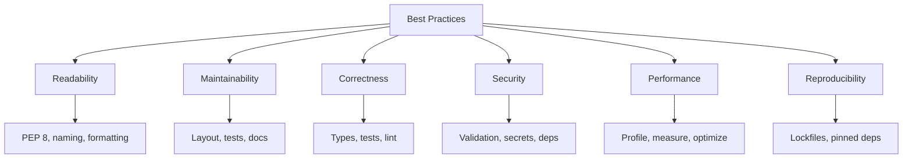
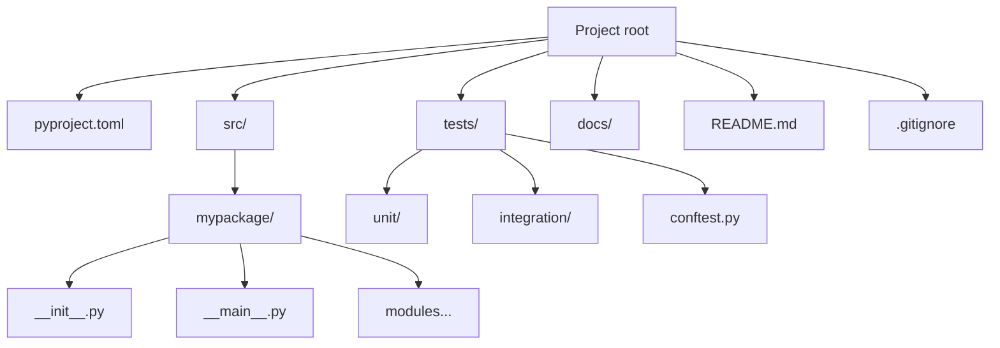
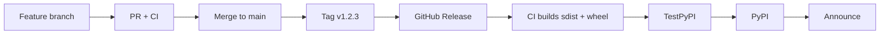
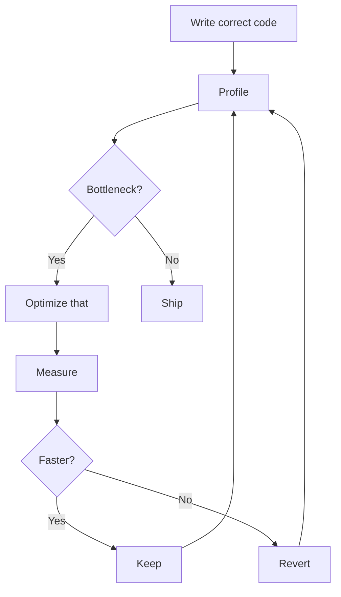
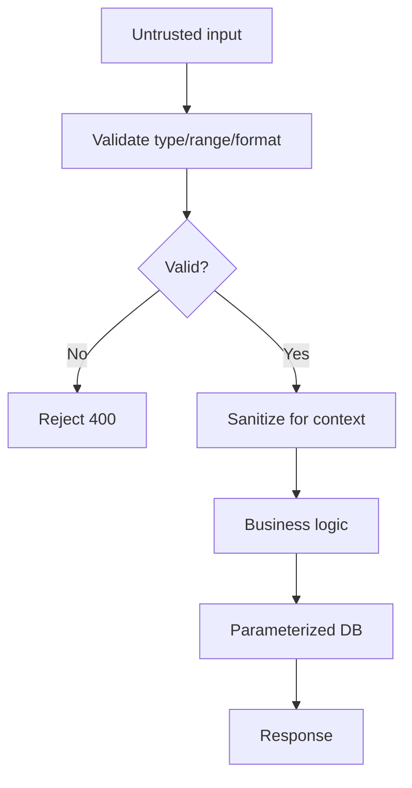
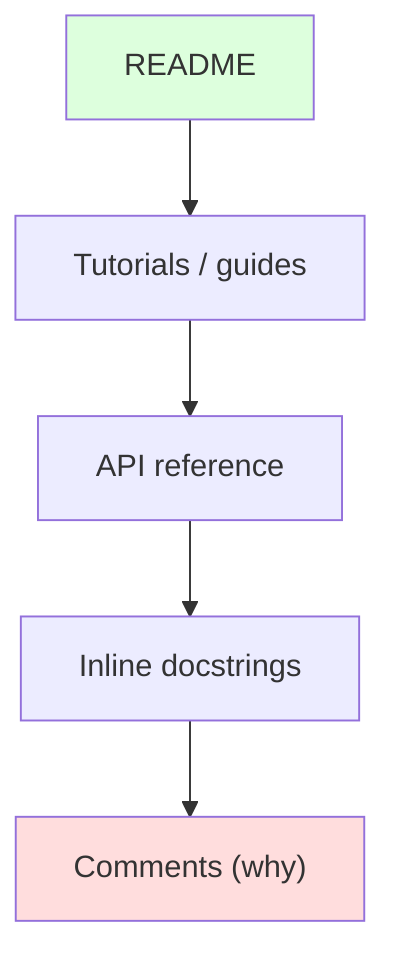
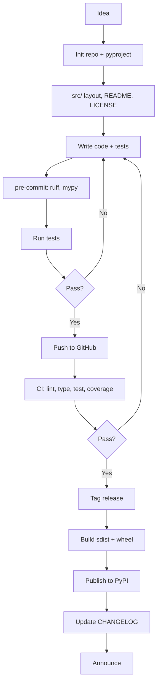
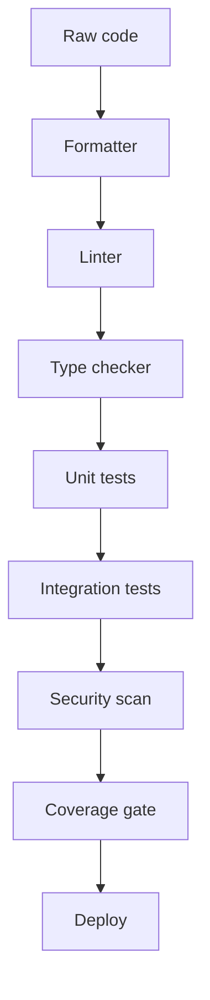
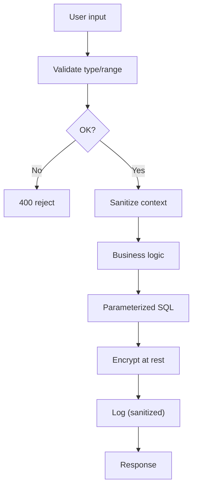

# Best Practices & Project Structure — Detailed Notes

---

## 1. What Is It? (Concept & Under the Hood)

**Best practices** are conventions, patterns, and disciplines that make code **readable, maintainable, secure, and performant**. **Project structure** is how files and directories are organized so a codebase scales from a one-file script to a multi-team repository.

Together they answer: *How should this code be written, organized, shipped, and maintained so that the next person (often future-you) can work with it?*

### The Core Principles



### What This Section Covers

- **PEP 8** — the Python style guide.
- **Clean code** — naming, function design, comments vs code.
- **Project layout** — `src/` vs flat, tests, docs, config.
- **Packaging & publishing** — `pyproject.toml`, build, PyPI.
- **Performance basics** — profile first, common wins.
- **Security basics** — input, secrets, dependencies, hashing.
- **Documentation** — README, docstrings, changelogs.

### The "Zen of Python" — Guiding Philosophy

```python
import this
```

```
The Zen of Python, by Tim Peters

Beautiful is better than ugly.
Explicit is better than implicit.
Simple is better than complex.
Complex is better than complicated.
Flat is better than nested.
Sparse is better than dense.
Readability counts.
Special cases aren't special enough to break the rules.
Although practicality beats purity.
Errors should never pass silently.
Unless explicitly silenced.
In the face of ambiguity, refuse the temptation to guess.
There should be one-- and preferably only one --obvious way to do it.
Although that way may not be obvious at first unless you're Dutch.
Now is better than never.
Although never is often better than *right* now.
If the implementation is hard to explain, it's a bad idea.
If the implementation is easy to explain, it may be a good idea.
Namespaces are one honking great idea -- let's do more of those!
```

These 19 aphorisms are the closest thing Python has to a design philosophy. When in doubt, return to them.

---

## 2. PEP 8 — The Style Guide

### What Is PEP 8?

**PEP 8** is Python's official style guide. It's not law — it's a widely-followed convention. Consistency with PEP 8 means your code reads like Python to every other Python developer.

### Indentation and Line Length

- **4 spaces** per indent level — never tabs.
- **79 characters** per line for code (many teams use 88 or 100).
- **72 characters** for docstrings and comments.
- **Blank lines**: 2 between top-level definitions, 1 between methods.

```python
# ✅
def outer_function():
    """Summary."""

    def inner_function():
        pass

    return inner_function


class MyClass:
    """Class docstring."""

    def method_one(self):
        pass

    def method_two(self):
        pass
```

### Naming Conventions

| Kind | Convention | Example |
|---|---|---|
| Module | `lower_snake_case` | `user_service.py` |
| Package | `lower_snake_case` | `my_package` |
| Class | `PascalCase` | `UserService` |
| Function | `lower_snake_case` | `fetch_user` |
| Variable | `lower_snake_case` | `user_count` |
| Constant | `UPPER_SNAKE_CASE` | `MAX_RETRIES` |
| Private | `_leading_underscore` | `_helper` |
| Dunder | `__double_underscore__` | `__init__` |
| Type var | `PascalCase` | `T`, `UserT` |
| Exception | `PascalCaseError` | `ValidationError` |

### Imports — Order and Grouping

```python
# 1. Standard library
import os
import sys
from pathlib import Path

# 2. Third-party
import requests
from pydantic import BaseModel

# 3. Local
from mypackage.core import Engine
from mypackage.utils import clean
```

Rules:
- **Absolute imports** preferred over relative.
- **One import per line** (except `from x import a, b`).
- **Group** as above with a blank line between groups.
- **No wildcard imports** (`from x import *`) except in `__init__.py` for re-exports.

### Whitespace

```python
# ✅
x = 1
y = 2
long_variable = 3

result = (a + b) * (c + d)

def f(a, b=1, *, c=2):
    return a + b + c

# ❌
x=1
y  =  2
def f( a, b = 1 ):
    ...
```

Rules:
- **No space** around `=` for keyword arguments and default values: `def f(x=1)`.
- **One space** around binary operators: `a + b`.
- **No space** inside brackets: `[1, 2, 3]` not `[ 1, 2, 3 ]`.
- **Space after comma**: `f(a, b)`.

### Comments

```python
# ✅ — explain WHY, not WHAT
# Retry with backoff because the API rate-limits at 10 req/s.
for attempt in range(5):
    ...

# ❌ — restates the code
# Loop 5 times
for attempt in range(5):
    ...
```

Rules:
- Comment **intent**, not mechanics.
- Keep comments **current** — stale comments are worse than none.
- Use **complete sentences** with proper punctuation.
- Never comment out dead code — delete it (git remembers).

### Docstrings

Use triple quotes, imperative mood, one-line summary first:

```python
def divide(a: float, b: float) -> float:
    """Return the quotient of a divided by b.

    Args:
        a: Numerator.
        b: Denominator. Must be non-zero.

    Returns:
        The quotient a / b.

    Raises:
        ZeroDivisionError: If b is zero.
    """
    if b == 0:
        raise ZeroDivisionError("division by zero")
    return a / b
```

**PEP 257** covers docstring conventions:
- Summary line ends with a period.
- Blank line after summary for multi-line.
- Imperative mood ("Return" not "Returns").

### When to Break PEP 8

PEP 8 itself says:

> "A Foolish Consistency is the Hobgoblin of Little Minds"

Exceptions:
- **Line length** — many teams use 88 or 100.
- **Consistency with surrounding code** beats strict compliance.
- **Legacy code** — don't reformat code you're not touching.
- **Math/DSLs** — `matrix[i,j]` vs `matrix[i, j]` — align for readability.

### Tooling Enforces PEP 8

| Tool | Role |
|---|---|
| `ruff` | Lint + fix many PEP 8 violations |
| `black` / `ruff format` | Enforce whitespace/formatting |
| `isort` / `ruff I` | Import ordering |
| `pylint` | Deeper style checks |
| `flake8` | Classic PEP 8 linter |

---

## 3. Clean Code — Writing Readable Python

### Names — The Foundation of Readability

```python
# ❌ Cryptic
def calc(d, r):
    return d * (1 - r)

# ✅ Self-documenting
def apply_discount(price: float, discount_rate: float) -> float:
    return price * (1 - discount_rate)
```

Rules:
- **Be specific** — `user_ids` beats `ids`, `total_price` beats `t`.
- **Avoid abbreviations** — `configuration` not `cfg`, `message` not `msg`.
- **Avoid single letters** except loop counters (`i`, `j`) and math (`x`, `y`).
- **Match the domain** — use the language of the problem.
- **Avoid type-based names** — `user_list` → `users`.

### Functions — Small, Focused, Pure Where Possible

```python
# ❌ Does too much
def process_order(order):
    validate_order(order)
    charge_card(order)
    update_inventory(order)
    send_confirmation(order)
    log_metrics(order)
    return order

# ✅ Each step is a function; the orchestrator is short
def process_order(order):
    validate(order)
    charge(order)
    update_stock(order)
    confirm(order)
    track(order)
    return order
```

Rules:
- **One thing per function** — the "single responsibility principle".
- **Few parameters** — 3 is fine, 5+ is a smell; use dataclasses for grouped args.
- **Return early** — use guard clauses to avoid nesting.
- **Avoid flag arguments** — `def save(user, silent=True)` — split into two functions.
- **Pure when possible** — no hidden side effects.
- **Short** — most functions should fit on a screen (~20–30 lines).

### Guard Clauses — Flatten Nesting

```python
# ❌ Deeply nested
def withdraw(account, amount):
    if account is not None:
        if not account.frozen:
            if amount > 0:
                if amount <= account.balance:
                    account.balance -= amount
                    return True
    return False

# ✅ Guard clauses
def withdraw(account, amount):
    if account is None:
        return False
    if account.frozen:
        return False
    if amount <= 0:
        return False
    if amount > account.balance:
        return False
    account.balance -= amount
    return True
```

### DRY — But Not Prematurely

**Don't Repeat Yourself** — but **don't abstract prematurely**. Rule of three: duplicate twice, abstract the third time.

```python
# First occurrence — inline
price = base_price * (1 - 0.1)

# Second occurrence — probably still inline
price = base_price * (1 - 0.15)

# Third occurrence — abstract
def apply_discount(price: float, rate: float) -> float:
    return price * (1 - rate)
```

Premature abstraction is worse than duplication — abstractions are hard to change.

### Comments vs Code

```python
# ❌ Comment compensates for bad code
# Check if user is adult
if u.a >= 18:
    ...

# ✅ Code explains itself
if user.age >= ADULT_AGE:
    ...
```

Write comments only when **the code can't express the intent** — regexes, workarounds, business rules.

### Magic Numbers — Name Them

```python
# ❌
if retries > 3:
    ...
time.sleep(0.5 * 2 ** attempt)

# ✅
MAX_RETRIES = 3
BASE_DELAY = 0.5

if retries > MAX_RETRIES:
    ...
time.sleep(BASE_DELAY * 2 ** attempt)
```

### Immutability by Default

Prefer immutable structures — easier to reason about, safer to share:

```python
from dataclasses import dataclass

@dataclass(frozen=True)
class Money:
    amount: int       # cents
    currency: str
```

### Composition Over Inheritance

Already covered in OOP — true for clean code too:

```python
# ❌ Fragile inheritance
class CsvExporter(FileExporter): ...

# ✅ Composition
class CsvExporter:
    def __init__(self, writer: Writer):
        self.writer = writer
```

### Errors Should Never Pass Silently

```python
# ❌ Silent failure
try:
    parse(data)
except:
    pass

# ✅ Log and re-raise, or handle explicitly
try:
    parse(data)
except ParseError as e:
    logger.warning("bad data: %s", e)
    return default
```

### Code Smells Checklist

| Smell | Fix |
|---|---|
| Long function (> 30 lines) | Extract helpers |
| Deep nesting (> 3 levels) | Guard clauses |
| Magic numbers | Named constants |
| Repeated code | Abstract (after rule of 3) |
| Poor names | Rename for clarity |
| Long parameter list | Group into dataclass |
| Flag arguments | Split into two functions |
| God object | Split by responsibility |
| Comments that restate code | Delete; improve names |
| Dead code | Delete |
| Long `if/elif` chains | Dispatch table / `match` |
| Mutable global state | Pass as arguments |

---

## 4. Project Structure — Layouts That Scale

### The `src/` Layout (Recommended)

```
myproject/
├── pyproject.toml
├── README.md
├── LICENSE
├── CHANGELOG.md
├── .gitignore
├── src/
│   └── mypackage/
│       ├── __init__.py
│       ├── __main__.py
│       ├── cli.py
│       ├── core.py
│       ├── config.py
│       ├── exceptions.py
│       └── utils.py
├── tests/
│   ├── conftest.py
│   ├── unit/
│   │   ├── test_core.py
│   │   └── test_utils.py
│   └── integration/
│       └── test_cli.py
├── docs/
│   ├── index.md
│   └── api.md
└── scripts/
    └── release.sh
```

### Why `src/`?

The **flat layout** puts the package at the root:

```
myproject/
├── mypackage/
└── tests/
```

The problem: `pytest` run from the root adds `myproject/` to `sys.path` — tests import `mypackage` **from the source tree**, not the installed package. Bugs in packaging (missing files, wrong `__init__.py`) stay hidden.

The `src/` layout forces tests to import the **installed** package — you must `pip install -e .` to run tests. This catches packaging errors early.

| Aspect | Flat layout | `src/` layout |
|---|---|---|
| Import source | Local dir | Installed pkg |
| Catches packaging bugs | ❌ | ✅ |
| Requires install | ❌ | ✅ (editable) |
| Simplicity | Higher | Slightly more setup |
| Recommended | Small scripts | Libraries, apps |

### What Goes Where

| Directory | Purpose |
|---|---|
| `src/` | Importable package code |
| `tests/` | Test code |
| `docs/` | Documentation (Markdown, Sphinx) |
| `scripts/` | Dev scripts (release, codegen) |
| `examples/` | Runnable examples |
| `benchmarks/` | Performance tests |
| `.github/` | CI workflows, issue templates |
| `pyproject.toml` | Project config + tooling |
| `README.md` | Front door |
| `LICENSE` | Legal |
| `CHANGELOG.md` | Release notes |

### What NOT to Commit

```gitignore
# Python
__pycache__/
*.py[cod]
*.egg-info/
.eggs/
build/
dist/

# Virtual envs
.venv/
venv/
env/

# Testing / coverage
.pytest_cache/
.coverage
htmlcov/
.tox/
.nox/

# Type checkers
.mypy_cache/
.pyright/

# Editors
.idea/
.vscode/
*.swp

# OS
.DS_Store
Thumbs.db

# Secrets
.env
*.pem
credentials.json
```

### Common Layouts — Sizes

**Single script:**

```
project/
├── script.py
├── requirements.txt
└── README.md
```

**Small app:**

```
project/
├── pyproject.toml
├── src/app/
│   ├── __init__.py
│   ├── main.py
│   └── config.py
├── tests/
└── README.md
```

**Library:**

```
project/
├── pyproject.toml
├── README.md
├── LICENSE
├── CHANGELOG.md
├── src/mylib/
│   └── ...
├── tests/
├── docs/
└── .github/workflows/
```

**Monorepo:**

```
monorepo/
├── pyproject.toml                # workspace root
├── packages/
│   ├── core/
│   │   ├── pyproject.toml
│   │   ├── src/core/
│   │   └── tests/
│   ├── api/
│   │   ├── pyproject.toml
│   │   ├── src/api/
│   │   └── tests/
│   └── cli/
│       ├── pyproject.toml
│       ├── src/cli/
│       └── tests/
├── docs/
└── tools/
```

### Structure Diagram



### Package `__init__.py` — Public API

```python
# src/mypackage/__init__.py
"""My package — short description."""

from .core import Engine, process
from .exceptions import ConfigError, MyPackageError

__all__ = ["Engine", "process", "ConfigError", "MyPackageError"]
__version__ = "1.0.0"
```

Expose the **stable public API** here — internal modules can change freely.

### Naming the Distribution vs Package

```toml
[project]
name = "my-awesome-package"        # distribution name on PyPI

[tool.setuptools.packages.find]
where = ["src"]
```

The **import name** comes from the directory: `import mypackage`. PyPI names use hyphens; Python packages use underscores or single words.

---

## 5. Packaging & Publishing

### `pyproject.toml` — Single Source of Truth

```toml
[build-system]
requires = ["hatchling"]
build-backend = "hatchling.build"

[project]
name = "my-awesome-package"
version = "0.1.0"
description = "A short, one-line description."
readme = "README.md"
requires-python = ">=3.9"
license = { text = "MIT" }
authors = [
    { name = "Ada Lovelace", email = "ada@example.com" },
]
keywords = ["example", "template"]
classifiers = [
    "Development Status :: 4 - Beta",
    "Intended Audience :: Developers",
    "License :: OSI Approved :: MIT License",
    "Programming Language :: Python :: 3",
    "Programming Language :: Python :: 3.9",
    "Programming Language :: Python :: 3.10",
    "Programming Language :: Python :: 3.11",
    "Programming Language :: Python :: 3.12",
]
dependencies = [
    "requests>=2.28",
    "pydantic>=2.0,<3.0",
]

[project.optional-dependencies]
dev = ["pytest>=8", "ruff>=0.4", "mypy>=1.8"]
docs = ["mkdocs>=1.5", "mkdocs-material"]
all = ["my-awesome-package[dev,docs]"]

[project.scripts]
my-cli = "mypackage.cli:main"

[project.urls]
Homepage = "https://github.com/example/my-awesome-package"
Documentation = "https://my-awesome-package.readthedocs.io"
Source = "https://github.com/example/my-awesome-package"
Changelog = "https://github.com/example/my-awesome-package/blob/main/CHANGELOG.md"
```

### Versioning — Semantic Versioning

```
MAJOR.MINOR.PATCH

1.4.2
│ │ │
│ │ └── PATCH — backwards-compatible bug fixes
│ └──── MINOR — backwards-compatible new features
└────── MAJOR — breaking changes
```

Pre-release: `1.0.0a1`, `1.0.0b1`, `1.0.0rc1`.
Post-release: `1.0.0.post1`.
Dev: `1.0.0.dev1`.

### Single-Sourcing the Version

**From `__init__.py`:**

```toml
[project]
dynamic = ["version"]

[tool.hatch.version]
path = "src/mypackage/__init__.py"
```

**From git tags (setuptools-scm / hatch-vcs):**

```toml
[build-system]
requires = ["hatchling", "hatch-vcs"]
build-backend = "hatchling.build"

[tool.hatch.version]
source = "vcs"

[tool.hatch.build.hooks.vcs]
version-file = "src/mypackage/_version.py"
```

Tags drive versions — `git tag v1.2.3 && git push --tags` releases.

### Building Distributions

```bash
pip install build
python -m build
```

Produces in `dist/`:

- **`mypackage-0.1.0.tar.gz`** — source distribution (sdist).
- **`mypackage-0.1.0-py3-none-any.whl`** — wheel (installable binary).

**Prefer wheels** — faster to install, no build step on user machines.

### Publishing to PyPI

```bash
pip install twine

# Test with TestPyPI first
python -m twine upload --repository testpypi dist/*

# Then the real PyPI
python -m twine upload dist/*
```

Better: use **trusted publishing** via GitHub Actions — no API token needed.

```yaml
# .github/workflows/publish.yml
name: Publish

on:
  release:
    types: [published]

jobs:
  build:
    runs-on: ubuntu-latest
    permissions:
      id-token: write              # for trusted publishing
    steps:
      - uses: actions/checkout@v4
      - uses: actions/setup-python@v5
        with:
          python-version: "3.12"
      - run: pip install build
      - run: python -m build
      - uses: pypa/gh-action-pypi-publish@release/v1
```

Configure on PyPI: "Publishing" → add the GitHub repo as a trusted publisher.

### Distribution vs Wheel

| | sdist (`.tar.gz`) | wheel (`.whl`) |
|---|---|---|
| Contents | Source code + build files | Pre-built |
| User needs to build | ✅ (usually) | ❌ |
| Cross-platform | ✅ | Tied to platform |
| Size | Usually larger | Smaller |
| Install speed | Slower | Fast |

Publish **both** — PyPI picks the wheel when available.

### Packaging Checklist

- [ ] `pyproject.toml` with metadata
- [ ] `README.md` rendered on PyPI
- [ ] `LICENSE` file
- [ ] `CHANGELOG.md`
- [ ] Type hints on public API
- [ ] Tests pass on all supported Python versions
- [ ] `python -m build` produces sdist + wheel
- [ ] Test on TestPyPI first
- [ ] Publish to PyPI
- [ ] Tag the release in git

### Mermaid — Release Pipeline



---

## 6. Performance Basics

### Rule Zero — Measure, Don't Guess

```python
import timeit

# Micro-benchmark
timeit.timeit("sum(range(1000))", number=10_000)

# Compare two approaches
timeit.timeit("[x for x in range(1000)]", number=10_000)
timeit.timeit("list(map(str, range(1000)))", number=10_000)
```

Or in the REPL:

```python
%timeit sum(range(1000))
```

### Profiling — Find the Real Bottleneck

```python
import cProfile

cProfile.run("main()", "profile.out")
```

```bash
python -m cProfile -o profile.out script.py
python -m pstats profile.out
```

Or with `py-spy` (sampling profiler, no instrumentation):

```bash
pip install py-spy
py-spy top -- python script.py
py-spy record -o profile.svg -- python script.py
```

### The 80/20 Rule

**80% of time is spent in 20% of the code.** Optimize that 20% — everything else is noise.

### Common Performance Wins

| Win | Impact | Effort |
|---|---|---|
| Use a `set`/`dict` for membership | O(n) → O(1) | Low |
| Replace `+=` on str in loop with `join` | O(n²) → O(n) | Low |
| Move lookups out of loops | Small per iteration | Low |
| Use `lru_cache` for pure functions | Exponential → linear | Low |
| Vectorize with NumPy | 10–100× | Medium |
| Use generators for streams | Memory O(n) → O(1) | Low |
| Multiprocessing for CPU-bound | ×cores | Medium |
| Async for I/O-bound | ×concurrency | Medium |

### Avoid Premature Optimization

> "Premature optimization is the root of all evil." — Donald Knuth

Rules:
- **Correctness first.** A fast wrong answer is still wrong.
- **Measure before changing.**
- **Optimize the bottleneck**, not the code you think is slow.
- **Keep readability** unless profiling says otherwise.

### Performance Snapshot — Common Operations

| Operation | list | set | dict |
|---|---|---|---|
| `x in container` | O(n) | O(1) | O(1) |
| Add | O(1)* | O(1)* | O(1)* |
| Delete by value | O(n) | O(1) | O(1) |
| Iterate | O(n) | O(n) | O(n) |

\*Amortized.

### Hot-Loop Idioms

```python
# ✅ Cache attribute lookups
method = obj.method
for x in data:
    method(x)

# ✅ Local variable binding
append = result.append
for x in data:
    append(compute(x))

# ✅ Avoid repeated work
N = len(data)
for i in range(N):
    ...

# ❌ Repeated attribute lookups
for x in data:
    obj.method(x)
```

### Memory — Profile Too

```python
import tracemalloc

tracemalloc.start()
main()
snapshot = tracemalloc.take_snapshot()
for stat in snapshot.statistics("lineno")[:10]:
    print(stat)
```

Or `pympler`:

```python
from pympler import asizeof
asizeof.asizeof(big_object)
```

### Performance Checklist

- [ ] Profiled before optimizing
- [ ] Bottleneck identified
- [ ] Change measured against baseline
- [ ] Correctness verified after optimization
- [ ] Tests still pass
- [ ] Readability preserved

### Mermaid — Optimization Loop



---

## 7. Security Basics

### Threat Model First

Ask: **Who might attack this? What do they want? What's the impact?** Not every project needs the same defenses.

Common threats:

| Threat | Impact |
|---|---|
| Injection (SQL, shell, template) | Data breach, RCE |
| Broken authentication | Account takeover |
| Secrets in code | Credential leak |
| Vulnerable dependencies | Silent backdoors |
| Insecure deserialization | RCE |
| Path traversal | Arbitrary file read/write |
| XSS / CSRF | Account hijack |

### Input Validation — Trust Nothing

```python
# ❌ Trusts user input
age = int(request.args["age"])

# ✅ Validates and bounds
raw = request.args.get("age", "")
try:
    age = int(raw)
except (TypeError, ValueError):
    raise ValueError(f"age must be an integer, got {raw!r}")
if not 0 < age < 150:
    raise ValueError(f"age out of range: {age}")
```

**Every input** from the outside world — CLI, HTTP, file, network, DB — must be validated. Use **`pydantic`** for declarative validation:

```python
from pydantic import BaseModel, Field, field_validator

class User(BaseModel):
    name: str = Field(min_length=1, max_length=100)
    age: int = Field(ge=0, le=150)
    email: str

    @field_validator("email")
    @classmethod
    def email_must_have_at(cls, v):
        if "@" not in v:
            raise ValueError("invalid email")
        return v
```

### Secrets — Never in Code

```python
# ❌ Hardcoded
API_KEY = "sk-abc123..."

# ✅ From environment
import os
API_KEY = os.environ["API_KEY"]     # crashes if missing
API_KEY = os.environ.get("API_KEY")  # None if missing

# ✅ From a secret manager
from mysecrets import get_secret
API_KEY = get_secret("api-key")
```

Rules:
- **Never commit** secrets — not even to private repos.
- **Use `.env` files** locally (git-ignored), env vars in prod.
- **Rotate** secrets on exposure.
- **Scan** git history with `gitleaks` / `trufflehog`.
- **Use secret managers** in production (AWS Secrets Manager, Vault, GCP Secret Manager).

`.env` example:

```bash
# .env (git-ignored)
DATABASE_URL=postgres://localhost/mydb
API_KEY=sk-abc123...
```

```python
# Load with python-dotenv
from dotenv import load_dotenv
load_dotenv()
```

### SQL Injection — Use Parameterized Queries

```python
# ❌ DANGEROUS
cursor.execute(f"SELECT * FROM users WHERE name = '{name}'")

# ✅ Parameterized
cursor.execute("SELECT * FROM users WHERE name = %s", (name,))
```

Parameterized queries handle escaping — never build SQL with f-strings or `%`.

### Command Injection — Avoid `shell=True`

```python
# ❌ DANGEROUS
subprocess.run(f"ls {user_input}", shell=True)

# ✅
subprocess.run(["ls", user_input], check=True)
```

### Path Traversal

```python
# ❌ User can pass "../../etc/passwd"
path = BASE_DIR / user_filename

# ✅ Resolve and check
from pathlib import Path

def safe_path(base: Path, user_input: str) -> Path:
    candidate = (base / user_input).resolve()
    if base.resolve() not in candidate.parents and candidate != base.resolve():
        raise ValueError("path escapes base directory")
    return candidate
```

### Password Hashing

**Never store plaintext passwords.** Use a slow, salted hash:

```python
# ✅ argon2 (modern, recommended)
from argon2 import PasswordHasher

ph = PasswordHasher()
hashed = ph.hash("user_password")
ph.verify(hashed, "user_password")    # True or raises

# ✅ bcrypt (classic)
import bcrypt

hashed = bcrypt.hashpw(b"password", bcrypt.gensalt())
bcrypt.checkpw(b"password", hashed)

# ❌ Never do this
import hashlib
hashlib.md5(b"password").hexdigest()  # Fast, unsalted — useless
```

Rules:
- **argon2** or **bcrypt** — never MD5/SHA-1/SHA-256 alone.
- **Salt** every password (bcrypt/argon2 do automatically).
- **Tune work factor** so hashing takes ~100 ms.
- **Never log** passwords.

### Dependencies — Known Vulnerabilities

```bash
pip install pip-audit
pip-audit
```

```bash
pip install safety
safety check
```

Both scan `requirements.txt` / installed packages against CVE databases.

**Best practices:**
- Pin versions (`==`) in applications, ranges in libraries.
- Commit lockfiles.
- Update regularly — `dependabot`, `renovate` automate this.
- Review diffs of new dependencies.
- Watch for **typosquatting** (`reqeusts`, `python-dateutil` vs `dateutil`).

### Insecure Deserialization

```python
# ❌ Never unpickle untrusted data — arbitrary code execution
import pickle
data = pickle.loads(untrusted_bytes)

# ✅ Use JSON for untrusted data
import json
data = json.loads(untrusted_str)

# ✅ For signed data, use HMAC
import hmac, hashlib
```

`yaml.load` is unsafe by default — use `yaml.safe_load`:

```python
# ❌ Dangerous
import yaml
yaml.load(untrusted)

# ✅
yaml.safe_load(untrusted)
```

### Timing-Safe Comparison

```python
# ❌ Vulnerable to timing attacks
if user_token == secret_token:
    ...

# ✅ Constant-time comparison
import hmac
if hmac.compare_digest(user_token, secret_token):
    ...
```

### Logging — Never Log Secrets

```python
# ❌ Leaks password to logs
logger.info("login attempt: %s/%s", user, password)

# ✅
logger.info("login attempt: %s", user)
```

Sanitize before logging — redact tokens, cookies, PII.

### HTTPS Everywhere

```python
# ✅ Verify TLS (default)
requests.get("https://api.example.com")

# ❌ Disables verification
requests.get(url, verify=False)
```

Never disable certificate verification in production.

### Security Checklist

- [ ] All inputs validated
- [ ] Secrets in env / secret manager — not code
- [ ] SQL parameterized
- [ ] Shell commands use list args, not `shell=True`
- [ ] Passwords hashed with argon2/bcrypt
- [ ] Dependencies scanned for CVEs
- [ ] No `pickle`/unsafe `yaml.load` on untrusted data
- [ ] HTTPS with verification
- [ ] Logs sanitized — no secrets
- [ ] Rate limiting on auth endpoints
- [ ] CSRF protection (web apps)
- [ ] Security headers (web apps)

### Threat Flow



---

## 8. Documentation & README

### The README — Front Door

Every project needs one. Minimum structure:

```markdown
# my-awesome-package

One-line description.

[](https://pypi.org/project/my-awesome-package/)
[](https://github.com/example/my-awesome-package/actions)
[](LICENSE)

## Features

- Fast
- Type-hinted
- Well-tested

## Installation

```bash
pip install my-awesome-package
```

## Quick Start

```python
from mypackage import Engine

engine = Engine()
result = engine.process("input")
print(result)
```

## Documentation

Full docs at [docs.example.com](https://docs.example.com).

## Contributing

See [CONTRIBUTING.md](CONTRIBUTING.md).

## License

MIT — see [LICENSE](LICENSE).
```

### The README Checklist

- [ ] One-line description (what it does)
- [ ] Badges (build, PyPI, coverage, license)
- [ ] Features list
- [ ] Installation
- [ ] Quick start / minimal example
- [ ] Link to full docs
- [ ] Contributing link
- [ ] License

### Docstrings — Structured Documentation

Use a consistent style (Google is the most common):

```python
def fetch_user(user_id: int, timeout: float = 5.0) -> User | None:
    """Fetch a user by ID.

    Args:
        user_id: The user's unique identifier.
        timeout: Request timeout in seconds.

    Returns:
        The user, or None if not found.

    Raises:
        ConnectionError: If the API is unreachable.
        TimeoutError: If the request exceeds timeout.

    Example:
        >>> user = fetch_user(1)
        >>> user.name
        'Ada'
    """
```

**Docstrings on:**
- All public modules, classes, functions, methods.
- Not on private helpers unless behavior is non-obvious.

### Type Hints — Living Documentation

Types are documentation that tools **enforce**:

```python
def merge(a: dict[str, int], b: dict[str, int]) -> dict[str, int]:
    """Return a new dict merging b into a (b wins on conflicts)."""
    return {**a, **b}
```

Readers don't need to infer parameter types — the signature tells them.

### Comments — Why, Not What

```python
# ✅ Explains non-obvious intent
# Rate limit is 10/s; sleep to avoid 429s from upstream.
if request_count >= 10:
    time.sleep(1)

# ❌ Restates the code
# If count >= 10, sleep 1 second
if request_count >= 10:
    time.sleep(1)
```

### CHANGELOG — Track What Changed

Follow **Keep a Changelog**:

```markdown
# Changelog

All notable changes to this project are documented here.
The format is based on [Keep a Changelog](https://keepachangelog.com/).

## [Unreleased]

## [1.2.0] - 2024-01-15

### Added
- `fetch_many()` for batch operations.
- Support for Python 3.12.

### Changed
- `fetch()` now retries 3 times by default.

### Deprecated
- `fetch_all()` — use `fetch_many()`.

### Fixed
- Crash when user_id was negative.

## [1.1.0] - 2023-12-01
...
```

Categories: **Added**, **Changed**, **Deprecated**, **Removed**, **Fixed**, **Security**.

### CONTRIBUTING.md — For Collaborators

```markdown
# Contributing

## Setup

```bash
git clone https://github.com/example/my-awesome-package
cd my-awesome-package
python -m venv .venv
source .venv/bin/activate
pip install -e ".[dev]"
pre-commit install
```

## Workflow

1. Fork and create a feature branch.
2. Make changes with tests.
3. Run `pytest` and `ruff check .` — both must pass.
4. Open a PR with a clear description.

## Code Style

- Formatted with `ruff format`.
- Linted with `ruff`.
- Type-checked with `mypy --strict`.

## Testing

```bash
pytest                              # all tests
pytest --cov=mypackage               # with coverage
```

## Reporting Issues

Use the [issue tracker](https://github.com/example/my-awesome-package/issues).
```

### API Documentation — Auto-Generate

Tools scan docstrings and type hints:

| Tool | Output |
|---|---|
| **Sphinx** | HTML/PDF, classic |
| **MkDocs** + `mkdocstrings` | Markdown-based |
| **pdoc** | Zero-config HTML |
| **pydoc** | Stdlib, CLI |

Example with MkDocs:

```yaml
# mkdocs.yml
site_name: my-awesome-package
theme: material
plugins:
  - mkdocstrings:
      handlers:
        python:
          options:
            show_source: true
nav:
  - Home: index.md
  - API: api.md
```

### Documentation Checklist

- [ ] README with install + quick start
- [ ] Docstrings on all public API
- [ ] Type hints throughout
- [ ] CHANGELOG maintained
- [ ] CONTRIBUTING.md for collaborators
- [ ] LICENSE file
- [ ] Example code that runs
- [ ] API reference (generated or manual)

### Documentation Layers



Start with README, add layers as the project grows.

---

## 9. Real-World Project Template

Putting it all together — a professional Python project.

```
myproject/
├── .github/
│   └── workflows/
│       ├── test.yml
│       └── publish.yml
├── .gitignore
├── .pre-commit-config.yaml
├── CHANGELOG.md
├── CONTRIBUTING.md
├── LICENSE
├── README.md
├── pyproject.toml
├── src/
│   └── mypackage/
│       ├── __init__.py
│       ├── __main__.py
│       ├── cli.py
│       ├── config.py
│       ├── core.py
│       ├── exceptions.py
│       └── utils.py
├── tests/
│   ├── conftest.py
│   ├── unit/
│   │   ├── test_core.py
│   │   └── test_utils.py
│   └── integration/
│       └── test_cli.py
├── docs/
│   ├── index.md
│   └── api.md
├── scripts/
│   └── release.sh
└── .env.example
```

### `pyproject.toml`

```toml
[build-system]
requires = ["hatchling", "hatch-vcs"]
build-backend = "hatchling.build"

[project]
name = "myproject"
dynamic = ["version"]
description = "A modern Python project template."
readme = "README.md"
requires-python = ">=3.9"
license = { text = "MIT" }
authors = [{ name = "Your Name", email = "you@example.com" }]
dependencies = [
    "requests>=2.28",
    "pydantic>=2.0,<3.0",
]

[project.optional-dependencies]
dev = [
    "pytest>=8",
    "pytest-cov>=5",
    "pytest-xdist>=3",
    "ruff>=0.4",
    "mypy>=1.8",
    "pre-commit>=3.6",
    "build>=1.2",
    "twine>=5",
]
docs = ["mkdocs>=1.5", "mkdocs-material", "mkdocstrings[python]"]

[project.scripts]
myproject = "mypackage.cli:main"

[project.urls]
Homepage = "https://github.com/you/myproject"
Source = "https://github.com/you/myproject"
Changelog = "https://github.com/you/myproject/blob/main/CHANGELOG.md"

[tool.hatch.version]
source = "vcs"

[tool.hatch.build.hooks.vcs]
version-file = "src/mypackage/_version.py"

# ─── Tool Config ───────────────────────────────

[tool.ruff]
line-length = 100
target-version = "py39"

[tool.ruff.lint]
select = ["E", "W", "F", "I", "B", "C4", "UP", "N", "SIM", "RUF", "T20"]
ignore = ["E501"]

[tool.ruff.lint.per-file-ignores]
"tests/*" = ["S101", "T20"]

[tool.mypy]
python_version = "3.9"
strict = true
warn_unused_ignores = true

[tool.pytest.ini_options]
testpaths = ["tests"]
addopts = "-ra --strict-markers --strict-config"
markers = ["slow: slow tests", "integration: needs external services"]

[tool.coverage.run]
source = ["src/mypackage"]
branch = true
omit = ["*/tests/*", "*/_version.py"]

[tool.coverage.report]
exclude_lines = [
    "pragma: no cover",
    "if TYPE_CHECKING:",
    "raise NotImplementedError",
]
```

### `.pre-commit-config.yaml`

```yaml
repos:
  - repo: https://github.com/astral-sh/ruff-pre-commit
    rev: v0.4.0
    hooks:
      - id: ruff
        args: [--fix]
      - id: ruff-format

  - repo: https://github.com/pre-commit/mirrors-mypy
    rev: v1.10.0
    hooks:
      - id: mypy
        args: [--strict]
        additional_dependencies: [pydantic, types-requests]

  - repo: https://github.com/pre-commit/pre-commit-hooks
    rev: v4.6.0
    hooks:
      - id: trailing-whitespace
      - id: end-of-file-fixer
      - id: check-yaml
      - id: check-added-large-files
```

### `.github/workflows/test.yml`

```yaml
name: Test

on: [push, pull_request]

jobs:
  test:
    runs-on: ubuntu-latest
    strategy:
      matrix:
        python-version: ["3.9", "3.10", "3.11", "3.12"]
    steps:
      - uses: actions/checkout@v4
      - uses: actions/setup-python@v5
        with:
          python-version: ${{ matrix.python-version }}
      - run: pip install -e ".[dev]"
      - run: ruff check .
      - run: ruff format --check .
      - run: mypy --strict src/
      - run: pytest --cov=src/mypackage --cov-fail-under=85
```

### `.gitignore`

```gitignore
__pycache__/
*.py[cod]
*.egg-info/
.eggs/
build/
dist/

.venv/
venv/
env/

.pytest_cache/
.coverage
htmlcov/
.tox/
.nox/

.mypy_cache/
.ruff_cache/
.pyright/

.idea/
.vscode/
*.swp

.DS_Store
Thumbs.db

.env
*.pem
credentials.json
```

### `.env.example`

```bash
# Copy to .env and fill in values
DATABASE_URL=postgres://localhost/mydb
API_KEY=your-api-key-here
LOG_LEVEL=INFO
```

### `src/mypackage/__init__.py`

```python
"""MyPackage — a modern Python project template."""

from .core import Engine, process
from .exceptions import ConfigError, MyPackageError

try:
    from ._version import __version__
except ImportError:
    __version__ = "0.0.0+unknown"

__all__ = ["Engine", "process", "ConfigError", "MyPackageError", "__version__"]
```

### `src/mypackage/cli.py`

```python
"""Command-line interface."""

from __future__ import annotations

import argparse
import logging
import sys
from pathlib import Path

from .core import Engine

logger = logging.getLogger(__name__)


def build_parser() -> argparse.ArgumentParser:
    parser = argparse.ArgumentParser(
        prog="myproject",
        description="Process things.",
    )
    parser.add_argument("path", type=Path, help="input file")
    parser.add_argument("-v", "--verbose", action="store_true")
    parser.add_argument("--version", action="version", version="%(prog)s")
    return parser


def main(argv: list[str] | None = None) -> int:
    args = build_parser().parse_args(argv)
    logging.basicConfig(
        level=logging.DEBUG if args.verbose else logging.INFO,
        format="%(asctime)s %(levelname)s %(name)s: %(message)s",
    )

    try:
        engine = Engine()
        engine.process(args.path)
    except Exception:
        logger.exception("failed")
        return 1
    return 0


if __name__ == "__main__":
    sys.exit(main())
```

---

## 10. Common Anti-Patterns

### Code Anti-Patterns

| Anti-pattern | Fix |
|---|---|
| God class / god function | Split by responsibility |
| Deep nesting | Guard clauses |
| Copy-paste code | Extract (after rule of 3) |
| Magic numbers | Named constants |
| Long parameter list | Dataclass / kwargs |
| Flag arguments | Split into two functions |
| Silent exceptions | Log and re-raise |
| Mutable global state | Pass as args |
| Commented-out code | Delete (git remembers) |
| Poorly named variables | Rename for clarity |

### Project Anti-Patterns

| Anti-pattern | Fix |
|---|---|
| No README | Write one |
| No tests | Add a test directory |
| No type hints | Annotate public API |
| No `pyproject.toml` | Add it |
| Committing `.venv/` | `.gitignore` |
| Committing secrets | Rotate + git-ignore |
| No CI | Add a workflow |
| Flat script sprawl | `src/` layout |
| Untracked TODOs | Issue tracker |
| Manual release steps | Automate with CI |

### Security Anti-Patterns

| Anti-pattern | Fix |
|---|---|
| `pickle` untrusted | Use JSON |
| `yaml.load` untrusted | `yaml.safe_load` |
| `shell=True` with input | List args |
| SQL via f-strings | Parameterized queries |
| `==` for tokens | `hmac.compare_digest` |
| Hardcoded secrets | Env / secret manager |
| MD5/SHA for passwords | argon2 / bcrypt |
| `verify=False` on HTTPS | Enable verification |

### Anti-Pattern Summary

| Category | Most common mistakes |
|---|---|
| Style | Inconsistent naming, mixed indentation |
| Structure | Flat sprawl, no tests, no CI |
| Security | Secrets in code, unsanitized SQL/shell |
| Performance | Optimizing without measuring |
| Documentation | No README, no docstrings |

---

## 11. Comparison Tables

### Project Layouts

| | Single-file | Flat | `src/` layout | Monorepo |
|---|---|---|---|---|
| Setup complexity | Lowest | Low | Medium | High |
| Package bugs caught | ❌ | ❌ | ✅ | ✅ |
| Multiple packages | ❌ | ❌ | ❌ | ✅ |
| Recommended for | Scripts | Small apps | Libraries | Multi-project |

### Versioning Strategies

| Strategy | Example | Use for |
|---|---|---|
| Semantic | `1.4.2` | Libraries, apps |
| CalVer | `2024.01.15` | Frequent releases |
| `0.x` | `0.4.1` | Pre-1.0, unstable |
| Post-release | `1.0.0.post1` | Patch without new release |
| Pre-release | `1.0.0rc1` | Release candidates |

### Documentation Tools

| Tool | Style | Strength |
|---|---|---|
| MkDocs | Markdown | Simple, modern theme |
| Sphinx | reStructuredText | Powerful, mature |
| pdoc | Auto HTML | Zero config |
| Docusaurus | Markdown + React | Polished sites |

### Security Tools

| Tool | Purpose |
|---|---|
| `pip-audit` | CVE scan |
| `safety` | CVE scan |
| `bandit` | Static security linter |
| `gitleaks` | Secrets in git |
| `trufflehog` | Deep git secret scan |
| `semgrep` | Pattern-based analysis |

### Performance Tools

| Tool | Purpose |
|---|---|
| `timeit` | Micro-benchmarks |
| `cProfile` | Deterministic profiler |
| `py-spy` | Sampling profiler |
| `tracemalloc` | Memory allocation |
| `pympler` | Deep object size |
| `memory_profiler` | Line-by-line memory |

### Quality Checklist — By Project Stage

| Stage | Minimum |
|---|---|
| Script | PEP 8, comments where needed |
| Prototype | `pyproject.toml`, some tests, README |
| Library | Tests, types, docs, CI, license |
| Production | All of the above + security, monitoring, changelog |

---

## 12. Real-World Scenarios

### Scenario 1 — Starting a New Library

1. `git init myproject && cd myproject`
2. Create `src/mypackage/` with `__init__.py`.
3. Write `pyproject.toml` with metadata.
4. Add `README.md`, `LICENSE`, `.gitignore`.
5. `pip install -e ".[dev]"`.
6. Write first test in `tests/`.
7. Add `.pre-commit-config.yaml`.
8. Add CI workflow.
9. Tag `v0.1.0`, publish to TestPyPI, then PyPI.

### Scenario 2 — Reviewing a PR

- Does the change have tests?
- Are types accurate?
- Do lint and format pass?
- Any security implications?
- Is the change documented (docstring, CHANGELOG)?
- Is it backwards compatible? If not, is it a major version bump?
- Is the commit history clean?

### Scenario 3 — Fixing a Production Bug

1. **Reproduce** — write a failing test.
2. **Diagnose** — `py-spy`, logs, `pdb`.
3. **Fix** — smallest change that passes the test.
4. **Add regression test** — prevent future recurrence.
5. **Deploy** — hotfix branch, tag, release.
6. **Post-mortem** — root cause, process improvements.

### Scenario 4 — Optimizing a Slow Function

1. **Measure baseline** — `%timeit` or `cProfile`.
2. **Find bottleneck** — sort by cumulative time.
3. **Hypothesize fix** — set vs list, caching, vectorization.
4. **Apply + measure** — compare.
5. **Verify correctness** — tests pass.
6. **Keep or revert** — based on data.

### Scenario 5 — Publishing to PyPI

1. Bump version in `pyproject.toml` (or tag).
2. Update `CHANGELOG.md`.
3. `git tag v1.2.3 && git push --tags`.
4. GitHub release triggers workflow.
5. Workflow builds sdist + wheel.
6. Publishes to PyPI via trusted publishing.
7. Announce.

### Scenario 6 — Handling a Security Report

1. **Acknowledge** — respond within 24h.
2. **Reproduce** — confirm the vulnerability.
3. **Assess impact** — CVSS score, affected versions.
4. **Patch** — private branch, no public discussion.
5. **Release** — coordinated with advisory.
6. **Notify** — CVE, security advisory, users.
7. **Post-mortem** — how did it slip through?

### Scenario 7 — Setting Up a Monorepo

1. Workspace root `pyproject.toml`:
   ```toml
   [tool.uv.workspace]
   members = ["packages/*"]
   ```
2. Each package is a full project in `packages/<name>/`.
3. Shared CI runs across all packages.
4. Shared dev tools in root.
5. Version bumps per package.

### Scenario 8 — Onboarding a New Contributor

1. README's "Getting Started" section.
2. `CONTRIBUTING.md` with setup + workflow.
3. `pre-commit install` as the first step.
4. A "good first issue" label.
5. Clear PR template with checklist.

### Scenario 9 — Deprecating an API

1. **Warn** — `DeprecationWarning` for one release.
2. **Document** — CHANGELOG + docstring `.. deprecated::`.
3. **Provide replacement** — same release.
4. **Remove** — next major version.

```python
import warnings

def old_api(*args, **kwargs):
    warnings.warn(
        "old_api is deprecated; use new_api instead",
        DeprecationWarning,
        stacklevel=2,
    )
    return new_api(*args, **kwargs)
```

### Scenario 10 — Creating a Changelog

Follow [Keep a Changelog](https://keepachangelog.com/):

```markdown
## [Unreleased]

### Added
- Support for TOML config files.

## [1.2.0] - 2024-01-15

### Added
- `batch_process()` for bulk operations.

### Changed
- Retry logic now uses exponential backoff.

### Fixed
- Crash when input was empty.
```

Every release updates the changelog; the top section is always "Unreleased".

---

## 13. Pitfalls

### Pitfall 1 — Reformatting an Entire Legacy Codebase

```bash
# ❌ Huge diff, breaks git blame
ruff format .

# ✅ Reformat only touched files
ruff format $(git diff --name-only main...HEAD)
```

Respect the codebase you're joining.

### Pitfall 2 — Adding Type Hints Without a Type Checker

```python
def f(x: int) -> int:
    return x         # hints are just documentation without mypy
```

Run `mypy`/`pyright` in CI or the hints are aspirational.

### Pitfall 3 — Ignoring `DeprecationWarning`

```bash
# ✅ See them in tests
pytest -W error::DeprecationWarning
```

Deprecations become removals — catch them early.

### Pitfall 4 — Secrets in `.env` Committed by Accident

```bash
# ✅ Prevent with gitignore from day one
echo ".env" >> .gitignore

# ✅ Scan history
gitleaks detect
```

Once a secret is committed, assume it's compromised — rotate immediately.

### Pitfall 5 — Tests That Test Implementation

```python
# ❌ Tests that the mock was called
@patch("module.internal_helper")
def test_process(mock_helper):
    process(data)
    mock_helper.assert_called_once()
```

Test **behavior** (output for input), not implementation.

### Pitfall 6 — Version Bumping by Hand

```python
# ❌ Manual — forgettable, error-prone
__version__ = "1.2.3"
```

Use `hatch-vcs` or `setuptools-scm` — git tags drive versions.

### Pitfall 7 — Over-Documenting

```python
def add(a, b):
    """Add two numbers.

    Args:
        a: The first number.
        b: The second number.

    Returns:
        The sum of a and b.
    """
    return a + b
```

Document **intent**, not the obvious. Skip the boilerplate docstring for trivial functions.

### Pitfall 8 — Ignoring `pip-audit`

Vulnerable dependencies are the #1 source of CVEs in Python apps. Run `pip-audit` in CI.

### Pitfall 9 — Premature Micro-Optimization

```python
# ❌ Optimizing a function that runs once
result = [x for x in data]  # "faster" than append loop
```

Profile first — **only 20% of code matters**.

### Pitfall 10 — No `.gitignore` From Day One

Without it, `.venv/`, `__pycache__/`, `.env` get committed. Add `.gitignore` **before the first commit**.

### Pitfall 11 — Flat Layout Hiding Packaging Bugs

Tests import from `./mypackage/` — pass locally, break after `pip install`. Use `src/` layout to catch these.

### Pitfall 12 — Inconsistent Formatter + Linter

Mixing `black` + `autopep8` + `flake8` fights itself. Choose one stack (`ruff` + `ruff format`).

### Pitfall Summary Table

| Pitfall | Fix |
|---|---|
| Reformat entire legacy repo | Format only touched files |
| Hints without checker | Run mypy in CI |
| Ignoring deprecations | `-W error` in CI |
| `.env` committed | `.gitignore` from day one |
| Tests testing mocks | Test behavior |
| Manual version bumps | Use `hatch-vcs` |
| Over-documenting | Explain why, skip obvious |
| Ignoring CVE scans | `pip-audit` in CI |
| Premature optimization | Profile first |
| No `.gitignore` | Add before first commit |
| Flat layout | `src/` layout |
| Mixed formatters | One stack |

---

## 14. Mermaid — Complete Project Lifecycle



### Quality Layers



Each layer catches different issues — the pipeline is your safety net.

### Security Flow



Every layer is a place a security bug can hide — and a place to enforce defense-in-depth.

---

## 15. Performance Notes

### Cost of Not Following Best Practices

| Issue | Cost |
|---|---|
| No tests | Bugs ship → hotfixes |
| No types | Refactor fear, silent bugs |
| No CI | Broken main branch |
| No formatting | Endless style debates |
| Manual release | Human errors, missed steps |
| Secrets in code | Credential leaks |
| No lockfile | Non-reproducible builds |

### Speed of Tooling

| Tool | Typical time (medium project) |
|---|---|
| `ruff check` | < 1 s |
| `ruff format` | < 1 s |
| `mypy --strict` | ~10 s |
| `pytest` (unit) | ~5 s |
| `pytest` + coverage | ~8 s |
| `pre-commit run --all-files` | ~15 s |
| Full CI | 2–5 min |

### Time Saved by Best Practices

| Practice | Bugs prevented |
|---|---|
| Type hints + checker | Type errors, `None` derefs |
| Tests | Regressions |
| Lint + format | Style bugs, unused imports |
| CI | Broken main |
| Pre-commit | WIP commits with bugs |
| Lockfiles | Version drift |
| Security scans | CVEs, secrets |

### Performance Checklist Applied to Code

- [ ] Data structure chosen by access pattern
- [ ] Hot paths measured
- [ ] Loops avoid O(n²)
- [ ] Generators for streaming
- [ ] Cache for pure expensive calls
- [ ] Multiprocessing only for CPU-bound
- [ ] Async only for I/O-bound

### Documentation — Time Investment

| Layer | Time | Value |
|---|---|---|
| README | 30 min | Very high |
| Docstrings on public API | 1 h | High |
| Type hints | Included in code | High |
| CHANGELOG per release | 15 min | Medium |
| CONTRIBUTING | 30 min | Medium (multi-dev) |
| Full docs site | Days | Depends on audience |

Start with README + docstrings + types. Add more as the project grows.

---

## 16. Quick Reference Card

```bash
# ─── INIT A PROJECT ────────────────────────────
git init myproject && cd myproject
python -m venv .venv && source .venv/bin/activate

# Create structure
mkdir -p src/mypackage tests docs
touch src/mypackage/__init__.py
touch README.md LICENSE CHANGELOG.md .gitignore
touch pyproject.toml

# Editable install with dev tools
pip install -e ".[dev]"

# Pre-commit
pip install pre-commit
pre-commit install

# ─── DAILY WORKFLOW ────────────────────────────
ruff check --fix .            # lint + fix
ruff format .                 # format
mypy --strict src/            # type check
pytest --cov=mypackage        # test + coverage

# ─── RELEASE ───────────────────────────────────
# Bump version (or tag)
git tag v1.0.0
git push --tags

# Build
python -m build

# Publish
python -m twine upload dist/*
```

```python
# ─── MODULE STRUCTURE ──────────────────────────
"""mypackage/__init__.py — public API only."""
from .core import Engine, process
from .exceptions import MyPackageError

__all__ = ["Engine", "process", "MyPackageError"]
__version__ = "1.0.0"

# ─── CLEAN FUNCTION ────────────────────────────
def fetch_user(user_id: int) -> User | None:
    """Return the user or None if missing."""
    if user_id <= 0:
        return None
    return db.query(user_id)

# ─── GUARD CLAUSES ─────────────────────────────
def process(data):
    if not data:
        return None
    if not is_valid(data):
        raise ValueError("invalid")
    return transform(data)

# ─── NAMED CONSTANTS ───────────────────────────
MAX_RETRIES = 3
BASE_DELAY = 0.5
ADULT_AGE = 18

# ─── SECURE PATTERNS ───────────────────────────
import os
API_KEY = os.environ["API_KEY"]                # not hardcoded

cursor.execute("SELECT * FROM users WHERE id = ?", (user_id,))   # parameterized

subprocess.run(["ls", path], check=True)       # no shell=True

import hmac
if hmac.compare_digest(a, b):                  # timing-safe
    ...

# ─── VALIDATION ────────────────────────────────
from pydantic import BaseModel, Field

class User(BaseModel):
    name: str = Field(min_length=1, max_length=100)
    age: int = Field(ge=0, le=150)
```

```toml
# ─── pyproject.toml CHECKLIST ──────────────────
[build-system]
requires = ["hatchling", "hatch-vcs"]
build-backend = "hatchling.build"

[project]
name = "mypackage"
dynamic = ["version"]
description = "..."
readme = "README.md"
requires-python = ">=3.9"
license = { text = "MIT" }
dependencies = [...]

[project.optional-dependencies]
dev = ["pytest", "ruff", "mypy", "pre-commit"]
docs = ["mkdocs", "mkdocs-material"]

[project.scripts]
myproject = "mypackage.cli:main"

[tool.ruff]
line-length = 100
target-version = "py39"

[tool.ruff.lint]
select = ["E", "F", "I", "B", "UP", "N", "SIM"]

[tool.mypy]
strict = true

[tool.pytest.ini_options]
testpaths = ["tests"]

[tool.coverage.run]
branch = true
```

```markdown
# ─── README TEMPLATE ───────────────────────────
# mypackage

One-line description.

[](link) [](link)

## Installation
```bash
pip install mypackage
```

## Quick Start
```python
from mypackage import Engine
Engine().run()
```

## Documentation
[docs.example.com](https://docs.example.com)

## Contributing
See CONTRIBUTING.md

## License
MIT
```

```markdown
# ─── CHANGELOG TEMPLATE ────────────────────────
# Changelog

## [Unreleased]

## [1.0.0] - 2024-01-15
### Added
- Initial release.
```

---

## Summary

- **PEP 8** is Python's style guide — 4-space indents, snake_case names, grouped imports, docstrings, and consistent whitespace. Tools (`ruff`, `black`) enforce it.
- **Clean code** is named well, small, focused, and readable — guard clauses over nesting, named constants over magic numbers, composition over inheritance, and errors that never pass silently.
- **Project layout** should scale: `src/` layout catches packaging bugs, tests live in `tests/`, docs in `docs/`, and `pyproject.toml` is the single source of configuration.
- **Packaging** uses `pyproject.toml` with PEP 621 metadata, PEP 440 versions, and PEP 517 build backends. Build with `python -m build`; publish to PyPI with `twine` or trusted publishing.
- **Performance** starts with **measurement** — `timeit` for micro-benchmarks, `cProfile` for functions, `py-spy` for production. Optimize the 20% that matters.
- **Security** is layered: validate input, keep secrets out of code, parameterize SQL, avoid `shell=True`, hash passwords with argon2/bcrypt, scan dependencies with `pip-audit`, and never unpickle untrusted data.
- **Documentation** includes a README, docstrings on public API, type hints, a CHANGELOG, and a CONTRIBUTING guide. Each layer serves a different audience and grows with the project.
- **Automation** is the multiplier — pre-commit hooks, CI workflows, and release pipelines enforce quality without human effort.
- **Anti-patterns** to avoid: god objects, deep nesting, magic numbers, silent exceptions, hardcoded secrets, SQL via f-strings, unmeasured optimization, and reformatting entire legacy codebases.
- **Every discipline** (formatting, linting, typing, testing, security, docs) is a **feedback loop** — cheap to run, catches bugs earlier, keeps the codebase maintainable.

---

## Series Wrap-Up

You've now covered all 21 sections of the Python notes:

1. **Python Basics & Syntax** — how Python runs, types, operators
2. **Conditions** — `if`/`elif`/`else`, `match`, ternary
3. **Loops** — `for`, `while`, `range`, `enumerate`, `zip`
4. **Strings** — immutable Unicode sequences, methods, formatting
5. **Lists** — mutable dynamic arrays
6. **Tuples** — immutable records, packing/unpacking
7. **Sets** — hash-table membership, set algebra
8. **Dictionaries** — key-value mappings
9. **Data Structure Concepts** — complexity, copying, hashing
10. **Functions** — first-class callables, scopes, closures
11. **Modules, Packages & Environments** — import system, venvs, `pyproject.toml`
12. **Errors & Exceptions** — try/except, custom errors, chaining
13. **File Handling & I/O** — `open`, `pathlib`, CSV, JSON
14. **Object-Oriented Programming** — classes, inheritance, dunder methods
15. **Iterators, Generators & Comprehensions** — lazy evaluation, `itertools`
16. **Functional Programming** — pure functions, decorators, `functools`
17. **Advanced Python** — context managers, metaclasses, GC, regex
18. **Concurrency & Async** — threading, multiprocessing, asyncio
19. **Standard Library Essentials** — `os`, `datetime`, `collections`, `logging`, `subprocess`, `sqlite3`
20. **Testing, Debugging & Tooling** — pytest, pdb, ruff, mypy, coverage
21. **Best Practices & Project Structure** — PEP 8, layouts, packaging, security, docs

Each section built on the last. Together they form a complete tour of professional Python — from `print("hello")` to publishing a secure, typed, tested, documented package on PyPI.